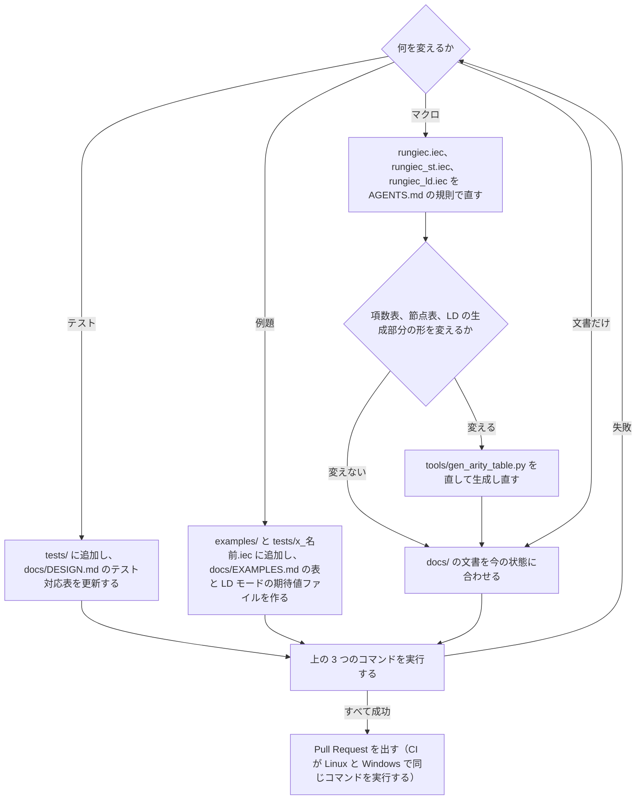

# 開発への参加 / Contributing

**English summary:** Clone the repository with `--recursive` (or run `git submodule update --init`; the tests use jiecunit, a unit test framework written in IEC 61131-3 text (https://github.com/yunos0987/jiecunit), from the submodule `vendor/jiecunit`), put jiepp (an IEC 61131-3 preprocessor, https://github.com/yunos0987/jiepp) and jiecc (a free command-line converter between IEC 61131-3 text and IEC 61131-10 XML that includes the jier interpreter, `jiecc --run`) from the jiecc homepage archive (https://www.graviness.com/iec_61131-3/jiecc.html; jiepp alone is also on https://github.com/yunos0987/jiepp/releases) into `tools/` (`jiepp.exe` / `jiecc.exe` on Windows, `jiepp` / `jiecc` on Linux), then run `python tools/gen_arity_table.py --check`, `python tools/run_tests.py` and `python -m unittest discover -s tools/ld_xml -p "test_*.py"` from the repository root. Macro-writing rules and test naming are in [AGENTS.md](AGENTS.md). Pull requests should keep all tests passing. Contributions are licensed under the repository's MIT License. The rest of this document is in Japanese.

## 準備

```
git clone --recursive https://github.com/yunos0987/rungiec.git
cd rungiec
```

テストは jiecunit（IEC 61131-3 のテキストで書く単体テストの枠組み。https://github.com/yunos0987/jiecunit ）を git submodule の `vendor/jiecunit`（v7.0.0 に固定）として使います。`--recursive` を付けずに clone した場合は `git submodule update --init` を実行してください。submodule の中は編集しません。

jiepp（IEC 61131-3 向けのプリプロセッサ。https://github.com/yunos0987/jiepp ）と jiecc（IEC 61131-3 のテキストと IEC 61131-10 XML を相互に変換する無料のコマンドラインツール。テストは jiecc に含まれるインタプリタ jier（`jiecc --run`）で実行する）を、リポジトリの `tools/` に置きます（Git では追跡しません）。jiecc のホームページ（https://www.graviness.com/iec_61131-3/jiecc.html ）の配布アーカイブには両方が入っているので、テストにはこのアーカイブから取り出すのが簡単です（CI もこのアーカイブから取得します）。jiepp だけなら GitHub の Releases（https://github.com/yunos0987/jiepp/releases ）からも取得できます。版と実行環境は [README の「必要なツール」](README.md#必要なツール)を参照してください。

| OS | アーカイブ | `tools/` に置くファイル |
|---|---|---|
| Windows | `jiecc.zip` | `jiecc.exe`、`jiepp.exe` |
| Linux | `jiecc.tgz` | `jiecc`、`jiepp`（実行権限を付ける） |

別の場所のバイナリを使うときは、`--jiepp` / `--jiecc` か環境変数 `RUNGIEC_JIEPP` / `RUNGIEC_JIECC` で指定します。Python 3.7 以上が必要です（標準ライブラリのみ。ラダー図 XML の変換器の XSD 検査にだけ、任意で lxml を使います）。

## テスト

リポジトリルートで次の 3 つを実行し、どれも成功することを確認します。

```
python tools/gen_arity_table.py --check
python tools/run_tests.py
python -m unittest discover -s tools/ld_xml -p "test_*.py"
```

- `python -m unittest discover ...` は、ラダー図 XML の変換器（`tools/ld_xml`）の単体テストです。jiepp と jiecc は不要です。
- `gen_arity_table.py --check` は、`rungiec_st.iec`（ST モードの本体）の項数表、`rungiec.iec`（入口）の節点表、`rungiec_ld.iec`（LD モードの本体）の生成部分の 3 つが生成結果と一致することを確認します（出力は 3 行、不一致は終了コード 1）。表と生成部分は直接編集せず、このスクリプトで生成し直します。
  - `rungiec_ld.iec` の生成部分は、目印のコメント `(* BEGIN GENERATED by tools/gen_arity_table.py --ld *)` と `(* END GENERATED *)` の間の行です。形を変えるときは、スクリプトの `generate_ld()` を直し、`python tools/gen_arity_table.py --ld` の出力で 2 つの目印の間を置き換え、`--check` で 3 つとも一致することを確認します。
- `run_tests.py` の最終行が `RESULT: N passed, 0 failed, N total` なら成功です。展開後の ST と実行ログは `tests/expanded/` に出力されます（Git で追跡するのは `eNNN` / `fNNN` / `rNNN` の出力と、例題の LD モードの期待値ファイル `<名前>.ld.xml` です。中のパスはリポジトリルートからの相対なので、clone した場所によって差分は出ません）。
- `run_tests.py` は全例題を LD モードでも変換し、omron の XML の LD の本文を期待値ファイル `tests/expanded/<名前>.ld.xml` と比べます（[`docs/TESTING.md` の「LD モードの変換の検査」](docs/TESTING.md#ld-モードの変換の検査)）。ランナーは期待値ファイルを書き換えません。本文が違うときやファイルが無いときは、omron の XML を `tests/expanded/<名前>.ld.xml.new`（Git で追跡しません）に書いて失敗にします。意図した変更なら、`.new` の XML を確認してから `<名前>.ld.xml` に名前を変え、もう一度 `run_tests.py` を実行します。
- `tools/xml2rungiec.py` で XML を断片に戻せない例題は、往復の検査から外すために、理由を付けて `tools/run_tests.py` の `LD_ROUNDTRIP_SKIP` に並べます。並べた例題が断片に戻せるようになったら、リストから外します（外さないとランナーが失敗にします）。

## 変更の書き方

変更の種類ごとに必要な作業と、Pull Request までの流れです:



- マクロ（入口 `rungiec.iec` と本体 `rungiec_st.iec` / `rungiec_ld.iec`）の記述規則、テストの名前の付け方（`tNNN_*` / `eNNN_*` / `rNNN_*` / `fNNN_*` / `x_*`）とヘッダー（`(* @expect ... *)` / `(* @cycles N *)`）は [AGENTS.md](AGENTS.md) にあります。
- テストと例題の文は POU の本体に直接書きます。DSL を使う POU には `{st}` / `{end}` を書きません（lint の LN16 が指摘します）。DSL を使わない POU も `{st}` / `{end}` で囲みません。
- 設計と決定の理由は [`docs/DESIGN.md`](docs/DESIGN.md) にあります。テストや例題を追加したら、`docs/DESIGN.md` のテスト対応表（例題は [`docs/EXAMPLES.md`](docs/EXAMPLES.md) の「例題」の表も）を更新してください。
- 例題（`examples/<名前>.iec`）は、ST モードのほかに LD モードのコマンド `tools\jiecc.exe examples/<名前>.iec -I . -D RUNGIEC_LD -P -nC -t <omron|keyence|codesys|mitsubishi> -o <名前>.<t>.ld.xml` でも 4 ターゲットとも XML になるようにします（`JMP()` / `LABEL()` を使う例題も同じ）。ボックスの呼び出しの引数は名前付き（`IN := Start`、`Q => Lamp`）だけにします（位置指定は LD モードで前処理エラーになり、lint の LN25 も指摘します）。例題を追加したら、`run_tests.py` が書いた `tests/expanded/<名前>.ld.xml.new` の XML を確認してから `<名前>.ld.xml` に名前を変えて期待値ファイルにします。`tools/xml2rungiec.py` が全部を断片に戻せない例題は、理由を付けて `LD_ROUNDTRIP_SKIP` に並べます。
- コード・コメント・テストの中のテキストは英語、README などの文書は日本語です。改行は LF、IEC 61131-3 のキーワードは小文字です。

## Pull Request

1. リポジトリを fork し、作業用のブランチを作る
2. 変更を小さな commit に分ける
3. 上の 3 つのコマンドが成功することを確認する（CI も Linux と Windows で同じものを実行します）
4. 変更の内容を書いて Pull Request を出す

送ってもらった変更は、このリポジトリと同じ MIT License（[LICENSE](LICENSE)）で公開します。
