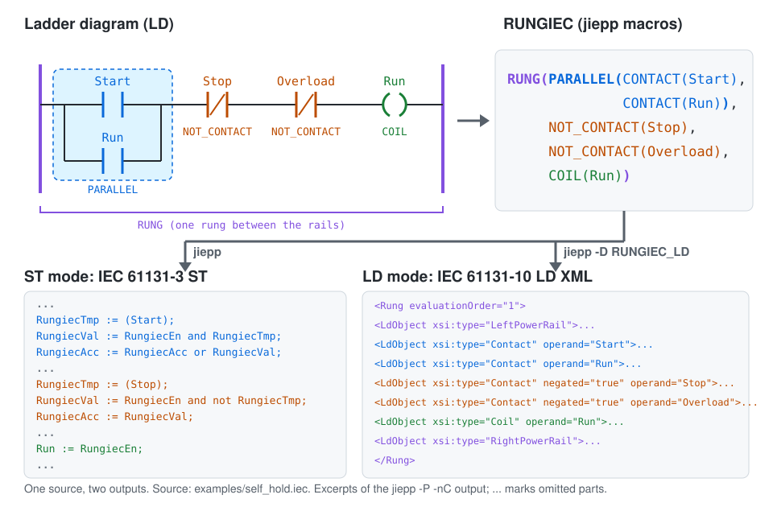
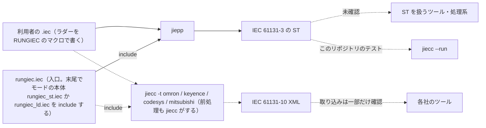
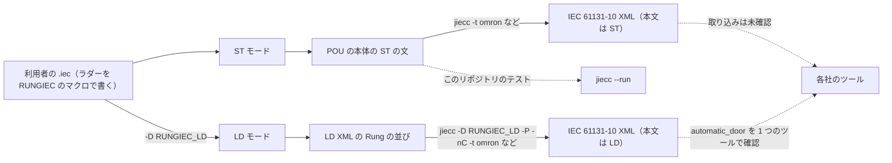
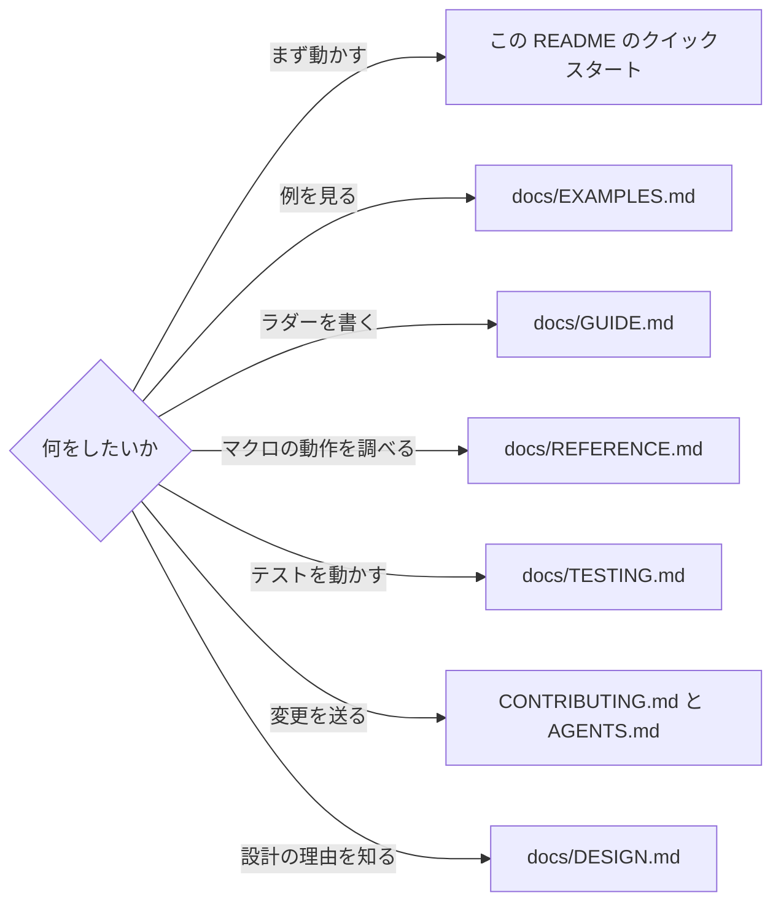
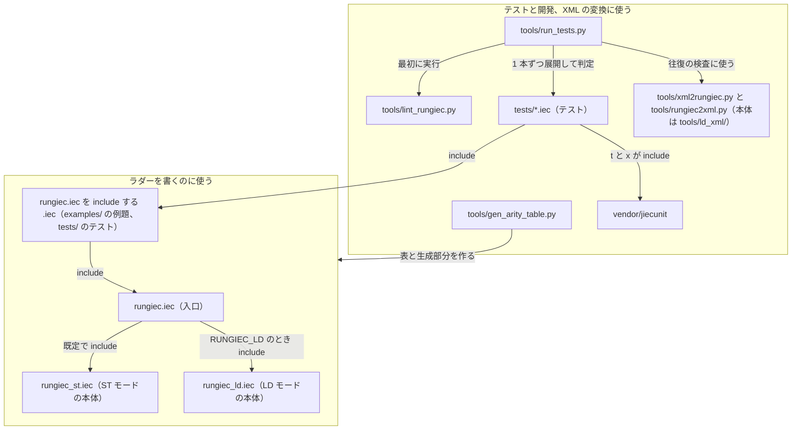

# RUNGIEC

[](https://github.com/yunos0987/rungiec/actions/workflows/ci.yml)



IEC 61131-3 のラダー図 (LD) を ST 言語に展開する DSL。同じソースから、IEC 61131-10 の LD XML（ラダー図を XML で表したもの）も作れる。名前は RUNGIEC。展開には jiepp（IEC 61131-3 向けのプリプロセッサ。https://github.com/yunos0987/jiepp ）を使う。

RUNGIEC lets you write IEC 61131-3 ladder diagrams (LD) as text with jiepp macros and expands them to plain IEC 61131-3 Structured Text (ST).
The same source can also be written out as the IEC 61131-10 LD XML of the ladder (the LD mode).
RUNGIEC is checked only with jiepp 1.4.0 and Jiecc 9.4.0 (the expanded ST is run with `jiecc --run`); the LD mode needs these versions, and older versions support only the ST mode.
The documents are written in Japanese.

## 目次

- [目的](#目的)
- [2 つのモード](#2-つのモード)
- [必要なツール](#必要なツール)
- [クイックスタート](#クイックスタート)
- [書き方](#書き方)
- [文書](#文書)
- [ファイル構成](#ファイル構成)
- [商標](#商標)
- [ライセンス](#ライセンス)

## 目的

ラダー図 (LD) を、IEC 61131-3 のソースの中にテキスト（jiepp マクロ）で書けるようにする DSL。ラダーがテキストになるので、ST のソースと同じように差分を取り、レビューし、Git で版を管理できる。jiepp で展開すると通常の ST になる。

ST モード（下の「2 つのモード」）の動作を確認しているのは jiepp 1.4.0 と Jiecc 9.4.0 だけ（jiepp で展開した ST を Jiecc 9.4.0 のインタプリタ `jiecc --run` で実行して確認し、例題は jiecc で XML に変換できることも確認する）。展開後の ST の文は POU の本体に直接並ぶ（`{st}` / `{end}` で囲まない。Jiecc 9.4.0 はこの形を読む）。ほかのツールや処理系で展開後の ST を使えるかは確認していない。各社のツールに取り込むときは、jiecc で IEC 61131-10 XML に変換できる（jiecc は必須ではない。例題 `automatic_door` の LD モードの XML を 1 つのツールで読み込めることを確認した。ほかの例題とツールは確認していない）。jiepp と jiecc は下の「この README に出てくるツール」で説明する。

- ネットワーク (`RUNG`)・直列 (`SERIES`)・並列 (`PARALLEL`)・各種接点・コイル・関数/FB 呼び出し・インライン ST (`ST_EXEC`)・実行制御 (`BEGIN_MC(条件...)` / `END_MC()` / `RETURN()` / `JMP()` / `LABEL()`) をマクロで書く
- 直並列で書けない回路（ブリッジ回路など）は、節点と配線で書く一般形のネットワーク（`BEGIN_NET` / `WIRE` / `END_NET`）で書く
- 接点を `Y := A and B` のように 1 つの式にまとめない。各接点のオペランドは必ず 1 回評価する
- 設計の詳細と IEC 61131-3 との差異は `docs/DESIGN.md`

この README に出てくるツール:

- jiepp: IEC 61131-3 向けのプリプロセッサ。`{#define}` / `{#include}` / `{#if}` などのディレクティブを処理する。RUNGIEC を使うのに必要なのはこれだけ。https://github.com/yunos0987/jiepp （Windows と Linux の実行ファイルは https://github.com/yunos0987/jiepp/releases ）
- jiecc: IEC 61131-3 のテキストと IEC 61131-10 XML を相互に変換する無料のコマンドラインツール。IEC 61131-10 は PLC のプログラムを XML でやり取りするための規格。ST をインタプリタで実行する jier（`jiecc --run`）も含み、配布アーカイブには jiepp も入っている。利用者には必須ではなく、このリポジトリのテストの実行に必要である。https://www.graviness.com/iec_61131-3/jiecc.html
- jiecunit: IEC 61131-3 のテキストで書く単体テストの枠組み。このリポジトリのテストが git submodule として使う。https://github.com/yunos0987/jiecunit

ラダーを書いた `.iec` から ST までの流れ（点線は任意の経路、または確認していない経路）:



## 2 つのモード

同じソースから 2 つの形を出せる。ソースはどちらのモードでも同じで、変換のときの指定だけが違う。

| モード | 出力 | 指定 | 使い道 |
|---|---|---|---|
| ST モード（既定） | POU の本体に直接並ぶ ST の文。作業変数 `Rungiec*` でパワーを計算する文の並び | なし | ST を扱うツール・処理系。jiecc で ST の本文を持つ IEC 61131-10 XML にする。このリポジトリのテストは `jiecc --run` で実行する |
| LD モード | `{ld}` から `{end}` までの、IEC 61131-10 の LD XML の `<Rung>` の並び（ラダー図そのもの） | `-D RUNGIEC_LD`（jiepp / jiecc）か、ソースの `{#include 'rungiec.iec'}` の前の `{#define RUNGIEC_LD 1}` | jiecc で `<BodyContent xsi:type="LD">` の IEC 61131-10 XML にし、各社のツールにラダー図として取り込む（例題 `automatic_door` の LD モードの XML を 1 つのツールで読み込めることを確認した。ほかの例題とツールは確認していない） |



変換のコマンド（Windows。例題 `examples/self_hold.iec` を omron 向けにする）:

```
tools\jiecc.exe examples/self_hold.iec -I . -t omron -o self_hold.omron.xml
tools\jiecc.exe examples/self_hold.iec -I . -D RUNGIEC_LD -P -nC -t omron -o self_hold.omron.ld.xml
```

- 1 行目が ST モード、2 行目が LD モード。`-t` は `omron` / `keyence` / `codesys` / `mitsubishi`。
- LD モードには `-P`（jiepp の行マーカー `(*{#:9 'examples/contact_coil.iec'}*)` のようなコメントを出さない）と `-nC`（コメントを出さない）を必ず付ける。付けないと、行マーカーやラダー図のコメントが `<BodyContent>` の中に残る。jiecc は `{ld}` の本文を検査しないので、エラーにならない。
- 同じ理由で、ST モードなら jiecc がエラーにする誤り（宣言していないオペランド、POU に無いラベルへの `JMP()`、型の不一致）も、LD モードではエラーにならずに XML になる。同じソースを ST モードでも変換するか `jiecc --run` で実行して確認する。
- LD モードの使い方、ST モードと意味の違う点、出力の例は [`docs/GUIDE.md` の「LD モード」](docs/GUIDE.md#ld-モード)、マクロごとの XML の形は [`docs/REFERENCE.md` の「LD モード」](docs/REFERENCE.md#ld-モード)にある。

## 必要なツール

RUNGIEC を使うのに必要なのは jiepp だけ（入手は下の「ツールの入手」）。jiecc は不要だが、各社のツールへ取り込むときは jiecc の IEC 61131-10 XML への変換が使える（例題は[`docs/EXAMPLES.md` の「例題」](docs/EXAMPLES.md#例題)のコマンドで変換できる。`JMP()` / `LABEL()` を使うプログラムは `-t omron` / `-t keyence` / `-t mitsubishi` では前処理エラーになり、変換できない）。このリポジトリのテストは jiecc のインタプリタ（jier。`jiecc --run`）で実行するので、テストを実行するには jiecc も必要である。

| ツール | 用途 | 版とパス |
|---|---|---|
| jiepp | 展開（必須） | jiepp 1.4.0。Windows は `tools/jiepp.exe`、Linux は `tools/jiepp`（`__has_builtin` と `-Werror=undef` と `__nosplit` のある版。LD モードにはこの版が必要） |
| jiecc | テストの実行、XML への変換 | Jiecc 9.4.0。Windows は `tools/jiecc.exe`、Linux は `tools/jiecc` |
| Python | テストランナー、lint、表の生成（`tools/*.py`） | 3.7 以上（標準ライブラリのみ。`tools/ld_xml` の XSD 検査にだけ lxml が使え、無ければその検査を飛ばす） |

テストを実行するときは、2 つの実行ファイルをリポジトリの `tools/` に置く（Git では追跡しない）。テストランナーがツールを探す場所と、jiepp に付ける `-Werror=undef` は [`docs/TESTING.md` の「ツールの置き場所」](docs/TESTING.md#ツールの置き場所)にある。

`rungiec.iec` は jiepp のビルトイン（`__assert`、名前付きカウンタ、`__nosplit`）を使い、無い jiepp では前処理エラー PP91（jiepp の診断の番号。RUNGIEC の検査に外れると出る）になる。`tools/` には上の表の版を置く。

LD モードは、さらに jiepp のビルトイン `__xmlattr` / `__xmltext`（XML の属性値と本文のエスケープ）と `__arg_lhs` / `__arg_rhs` / `__arg_dir`（`IN := Start` のような引数の分解）を使う。この 5 つは jiepp 1.4.0（と Jiecc 9.4.0 の配布アーカイブの jiepp）にある。古い jiepp で使えるのは ST モードだけで、LD モードの変換は `rungiec.iec` のエラー PP91 `RUNGIEC LD mode needs a jiepp with the XML and argument built-ins; use the jiepp version named in README.md` になる。

どちらのモードも Jiecc 9.4.0 が必要である。ST モードの文は POU の本体に囲まずに並ぶので、それより古い jiecc では変換と実行が `rungiec.iec` のエラー PP91 `RUNGIEC needs Jiecc 9.4.0 or later` になる（jiecc が定義する版の macro で確認する。jiepp だけで展開するときは確認しない）。

### ツールの入手

jiepp は GitHub の Releases（https://github.com/yunos0987/jiepp/releases ）の v1.4.0 から、OS に合うアーカイブを取得する。アーカイブの中のフォルダにある実行ファイルを `tools/` に置く。実行環境は jiepp のリリースノートの記載。アーカイブは同じ場所の `SHA256SUMS.txt` で確認できる（`sha256sum -c SHA256SUMS.txt`）。

| OS | jiepp のアーカイブ | `tools/` に置くファイル | 実行環境 |
|---|---|---|---|
| Windows | `jiepp-v1.4.0-windows-x64.zip` | `jiepp.exe` | Windows 10 version 1903 以降または Windows Server 2022 以降（x64）。Microsoft Visual C++ Redistributable 2015-2022 (x64) |
| Linux | `jiepp-v1.4.0-linux-x64.tar.gz` | `jiepp` | Linux x64。glibc 2.34 以降と GCC 11 以降の libstdc++（Ubuntu 22.04 以降、Debian 12 以降、RHEL 9 以降など） |

jiecc（テストの実行と XML への変換に使う）は、jiecc のホームページ（https://www.graviness.com/iec_61131-3/jiecc.html ）の配布アーカイブから取り出す。このアーカイブには jiepp も入っているので、テストを実行するときは両方をこのアーカイブから取り出してもよい（CI はこのアーカイブから両方を取得する）。ホームページの記載では、jiecc の動作環境は Windows 10（1903 以降）と Linux（WSL）Ubuntu 22.04.5 LTS 以降の 64 bit OS。

| OS | アーカイブ | `tools/` に置くファイル |
|---|---|---|
| Windows | https://www.graviness.com/iec_61131-3/jiecc.zip | `jiecc.exe`、`jiepp.exe` |
| Linux | https://www.graviness.com/iec_61131-3/jiecc.tgz | `jiecc`、`jiepp`（実行権限を付ける） |

## クイックスタート

例題の自己保持回路（`examples/self_hold.iec`）を、jiepp で ST に展開してみる。リポジトリを取得し、jiepp v1.4.0 を `tools/` に置いて、リポジトリルートで jiepp を実行する。ダウンロードしたアーカイブと展開した ST は `out/` に置く（`out/` は Git で追跡しない。`-o` の出力先はどこでもよい）。

Windows（コマンドプロンプト。`curl` と `tar` は Windows 10 version 1803 以降に標準で入っている）:

```
git clone https://github.com/yunos0987/rungiec.git
cd rungiec
mkdir out
curl -fL -o out\jiepp.zip https://github.com/yunos0987/jiepp/releases/download/v1.4.0/jiepp-v1.4.0-windows-x64.zip
tar -xf out\jiepp.zip -C out
copy out\jiepp-v1.4.0-windows-x64\jiepp.exe tools\
tools\jiepp.exe -P -I . examples/self_hold.iec -o out/self_hold.st
```

Linux（bash）:

```
git clone https://github.com/yunos0987/rungiec.git
cd rungiec
mkdir -p out
curl -fL -o out/jiepp.tar.gz https://github.com/yunos0987/jiepp/releases/download/v1.4.0/jiepp-v1.4.0-linux-x64.tar.gz
tar -xzf out/jiepp.tar.gz -C out
cp out/jiepp-v1.4.0-linux-x64/jiepp tools/
tools/jiepp -P -I . examples/self_hold.iec -o out/self_hold.st
```

`-I .` は `{#include 'rungiec.iec'}` が `rungiec.iec`（とそれが include する本体）を探す場所、`-P` は行マーカー（`(*{#:0 'rungiec.iec'}*)` のようなコメント）を出さない指定。

`out/self_hold.st` の先頭には `rungiec.iec` と `rungiec_st.iec` と例題のコメントが入り、その後に FB が続く。FB の宣言は書いたとおりに残る:

```
function_block self_hold
var_input Start, Stop, Overload: bool; end_var
var_output Run: bool; end_var
```

その後に、`RUNGIEC_VAR()` を展開した作業変数の `var` ブロック、`BEGIN_RUNGIEC()` を展開した初期化文、ラダーのコメント、`RUNG(...)` を展開した 1 行の ST、`end_function_block` が続く（`END_RUNGIEC()` は何も出さない）。自分の `.iec` も、先頭に `{#include 'rungiec.iec'}` を書き、`-I` に `rungiec.iec` のあるフォルダを渡せば同じように展開できる。

jiecc を使うと、例題を IEC 61131-10 XML に変換できる（[`docs/EXAMPLES.md` の「例題」](docs/EXAMPLES.md#例題)。LD モードのコマンドは上の「2 つのモード」。例題 `automatic_door` の LD モードの XML を 1 つのツールで読み込めることを確認した。ほかの例題とツールは確認していない）。テストの実行のしかたは [`docs/TESTING.md`](docs/TESTING.md) にある。

## 書き方

```
{#include 'rungiec.iec'}
program __main__
var
    A, B, Y: bool;
end_var
RUNGIEC_VAR()
BEGIN_RUNGIEC()
(*  |--| A |--| B |--( Y )--|  *)
RUNG(CONTACT(A), CONTACT(B), COIL(Y))
END_RUNGIEC()
end_program
```

各行が jiepp の展開（`jiepp -P` の出力）で何になるか。`...` は省いた部分で、実際の出力は[`docs/EXAMPLES.md` の「例: DSL → 展開後 ST → 実行結果」](docs/EXAMPLES.md#例-dsl--展開後-st--実行結果)にある:

```
POU source                  jiepp -P output
--------------------------  ----------------------------------------------------------------------------
program __main__            program __main__
var ... end_var             var ... end_var   (as written)
RUNGIEC_VAR()          -->   var RungiecEn: bool := true; ... RungiecPrev: array[1..64] of bool; end_var
BEGIN_RUNGIEC()        -->   RungiecEn := true; ... RungiecSp := 0;   (the checks print no ST)
(* ladder comment *)        (* ladder comment *)   (as written)
RUNG(...)             -->   RungiecStIn[1 - RungiecSp] := RungiecIn; ... RungiecSp := RungiecSp - 1;   (one line)
END_RUNGIEC()          -->   (nothing; the checks print no ST)
end_program                 end_program

RUNGIEC_VAR_TEMP()     -->   var_temp RungiecEn: ... RungiecMcSt: ...; end_var var RungiecPrev: ...; end_var
RUNGIEC_VAR_NOEDGE()   -->   var RungiecEn: ... RungiecMcSt: ...; end_var   (no RungiecPrev)
```

LD モードでは、同じ POU が次のようになる（`jiepp -P -nC -D RUNGIEC_LD` の出力。`...` は省いた部分で、`RUNG(...)` の出力の全体は [`docs/GUIDE.md` の「LD モード」](docs/GUIDE.md#ld-モード)の例にある）:

```
POU source                  jiepp -P -nC -D RUNGIEC_LD output
--------------------------  ----------------------------------------------------------------
program __main__            program __main__
var ... end_var             var ... end_var   (as written)
RUNGIEC_VAR()          -->   (nothing; the LD mode has no work variables)
BEGIN_RUNGIEC()        -->   (*{ld}*)   (the checks print nothing)
(* ladder comment *)        (removed by -nC)
RUNG(...)             -->   <Rung evaluationOrder="1"> ... </Rung>   (one line per LD object)
END_RUNGIEC()          -->   (*{end}*)
end_program                 end_program
```

書き方の規則（POU の並び、宣言の選び方、ネットワークの書き方など）と長いラングの書式は[`docs/GUIDE.md` の「書き方」](docs/GUIDE.md#書き方)にある。

## 文書

やりたいことから読む文書を選ぶ:



| 文書 | 内容 | 読む人 |
|---|---|---|
| [`docs/GUIDE.md`](docs/GUIDE.md) | 書き方の規則、長いラングの書式、使い方の注意、LD モードの使い方と制約、未対応の機能と代わりの書き方 | RUNGIEC でラダーを書く人 |
| [`docs/REFERENCE.md`](docs/REFERENCE.md) | 公開マクロの仕様（正本）、LD モードの XML の形、意味論、設定パラメータ、上限とエラー、IEC との差異、バージョン、予約名と共有資源 | マクロの動作を調べる人 |
| [`docs/EXAMPLES.md`](docs/EXAMPLES.md) | DSL → 展開後 ST → 実行結果の例、例題の一覧と各例題のラダー、XML への変換 | 例から始める人 |
| [`docs/TESTING.md`](docs/TESTING.md) | テストと lint の実行のしかた、判定の決まり、LD モードの変換の検査、CI | このリポジトリを開発する人 |
| [`docs/DESIGN.md`](docs/DESIGN.md) | 設計判断、展開意味論、LD モードの構造、エラーと上限、IEC とメーカーの差異、lint の規則、テスト対応表 | 設計の理由を知りたい人、開発する人 |

## ファイル構成

ファイルの関係。ラダーを書くのに必要なのは上の枠で、下の枠はテストと開発、XML の変換の道具:



| パス | 内容 |
|---|---|
| `rungiec.iec` | 入口。共通部（版、設定と範囲の検査、両モードが使う前処理の検査とトークン連結、節点表）を定義し、末尾でモードの本体（`rungiec_st.iec` か `rungiec_ld.iec`）を include する。公開マクロは本体だけが定義する。利用者が include するのはこのファイルだけ |
| `rungiec_st.iec` | ST モードの本体。公開マクロを ST に展開する定義（作業変数、要素、結合子、項数表）。`rungiec.iec` が ST モードのとき（`RUNGIEC_LD` が無いか 0）に末尾で include する。直接 include すると前処理エラー |
| `rungiec_ld.iec` | LD モードの本体。公開マクロを LD XML に展開する定義。`rungiec.iec` が LD モードのときに末尾で include する。直接 include すると前処理エラー。後半は生成部分 |
| `docs/` | 文書（`GUIDE.md` / `REFERENCE.md` / `EXAMPLES.md` / `TESTING.md` / `DESIGN.md`。内容は上の「文書」の表）と、`images/` の図 |
| `tools/run_tests.py` / `tools/lint_rungiec.py` | テストランナーと lint |
| `tools/gen_arity_table.py` | 項数表と節点表の生成。項数表（`_RUNGIEC_SERIES_N` / `_RUNGIEC_PARALLEL_N`）は引数なし、節点表（`_RUNGIEC_IS_NODE_<K>0`、K = 0〜64）は `--nodes`、`rungiec_ld.iec` の生成部分は `--ld` で出力する。`--check` で項数表と `rungiec_st.iec`、節点表と `rungiec.iec`、生成部分と `rungiec_ld.iec` の一致を検査（開発者向け） |
| `tools/xml2rungiec.py` / `tools/rungiec2xml.py` | ラダー図の XML と RUNGIEC の変換器。`xml2rungiec.py` は IEC 61131-10 の XML（プログラムを XML で交換する規格。Omron の Sysmac Studio（https://www.ia.omron.com/sysmac/ ）の書き出しも読める）のラダー図を RUNGIEC の断片（`.iec`）にし、`rungiec2xml.py` は断片を標準の IEC 61131-10 の LD XML に戻す。ラングごとに前のコメントとしてラダー図のアスキーアートを付ける。変換できないラングは `(* @skipped N 理由 *)` のコメントを残して数える。ジャンプは `JMP()` / `LABEL()` になり、`jiecc -t omron` / `-t keyence` / `-t mitsubishi` では前処理エラー PP91 になる（この変換器の標準 XML の書き出しは jiecc を使わない）。使い方は各ファイルの先頭の説明（開発者向け） |
| `tools/ld_xml_roundtrip.py` | XML → RUNGIEC → 標準 XML の往復と検査（XSD、ラング数、比較、jiepp での展開と lint）。`docs/TESTING.md` の「LD XML 変換器のテスト」（開発者向け） |
| `tools/ld_xml/` | 変換器の本体（Python のパッケージ）と単体テスト（`test_ld_xml.py`） |
| `tests/` | テスト、`tests/support/t_jiecunit.iec` は jiecunit を使うテスト（t / x）の補助（`T_BEGIN()` / `T_EXPECT_IDLE()`）、`tests/support/t_stdfb.iec` は標準タイマ（`TON` / `TOF` / `TP`）と積算タイマ（`TONR`）の決定論的な代用品（1 回の呼び出しが 100 ms。カウンタとエッジは jiecc の組み込みを使う） |
| `examples/` | 例題（利用者が書くコードだけ。1 本が同名の FUNCTION_BLOCK 1 つ。確認は `tests/x_*.iec`） |
| `vendor/jiecunit` | jiecunit（git submodule、v7.0.0）。t / x のテストが使う |
| `AGENTS.md` | マクロの記述規則とテストの書き方（AI と人の開発者が従う） |
| `CHANGELOG.md` / `CONTRIBUTING.md` / `SECURITY.md` | 変更履歴、開発への参加の手引き、脆弱性の報告方法 |
| `.github/` | CI（`workflows/ci.yml`）と Dependabot の設定 |
| `LICENSE` | ライセンス（MIT） |

## 商標

文書とテストのコメントに出てくる会社名・製品名（Siemens、TIA、Rockwell Automation、Studio 5000、Logix、OMRON（オムロン）、Sysmac、KEYENCE（キーエンス）、Visual KV、三菱電機、MELSEC、iQ-R、CODESYS、ABB、logi.cals、Microsoft、Windows、Linux、Ubuntu、Debian、RHEL、GitHub など）は、それぞれの所有者の商標または登録商標。このプロジェクトはこれらの会社と関係が無く、承認や支援も受けていない。

## ライセンス

MIT License。全文は [LICENSE](LICENSE) にある。
