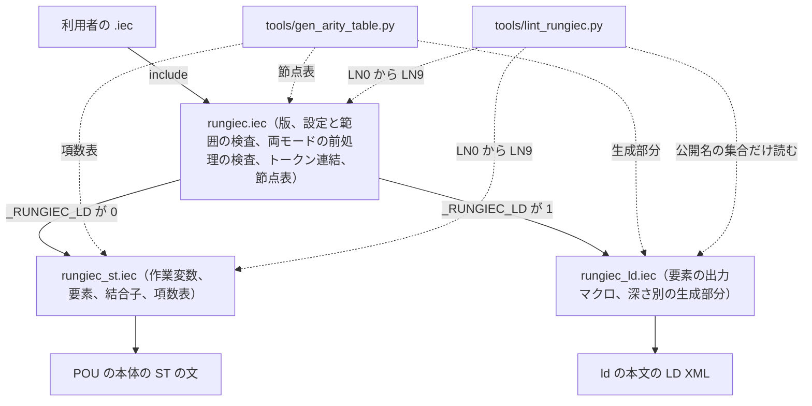
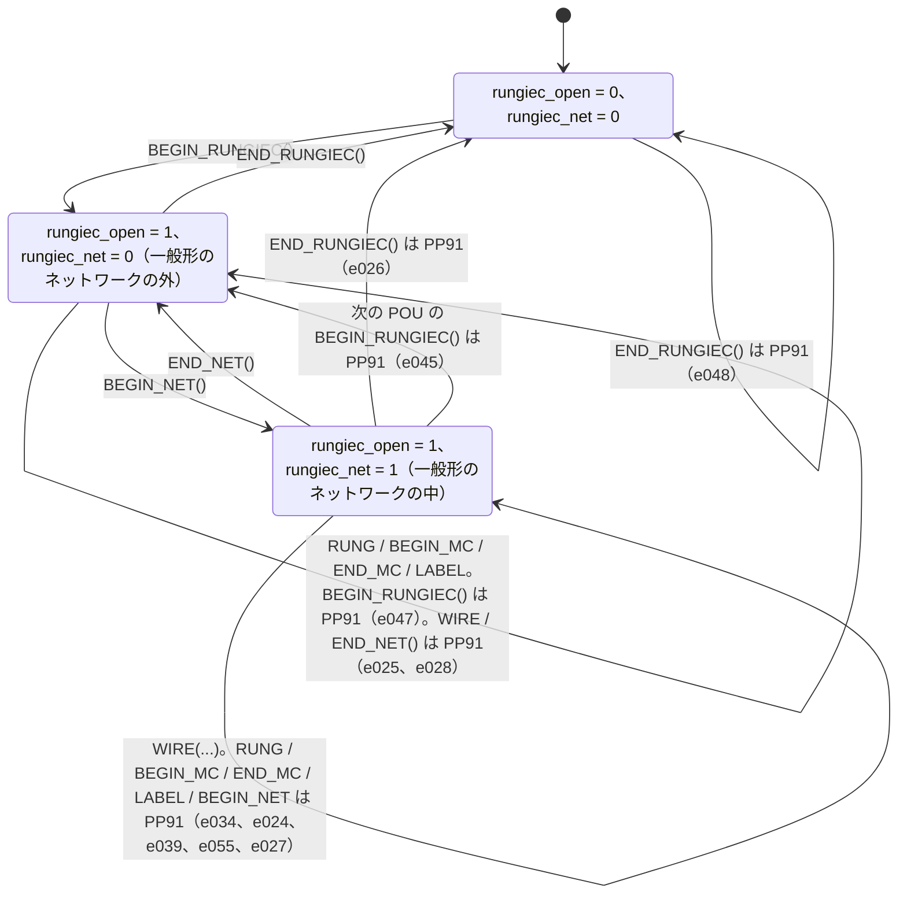
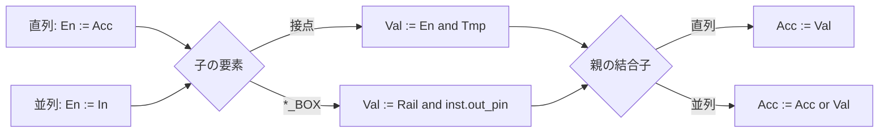
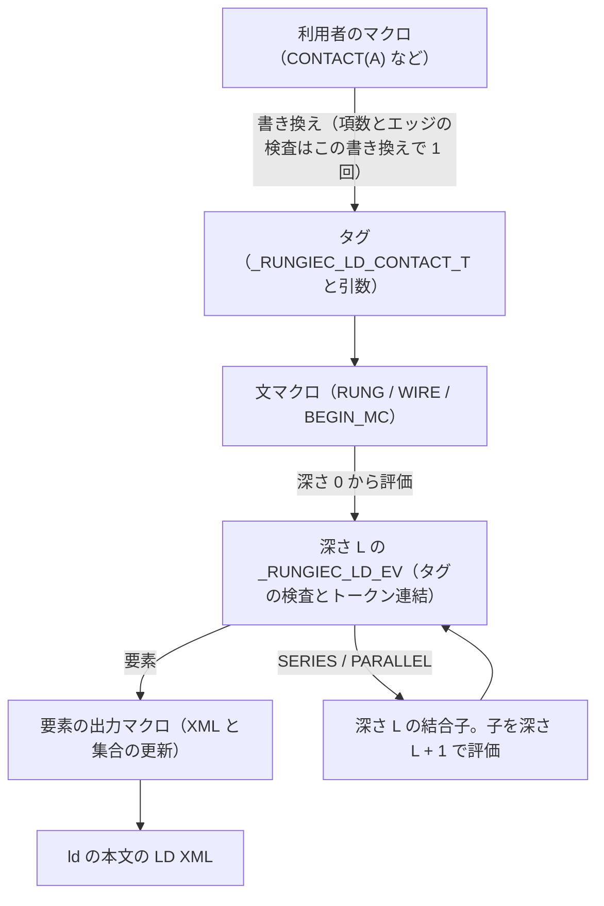
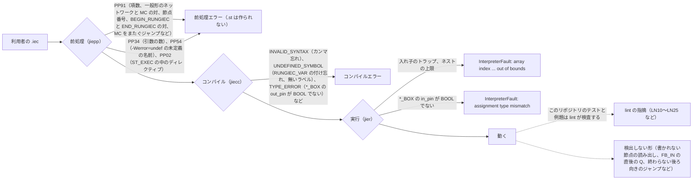
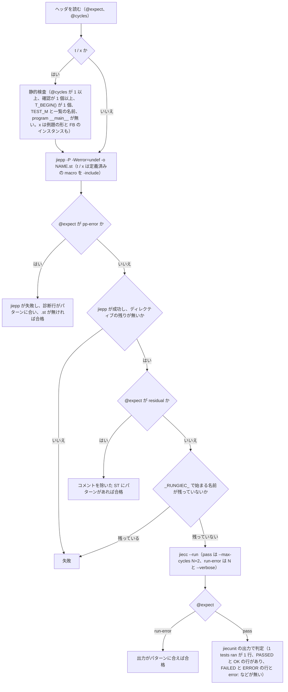
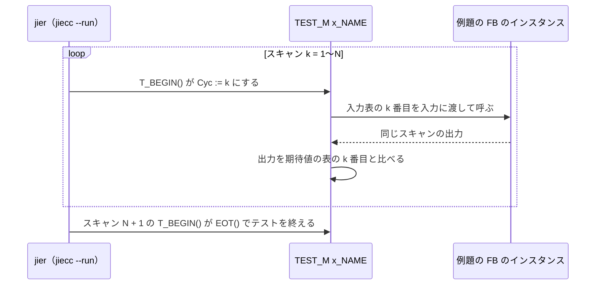

# RUNGIEC 設計書

IEC 61131-3 のラダー図 (LD) を jiepp のマクロで書き、ST（または IEC 61131-10 の LD XML）に展開する DSL の設計書。実装は入口 `rungiec.iec`（共通部を定義し、末尾でモードの本体を include する。公開マクロは本体だけが定義する）と、ST モードの本体 `rungiec_st.iec`、LD モードの本体 `rungiec_ld.iec`。検証は `tools/run_tests.py` と `tests/`。

## 目次

- [概要](#概要)
- [設計判断](#設計判断)
- [使い方の規則](#使い方の規則)
- [作業変数と前処理カウンタ](#作業変数と前処理カウンタ)
- [展開意味論](#展開意味論)
- [jiepp 実装規則](#jiepp-実装規則)
- [LD モードの構造](#ld-モードの構造)
- [エラーと上限](#エラーと上限)
- [設けないもの](#設けないもの)
- [考慮事項](#考慮事項)
- [IEC とメーカーの差異](#iec-とメーカーの差異)
- [lint の規則](#lint-の規則)
- [テスト対応表](#テスト対応表)

## 概要

- 公開マクロの形と意味は [`docs/REFERENCE.md`](REFERENCE.md) が正本。本書には決定の理由、展開の形、jiepp で書くときの制約、テストとの対応を書く。
- 展開に必要なのは jiepp だけで、展開結果は IEC 61131-3 の ST。このリポジトリのテストは、展開した ST を jiecc のインタプリタ（jier。`jiecc --run`）で実行して確認する。
- 同じソースから IEC 61131-10 の LD XML も出せる（LD モード。D41〜D51）。ST モードの定義は `rungiec_st.iec`、LD モードの定義は `rungiec_ld.iec` にあり、入口 `rungiec.iec` がモードに合う方を include する（D41）。LD モードの構造は「LD モードの構造」に書く。
- 本書は jiepp 1.2.0 と Jiecc 9.2.0 を前提にする。LD モードは、この版の jiepp のビルトイン `__xmlattr` / `__xmltext` / `__arg_lhs` / `__arg_rhs` / `__arg_dir` を使う。古い jiepp で使えるのは ST モードだけ。どちらのモードも Jiecc 9.2.0 が必要である（ST モードの文を POU の本体に囲まずに出すため。それより古い jiecc は `rungiec.iec` の `{#error}` の PP91 `RUNGIEC needs Jiecc 9.2.0 or later` になる。`e071`）。
- 参照元: IEC 61131-3 ed4.0 CDV、各 PLC メーカーの資料（出典は「IEC とメーカーの差異」）。
- ID（D / U- / X / V / R / I）は振り直さないので、番号に欠けがある。

実装の構成。利用者は入口だけを include し、公開マクロは 2 つの本体がそれぞれ定義する:



## 設計判断

| # | 決定 | 理由 |
|---|---|---|
| D1 | 公開要素は 49 マクロ（最上位ネットワークの `RUNG`（D20）と一般形のネットワーク `BEGIN_NET` / `WIRE` / `END_NET`（D28）、宣言の `RUNGIEC_VAR()` / `RUNGIEC_VAR_TEMP()` / `RUNGIEC_VAR_NOEDGE()` と `BEGIN_RUNGIEC()` / `END_RUNGIEC()`（D37）、インライン ST の `ST_EXEC`（D39）を含む。ボックスは 14 種。D24、D26、D30、D52）。名前は IEC 61131-3 の記号（Table 74 / 75、p.237〜239）に合わせる: 接点は normally open `--\| \|--` = `CONTACT`、normally closed `--\|/\|--` = `NOT_CONTACT`、positive / negative transition-sensing = `RISE_CONTACT` / `FALL_CONTACT`、その否定 = `NOT_RISE_CONTACT` / `NOT_FALL_CONTACT`。コイルは `COIL` / `NOT_COIL`（negated `(/)`）/ `SET_COIL` / `RESET_COIL`、遷移コイルは `RISE_COIL`（`(P)`）/ `FALL_COIL`（`(N)`）（D15）。実行制御は `BEGIN_MC` / `END_MC` / `RETURN` / `JMP` / `LABEL`（D29、D17、D23）。命名規則: 否定は `NOT_`、遷移は `RISE_` / `FALL_` を前置し、`N` 1 文字・`NEG` は使わない。別名は持たない | IEC の `(N)` は negative transition-sensing コイルで、「N = 否定」の読みは IEC と矛盾する。`RISE` は `R_TRIG` に合わせた。三菱の LDI / LDP / LDF / LDPI / LDFI、Rockwell の XIO と対応が取れる。IEC 寄りの `POS_` / `NEG_` は、`NOT` と `NEG` が似ていて混同しやすいので採らない |
| D2 | コイルの後段パワーは `RungiecVal := RungiecEn`（IEC 8.2.5 のパススルー）。コイルが結合に寄与しない値 `RungiecId` を使う案は採らない | SERIES の中では `RungiecId` を使う案と同じ結果になり、コイルだけの PARALLEL の後ろにもパワーが流れる。IEC・Rockwell・Omron と一致する。`RungiecId` を使う案はスタックが 1 本増える（詳細は「D2（コイルのパススルー）の詳細」） |
| D3 | ENO は名前と引数を分けて渡す: `FUN_ENO(Fn, args...)` / `FB_ENO(Inst, args...)`。戻り値を受けるのは `FUN_ENO_RET(dst, Fn, args...)`。ENO は `__VA_OPT__(,) ENO => RungiecTmp` でマクロが常に結線する。戻り値 BOOL 専用の形は設けない（代わりは `FUN_EXEC_RET` + `CONTACT`。`t032`） | 書き忘れが起きない。引数に `ENO =>` を書く形は、2 回結線されてもエラーにならない（X18）。IEC では `ENO =>` を書く呼び出しに位置指定を混ぜられないので、引数は名前付きだけ。引数 0 個でも先頭にカンマが出ない。`FUN_ENO_RET` が無いと ENO 付き関数の戻り値を受け取れない |
| D4 | 作業変数は `Rungiec*` の固定 13 名。内部マクロ（利用者が普通は書かないマクロ）の接頭辞は `_RUNGIEC_`。公開マクロは `_` で始めない | 作業変数は ST の識別子として展開後に残るので `_` 始まりにしない（ベンダー変換で禁止され得る）。内部マクロは展開後に消え、ST には残らないので `_` 始まりでよい。`_` 始まりのマクロ名が jiepp で通ること（定義・呼び出し、`@@` によるトークン連結 `_X_@@N`、`__VA_ARGC__` による可変長の項数分岐、引数名が `_` で始まるマクロ。`_JIEPP_FULL_VER` も `_` 始まり）と、展開後の ST が jiecc で動くことは実測した。名前の頭の `_` で公開と内部が一目で分かる。`LdT` は `LDT#` と衝突する |
| D6 | エッジ前値は静的 `var RungiecPrev: array[1..RUNGIEC_EDGE_MAX] of bool`（既定 64）。スロットは POU ごとにカウンタ `rungiec_edge` で 1 から数え、`RungiecPrev[n]` を使う。超過は PP91（D32）。設定名は個数を表す `RUNGIEC_EDGE_MAX` で、1 未満は PP91 | `RungiecPrev` を静的 `var` にする理由は「作業変数と前処理カウンタ」。`RUNGIEC_EDGE_MAX < 1` の PP91 は終了コード 1 で、出力ファイルは作られない（実測）。個数を指定する名前にしたのは、最大添字を表す名前では、個数を入れると 1 個足りなくなる誤りが起きたため |
| D7 | ネストスタックは 1 起点 `array[1..RUNGIEC_NEST_MAX]`（既定 16）。17 段目は実行時に `InterpreterFault: array index 17 out of bounds` | 配列の境界は整数リテラル（整数リテラルだけの式も可）にする。変数と `var constant` は境界に書けない（X3） |
| D8 | 結合子は退場時に `RungiecEn` を入場時の値へ戻す。最上位では `RUNG` が冒頭で `RungiecEn := RungiecRail; RungiecIn := RungiecRail` を行うので、`_RUNGIEC_POP` に最上位だけの分岐は無い。ネットワークの間は `RungiecSp = 0`、`RungiecAcc = TRUE`、`RungiecEn = RungiecIn = 直前の RUNG が受けた左レール`（次の `RUNG` が上書きする）。1 ネットワーク = `RUNG(...)` 1 個か、`BEGIN_NET()` … `END_NET()` の 1 組 | 追加マクロなしでネットワーク間の独立性を保証できる。左レールを変数 `RungiecRail` にし、`RUNG` が冒頭で受け取ることで MC 領域を実現する（D29） |
| D9 | エッジ接点の前値の初期値は FALSE。初回 x=TRUE で `RISE_CONTACT` 成立（IEC `R_TRIG` 流）、`FALL_CONTACT` は初回成立しない（IEC `F_TRIG` とは異なる） | 前値の初期値 FALSE の素直な式にした。Rockwell 流に初回の誤トリガを抑止する案は、初回フラグが必要なので採らない |
| D10 | 比較接点 `EQ/NE/GT/GE/LT/LE_CONTACT(a, b)` を公開する | CONTACT と同形で単純。両オペランドが 1 回ずつ評価されることをテストで確認した（`t040`）。比較接点を設けず `CONTACT(a > b)` だけにする案は採らない |
| D11 | テストは Python ランナー。t / x は jiecunit と補助の `T_BEGIN()` / `T_EXPECT_IDLE()`（D40）、e / f / r は `@expect` の照合。展開後 ST と実行ログを `tests/expanded/` に保存する | `jiecc --run` の終了コードは合否を表さない |
| D12 | 宣言マクロは 3 種: `RUNGIEC_VAR()`（主宣言。作業変数も `RungiecPrev` もすべて `var`）、`RUNGIEC_VAR_TEMP()`（作業変数 `var_temp`、`RungiecPrev` は `var`。PROGRAM / FB 用）、`RUNGIEC_VAR_NOEDGE()`（FUNCTION・METHOD 用。`var` に作業変数のみで `RungiecPrev` 無し）。作業変数の宣言の組み立ては内部名 `_RUNGIEC_WORK_VARS` / `_RUNGIEC_EDGE_VARS` | `var` はほぼ全メーカーで使え、関数では IEC 上 VAR と VAR_TEMP が同義（p.76 で関数の VAR は非保持）。VAR_TEMP は IEC p.54 では FB・メソッド・プログラム用で、CODESYS は「programs and function blocks でのみ可」、三菱 iQ-R（SH-081265ENG の 3.2 節 / 3.3 節）に VAR_TEMP は無い。Siemens S7-300/400 LAD（A5E02790079-01 p.18）の TEMP は FC / FB / OB で可。Omron・Rockwell は未確認。jiecc は `var_temp` を呼び出しのたびに初期化する（PROGRAM・FB・FUNCTION で実測。`t043` はこの下で通る）。`RungiecPrev` を `var_temp` にすると毎スキャン初期化されてエッジが壊れるので、`RungiecPrev` は常に静的 `var` にする。`_NOEDGE` を 1 種類にまとめないのは、まとめると FUNCTION にも `RungiecPrev` が宣言され、呼び出しごとに初期化されてエッジ接点がエラーにならずにレベル接点になるため（`f002` の保護が消える） |
| D13 | ボックスマクロの名前は「対象 + 動作」で付ける。対象は `FB_`（function block）/ `FBT_`（function block で、第 2 引数に型名を取る）/ `FUN_`（function）、動作は `SCAN`（パワーにも左レールにも関係なく毎スキャン呼ぶ）/ `IN`（パワーを入力に渡して毎スキャン呼ぶ）/ `BOX`（パワーを入力に渡して毎スキャン呼び、後段 = 出力）/ `EXEC`（パワー ON のときだけ呼ぶ）/ `ENO`（パワー ON のときだけ呼び、後段 = ENO）。戻り値を代入する形は末尾に `_RET`。名前の末尾の `_` は「公開マクロだが、普通は使わない」の目印として取っておき、今は該当するマクロは無い（AGENTS.md の規則 14）。jiepp は末尾が `_` のマクロ名を受け付ける（実測）。先頭の `_` は内部マクロ（D4）で、末尾の `_` は他の目的に使わない | IEC ed4 CDV に FUNCTION の略号の定義は無い。`FUN` は Table 20 のボックス図（p.79）、`FCT` は Table 71 の例の関数名（p.223）。`FN`・`FUNC` は 0 件。`FB` は Figure 1 凡例（p.18）や p.116〜121 で function block の略。三菱 SH-081265ENG も「3.2 Functions (FUN)」「3.3 Function Blocks (FB)」。接頭辞を 1 つにする（「パワーを受けて呼ぶ」ことしか表さない名前にする）と、毎スキャン呼ぶものとパワー ON のときだけ呼ぶものを名前で区別できない |
| D14 | 要素と結合子の本体は `;` で終わらず、代入で始まり代入で終わる。結合子は子の後に `;` を追加する（`_RUNGIEC_S` / `_RUNGIEC_P` は `_RUNGIEC_CHILD(a);`）。最上位の `;` は `RUNG` などの文マクロが付けるので、利用者は書かない（D20） | 本体を `;` で終える形では、要素間のカンマ忘れ（`CONTACT(A) CONTACT(B)`）が 2 個の代入が並ぶだけでエラーにならずに通る（X17）。`;` なしの代入で終わると `a := x b := y` となり jiecc の構文エラー（`f004`〜`f006`）になる。ただし jiecc は `end_if` の後の `;` 欠落、`if` の直前の `;` 欠落、本体末尾の `;` 欠落を受け付ける（X20）ので、`if ... end_if` で始まる・終わる要素ではこの保護が効かない。そのため要素は「代入で始まり代入で終わる」形に統一した（`SET_COIL` などは `RungiecTmp := RungiecEn; if RungiecTmp then ...; end_if; RungiecVal := RungiecTmp`）。形は lint の LN6 が検査する（「lint の規則」） |
| D15 | 遷移コイル `RISE_COIL(x)`（`(P)`）/ `FALL_COIL(x)`（`(N)`）を公開する。`x := RungiecEn and not RungiecPrev[n]`（FALL は `not RungiecEn and RungiecPrev[n]`）、`RungiecPrev[n] := RungiecEn`、`RungiecVal := RungiecEn`。エッジのスロット `RungiecPrev` を接点と共有する | IEC ed4 Table 75 項目 8・9。三菱の PLS / PLF に当たる。中間 BOOL を経由しなくてよい。初回スキャンは `RISE_COIL` が成立し `FALL_COIL` は成立しない（V18） |
| D17 | `RETURN()` は `RungiecTmp := RungiecEn; if RungiecTmp then return; end_if; RungiecVal := RungiecTmp`。`RUNG` か `WIRE` の最後の子に置き、`WIRE` なら一般形のネットワークの最後の `WIRE` にする（後ろの `WIRE` は PP91。D23、U-9） | IEC 61131-3 表 72 の RETURN（V17）。FUNCTION では戻る前に代入した戻り値が残る。戻ったスキャンの MC 領域は次の `BEGIN_RUNGIEC()` の初期化で解除される |
| D18 | バージョンマクロ `RUNGIEC_VERSION_MAJOR` / `_MINOR` / `_REVISION` と `RUNGIEC_VERSION`（= MAJOR * 10000 + MINOR * 100 + REVISION）。現在値は [`docs/REFERENCE.md` の「バージョン」](REFERENCE.md#バージョン)。`rungiec.iec` 内の `{#if}` が一致を検査する。互換性のない変更・機能追加は MINOR、修正は REVISION | jiepp の `_JIEPP_FULL_VER` と同じ形式。利用側が `{#if RUNGIEC_VERSION >= ...}` の形で必要な版を確認できる |
| D19 | 例題は `examples/<名前>.iec` に置き、利用者が書くコードだけを入れる。名前は例題の目的を表し、例題はその名前の FUNCTION_BLOCK 1 つ（`function_block on_delay_timer`）。入力は `var_input`、出力は `var_output` に書き、大域変数・configuration・PROGRAM を持たず、DSL のマクロのほかに `{#define}` を使わない。例題 1 本を `jiecc examples/<名前>.iec -I . -t <ターゲット> -o <XML>` で変換すると、ベンダーのツールに渡す IEC 61131-10 の XML（`<FunctionBlock name="<名前>">`）になる（`JMP()` / `LABEL()` を使う例題は、`-t omron` / `-t keyence` / `-t mitsubishi` では PP91 で XML にならない。D23）。入力と確認（jiecunit の `TEST_M` / `EXPECT_*`、`T_*`、`@expect` / `@cycles`。D40）は `tests/x_<名前>.iec` が例題を `{#include}` して持ち、`TEST_M` が例題の FB のインスタンスを毎スキャン呼んで、同じスキャンの出力を確認する。出力は `tests/expanded/`。ランナーは `examples/` を直接実行せず、どの `x_*.iec` にも含まれない例題を失敗にし、例題の形（`function_block <名前>` が 1 つで `program` が無い）と確認ファイルのインスタンスの宣言を静的に検査し、`--only` なしのとき全例題を 4 ターゲット（omron / keyence / codesys / mitsubishi）で XML に変換して確認する（`JMP()` / `LABEL()` を使う例題は、codesys の XML の ST のジャンプが `jmp` であることを確認し、omron / keyence / mitsubishi では変換が `RUNGIEC JMP to ... is not supported ...` の PP91 だけで失敗し XML を作らないことを確認する。D23）。期待は `pass` だけ | 例題は「こう書く」の見本であり、テストの道具が混ざると利用者が何を書けばよいか読み取れない。FB だけにすると、例題に jiecc や jiecunit に固有の定義（大域変数のマクロ、configuration を作るマクロ）が不要で、例題 1 本の XML をベンダーのツールに取り込み、利用者のプログラムから FB として呼ぶ形を想定できる。[`docs/EXAMPLES.md`](EXAMPLES.md) の抜粋が動くことの保証は確認ファイルが担う。ベンダーのツールへの取り込みは確認していない |
| D20 | 最上位ネットワークは `RUNG(...)` か `BEGIN_NET()` … `END_NET()` で書く。`RUNG` は一般形のネットワークの外であることと項数を前処理で検査し、入れ子のトラップ（D32）の後に `RungiecEn := RungiecRail; RungiecIn := RungiecRail;` と直列を展開して、末尾に `;` を付ける。利用者は `;` を書かない。`SERIES` は入れ子の中だけで使う。`RUNG(SERIES(...))` は許す（警告なし） | 最上位の形を 1 つにすると、利用者が `;` を書き忘れる事故と裸の要素の特別扱いが無くなり、左レールの反映が `RUNG` の 1 か所に集まる。`RUNG` の入れ子（内側の `RUNG` が `RungiecEn` / `RungiecIn` を左レールで上書きする）は前処理もコンパイルも通り、実行時にエラーにならずに意図と違う動作になる（X23）ので、入れ子のトラップで実行時に止める（D32、`f013`）。`RUNG` を忘れた最上位の `SERIES` は、直後が識別子で始まる文のときだけ jiecc の構文エラーになり、`if` や `END_RUNGIEC()` が続くと通る（X24）。前処理と jiecc でエラーにならない形は lint の LN10 が検出する（「lint の規則」） |
| D22 | 対になる公開マクロは `BEGIN_` / `END_` を名前の先頭に置く（`BEGIN_RUNGIEC` / `END_RUNGIEC`、`BEGIN_NET` / `END_NET`、`BEGIN_MC` / `END_MC`）。`RUNGIEC_BEGIN` のように後ろに置かない | 開始と終了の対が名前の先頭で分かり、並べたときに揃うため |
| D23 | ジャンプとラベル。`JMP(label)` は要素で、最上位の `RUNG` か `WIRE` の最後の子に置く（U-14）。パワー ON のとき、ネットワークの間の状態（I1）に戻してから、同じ POU の `LABEL(label)` へ飛ぶ。`LABEL(label)` は文マクロで、ネットワークの間に単独で書く（`END_RUNGIEC()` の直前も可）。展開は `label: RungiecStIn[1 - RungiecSp] := RungiecIn;` で、ラベルの後に入れ子のトラップ（D32）を置く。後ろ向きのジャンプも書ける。ジャンプは 1 つの MC 区間（`BEGIN_RUNGIEC()` / `BEGIN_MC` / `END_MC` で区切った範囲）の中に限り、`BEGIN_MC` / `END_MC` をまたぐ形（前向き、後ろ向き、領域を丸ごと飛び越す形）は PP91。一般形のネットワークの中の `LABEL` と、1 つの POU に同じラベル 2 回も PP91。`JMP()` か `RETURN()`（D17）を持つ `WIRE` は一般形のネットワークの最後の `WIRE` にし、その後の同じネットワークの `WIRE` は PP91 `RUNGIEC WIRE after a WIRE that jumps or returns, write that WIRE last before END_NET`（`e057`、`e058`）。検査は前処理のカウンタ `rungiec_seg` / `rungiec_pou` / `rungiec_exit` とラベルごとのカウンタで行う（「作業変数と前処理カウンタ」）。ST のキーワードは jiecc の対象のマクロで選ぶ: `_CODESYS` が TRUE（`jiecc -t codesys`）なら `jmp`、`-t omron` / `-t keyence` / `-t mitsubishi`（`_OMRON` / `_KEYENCE` / `_MITSUBISHI` が TRUE）では `JMP()` と `LABEL()` が PP91 `RUNGIEC JMP to L is not supported for the jiecc targets omron, keyence and mitsubishi`（`LABEL` は `RUNGIEC LABEL L is not supported ...`。`e059`）、ほかの対象（`-t standard` / `-t phoenixcontact`、`jiecc --run`）と単体の jiepp（対象のマクロが未定義）では `goto`。選び方は内部マクロ `_RUNGIEC_JUMP_KW`（キーワード）と `_RUNGIEC_JUMP_OK`（使えるか）の 1 か所にまとめる（V23） | IEC 61131-3 の LD にはジャンプとネットワークラベルがある（8.1.4、8.1.6、表 72）。Jiecc 9.2.0 は ST の `goto` / `jmp` とラベルを実行し、XML への変換でも ST に残す（X41）。飛ぶ前に I1 に戻すのは、飛んだ先の文マクロの入れ子のトラップが `RungiecSp` を読むため（戻さないと、要素の途中から飛んだときにトラップが働く）。MC 区間をまたぐと `RungiecRail` と `RungiecMcSt` が飛んだ先と合わなくなる（前向きに `BEGIN_MC` をまたぐと条件を通らずに領域に入り、後ろ向きに `END_MC` をまたぐと領域の中を外の左レールで実行する）ので、前処理でエラーにする。ラベルは ST の識別子のまま使い、名前を変えない（ラベルの有効範囲は POU で、IEC と同じ）。IEC 61131-3 では、ジャンプを含むネットワークはすべて評価してから飛ぶ。展開後の ST はジャンプの文でその場を離れ、同じネットワークの後ろの `WIRE` を実行しないので、ジャンプと戻りを持つ `WIRE` を一般形のネットワークの最後に限って IEC と合わせる。`WIRE` の引数は `WIRE` 本体の検査より先に展開されるので、`JMP()` / `RETURN()` は一般形のネットワークの中で `rungiec_exit` に 2 を足し、`WIRE` は `rungiec_exit` が偶数（前の `WIRE` に無い）ことを検査してから、0 より大きければ 1 にする。キーワードを `goto` だけにしないのは、CODESYS の ST の書き方が `JMP <label>;` のため。オムロン・キーエンス・三菱の対象でエラーにするのは、各社のツールの ST が展開後のジャンプを受け付けるかを確認していないため（警告なしに XML を作ることはしない）。対象のマクロは jiecc が定義し、単体の jiepp は定義しないので、`{#if defined(_CODESYS) \and\ _CODESYS}` と書いて `-Werror=undef` の PP54 を避ける |
| D24 | ボックスマクロは呼び出しの形（名前 + 引数）だけを仕様とする: `FB_SCAN(inst, ...)` / `FB_IN(inst, pin, ...)` / `FB_BOX(inst, in_pin, out_pin, ...)` / `FB_EXEC(inst, ...)` / `FB_ENO(inst, ...)` / `FBT_SCAN(inst, type, ...)` / `FBT_IN(inst, type, pin, ...)` / `FBT_BOX(inst, type, in_pin, out_pin, ...)` / `FBT_EXEC(inst, type, ...)` / `FBT_ENO(inst, type, ...)` / `FUN_EXEC(fn, ...)` / `FUN_EXEC_RET(dst, fn, ...)` / `FUN_ENO(fn, ...)` / `FUN_ENO_RET(dst, fn, ...)`。ST の文を渡す形（`FUN_EXEC(Count := Count + 1)` など）は仕様外で保証しない（ST の文は `ST_EXEC` に書く。D39）。標準関数 `ADD` / `MOVE` は jiecc が未対応（`UNDEFINED_SYMBOL`）なので、代入したいときは自作の関数を呼ぶ | 全種が同じ形（名前 + 引数）になり、導線が 1 つになる。文を引数に渡す形は DSL の外の ST が何でも入り（`;` を含む文・複数文など）、保証の範囲が決められないので採らない。名前と引数を分けると `__VA_ARGS__` で 0 個の引数も同じに扱える |
| D26 | ボックスマクロは 14 種。`FB_SCAN(inst, args...)`: パワーにも左レールにも関係なく毎スキャン呼び、後段のパワーは前段のまま。`FB_IN(inst, pin, args...)`: パワーを入力 `pin` に渡して毎スキャン呼び、後段のパワーは前段のまま（D30）。`FB_BOX(inst, in_pin, out_pin, args...)`: パワーを入力 `in_pin` に渡して毎スキャン呼び、後段のパワーは出力 `inst.out_pin`（D52）。`FBT_SCAN` / `FBT_IN` / `FBT_BOX` / `FBT_EXEC` / `FBT_ENO`: 対応する `FB_*` の第 2 引数に型名を追加したもの（D52）。`FB_EXEC(inst, args...)`: パワー ON のときだけ呼び、出力は保持。`FB_ENO(inst, args...)`: パワー ON のときだけ呼び、`ENO =>` を付けて後段 = ENO。`FUN_EXEC(fn, args...)`: 戻り値を捨てる。呼び方は `FB_EXEC` と同じ。`FUN_EXEC_RET(dst, fn, args...)`: `dst := fn(args...)`。呼ばなければ `dst` を保持。`FUN_ENO(fn, args...)`: 戻り値を捨て、後段 = ENO。`FUN_ENO_RET(dst, fn, args...)`: 戻り値を代入し、後段 = ENO。別名は持たない | タイマ・カウンタのように状態を持つ FB は、毎スキャン呼ばないと入力の変化を見落とす（`t077`）ので、パワー ON のときだけ呼ぶ形のほかに毎スキャン呼ぶ形が必要である。動作（毎スキャン / 出力が後段 / パワー ON のときだけ / ENO）と対象（FB / 型名付きの FB / 関数）が名前に出る形にそろえると、導線が 1 つになり、種類が 14 に閉じて文書と検査の対応が取れる |
| D28 | 一般形のネットワーク。`BEGIN_NET()` … `WIRE(from, to, c1, …)` … `END_NET()` で、節点と配線の有向グラフとしてネットワークを書く。節点 0 は左レール、節点の値は入る `WIRE` の出力の OR。`WIRE` は節点 `from` のパワーから要素を直列に評価し、`RungiecNode[to] := RungiecNode[to] or RungiecVal;` で合流させる。節点番号は整数リテラルで 0〜`RUNGIEC_NODE_MAX`（既定 16、上限 64。整数リテラルであることは D35 が検査する）。規則は U-10 の 4 つ（`from < to`、`to` は直前の `WIRE` の `to` 以上、番号は飛ばしてよい、書かれない節点は FALSE）で、`BEGIN_NET()` が一般形のネットワークごと・スキャンごとに節点 1 以上を FALSE、節点 0 を左レールにする。`RUNG(...)` は「節点 0 から 1 本の配線」の省略形。作業変数 `RungiecNode` / `RungiecI` と前処理カウンタ `rungiec_net` / `rungiec_node` を使う。`NODE(k)`（節点を式として公開する）は入れない | 直並列木では書けない回路（ブリッジ回路など）がある。IEC 61131-3 の LD は左から右へ一方向にパワーが流れる要素のグラフで、直並列木はその特殊形である。非減少の `to` だけで、書いた順がトポロジカル順になる（ある節点に書く `WIRE` はすべて、その節点を読む `WIRE` より前にある。節点 `k` を読む `WIRE` の `to` は `k` より大きく、後ろの `WIRE` の `to` も非減少で `k` より大きい）。`to` に連番（直前の `to` か、それより 1 大きい番号）を求める案は採らない。未書き込みの節点を読む誤りを前処理でエラーにでき、初期化ループも不要だが、規則が曖昧で理解しにくく、番号を飛ばせない。代わりに、書かれていない節点をエラーにならずに FALSE として読むことを受け入れる（`t091`）。要素の実装を `RUNG` と共有するので、2 つの書き方で意味はずれない。ボックスの 2 つ目の BOOL 入力を別の枝から取るときは中間コイルで変数にする |
| D29 | `BEGIN_MC(c1, …)` / `END_MC()`。`BEGIN_MC` は条件の直列を今の左レールで評価し、深さ `d`（前処理カウンタ `rungiec_mc`）の退避先 `RungiecMcSt[d]` に今の左レールを入れて `RungiecRail := RungiecVal` とする。`END_MC()` は `RungiecMcSt[d]` から左レールを戻し、深さを 1 減らす。入れ子は `RUNGIEC_MC_MAX`（既定 15）段まで。`BEGIN_MC` / `END_MC` / `END_NET` の後も `RungiecEn = RungiecIn = RungiecRail` にそろえる（I1） | 左レールを `RUNG` が冒頭で受け取るだけで、追加の構文なしに、領域 OFF のコイル FALSE・SET/RESET 保持・パワーで呼び分けるボックスの非実行・接点のオペランド評価・エッジ前値の更新が成り立つ。深さは前処理で静的に決まるので、`d` は整数リテラルになり、実行時のスタック指標は不要である。内側の領域は外側との AND になり、`END_MC()` は内側だけを閉じる（三菱の N0〜N14 と同じ考え方で、既定の上限は 15 段）。MC / MCR は IEC に無い DSL の拡張（V16）。Omron NJ/NX の MC / MCR との動作の違い（TOF・CTU の扱い、`FB_SCAN`、`JMP()` と `LABEL()` の位置、MCNo など）は `docs/REFERENCE.md` の「実行制御」にある |
| D30 | `FB_IN(inst, pin, args...)` は `RungiecTmp := RungiecEn; inst(pin := RungiecTmp __VA_OPT__(,) __VA_ARGS__); RungiecVal := RungiecTmp` で、パワーを入力 `pin`（TON / TOF / TP の `IN`、CTU の `CU`、CTD の `CD`、R_TRIG / F_TRIG の `CLK`）に渡して毎スキャン呼ぶ。`FB_SCAN` は `RungiecTmp := RungiecEn; inst(__VA_ARGS__); RungiecVal := RungiecTmp` で、パワーにも左レールにも関係なく毎スキャン呼ぶ。どちらも後段はパススルー。毎スキャン呼ぶ関数版は設けない | ラダーの図どおり「前段の接点の結果がタイマの入力になる」形を `FB_IN` で書く（`FB_SCAN` の前の接点は入力に渡らない）。`FB_IN` は OFF の MC 領域で `pin = FALSE` になり、タイマは IEC どおりリセットされる（三菱の MC の通常タイマと同じ。V16）。`FB_SCAN` は領域 OFF でも呼び、「入力を引数で渡して毎スキャン呼ぶ」の 1 つの意味にする。関数は状態を持たないので毎スキャン呼ぶ関数版は不要である。後段がパススルーなので、TOF / TP / カウンタの `Q` は別の `RUNG` で読むか、出力を後段のパワーにする `FB_BOX` で置く（U-11、V20、D52） |
| D31 | `NOT_COIL(x)` は `x := RungiecRail and not RungiecEn`。左レールが OFF（OFF の MC 領域）では FALSE を書く | MC は出力を切るための命令で、領域 OFF で `NOT_COIL` の出力が TRUE になるのは意図に反する。領域の外（`RungiecRail = TRUE`）では `x := not RungiecEn` と同じ |
| D32 | 前処理検査と入れ子の実行時トラップ。(1) 項数: `SERIES` / `PARALLEL` / `RUNG` / `WIRE` / `BEGIN_MC` は `_RUNGIEC_ARITY_CHECK(名前, 項数)`（`__assert`）で 1〜`RUNGIEC_ARITY_MAX`（既定 16、設定範囲 1〜32）を検査し、外れたら（33 以上を含む）PP91 でマクロ名と項数を出す。項数表は N = 1〜32 の本物の定義だけ。(2) 空の子: `_RUNGIEC_CHILD` が `__VA_ARGC__ = 1` を検査する（PP91）。(3) エッジのスロット: POU ごとにカウンタ `rungiec_edge` で 1 から数え、`_RUNGIEC_EDGE_CHECK(n)` が超過を PP91 にする。(4) 一般形のネットワークと MC の対と順序: カウンタ `rungiec_net` / `rungiec_node` / `rungiec_mc` で、一般形のネットワークの外の `WIRE`、一般形のネットワークの中の `RUNG` / `BEGIN_MC` / `END_MC` / `BEGIN_NET`、対の無い `END_NET()` / `END_MC()`、節点番号の規則、MC の入れ子の上限、`END_RUNGIEC()` での閉じ忘れ、`END_RUNGIEC()` も忘れたときの次の POU の `BEGIN_RUNGIEC()` での閉じ忘れ（D36）を検査する。`BEGIN_RUNGIEC()` と `END_RUNGIEC()` の対はカウンタ `rungiec_open` で検査する（D38）。(5) 入れ子: 文マクロのうち `RUNG` / `WIRE` / `BEGIN_MC` / `END_MC` / `END_NET` の先頭に `RungiecStIn[1 - RungiecSp] := RungiecIn;` を置き、要素の中に置かれたら実行時に `array index 0 out of bounds` で止める。`BEGIN_NET` には置かない（`RUNG` / `WIRE` / `BEGIN_MC` の子に書くと、外側の `rungiec_net = 0` の検査か `BEGIN_NET` 自身の検査で PP91 になる） | 誤りを前処理でエラーにし、メッセージにマクロ名と値を出す。`{#error}` をマクロ本体から出す手段は jiepp に無い（本体に `{#` を入れない。実装規則 4）ので、マクロの中の検査は `__assert` で書く。項数の上限を設定できても 32 を超える横並びはラダーとして読めない。表の上限を 64 にすると `rungiec_st.iec` の項数表が約 3.6 倍（約 26 KB から約 96 KB）になる。エッジのスロットの超過を実行時の範囲外に任せると、実機では範囲外のときの動作がメーカーごとに違い、フォールトにならない機種もある。エッジのスロットを POU ごとに数えると、各 POU の `RungiecPrev` はその POU の構成だけを持てばよい（`__COUNTER__` はファイル全体の通し番号。X4）。`RUNG` の入れ子は、引数が外側の本体より先に展開される（X36）ので前処理では検出できず、実行時のトラップにした（最上位では添字 1 で無害、コストは 1 代入）。`END_MC()` / `END_NET()` にもトラップを置くのは、置かないと要素の中に書いたとき、引数が先に展開されて対がそろって見え、前処理でも実行時でもエラーにならないため（`f018`、`f019`）。オブジェクト形マクロで後ろの `(...)` を検出する静的な方法は、jiepp で引数の収集が置換リストの外に出るときの扱いが未確認で、メッセージ中の語 `RUNG` も展開されるため採らない |
| D33 | jiepp への依存。`rungiec.iec` は先頭で `{#ifndef __has_builtin}{#error ...}{#elif \not\ __has_builtin(__assert) \or\ \not\ __has_builtin(__counter) \or\ \not\ __has_builtin(__counter_peek) \or\ \not\ __has_builtin(__counter_set) \or\ \not\ __has_builtin(__nosplit)}{#error ...}{#endif}` で機能を検出し、無ければ PP91 `RUNGIEC needs a jiepp with the built-in assert, named counters and comma protection, ...` にする（代わりの動作は無い）。ランナーは jiepp に `-Werror=undef` を付け、`{#if}` / `__assert` の条件の中の未定義の識別子（設定値に書いた名前など）を PP54 にする（節点番号の変数・式は `-Werror=undef` が無くても D35 の PP91 になる）。引数の数の誤りは jiepp の PP34 がマクロ名を出す（`'CONTACT: expected 1, got 2'`） | `-U __assert` / `{#undef __assert}` / `-D __assert=` はどれもビルトインを無効にし、PP35 の警告だけで終了コード 0 のまま検査を消す（実測。`-D __assert=` では残ったテキストを jiecc が構文エラーにする）。`__has_builtin(NAME)` はそれを反映して 0 になる。素の `not` は条件式の中でもビット反転なので `\not\` を使う。`{#error}` のメッセージもマクロ展開されるので、メッセージにビルトイン名を書かない。バージョン番号では機能の有無を判別できない |
| D35 | 節点番号の整数リテラル検査。`WIRE` は `__assert(_RUNGIEC_CAT3_X(_RUNGIEC_IS_NODE_, from_node, 0) = 1, ...)`（`to_node` も同じ）で、節点番号の前に `_RUNGIEC_IS_NODE_`、後ろに `0` を連結し、節点表 `{#define _RUNGIEC_IS_NODE_<K>0 1}`（K = 0〜64 の 65 行）に当たるかを調べる。当たらなければ PP91 `RUNGIEC WIRE from node K is not an integer literal from 0 to 64`。`_RUNGIEC_CAT3_X(a, b, c)` は `a` を `b` の最初の字句に、`c` を `b` の最後の字句に連結する（`1 + K` は `_RUNGIEC_IS_NODE_1 + K0` になり、表に当たらない）。`RUNGIEC_NODE_MAX` は 64 以下（`{#if RUNGIEC_NODE_MAX > 64}` の `{#error}`）。表は `tools/gen_arity_table.py` が生成し（`--nodes`）、`--check` が項数表と一緒に確認する。ランナーの `-Werror=undef` は設定値の `{#if}` のために残す | `-Werror=undef` の PP54 だけに頼ると、付けない jiepp では `from` だけが変数のときエラーにならずに通る（X37）。前だけを連結する案は、式の最初の字句だけで表を引くので `1 + 0`・`2 * 1`・`K + 1` を素通しする（X39）。前後を連結すると、複数の字句からなる式や名前はどれも表に当たらない。上限 64 は既定 16 の 4 倍で、65 節点の一般形のネットワークはラダーとして読めない。`{#define N 3}` の `N` は引数が先に展開されるので結果的に通るが、保証しない。代償は、表の名前が `_RUNGIEC_IS_NODE_30` のように末尾に 0 が付くことと、`-Werror=undef` では内部名の PP54（`'_RUNGIEC_IS_NODE_K0' is not defined`）も出ること。`(1)` は PP32 + PP52、`16#1` は PP52 で、RUNGIEC の PP91 にはならないがエラーになる。`K - 9 + 1` のようにわざと作った式は表の検査を通るが、値が範囲外なら `from >= 0` などの検査が PP91 にする（目的外。X39） |
| D36 | 次の POU での閉じ忘れの検出。`_RUNGIEC_START()`（`BEGIN_RUNGIEC()` の本体）は、最初の `__counter_set` より前に `__assert(__counter_peek(rungiec_net) = 0, RUNGIEC END_NET and END_RUNGIEC are missing before the next BEGIN_RUNGIEC)` と `rungiec_mc` の同じ検査を置く。`END_RUNGIEC()` は検査の後に `rungiec_net` / `rungiec_mc` を 0 に戻す | `END_RUNGIEC()` も忘れた POU の一般形のネットワーク・MC 領域の閉じ忘れは、0 に戻さないと `END_RUNGIEC()` と次の `BEGIN_RUNGIEC()` の両方で 2 回報告される（実測）。戻せば、`END_RUNGIEC()` を書いた POU の閉じ忘れは `END_RUNGIEC()` の 1 回で済む。`END_RUNGIEC()` を書かなかった POU では、D38 の `END_RUNGIEC is missing before BEGIN_RUNGIEC` と合わせて、次の `BEGIN_RUNGIEC()` の行に PP91 が 2 行出る（`e044`、`e045`）。検出できないもの: ファイルの最後の POU、次の POU が DSL を使わない場合、次の POU も `BEGIN_RUNGIEC()` を忘れた場合 |
| D37 | 宣言の分離。宣言は `RUNGIEC_VAR()`（作業変数と `RungiecPrev` を `var`）/ `RUNGIEC_VAR_TEMP()`（作業変数を `var_temp`、`RungiecPrev` は `var`）/ `RUNGIEC_VAR_NOEDGE()`（`RungiecPrev` なし。FUNCTION・METHOD 用）の 3 つで、利用者の `var` ブロックの後、`BEGIN_RUNGIEC()` の直前に置く。`BEGIN_RUNGIEC()` は 1 種類だけで、`_RUNGIEC_START()`（前処理の検査、カウンタの初期化）と `_RUNGIEC_INIT()`（初期化文）を展開する。`END_RUNGIEC()` は `_RUNGIEC_END()`（前処理の検査）だけを展開し、ST を出さない。POU の形は「利用者の `var` → `RUNGIEC_VAR*()` → `BEGIN_RUNGIEC()` → ネットワーク → `END_RUNGIEC()`」。文は POU の本体に直接書き、DSL を使う POU に `{st}` / `{end}` を書かない（lint の LN16）。`RUNGIEC_VAR*()` と `BEGIN_RUNGIEC()` の間にはコメントだけを書く（lint の LN16 が検査する） | 宣言と初期化の責務を分ける。`var ... end_var` を文の前に置く IEC 標準の形。展開後の ST を他社のツールへ写すときも宣言を移さずに済む見込み（V21。写して確認してはいない）。ST モードの本文は Jiecc 9.2.0 が読む囲みの無い文の並びで、ディレクティブを持たない。LD モードでは `BEGIN_RUNGIEC()` / `END_RUNGIEC()` が `{ld}` / `{end}` を出す（D42）ので、両モードで同じ形のソースになる。`RUNGIEC_VAR*()` を `BEGIN_RUNGIEC()` の直前に置くのも両モードで同じ形にするため。採らない案: `BEGIN_RUNGIEC()` が宣言も持つ形は、決まり文句が 1 個になるが宣言が文の後ろに出て、他社のツールへそのまま写せない。`RUNGIEC_VAR()` の付け忘れはコンパイルエラー（`f012`）、`BEGIN_RUNGIEC()` の付け忘れと 2 回は前処理エラー（D38）、利用者が `RUNGIEC_VAR()` と `BEGIN_RUNGIEC()` の間に `{st}` を書くと閉じないブロックのコンパイルエラー（`f017`）。前処理でも jiecc でもエラーにならないのは、ファイルの最後の POU の `END_RUNGIEC()` の付け忘れで、lint の LN16 が指摘する（害はその POU の一般形のネットワークと MC 領域の閉じ忘れの検査が働かないこと。LD モードでは閉じない `{ld}` で jiecc の構文エラー） |
| D38 | `BEGIN_RUNGIEC()` / `END_RUNGIEC()` の対の検査。名前付きカウンタ `rungiec_open` を使う。`_RUNGIEC_START()` は D36 の 2 つの検査の後に `__assert(__counter_peek(rungiec_open) = 0, RUNGIEC END_RUNGIEC is missing before BEGIN_RUNGIEC)`、続けて `__counter_set(rungiec_open, 1)`。`END_RUNGIEC()` は先頭に `__assert(__counter_peek(rungiec_open) = 1, RUNGIEC BEGIN_RUNGIEC is missing before END_RUNGIEC)` を置き、末尾で `rungiec_open` / `rungiec_net` / `rungiec_mc` を 0 に戻す。`BEGIN_RUNGIEC()` の 2 回（`e047`）と付け忘れ（`e048`）は前処理の PP91 になる | `BEGIN_RUNGIEC()` は宣言を持たないので、2 回書いても `DUPLICATE_SYMBOL` にならずに通る（初期化文が 2 回走るだけ）。付け忘れも、この検査が無ければ `RungiecSp = -1` の実行時フォールトでしか分からない。カウンタで対を見ると、どちらも前処理でエラーになり、`END_RUNGIEC()` の付け忘れも次の POU で分かる（D36）。文マクロの先頭のトラップ・規則 10 の形は変わらない（`__assert` / `__counter_*` は前処理で消える） |
| D39 | インライン ST の要素 `ST_EXEC(文...)`。本体は `__assert(__VA_ARGC__ >= 1, RUNGIEC ST_EXEC has no statements) RungiecTmp := RungiecEn; if RungiecTmp then __nosplit(__VA_ARGS__); end_if; RungiecVal := RungiecTmp`。パワー ON のときだけ文を実行し、後段のパワーは前段のまま（`FB_EXEC` と違い、実行しても後段を ON にしない。パススルー）。OFF の MC 領域では実行しない。`RUNG` / `SERIES` / `PARALLEL` / `WIRE` / `BEGIN_MC` の子のどこにでも置ける。文の結果を後段に渡すときは変数に入れて次の接点で読む（`ST_EXEC(Ok := Pos > Lim;), CONTACT(Ok)`）。引数は jiepp のビルトイン `__nosplit` でつなぐ。`__nosplit(a, b)` は引数の間を区切りにならないカンマでつなぐので、文の中の裸のカンマ（`case N of 1, 2:` など）は、外側の `RUNG` などの引数の区切りにも `__VA_ARGC__` にもならない（X40）。最後の文の後の `;` は書いても書かなくてもよい（書くと展開後に `;;` になり、Jiecc 9.2.0 は空文として受け付ける。X40）。文の中に DSL のマクロ・`return`・ディレクティブ・コメント・`Rungiec*` の名前を書かない（U-13）。`rungiec.iec` の機能検出は `__has_builtin(__nosplit)` も確認する（D33） | ST の文を書くために関数を作って `FUN_EXEC` で呼ぶ回り道を無くす。ST から後段のパワーを決める形は作らない（IEC 61131-3 ではすべての文が値を持つわけではない）。パワーに関係なく毎スキャン実行する `ST_SCAN` も作らない。本体に `__VA_ARGS__` をそのまま置くと、事前展開の後の再走査でカンマが区切りになり、最上位の `RUNG` では `_RUNGIEC_SERIES_3` に化けて jiecc の `INVALID_SYNTAX_FOR_CASE`、入れ子では PP34 になった（X40）。ライブラリだけで直す案 A2（本体の深さを増やす）は、`__assert` のメッセージ中の名前の展開・入れ子の `RUNG` の検出の劣化・空の子の素通しがあり、採らない |
| D40 | t / x のテストは jiecunit で書く。e / f / r は jiecunit を使わない。jiecunit は git submodule の `vendor/jiecunit`（v6.0.0 = ba5e55a に固定）。各 t / x のファイルは `tests/support/t_jiecunit.iec` を include し、`DEFINE_CONFIGURATION(... _JIEC_TESTNAMES_LIST_(<語幹>) ...)` と `TEST_M(<語幹>)` … `END_TEST_M` を 1 つずつ持つ（テストが使う FUNCTION / FUNCTION_BLOCK はその前。x の `TEST_M` は例題の FB のインスタンスを持つ。D19）。POU の中は規則 9 の順のまま。`T_BEGIN()` は `BEGIN_RUNGIEC()`（DSL を使わない x では利用者の最後の `end_var`）の直後に置き、`if CURRENT_CYCLE() >= T_CYCLES then EOT(); end_if; Cyc := CURRENT_CYCLE() + 1;` に展開する。`T_CYCLES` はランナーが `@cycles` から `-D` で渡し、`jiecc --run --max-cycles` は N + 2。確認は `EXPECT_TRUE(条件, '名前');` と `T_EXPECT_IDLE(名前);`。t / x の展開後の出力（`tests/expanded/t*`、`tests/expanded/x_*`）は Git で追跡しない。ランナーは合否を jiecunit の出力（`[========] 1 tests ran.` が 1 行、`[ PASSED ] 1 tests.`、`[     OK ] <語幹>`、`[ FAILED ]` / `[  ERROR ]` が無い）で決め、実行の前にソースを検査する（確認が 1 個以上、`T_BEGIN()` が 1 個、`TEST_M` と一覧の名前が語幹、`program __main__` と自前の `EOT(` / `SKIP_TEST(` が無い）。jiecunit の `{#if}` が使う `_JIER` / `_OMRON` などは `jiecc --run` が定義済みにするが単体の jiepp は定義しないので、ランナーは起動時に `jiecc --run -E -dM`（空のファイル）の結果を作り、jiepp に `-include` で渡す | jiecunit の失敗表示は `Expected` / `Actual` と `<語幹>:<行>@<サイクル> <名前>` で原因が読める。jiecunit は、確認が 0 個のテスト、`program __main__` の残り（configuration の下では警告なしに実行されない）、早すぎる `EOT()` を合格に見せるので、前の 2 つはランナーの静的検査で失敗にし、3 つめは `EOT()` を `T_BEGIN()` だけが出す形で防ぐ（各テストの末尾で `EOT()` する形は、後ろの `RETURN()` などで終わりが飛ばされうる）。configuration の下では `--verbose` がグローバル変数しか出さないので、合否は jiecunit の出力で決める。`[ PASSED ] 0 tests.` は失敗したときも出るので見ない。定義済みの macro を `-D` で並べるより、jiecc の出力をそのまま使うほうが jiecc の版に追従する。t / x の展開後 ST は jiecunit の展開を含んで大きく、差分が読めないので追跡しない（`.gitignore`）。e / f / r の展開後 ST と実行ログは Git で追跡し、差分で確認する。ログのパスはリポジトリルートからの相対にする（「テストの仕組み」）ので、clone した場所で差分が出ない |
| D41 | LD モード。同じソースから ST（ST モード）と IEC 61131-10 の LD XML（LD モード）を出す。展開は jiepp のマクロだけで行い、Python の変換は使わない。`RUNGIEC_LD` が 0 でない値で定義されていれば LD モード（jiecc / jiepp の `-D RUNGIEC_LD`、または `{#include 'rungiec.iec'}` の前の `{#define RUNGIEC_LD 1}`）。利用者が include するのは入口 `rungiec.iec` だけ。`rungiec.iec` は `{#if defined(RUNGIEC_LD) \and\ RUNGIEC_LD}` で内部マクロ `_RUNGIEC_LD` を 1 か 0 にし、共通部（版、設定と範囲の検査、前処理の検査とトークン連結、節点表）を定義した後、末尾でモードの本体を include する: LD モードなら `rungiec_ld.iec`、ST モードなら `rungiec_st.iec`。LD モードで jiepp に LD モードのビルトインが無ければ、どちらの本体も読まずに `{#error}` でエラーになる。公開マクロ（`END_RUNGIEC` を含む）は本体だけが定義し、`rungiec.iec` は定義しない。前処理の検査（`_RUNGIEC_START` / `_RUNGIEC_END` / `_RUNGIEC_ARITY_CHECK` / `_RUNGIEC_EDGE_CHECK` と、文マクロの `_RUNGIEC_*_CHECKS` / `_RUNGIEC_*_DONE`）は `rungiec.iec` にあり、両モードで共有する。ジャンプを使えるかの `_RUNGIEC_JUMP_OK` は各本体が定義する（ST は対象のマクロで選び、LD は 1。D23）。本体は `{#pragma once}` を持ち、`rungiec.iec` を通さずに直接 include すると `{#error}` でエラーになる（`e069`、`e070`）。版は 0.2.0 のまま | 展開に必要なのは jiepp だけ、という前提を保つ。モードの読み方は jiecc の対象のマクロ（D23）と同じで、単体の jiepp に `-Werror=undef` を付けても未定義の `RUNGIEC_LD` が PP54 にならない。2 つの本体は同じ公開マクロを定義し、入口が片方だけを読むので、利用者の書き方は include 1 つと `-D RUNGIEC_LD` の有無だけになる。モードの切り替えは設定の `{#error}` より後に置く。検査を共有するので、両モードで同じ誤りが同じメッセージの PP91 になる。公開前なので、最初の公開版 0.2.0 に含める |
| D42 | POU の形は両モード共通（D37）。LD モードでは `RUNGIEC_VAR()` / `RUNGIEC_VAR_TEMP()` / `RUNGIEC_VAR_NOEDGE()` は何も出さない。`BEGIN_RUNGIEC()` は `_RUNGIEC_START()`、ID と `evaluationOrder` のカウンタの初期化、`{ld}`（本体では `${ld$}`）を出し、`END_RUNGIEC()` は ST モードと同じ `_RUNGIEC_END()` と `{end}`（本体では `${end$}`）を出す。1 つの POU の本文は LD だけにし、DSL を使う POU では `RUNGIEC_VAR*()` の前と `END_RUNGIEC()` の後に利用者の文を置かない（前処理と jiecc では検出しない。lint の LN24 が両モードで指摘する）。DSL を使わない POU は、本体に直接書いた文が ST の本文のまま出る | 同じソースを両モードで使うには、本文の種類を利用者のソースではなく RUNGIEC が決める必要がある。LD モードは作業変数を使わない。`{ld}` の外の利用者の文は ST の本文になり、jiecc は LD と ST の本文が混ざった XML を警告なしに出す（実測。Jiecc 9.2.0 の `-D RUNGIEC_LD -P -nC -t omron` で、`END_RUNGIEC()` の後の文は LD の `<BodyContent>` の後に、`RUNGIEC_VAR()` の前の文は前に `<BodyContent xsi:type="ST">` として出て、終了コード 0、診断なし）。1 つの POU に ST と LD の本文が混ざる XML を取り込める PLC メーカーは少ない |
| D43 | LD モードの変換は `-P -nC` を付ける（`jiecc examples/<名前>.iec -I . -D RUNGIEC_LD -P -nC -t <対象> -o <XML>`） | `-P` が無いと jiepp の行マーカー `(*{#:n 'file'}*)` が、`-nC` が無いとラダー図のコメントが `{ld}` の本文に混ざり、XML の本文に残る（`<RETURN>` のように `<` を含むコメントは XML の構文を壊す）。jiecc は `{ld}` の本文を検査しないのでエラーにならずに通る。`-P -nC` は行マーカーとコメントを消し、`(*{ld}*)` / `(*{end}*)` を残す（X42） |
| D44 | LD XML の形と接続。要素の形は `tools/ld_xml/std_writer.py`（変換器 `tools/rungiec2xml.py` の標準の LD XML）にそろえる。ID は POU ごとに 1 から振り（Rung をまたいで重ならない）、`evaluationOrder` も POU ごとに 1 から数える。要素は ID を 1 つ持ち、入力は前段の出力の ID の集合を `Connection` で並べる。並列の出力は枝の出力の和で、同じ ID を 2 回持たない。パワーを素通しする要素（`FB_SCAN` / `FB_IN` / `FB_EXEC` / `FUN_EXEC` / `FUN_EXEC_RET` / `ST_EXEC`）の出力は入力と同じ集合（`FB_EXEC` / `FUN_EXEC` / `FUN_EXEC_RET` は `ENO` を使わない）。ネットワークの右レールには、どの `WIRE` も `from` に使わない節点（1 以上で出力が入るもの）をつなぐ。最後の子が `JMP()` / `RETURN()` の Rung は右レールを書かない。`LABEL(L)` は左レールと接続の無い右レールだけの `<Rung label="L">` | 既存の変換器と同じ形にすると、2 つの出力を比べられ、往復（`tools/xml2rungiec.py`）の照合にも使える。ID を POU で一意にすると、期待値ファイルの差分が読みやすく、往復の照合で ID の衝突を考えずに済む（XSD は Rung の中で一意なら足りる）。素通しの要素を並列に並べると同じ ID が 2 回入るので、集合は重複を持たない（同じ `Connection` を 2 回書かない）。ST モードの `FB_EXEC` などの「呼んだら後段 ON」は、パワー ON のときだけ呼ぶので前段のパワーと同じ値になる。ST モードの一般形のネットワークは右レールを持たない（コイルの出力は捨てる）が、XML は Rung の終わりを右レールで示す。`Jump` の `targetNetworkLabel` は Rung の `label` を指す。`JMP` / `RETURN` の Rung に右レールを書かない形と、`LABEL` の接続の無い右レールは、どちらも XSD が許す（`RightPowerRail` の `ConnectionPointIn` は 0 個以上）。`std_writer.py` は前者でも空の右レールを書く。各社のツールの取り込みで差が出たら `std_writer.py` にそろえる |
| D45 | `ST_EXEC` は LD モードでも書け、Omron の拡張要素 `smcext:InlineST` で出す（どのターゲットでも）。要素に `xmlns:smcext="https://www.ia.omron.com/Smc"` を付け、文は `__xmltext` でエスケープして `<smcext:ST><ST>…</ST></smcext:ST>` に書く。文の中の裸のカンマは ST モードと同じく `__nosplit` で守る（D39） | IEC 61131-10 にインライン ST の要素が無い。名前空間を要素に付けるので、ターゲットごとの XML の頭に依らない。`smcext:InlineST` は XSD に無いので、`ST_EXEC` を使う例題は XSD の検査から外す（「テストの仕組み」） |
| D46 | `BEGIN_MC` / `END_MC` は Omron の形の `Block`（`typeName="MC"` / `"MCR"`、入力 `In` / `EN` と `MCNo`、出力 `ENO`）。`MCNo` は入れ子の深さ（最も外側が 0）を `DataSource` で渡し、`END_MC()` は対の `BEGIN_MC` と同じ番号。`JMP` / `LABEL` は LD モードではどのターゲットでも使える（`_RUNGIEC_JUMP_OK` は LD モードで 1） | MC / MCR は IEC に無い（V16）ので、既存の変換器と同じ形にした。ST モードの omron / keyence / mitsubishi の PP91（D23）は、展開後の ST の `goto` を各社の ST が受け付けるか分からないための制限で、LD の `Jump` には当たらない |
| D47 | 属性値・要素の本文・引数の分解は jiepp のビルトイン `__xmlattr` / `__xmltext` / `__arg_lhs` / `__arg_rhs` / `__arg_dir` を使い、マクロ本体で直接呼ぶ。ボックスの呼び出しの引数は名前付きだけで、位置指定は `__arg_dir` の PP81（lint の LN25 は両モードで指摘する）。`rungiec.iec` は LD モードのとき 5 つを `__has_builtin` で確認し、無ければ `{#error}` でエラーにする（D33 と同じ形） | マクロだけでは `&` `<` `"` のエスケープも、`:=` / `=>` の分解もできない。仮引数は事前展開されるので、本体の `__xmlattr(id)` に `__counter(...)` の値をそのまま渡せる（包むマクロは不要である。X42）。XML の `InputVariable` / `OutputVariable` は `parameterName` を持つので、位置指定の引数は XML にできない |
| D48 | `FB_*` の FB のボックスの `Block` は `typeName=""` で出し、`FBT_*` は引数の型名を `typeName` に出す | 前処理ではインスタンスの型（`Tm` の `TON`）が分からない。`FB_*` は jiecc が宣言の型で補うことを想定している（Jiecc 9.2.0 は補わない）。`FBT_*` は型を引数で受けるので空にならない（空の型は PP91。`e073`）。LD XML を取り込むツールによっては、FB のボックスに型名が必須のことがある。型名がインスタンスの宣言と合うかは前処理では検査しない |
| D49 | タグとディスパッチ。LD モードの要素・`SERIES`・`PARALLEL` は、引数を付けたタグ（`CONTACT(A)` は `_RUNGIEC_LD_CONTACT_T (A)`）に書き換わるだけで、文マクロ（`RUNG` / `WIRE` / `BEGIN_MC`）が上から評価する。評価は、タグの表 `_RUNGIEC_LD_IS_<タグ>`（展開結果は定義の無い字句 `_RUNGIEC_LD_TAG`）を子の最初の字句に連結して引き、その結果を `_RUNGIEC_CAT3_X` で前後に連結した名前 `_RUNGIEC_LD_TAGOF__RUNGIEC_LD_TAG_`（値は 31415）が定義されている、つまり子がタグだけであることを `__assert` で確認してから、`@@` で深さ別の名前 `_RUNGIEC_LD_EV<L>_` にタグを連結してマクロを選ぶ（`_RUNGIEC_LD_EV<L>__RUNGIEC_LD_CONTACT_T`。`_` が 2 個続く）。子がタグでなければ PP91 `RUNGIEC LD: a child is not an element, SERIES or PARALLEL`。LD モードは実行時のトラップを持たない | タグは定義の無い名前なので、引数として何度渡されても変わらず、評価の順を文マクロが決められる。項数の検査とエッジの番号は書き換えのときに 1 回だけ行う。タグの検査が無いと、`RUNG(A, COIL(Y))` の `A` が `_RUNGIEC_LD_EV1_A` のまま `{ld}` の本文に残り、jiecc は本文を検査しないのでエラーにならずに通る（D35 の節点表と同じ方法でエラーにする）。タグの後ろに字句が続く子（`CONTACT(A) or B`）は、最後の字句に接尾辞が連結されて名前が変わり、定義が無いので 0 になり、エラーになる（`-Werror=undef` の有無によらない。タグそのものを 31415 に展開して式で比べると、`or B` が通って XML に残る）。値を 1 にしないのは、`A = B` が 1 になって通るため。要素の中の文マクロもタグでないので PP91 になり、ST モードの入れ子のトラップ（D32）の代わりになる。タグの名前を `_RUNGIEC_` で始めるのは実装規則 13 |
| D50 | 深さ別の生成。jiepp は再帰しないので、評価の経路に乗るマクロを深さ L = 0〜16、項数 N = 1〜32 で別の名前にして生成する（「LD モードの構造」）。LD モードの `RUNGIEC_NEST_MAX` は 16 以下（17 以上は `{#error}`）。生成部分は `tools/gen_arity_table.py --ld` が作り、`--check` が照合する。LD の本体は XML の行を `$n` で分ける（実装規則 4 の例外） | 項数の上限 32 は ST モード（D32）と同じ。深さ 16 は `RUNGIEC_NEST_MAX` の既定と同じ。生成と照合の仕組みは項数表（実装規則 5）と同じ。1 行に全 Rung が並ぶと期待値ファイルの差分が読めない |
| D51 | 検証は、例題の LD モードの XML を期待値ファイル（`tests/expanded/<名前>.ld.xml`）と比べることと、`tools/xml2rungiec.py` で断片に戻して ST モードで展開した結果を元の例題の展開と比べること（往復）で行う。`jiecc --run` で `{ld}` の本文を実行する検査はしない。変換器 `tools/rungiec2xml.py` / `std_writer.py` は LD モードと並べて残す | 動作の検査は ST モードのテスト（t / x）が受け持つ。変換器を LD モードに置き換えるかは、全例題で両方の出力を比べてから決める |
| D52 | 出力を後段のパワーにするボックス `FB_BOX(inst, in_pin, out_pin, args...)` と、型名を引数で受ける `FBT_SCAN` / `FBT_IN` / `FBT_BOX` / `FBT_EXEC` / `FBT_ENO`（`FB_*` の第 2 引数に型名を追加したもの）。`FB_BOX` の本体は `RungiecTmp := RungiecEn; inst(in_pin := RungiecTmp __VA_OPT__(,) __VA_ARGS__); RungiecVal := RungiecRail and inst.out_pin`。接点系の要素は自分の入力パワーを含めた値（`RungiecVal := RungiecEn and RungiecTmp`）を出し、直列は子の値を写す（`RungiecAcc := RungiecVal`）。`*_BOX` だけが入力パワーを含めず、どの深さでも後段のパワーを出力に置き換える。`RungiecRail and` で、OFF の MC 領域では出力が TRUE でも後段は OFF。`FBT_*` の ST モードの展開は `FB_*` と同じで型を使わない。`in_pin` と `out_pin` は BOOL のピン | LD XML を取り込むツールによっては、FB のボックスに型名と、後段へつながる出力が必須のことがある。IEC のボックスでは後段のパワーは出力で、TOF / TP の `Q` は入力パワーが OFF でも TRUE になりうる。直列が `RungiecAcc and RungiecVal` で入力パワーと AND を取る形では、出力が入力パワーを超えられず、LD XML と ST モードの意味が分かれる。接点系が入力パワーを含めるので、ほかの要素では直列の AND を取る形と結果が同じ（`Acc and (En and x)` は `En = Acc` なので `Acc and x`）。ST モードでは jiecc がインスタンスの宣言から型を知るので、`FBT_*` の型名は LD モードの `typeName` にだけ出す。ピンの型の検査は ST モードの jiecc（実行時の型の不一致 `f025`、コンパイルの `TYPE_ERROR` `f026`）で、LD モードは取り込むツールに任せる |

## 使い方の規則

公開 API（49 マクロ）の形・意味・メーカー対応は [`docs/REFERENCE.md`](REFERENCE.md) が正本で、この文書には重複して書かない。この節には使い方の規則を書く。

予約名: 公開マクロ名、`_RUNGIEC_*`、`Rungiec*`（ST の識別子は大小を区別しないので `rungiecen` も予約）、jiepp の名前付きカウンタ `rungiec_edge` / `rungiec_net` / `rungiec_node` / `rungiec_mc` / `rungiec_open` / `rungiec_seg` / `rungiec_pou` / `rungiec_exit` と、ラベルごとのカウンタ `rungiec_label_<ラベル>` / `rungiec_jump_<ラベル>`、LD モードの `_rungiec_ld_` で始まるカウンタ（ST にも XML にも残らず、マクロとは別の名前空間。利用者が `__counter(rungiec_*)` などを使うと検査と XML が壊れる）。jiepp のマクロ名は大小を区別し、関数形マクロは `(` が続くときだけ展開される。

- U-1 1 ネットワークは、`RUNG(...)` 1 個か、`BEGIN_NET()` から `END_NET()` までの 1 組（D20、D28）。最上位は必ずこのどちらかで書き、末尾に `;` を書かない。`RUNG` は左レール（`RungiecRail`。通常 TRUE）からパワーを渡す。`RUNG(COIL(Y))` 単独なら、MC 領域の外で Y は常に TRUE。`RUNG` / `WIRE` / `BEGIN_MC` / `END_MC` / `LABEL` / `END_NET` を要素や結合子の中に入れると、実行時に `array index 0 out of bounds` で止まる（`f013`〜`f015`、`f018`、`f019`、`f024`。D32）。`BEGIN_NET` を `RUNG` / `WIRE` / `BEGIN_MC` の子に書くと前処理でエラーになる（PP91）。一般形のネットワークの中には `RUNG` / `BEGIN_MC` / `END_MC` / `LABEL` / `BEGIN_NET` を書けない（PP91）。`RUNG` を忘れた最上位の `SERIES` や裸の要素も禁止。前処理では検出せず、jiecc も直後が識別子で始まる文のときだけ構文エラーにする（X24。lint の LN10 が検出する。`RUNG(...)` の後の `;` は LN11）。
- U-2 コイルを `PARALLEL` の直下の子として接点などと混ぜる形（例: `PARALLEL(CONTACT(A), CONTACT(B), COIL(Y))`）は禁止。前処理と jiecc では検出しない（lint の LN12 が検出する）。IEC どおりに読むと `Y := パワー入力` になり、意図（Y := A or B）とずれる。正しくは `RUNG(PARALLEL(...), COIL(Y))`（入れ子の中なら `SERIES(PARALLEL(...), COIL(Y))`）。枝ごとにコイルを持つ `PARALLEL(SERIES(CONTACT(B), COIL(Y1)), SERIES(CONTACT(C), COIL(Y2)))`（`t011`）とコイルだけの `PARALLEL(COIL(Y1), COIL(Y2))`（`t012`）は正しい。
- U-3 マクロ引数の中にコメントを書かない。jiepp は引数の先頭と末尾のコメントを捨て、字句の間のコメントは残す（X7）ので、書いた位置によって消えたり展開後に残ったりする（lint の LN18 が検出する）。アスキーアートは呼び出しの直前に `(* *)` で書く。コメント内に `*)` と `{#` を含めない。
- U-4 エッジ接点を FUNCTION・ループ・条件付き実行コードの中に置かない。FUNCTION では `RUNGIEC_VAR_NOEDGE()` を使う。
- U-5 状態を持つ FB（タイマ・カウンタ・エッジ FB）は `FB_IN` / `FB_BOX` / `FB_SCAN`（または型名付きの `FBT_*`）で呼ぶ（D30、D52）。
  - `FB_IN(Tm, IN, PT := T#2s)` はパワーを `IN` に渡して毎スキャン呼ぶ。OFF の MC 領域では `IN = FALSE` になり、タイマはリセットされる。
  - `FB_BOX(Tm, IN, Q, PT := T#2s)` も同じく呼び、後段のパワーを `Tm.Q` にする。`in_pin` と `out_pin` は BOOL のピン（違えば jiecc がエラーにする。`f025`、`f026`）。
  - `FB_SCAN` はパワーにも左レールにも関係なく毎スキャン呼び、入力は引数で渡す。領域 OFF でも呼ぶので、タイマは進み、`Q => Lamp` のような出力の結線も領域 OFF で書き込む。複合条件を入力に渡すときは、コイルで中間 BOOL を作る（`t039`）。
  - パワーで呼び分ける `FB_EXEC` などは、呼ばれないスキャンで入力の変化を見ない。
- U-6 同一変数への複数コイルは後勝ち。`COIL` と `SET_COIL` / `RESET_COIL` の併用は非推奨。MC 領域の中のコイルと同じ変数を領域の外のコイルでも書くと、領域 OFF のときに書いた FALSE を後のコイルが上書きし（または逆）、MC で出力を切る効果が消える。領域の中で駆動する変数は、領域の外で書かない。
- U-7 ボックスマクロの引数は「インスタンス名（関数名）、呼び出しの引数…」の呼び出しの形だけ（D24。`FBT_*` はインスタンス名の後に型名、`*_IN` / `*_BOX` はその後にピン名）。ST の文をそのまま渡す形は仕様外（ST の文は `ST_EXEC` に書く。U-13）。引数に DSL 要素を入れない。
  - ボックスの呼び出しの引数は名前付き（`name := v` / `name => v`）だけ（両モード。lint の LN25。LD モードでは PP81 でもエラーになる）。
- U-8 `BEGIN_MC(条件...)` と `END_MC()` は最上位に対で書く（D29）。入れ子にでき（`RUNGIEC_MC_MAX` まで）、`END_MC()` は最も内側を閉じる。一般形のネットワークの中・要素の中には書けない（一般形のネットワークの中は PP91、要素の中は入れ子のトラップで実行時フォールト。`f015`、`f018`）。利用者の `if` などで片方だけ包まない（lint の LN21 が検出する）。POU の終わりまでに閉じる（`END_RUNGIEC()` が検査する。`END_RUNGIEC()` も忘れたときは次の POU の `BEGIN_RUNGIEC()` が検査する。D36、`e044`）。Omron の MC / MCR と違い、MC の番号は持たず、入れ子の深さを前処理のカウンタで数える。
- U-9 `RETURN()` は `RUNG` か `WIRE` の最後の子（`RUNG(RETURN())` も可。`WIRE` は `t092`）に置く。`WIRE` に置くときは、その `WIRE` を `END_NET()` の直前の最後の `WIRE` にする（後ろの `WIRE` は戻ったスキャンで実行されないので PP91。`e058`。lint の LN13 も検出する）。ネットワークの途中や `PARALLEL` の枝の中に置くと、パワー ON のとき後ろの要素と後続のネットワークを警告なしに飛ばす（飛ばされたエッジ接点の前値は更新されないので、立ち上がりを遅れて見ることがある。`t049`）。前処理と jiecc では検出しない（lint の LN13 が検出する）。
- U-10 `WIRE` の書き方（D28）:
  - 節点番号は 0〜64 の整数リテラルで、0 以上 `RUNGIEC_NODE_MAX`（1〜64）以下。節点 0 は左レール。変数や式（`K`、`1 + 1`、`1 + K`）は節点表の検査で PP91（D35。`e041`、`e042`、`e046`）。`{#define N 3}` のようなマクロは引数が先に展開されるので結果的に通るが、保証しない。
  - 規則は 4 つ: `from < to`。`to` は直前の `WIRE` の `to` 以上（`BEGIN_NET()` の直後は 0 と比べる）。番号は飛ばしてよい。どの `WIRE` も書かない節点（節点 0 を除く）は FALSE。
  - 整数リテラルであること、範囲、前の 2 つは前処理が検査する（PP91）。書かれていない節点を `from` に読んでも検出しない。`from` を打ち間違えると、エラーにならずに FALSE として読まれる（`t091`）。
  - コイルで終わる配線の `to` には、どの `WIRE` も読まない番号を書く（ふつうは直前の `to` より 1 大きい番号）。
  - 1 行に 1 本書き、直前にアスキーアートを添える。
  - 要素は 1 個以上で、直列に評価する（`WIRE(0, 1, CONTACT(A), CONTACT(B))`）。中に `SERIES` / `PARALLEL` を置ける。
- U-11 `FB_IN` の後段はパススルーなので、同じ直列で `CONTACT(inst.Q)` を読むと、その値は `パワー and Q` になる（D30）。`Q` そのものを後段のパワーにするときは `FB_BOX` で置く（D52）。
  - TON は `Q` が立てば `IN` も立っているので、同じ直列で読んでよい。
  - TOF / TP（`IN` が落ちた後も `Q` が残る）とカウンタ（`CU` はパルス、`Q` はレベル）は、`Q` を別の `RUNG` で読む（`RUNG(CONTACT(Ct.Q), COIL(Full))`。`t089`）。
- U-12 POU の書き方（D37）: 利用者の `var` ブロック → `RUNGIEC_VAR()`（FB の作業変数を `var_temp` にするなら `RUNGIEC_VAR_TEMP()`、FUNCTION・METHOD は `RUNGIEC_VAR_NOEDGE()`）→ `BEGIN_RUNGIEC()` → ネットワーク → `END_RUNGIEC()`。文は POU の本体に直接書き、DSL を使う POU には `{st}` / `{end}` を書かない（`(*{st}*)` / `(*{end}*)` も。lint の LN16）。
  - `RUNGIEC_VAR*()` は `BEGIN_RUNGIEC()` の直前に 1 回書く（間にはコメントだけ）。付け忘れは `UNDEFINED_SYMBOL`（`f012`）。利用者の `var` ブロックの前に書いても通る（`var` ブロックが 2 つ並ぶだけ）が、書き方は上の順の 1 つとする（テストは作らない。lint の LN16 が検査する）。
  - `BEGIN_RUNGIEC()` は 1 回だけ書く（2 回は PP91 `RUNGIEC END_RUNGIEC is missing before BEGIN_RUNGIEC`（`e047`）、付け忘れは `END_RUNGIEC()` の PP91 `RUNGIEC BEGIN_RUNGIEC is missing before END_RUNGIEC`（`e048`））。利用者が `RUNGIEC_VAR*()` と `BEGIN_RUNGIEC()` の間に `{st}` を書くと、閉じないブロックになり `INVALID_SYNTAX_FOR_CODEBLOCK`（`f017`）。利用者の `if` などの中に書くと、ST モードではエラーにならず（条件が偽のスキャンは初期化文とネットワークを実行しない）、LD モードでは `{ld}` が文の中に出て `INVALID_SYNTAX`（どちらも `RUNGIEC_VAR*()` の直後でないので lint の LN16 が指摘する）。
  - ST モードでは、`BEGIN_RUNGIEC()` の初期化文から POU の終わりまでが、POU の本体の 1 つの文の並びになる（X27）。
  - DSL を使う POU では、`RUNGIEC_VAR*()` の前と `END_RUNGIEC()` の後に利用者の文を置かない（両モード。lint の LN24。D42）。置けるのは宣言のブロック、pragma、コメント、`using`、入れ子の function / method / action / transition。
  - 利用者は `Rungiec*` の名前を宣言しない（`DUPLICATE_SYMBOL`）。
- U-13 `ST_EXEC(文...)` の書き方（D39）。文の中に書かないもの（DSL のマクロ、`return`、`goto` / `jmp`、ラベル、ディレクティブ、`Rungiec*` の名前）は lint の LN17、コメントは LN18 が検出する:
  - 文は 1 個以上（`ST_EXEC()` は PP91 `RUNGIEC ST_EXEC has no statements`。`e049`）。文と文の間の `;` は省けない（`ST_EXEC(N := 1 M := 2;)` は jiecc の `INVALID_SYNTAX`。`f022`）。最後の文の後の `;` は書いても書かなくてもよい（`t096`）。
  - 文の中の裸のカンマ（`case` の値の並び `1, 2:`、`3..4, 6:`）はそのまま書ける。最上位の `RUNG` の先頭・途中・末尾、`PARALLEL` の中の `SERIES`、`PARALLEL` の直下、`WIRE`、`BEGIN_MC` の条件で確認した（`t099`）。
  - 文の結果を後段に渡すときは変数に入れ、次の接点で読む（`ST_EXEC(Ok := Pos > Lim;), CONTACT(Ok)`。`t098`）。
  - 文の中に DSL のマクロを書かない。`RUNG` などの文マクロは入れ子のトラップで実行時フォールト（`f021`）。`COIL` などの要素はエラーにならずに通る（検査しない）。エッジ接点・遷移コイルも書かない（スロットを取り、パワーが無いスキャンは前値が更新されない）。
  - `return` を書かない（`RETURN()` を使う）。
  - ディレクティブを書かない。`{#if}` などの制御ディレクティブと、`{#include}` / `{#line}` / `{#string}` は jiepp の PP02（`e050`）、`{#error}` はそのメッセージの PP91 になる。`{#define}` / `{#undef}` / `{#pragma}` はエラーにならず、その場で処理される（X40）。
  - コメントを書かない（U-3。字句の間のコメントは展開後に残る）。
  - `Rungiec*` の名前を文の中で使わない（作業変数を書き換えると回路が壊れる）。
  - `goto` / `jmp` とラベルを書かない（`JMP()` と `LABEL()` を使う。文は `if` の中に入るので、外から文の中のラベルへは飛べない）。
- U-14 `JMP(label)` と `LABEL(label)` の書き方（D23）:
  - `JMP()` は最上位の `RUNG` か `WIRE` の最後の子に置く（`RUNG(JMP(L))` は無条件のジャンプ。`WIRE` の最後の子なら一般形のネットワークの外のラベルへ飛べる。`t027`）。`JMP()` を持つ `WIRE` は `END_NET()` の直前の最後の `WIRE` にする（前の `WIRE` は飛ぶスキャンでも実行される。後ろの `WIRE` は飛んだスキャンで実行されないので PP91。`e057`。lint の LN13 も検出する）。途中や `PARALLEL` の枝の中、`BEGIN_MC` の条件に置くと、後ろの要素を警告なしに飛ばす（lint の LN13 が検出する）。
  - `LABEL()` はネットワークの間に単独で書く。`BEGIN_RUNGIEC()` の直後、`END_NET()` / `BEGIN_MC` / `END_MC` の直後、ラベルの直後、`END_RUNGIEC()` の直前に書ける（`t056`、`t029`）。一般形のネットワークの中は PP91（`e055`）、要素の中は入れ子のトラップで実行時フォールト（`f024`）。
  - ラベルは 1 つの名前（ST の識別子）。同じ POU に 2 回書くと PP91（`e054`）。別の POU では同じ名前を使える（`t029`）。`Rungiec` で始まる名前は使わない（lint の LN22）。
  - `JMP()` と `LABEL()` は同じ MC 区間に置く。`BEGIN_MC` / `END_MC` をまたぐと PP91（前向き `e051`、後ろ向き `e052`、領域の飛び越し `e053`、1 つのラベルへの前向きのジャンプが MC の両側にある形 `e056`）。OFF の MC 領域の中の `JMP()` はパワーが来ないので飛ばない（`t027`）。
  - POU に無いラベルへの `JMP()` は jiecc の `UNDEFINED_SYMBOL`（`f023`）。
  - `jiecc -t omron` / `-t keyence` / `-t mitsubishi` では `JMP()` と `LABEL()` を使えない（PP91。`e059`、V23）。
  - ラベルの大文字小文字をそろえる。ST のラベルは大小を区別しないが、前処理の検査のカウンタ名は区別するので、`JMP(Skip)` と `LABEL(SKIP)` では MC 区間の検査が働かない（lint の LN22 が検出する）。
  - 飛ばしたラングのコイルは前回の値のまま、エッジ接点と遷移コイルの前値は更新されない（立ち上がりを遅れて見ることがある。遷移コイルは出力を保つ。`t028`）。後ろ向きのジャンプの間のラングは 1 スキャンに何回も実行されるので、エッジ接点と遷移コイルを置かない（lint の LN23）。終わらない後ろ向きのジャンプはスキャンを終えない（jiecc の `--max-cycles` でも止まらない。X41）。
- U-15 LD モードの書き方（D41〜D51）。ソースは ST モードと同じで、次を守る:
  - 変換は `-D RUNGIEC_LD -P -nC`（D43）。`-P` か `-nC` を忘れてもエラーにならない。
  - ボックスの呼び出しの引数は名前付き（`IN := Start`、`Q => Lamp`）だけ。位置指定は jiepp の PP81（`e062`。lint の LN25 も指摘する。U-7）。ボックスの名前（インスタンス名、関数名、`pin`、`dst`）が空、呼び出しの引数が 33 個以上は PP91（LD モードだけの検査。ST モードの `FB_EXEC()` は前処理を通る）。
  - 子は要素・`SERIES`・`PARALLEL` の呼び出しだけ。裸の名前、演算子でつないだ子、カンマ忘れ、要素の中の文マクロは PP91（D49。`e063`）。
  - 入れ子の深さは `RUNGIEC_NEST_MAX` 以下で、`RUNGIEC_NEST_MAX` は 16 以下（`e060`、`e064`）。1 か所に合流する出力の数は `RUNGIEC_LD_FANIN_MAX`（既定 16、1〜32）以下（`e061`、`e065`）。
  - DSL を使う POU では `RUNGIEC_VAR*()` の前と `END_RUNGIEC()` の後に利用者の文を置かない（D42。前処理と jiecc は検出せず、LD と ST の本文が混ざった XML になる。lint の LN24 が指摘する。U-12）。`RUNGIEC_VAR_NOEDGE()` の POU のエッジ接点・遷移コイルも LD モードでは検出しない。
  - `jiecc --run` は `{ld}` の本文を実行しない。動作は ST モードで確認する（D51）。
  - jiecc は `{ld}` の本文を検査しない。ST モードなら jiecc がエラーにする誤り（宣言していないオペランド `CONTACT(Strat)`、POU に無いラベルへの `JMP()`（ST モードでは `f023` の `UNDEFINED_SYMBOL`）、型の不一致）は、LD モードではエラーにならずに XML になる。同じソースを ST モードでも変換するか `jiecc --run` で実行して確認する。

## 作業変数と前処理カウンタ

宣言は 3 種の `RUNGIEC_VAR()` / `RUNGIEC_VAR_TEMP()` / `RUNGIEC_VAR_NOEDGE()` が、`BEGIN_RUNGIEC()` の初期化文の前に `var` ブロック（`RUNGIEC_VAR_TEMP()` は `var_temp` と `var`）として展開する（D37）。中身は `rungiec_st.iec` 内の `_RUNGIEC_WORK_VARS()`（作業変数）と `_RUNGIEC_EDGE_VARS()`（`RungiecPrev`）から組み立てる。`BEGIN_RUNGIEC()`（本体は `_RUNGIEC_START()`）は、前の POU の一般形のネットワーク・MC 領域・`BEGIN_RUNGIEC()` が閉じていることを検査し（D36、D38）、前処理カウンタを初期化して、初期化文（`_RUNGIEC_INIT()`）を展開する。`END_RUNGIEC()`（検査は `_RUNGIEC_END()`）は ST を展開しない（`BEGIN_RUNGIEC()` との対と、一般形のネットワークと MC 領域の閉じ忘れを検査し、`rungiec_open` / `rungiec_net` / `rungiec_mc` を 0 に戻す。D32、D36、D38）。文は POU の本体に囲まずに並び、Jiecc 9.2.0 が ST として読む。

| 変数 | 領域 | 意味 |
|---|---|---|
| `RungiecEn` | `var`（`RUNGIEC_VAR_TEMP()` では `var_temp`） | いま評価する要素へのパワー（EN 相当） |
| `RungiecIn` | 同上 | 現在の結合子へのパワー入力（入場時の `RungiecEn`） |
| `RungiecAcc` | 同上 | 結合の途中経過（SERIES は直前の子の値、PARALLEL は枝の OR） |
| `RungiecVal` | 同上 | 直前要素の出力値。実際の後段パワーは `RungiecEn and RungiecVal` |
| `RungiecTmp` | 同上 | 接点のオペランドを 1 回だけ評価して置く |
| `RungiecRail` | 同上 | 左レール。TRUE か、開いている最も内側の MC 領域の左レール。宣言の初期値と `BEGIN_RUNGIEC()` の初期化で TRUE。`BEGIN_MC` が条件との AND にし、`END_MC()` が `RungiecMcSt` から戻す（D29）。`RUNG` / `BEGIN_MC` の冒頭、`BEGIN_NET()`（節点 0）、`NOT_COIL`（D31）、`END_NET()` / `END_MC()`（`RungiecEn` / `RungiecIn` を合わせる）が読む |
| `RungiecSp` | 同上 | スタックの深さ（最上位 = 0）。宣言の初期値は -1（`BEGIN_RUNGIEC()` の初期化が 0 にする） |
| `RungiecStIn[]` / `RungiecStAcc[]` | 同上 | 親の `RungiecIn` / `RungiecAcc` の退避先。`RungiecStIn` は入れ子のトラップの書き先にもなる（D32） |
| `RungiecNode[]` | 同上 | ネットワークの節点の値（`array[0..RUNGIEC_NODE_MAX]`）。節点 0 は左レール。`BEGIN_NET()` が毎回、節点 0 に左レールを、節点 1 以上に FALSE を入れる（`BEGIN_RUNGIEC()` は触らない。D28） |
| `RungiecI` | 同上 | `BEGIN_NET()` の初期化ループの添字。ほかでは使わない |
| `RungiecMcSt[]` | 同上 | 深さ `d` の MC 領域の外側の左レール（`array[1..RUNGIEC_MC_MAX]`）。`BEGIN_MC` が書き、対の `END_MC()` が読む（D29） |
| `RungiecPrev[]` | 静的 `var`（`RUNGIEC_VAR_NOEDGE()` では無し） | エッジ接点と遷移コイルごとの前値（`array[1..RUNGIEC_EDGE_MAX]`）。`var_temp` にしない（呼び出しのたびに初期化されてエッジが壊れる。`var_temp` を呼び出しをまたいで残す処理系では誤りが表に出ないので、常に静的 `var` にする） |

スタックの例。「結合子」の例 `RUNG(PARALLEL(CONTACT(A), CONTACT(B)), NOT_CONTACT(C), COIL(Y))` を A = FALSE、B = TRUE、C = FALSE で実行し、`PARALLEL` の 2 本目の枝（`CONTACT(B)`）を評価した直後の値（T = TRUE、F = FALSE。展開後の ST を順に評価して求めた）:

```
RungiecSp = 2   (inside PARALLEL, the deepest point of this rung)

index  RungiecStIn  RungiecStAcc  pushed by        holds
[2]    T           T            PARALLEL         In and Acc of the SERIES of RUNG
[1]    T           T            SERIES of RUNG   In and Acc of the top level (In = left rail)

current: RungiecIn = T (power into PARALLEL), RungiecAcc = T (F or T), RungiecEn = T, RungiecVal = T
```

前処理カウンタ（jiepp の名前付きカウンタ。ST には残らない）:

| 名前 | 内容 |
|---|---|
| `rungiec_edge` | 次に使う `RungiecPrev` のスロット（POU ごとに 1 から） |
| `rungiec_net` | `BEGIN_NET()` から `END_NET()` の間は 1、ほかは 0 |
| `rungiec_node` | 直前の `WIRE` の `to`（`BEGIN_NET()` で 0） |
| `rungiec_mc` | 開いている MC 領域の深さ |
| `rungiec_open` | `BEGIN_RUNGIEC()` から `END_RUNGIEC()` の間は 1、ほかは 0（D38） |
| `rungiec_seg` | いまの MC 区間の番号。ファイル全体で数え、戻さない。`BEGIN_RUNGIEC()` / `BEGIN_MC` / `END_MC` が 1 増やす（D23） |
| `rungiec_pou` | この POU の最初の MC 区間の番号（`BEGIN_RUNGIEC()` が `rungiec_seg` から写す） |
| `rungiec_exit` | 開いている一般形のネットワークで、前の `WIRE` が `JMP()` か `RETURN()` を持つなら 1、ほかは 0（`BEGIN_NET()` で 0）。一般形のネットワークの中の `JMP()` / `RETURN()` は 2 を足し、`WIRE` は偶数であることを検査してから 0 か 1 に戻す（D23） |
| `rungiec_label_<ラベル>` | `LABEL(ラベル)` を書いた MC 区間の番号。`rungiec_pou` より小さければ、この POU にはまだ無い（使っていないカウンタは 0） |
| `rungiec_jump_<ラベル>` | 最後の `JMP(ラベル)` の MC 区間の番号（同上） |

`BEGIN_RUNGIEC()` は最初の `__counter_set` より前に `rungiec_net` / `rungiec_mc` / `rungiec_open` が 0 であることを検査してから、`rungiec_open` を 1、`rungiec_seg` を 1 増やして `rungiec_pou` に写し、`rungiec_edge` を 1、`rungiec_net` / `rungiec_node` / `rungiec_mc` を 0 にする。`END_RUNGIEC()` は `rungiec_open` が 1、`rungiec_net` / `rungiec_mc` が 0 であることを検査してから、`rungiec_open` / `rungiec_net` / `rungiec_mc` を 0 に戻す（同じ閉じ忘れを次の POU で重ねて報告しないため。D36）。

`JMP` / `LABEL` の検査（D23）。ラベル L のカウンタ名は `JMP(L)` / `LABEL(L)` の本体が `_RUNGIEC_CAT_X(rungiec_label_, L)` / `_RUNGIEC_CAT_X(rungiec_jump_, L)` で連結して作り、`_RUNGIEC_JMP_I` / `_RUNGIEC_LABEL_I` の仮引数 `lc` / `jc` に渡す（`__counter_peek` / `__counter_set` の第 1 引数にトークン連結を直接書くと、カウンタ名はマクロ展開されないので PP39 `counter name must be an identifier` になる。X33、X41）。`rungiec_seg` は戻さないので、前の POU で使ったラベルのカウンタは必ず `rungiec_pou` より小さい。

- `JMP(L)`: `rungiec_label_L` が `rungiec_pou` 以上なら後ろ向きのジャンプで、`rungiec_seg` と等しいこと（PP91 `RUNGIEC JMP to L goes back across BEGIN_MC or END_MC`）。前向きなら、この POU の前の `JMP(L)` が無いか、同じ区間にあること（PP91 `RUNGIEC JMP to L and an earlier JMP to L are on different sides of BEGIN_MC or END_MC`）。最後に `rungiec_jump_L` を `rungiec_seg` にする。
- `LABEL(L)`: 一般形のネットワークの外であること、この POU で初めてであること（`rungiec_label_L < rungiec_pou`）、この POU の前向きの `JMP(L)` が同じ区間にあること（PP91 `RUNGIEC JMP to L goes forward across BEGIN_MC or END_MC`）。最後に `rungiec_label_L` を `rungiec_seg` にする。

`rungiec_open` と `rungiec_net` の状態の遷移。PP91 の検査が外れても展開は続き、検査の後の `__counter_set` も働くので、PP91 の遷移も行き先の状態がある。図は `rungiec_open` / `rungiec_net` を検査するか書き換えるマクロの遷移を描き、`rungiec_open` が 0 の状態に書いた `RUNG` などは描かない（`rungiec_open` を検査するのは `BEGIN_RUNGIEC()` と `END_RUNGIEC()` で、`RUNG` などは見ない）:



- 宣言の初期値（`RungiecEn := true` など）は多重の安全策。ただし `RungiecSp` だけは -1 で宣言する。初期化文（`_RUNGIEC_INIT()`）を通らないプログラムは最初の `PUSH` で `RungiecStIn[0]`（配列は 1 起点）に書いて範囲外フォールトになり、エラーにならずに動作し続けることがない。`BEGIN_RUNGIEC()` の付け忘れは `END_RUNGIEC()` の前処理エラー（PP91。`e048`）になり、利用者の `if` の中に書くと lint の LN16 が指摘する（ST モードでは条件が偽のスキャンに初期化文とネットワークが走らない。テストは無い）。この安全策は、それらの検査を抜けて初期化文が走らない場合の備えである。作業変数が `var`（静的）でも、各ネットワークは idle で終わり、スタックは書いてから読むので、`BEGIN_RUNGIEC()` で毎スキャン初期化すれば成立する（`t044`）。初期化は `RungiecPrev` と `RungiecNode` / `RungiecMcSt` に触らない（どちらも書いてから読む）。
- 3 種の `RUNGIEC_VAR*()` は `_RUNGIEC_WORK_VARS()` を共有するので、どれにも `RungiecNode` / `RungiecI` / `RungiecMcSt` が入る。`RUNGIEC_VAR_TEMP()` では `var_temp` になる（3 つともスキャンの中で書いてから読むので、呼び出しのたびに初期化される `var_temp` でよい）。
- エッジのスロットは POU ごとに `rungiec_edge` で 1 から数える（`BEGIN_RUNGIEC()` が 1 に戻す）。`__COUNTER__` はファイル全体（include をまたぐ）の通し番号なので、POU ごとのスロットには名前付きカウンタを使う（X4）。

作業変数は ST モードの本体 `rungiec_st.iec` が宣言する。LD モード（D41）は作業変数を持たず、上の `rungiec_*` のカウンタ（検査は入口 `rungiec.iec` にあり、両モードで共有する）に加えて、次の名前付きカウンタを使う（`rungiec_ld.iec`。前処理で消え、XML には残らない）:

| 名前 | 内容 |
|---|---|
| `_rungiec_ld_id` | 次の ID。`BEGIN_RUNGIEC()` が 1 にする |
| `_rungiec_ld_rung` | 次の `evaluationOrder`。`BEGIN_RUNGIEC()` が 1 にする |
| `_rungiec_ld_t` | 式の値を整数の字句にするための作業用（タグの検査、集合に同じ ID があるか、右レールを書くか、`InputVariables` / `OutputVariables` を書くか、MC の深さ） |
| `_rungiec_ld_a` / `_rungiec_ld_b` | ボックスの引数の走査で、`DataSource` と `DataSink` の ID を 2 回目に振り直すための作業用（「LD モードの構造」） |
| `_rungiec_ld_i<L>_*` / `_rungiec_ld_o<L>_*` | 深さ L（0〜16）の入力と出力の ID の集合 |
| `_rungiec_ld_n<K>_*` | ネットワークの節点 K（0〜64）の ID の集合。`BEGIN_NET()` が節点 0 を左レールの ID 1 個に、ほかを空にする |
| `_rungiec_ld_r_*` | ネットワークの右レールにつなぐ ID の集合（`END_NET()` が、読まれなかった節点の集合を集める） |
| `_rungiec_ld_nr<K>` | 節点 K を `from` に読む `WIRE` があったら 1。`BEGIN_NET()` が 0 にする |

ID の集合 p は、個数 `p_n` と要素 `p_s0`、`p_s1`、…（`RUNGIEC_LD_FANIN_MAX` 個まで）のカウンタで持つ。カウンタ名はマクロ展開されないので、トークン連結した名前を仮引数で `__counter_set` / `__counter_peek` に渡す（ラベルのカウンタと同じ。X41）。

## 展開意味論

### 結合子

```
_RUNGIEC_PUSH(): RungiecSp := RungiecSp + 1; RungiecStIn[RungiecSp] := RungiecIn; RungiecStAcc[RungiecSp] := RungiecAcc; RungiecIn := RungiecEn;
_RUNGIEC_POP():  RungiecVal := RungiecAcc; RungiecEn := RungiecIn; RungiecIn := RungiecStIn[RungiecSp]; RungiecAcc := RungiecStAcc[RungiecSp]; RungiecSp := RungiecSp - 1   （末尾に ';' なし）
_RUNGIEC_S(a):   RungiecEn := RungiecAcc; <子 a>; RungiecAcc := RungiecVal;
_RUNGIEC_P(a):   RungiecEn := RungiecIn;  <子 a>; RungiecAcc := RungiecAcc or RungiecVal;
SERIES_N:     PUSH; RungiecAcc := RungiecIn;  S(c1) … S(cN); POP   （N = 1〜32 の表。項数は ARITY_CHECK が 1〜RUNGIEC_ARITY_MAX に限る）
PARALLEL_N:   PUSH; RungiecAcc := false;  P(c1) … P(cN); POP   （同上）
SERIES(...):  ARITY_CHECK(SERIES, N) SERIES_N(...)        （PARALLEL も同じ形）
RUNG(...):    [rungiec_net = 0 の検査] ARITY_CHECK(RUNG, N) RungiecStIn[1 - RungiecSp] := RungiecIn; RungiecEn := RungiecRail; RungiecIn := RungiecRail; SERIES_N(...);
              （末尾の ';' は RUNG が付ける。D20。先頭の代入は入れ子のトラップ。D32）
```

- 入場: 親の (In, Acc) を積み、`In := En`。SERIES は `Acc := In`、PARALLEL は `Acc := false`。
- 各子: SERIES は `En := Acc`、PARALLEL は `En := In`。評価後に AND / OR で `Acc` に合成する。
- 退場: `Val := Acc`、`En := In`（入場時の En に戻す）、(In, Acc) を戻して `Sp` を 1 減らす。最後の文は `RungiecSp := RungiecSp - 1` で、`;` は付けない（親が補う。最上位では `RUNG` が付ける）。
- 最上位: `RUNG` が冒頭で `RungiecEn := RungiecRail; RungiecIn := RungiecRail` としてから直列（`_RUNGIEC_SERIES_ANY`。項数検査は `RUNG` 自身が行う）を展開し、末尾に `;` を付ける。`RungiecIn := RungiecRail` は、結合子の入場で退避され退場で戻る `RungiecIn` を、ネットワークの間も左レールに揃えておくために書く（I1）。`RUNG(c1, …)` と `RUNG(SERIES(c1, …))` はどちらも有効で、後者は `SERIES` の入れ子が 1 段増えるだけ（`t053`）。
- 結合は `RungiecAcc := RungiecVal;`（直列）と `RungiecAcc := RungiecAcc or RungiecVal;`（並列）だけ。接点系の要素は自分の入力パワーを含めた値（`RungiecVal := RungiecEn and RungiecTmp` など）を出すので、直列は子の値を写せばよい。`*_BOX` だけが入力パワーを含めず、後段のパワーを出力に置き換える（D52）。接点を `Y := A and B` のように 1 つの式にまとめない。ST の短絡評価を回路評価に使わない。
- 項数: `SERIES` / `PARALLEL` / `RUNG` / `WIRE` / `BEGIN_MC` は `_RUNGIEC_ARITY_CHECK(名前, 項数)`（`__assert`）で 1〜`RUNGIEC_ARITY_MAX` を検査する（D32）。メッセージは `RUNGIEC RUNG has 17 elements, allowed 1 to 16` のように、マクロ名と項数を出す。`WIRE` の項数は名前付き仮引数と可変部が混ざるので、`_RUNGIEC_COUNT(__VA_ARGS__)` で数える（名前付き仮引数を持つマクロの `__VA_ARGC__` の意味に頼らない）。範囲外でも振り分けは続くが、PP91 が出て `.st` は作られない。`{#ignore PP91}` で抑制すると、振り分け先の無い `_RUNGIEC_SERIES_0(` や `_RUNGIEC_SERIES_33(` が残り、ランナーが残留として検出する（`r001`、`r002`）。
- 項数の振り分けは `_RUNGIEC_CAT_X(_RUNGIEC_SERIES_, __VA_ARGC__)(...)`（`RUNG` / `WIRE` / `BEGIN_MC` は `_RUNGIEC_SERIES_ANY(...)` 経由）。項数表は N = 1〜32 の本物の定義だけ（64 行）で、`RUNGIEC_ARITY_MAX` は表の中身を変えず、検査の上限としてだけ働く。表は `tools/gen_arity_table.py` で生成する。本体の形はスクリプトの `arity_body()` が決める。`python tools/gen_arity_table.py --check` は `rungiec_st.iec` の項数表（`_RUNGIEC_SERIES_1` の define から `_RUNGIEC_PARALLEL_32` の define まで）と生成結果を比べ、違えば差分を出して終了コード 1 になる。
- 上限 `RUNGIEC_ARITY_MAX`（既定 16、1〜32）は `rungiec.iec` の先頭で検査し、範囲外は `{#error}`（PP91）。`RUNGIEC_NEST_MAX` / `RUNGIEC_EDGE_MAX` / `RUNGIEC_NODE_MAX` / `RUNGIEC_MC_MAX` の 1 未満と、`RUNGIEC_NODE_MAX` の 64 超え（節点表の最後。D35）も同じ場所で `{#error}`（PP91）にする。4 つは配列の境界なので整数リテラルでなければならないが（X3）、リテラルかどうかは前処理で検査できないので範囲だけを検査する。メッセージ中のマクロ名は展開される（`arity limit 33 is out of range 1 to 32`）。32 項の SERIES / PARALLEL は jiepp で約 0.04 秒で展開でき、jiecc で正しく動く（`t042`）。
- 空の子: `_RUNGIEC_CHILD(...)` が `__VA_ARGC__ = 1` を検査する（PP91 `RUNGIEC empty element, look for a doubled or trailing comma`。`e005`）。これが無いと jiecc は空文 `;` を受理するので、前要素の `RungiecVal` がエラーにならずに再利用される。
- 入れ子のトラップ: `RUNG` / `WIRE` / `BEGIN_MC` / `END_MC` / `END_NET` の先頭の `RungiecStIn[1 - RungiecSp] := RungiecIn;`（D32）。最上位では `RungiecSp = 0` で添字は 1（次の `PUSH` が読む前に上書きするので無害）。要素の中に置くと `RungiecSp >= 1` なので添字が 0 以下になり、`InterpreterFault: array index 0 out of bounds` で止まる（`f013`〜`f015`、`f018`、`f019`）。`BEGIN_RUNGIEC()` の初期化文が走らなかったとき（`RungiecSp = -1`）は添字 2 になり、続く `PUSH` が添字 0 でフォールトする。前処理のカウンタでは検出できない（外側の本体より先に引数の中の内側が展開される。X36）。

パワーの受け渡し。子の入力 `En` の取り方と、子の結果 `Val` の合成のしかたが直列と並列で違う。`*_BOX` は入力パワーを含めずに `Val` を作るので、どの深さでも後段のパワーが出力に置き換わる:



例。次の POU を jiepp で展開する（`jiepp -P -Werror=undef`）:

```
{#include 'rungiec.iec'}
program __main__
var
    A, B, C, Y: bool;
end_var
RUNGIEC_VAR()
BEGIN_RUNGIEC()
(*  |--+--| A |--+--|/C |--( Y )--|  *)
(*  |  |         |                |  *)
(*  |  +--| B |--+                |  *)
RUNG(PARALLEL(CONTACT(A), CONTACT(B)), NOT_CONTACT(C), COIL(Y))
END_RUNGIEC()
end_program
```

展開後の ST の、`BEGIN_RUNGIEC()` の初期化文から `end_program` の前まで。jiepp は `BEGIN_RUNGIEC()`（初期化文）と `RUNG(...)` をそれぞれ 1 行に出し、`END_RUNGIEC()` は何も出さない。この抜粋では文の切れ目で改行し、行頭の空白を除き、番号付きの `(* *)` の注記を追加した（ほかは jiepp の出力のまま）:

```
(* 1 BEGIN_RUNGIEC(): init *)
RungiecEn := true; RungiecIn := true; RungiecAcc := true; RungiecVal := true; RungiecTmp := false; RungiecRail := true; RungiecSp := 0;
(*  |--+--| A |--+--|/C |--( Y )--|  *)
(*  |  |         |                |  *)
(*  |  +--| B |--+                |  *)
(* 2 RUNG: trap, left rail *)
RungiecStIn[1 - RungiecSp] := RungiecIn; RungiecEn := RungiecRail; RungiecIn := RungiecRail;
(* 3 SERIES: push, Acc := In *)
RungiecSp := RungiecSp + 1; RungiecStIn[RungiecSp] := RungiecIn; RungiecStAcc[RungiecSp] := RungiecAcc; RungiecIn := RungiecEn; RungiecAcc := RungiecIn;
(* 4 child 1: En := Acc *)
RungiecEn := RungiecAcc;
(* 5 PARALLEL: push, Acc := false *)
RungiecSp := RungiecSp + 1; RungiecStIn[RungiecSp] := RungiecIn; RungiecStAcc[RungiecSp] := RungiecAcc; RungiecIn := RungiecEn; RungiecAcc := false;
(* 6 branch 1: CONTACT(A) *)
RungiecEn := RungiecIn; RungiecTmp := (A); RungiecVal := RungiecEn and RungiecTmp; RungiecAcc := RungiecAcc or RungiecVal;
(* 7 branch 2: CONTACT(B) *)
RungiecEn := RungiecIn; RungiecTmp := (B); RungiecVal := RungiecEn and RungiecTmp; RungiecAcc := RungiecAcc or RungiecVal;
(* 8 PARALLEL: pop *)
RungiecVal := RungiecAcc; RungiecEn := RungiecIn; RungiecIn := RungiecStIn[RungiecSp]; RungiecAcc := RungiecStAcc[RungiecSp]; RungiecSp := RungiecSp - 1;
(* 9 child 1: Acc := Val *)
RungiecAcc := RungiecVal;
(* 10 child 2: NOT_CONTACT(C) *)
RungiecEn := RungiecAcc; RungiecTmp := (C); RungiecVal := RungiecEn and not RungiecTmp; RungiecAcc := RungiecVal;
(* 11 child 3: COIL(Y) *)
RungiecEn := RungiecAcc; Y := RungiecEn; RungiecVal := RungiecEn; RungiecAcc := RungiecVal;
(* 12 SERIES: pop, then the ';' of RUNG *)
RungiecVal := RungiecAcc; RungiecEn := RungiecIn; RungiecIn := RungiecStIn[RungiecSp]; RungiecAcc := RungiecStAcc[RungiecSp]; RungiecSp := RungiecSp - 1;
```

A = FALSE、B = TRUE、C = FALSE のときの、各行の後の作業変数と Y（T = TRUE、F = FALSE。上の ST を順に評価して求めた。Y の初期値は FALSE）。行 5〜7 で `Acc` が `false` から `A or B` に合成され、行 8 の退場で `Val` に移り、行 12 の後はネットワークの間の状態（I1）に戻る。行 7 の直後のスタックは「作業変数と前処理カウンタ」の例にある:

```
    after the line                 Sp  En  In  Acc Val Tmp Y
 1  BEGIN_RUNGIEC(): init           0   T   T   T   T   F   F
 2  RUNG: trap, left rail          0   T   T   T   T   F   F
 3  SERIES: push, Acc := In        1   T   T   T   T   F   F
 4  child 1: En := Acc             1   T   T   T   T   F   F
 5  PARALLEL: push, Acc := false   2   T   T   F   T   F   F
 6  branch 1: CONTACT(A)           2   T   T   F   F   F   F
 7  branch 2: CONTACT(B)           2   T   T   T   T   T   F
 8  PARALLEL: pop                  1   T   T   T   T   T   F
 9  child 1: Acc := Val            1   T   T   T   T   T   F
10  child 2: NOT_CONTACT(C)        1   T   T   T   T   F   F
11  child 3: COIL(Y)               1   T   T   T   T   F   T
12  SERIES: pop                    0   T   T   T   T   F   T
```

### 一般形のネットワーク

```
BEGIN_NET():          [rungiec_net = 0 の検査] rungiec_net := 1; rungiec_node := 0;
                      for RungiecI := 1 to RUNGIEC_NODE_MAX do RungiecNode[RungiecI] := false; end_for; RungiecNode[0] := RungiecRail;
WIRE(from, to, c...): [rungiec_net = 1、from と to が 0〜64 の整数リテラル、0 <= from < to、to <= RUNGIEC_NODE_MAX、to >= rungiec_node の検査] ARITY_CHECK(WIRE, N)
                      RungiecStIn[1 - RungiecSp] := RungiecIn; RungiecEn := RungiecNode[from]; SERIES_N(c...);
                      RungiecNode[to] := RungiecNode[to] or RungiecVal; rungiec_node := to
END_NET():            [rungiec_net = 1 の検査] rungiec_net := 0; RungiecStIn[1 - RungiecSp] := RungiecIn; RungiecEn := RungiecRail; RungiecIn := RungiecRail;
```

（`[...]` と `rungiec_*` への代入は前処理の `__assert` / `__counter_set` で、ST には何も出ない）

- 設計の核（D28）: ネットワークは節点と配線からなる有向グラフで、直並列木はその特殊形である。縦線が節点（OR の合流点）、横線の上の要素列が 2 つの節点を結ぶ配線に当たる。要素はどれも「`RungiecEn` を受けて `RungiecVal` を返す 2 端子部品」なので、接点・コイル・ボックス・`SERIES` / `PARALLEL` をそのまま配線の中身に置ける。
- `BEGIN_NET()` は節点 1 以上を FALSE、節点 0 を左レールにする。一般形のネットワークごと・スキャンごとに行うので、前の一般形のネットワークや前のスキャンの節点の値は残らない（`t087`、`t091`）。コストは一般形のネットワーク 1 個につき `RUNGIEC_NODE_MAX` 回の代入（既定 16）。
- `WIRE` は `RungiecEn := RungiecNode[from]` から要素列を直列に評価し、`RungiecVal`（直列の結果。入口の節点の値との AND を含む）を節点 `to` に OR で合流させる。節点は `BEGIN_NET()` が FALSE にしてあるので、最初の書き込みも同じ式でよい。
- 非減少の検査は `__assert(to_node >= __counter_peek(rungiec_node), ...)` で、本体の最後の `__counter_set(rungiec_node, to_node)` が次の `WIRE` のために `to` を記録する。メッセージにも `__counter_peek(rungiec_node)` を書いて直前の `to` を出す（`RUNGIEC WIRE to node 1 must not be less than 2, the to node of the previous WIRE`）。メッセージは `__assert` を評価するときに展開されるので、同じ本体の後ろの `__counter_set` より前の値になる（X34）。
- `RungiecIn` は結合子の入場・退場で戻るので、`WIRE` の後も左レールのまま。`END_NET()` が `RungiecEn` を左レールに戻し、ネットワークの間の状態（I1）にする。要素の中の `END_NET()` は、引数が先に展開されて一般形のネットワークが閉じてから外側の検査が働くので前処理ではエラーにならず、入れ子のトラップで実行時フォールトになる（`f019`）。
- 節点番号の整数リテラル検査（D35）: `WIRE` は `_RUNGIEC_CAT3_X(_RUNGIEC_IS_NODE_, from_node, 0)` で節点番号の前後に連結し、節点表 `_RUNGIEC_IS_NODE_<K>0`（K = 0〜64）に当たらなければ PP91 `RUNGIEC WIRE from node K is not an integer literal from 0 to 64`（`to` も同じ）にする。変数（`WIRE(K, 2, ...)`。`e041`）、整数リテラルの式（`1 + 1`。`e042`）、変数を含む式（`1 + K`。`e046`）はどれも表に当たらない。`-Werror=undef` の有無に関係なく PP91 になる。`-Werror=undef`（ランナーは付ける）では、内部名の PP54（`'_RUNGIEC_IS_NODE_K0' is not defined`、`'_RUNGIEC_IS_NODE_1' is not defined` など）と、続く範囲の検査の `'K' is not defined` も出る。`{#define N 3}` の `N` は引数が先に展開されるので結果的に通るが、保証しない。`(1)` は PP32 + PP52、`16#1` は PP52 になる（RUNGIEC の PP91 ではない。X39）。
- 例（ブリッジ回路。`examples/bridge_circuit.iec`、`t086`）。E は節点 1 から 2 への一方向（IEC のパワーフロー）で、`Y = A and C or B and D or A and E and D` になる。

```
(*  |--| A |--(1)--| C |--(3)--( Y )--|  *)
(*  |          |           |             *)
(*  |        | E |         |   (1 -> 2)  *)
(*  |          |           |             *)
(*  |--| B |--(2)--| D |---+             *)
BEGIN_NET()
WIRE(0, 1, CONTACT(A))
WIRE(0, 2, CONTACT(B))
WIRE(1, 2, CONTACT(E))
WIRE(1, 3, CONTACT(C))
WIRE(2, 3, CONTACT(D))
WIRE(3, 4, COIL(Y))
END_NET()
```

A = TRUE、B = FALSE、C = FALSE、D = TRUE、E = TRUE のときの、1 スキャン目の各行の後の節点の値（T = TRUE、F = FALSE。左レールは TRUE、Y の初期値は FALSE。`examples/bridge_circuit.iec` の展開後の ST を順に評価して求めた）。経路 A → E → D で Y が TRUE になる:

```
after                     N0  N1  N2  N3  N4   Y
BEGIN_NET()               T   F   F   F   F    F
WIRE(0, 1, CONTACT(A))    T   T   F   F   F    F
WIRE(0, 2, CONTACT(B))    T   T   F   F   F    F
WIRE(1, 2, CONTACT(E))    T   T   T   F   F    F
WIRE(1, 3, CONTACT(C))    T   T   T   F   F    F
WIRE(2, 3, CONTACT(D))    T   T   T   T   F    F
WIRE(3, 4, COIL(Y))       T   T   T   T   T    T
END_NET()                 T   T   T   T   T    T
```

### 接点

```
CONTACT(x):    RungiecTmp := (x); RungiecVal := RungiecEn and RungiecTmp
NOT_CONTACT(x):      RungiecTmp := (x); RungiecVal := RungiecEn and not RungiecTmp
RISE_CONTACT(x):     RungiecTmp := (x); RungiecVal := RungiecEn and RungiecTmp and not RungiecPrev[n]; RungiecPrev[n] := RungiecTmp
FALL_CONTACT(x):     RungiecTmp := (x); RungiecVal := RungiecEn and not RungiecTmp and RungiecPrev[n]; RungiecPrev[n] := RungiecTmp
NOT_RISE_CONTACT(x): RungiecTmp := (x); RungiecVal := RungiecEn and not (RungiecTmp and not RungiecPrev[n]); RungiecPrev[n] := RungiecTmp
NOT_FALL_CONTACT(x): RungiecTmp := (x); RungiecVal := RungiecEn and not (not RungiecTmp and RungiecPrev[n]); RungiecPrev[n] := RungiecTmp
EQ_CONTACT(a, b): RungiecTmp := ((a) = (b)); RungiecVal := RungiecEn and RungiecTmp   (NE <> / GT > / GE >= / LT < / LE <=)
```

（エッジ接点の本体の先頭には `_RUNGIEC_EDGE_CHECK(n)` がある。ST には何も出ない。接点系は入力パワー `RungiecEn` を含めた値を出し、直列はその値を写す。D52）

要素の本体は `;` で終わらない（D14）。

- オペランドはパワーに関係なく毎回ちょうど 1 回評価する（`t006` / `t025` / `t040`）。これは左レールが OFF の MC 領域でも同じで、オペランドに書いた関数の呼び出しは領域 OFF でも実行される。パワーで呼び分けるボックス（`*_EXEC*` / `*_ENO`）が領域 OFF で呼ばれないのと対照的である（`t058`）。エッジの前値もパワーに関係なく毎回更新する（`t024`）。この「毎回評価・毎回更新」が成り立たず、オペランドの評価と前値の更新が毎スキャンちょうど 1 回にならない場合は次の 3 つである。(1) `RETURN()` で飛ばされた要素とネットワーク（U-9、`t049`）と、`JMP()` で飛ばされたネットワーク（U-14、`t028`）。飛ばされた遷移コイルの出力は前回の値のまま残る。後ろ向きの `JMP()` で繰り返すネットワークは、逆に 1 スキャンに何回も評価・更新される（lint の LN23）。(2) 利用者の ST の制御構文（`if` / `case` / `for` / `while` / `repeat`）の中に置いた要素、利用者の `return` / `exit` で飛ばされる位置に置いた要素、FUNCTION に置いた要素（前値を持てない）（U-4）。(3) ボックス（14 種類）や `ST_EXEC` の文や利用者の ST で呼ぶ FB・PROGRAM の中のネットワーク。呼ばれないスキャン（パワー OFF の `FB_EXEC` / `FB_ENO` / `FBT_EXEC` / `FBT_ENO` / `FUN_EXEC` / `FUN_EXEC_RET` / `FUN_ENO` / `FUN_ENO_RET` / `ST_EXEC`。OFF の MC 領域の中のこの 9 種を含む。`*_SCAN` / `*_IN` / `*_BOX` は毎スキャン呼ぶので止まらない）では、中の要素が評価されず前値も更新されない。`BEGIN_MC` / `END_MC` は呼び出し側のネットワークの評価と更新は止めず、ネットワークの間に書いた利用者の ST の文も止めない（「実行制御」）が、領域の中のパワーで呼び分けるボックスで呼ぶ FB の中は止まる（領域が ON に戻ったスキャンで、FB の中のエッジ接点が遅れて成立することがある）。
- 接点の `RungiecVal` はオペランドだけで決まり、`RungiecEn` とは AND しない。AND は SERIES が担う（不変条件 I6）。
- エッジ接点の添字 `n`: `RISE_CONTACT(x)` は `_RUNGIEC_RISE_I(x, __counter(rungiec_edge))` に展開される。jiepp は実引数を呼び出しごとに 1 回だけ展開するので（X33）、`n` は本体のどこでも同じ整数リテラルになる。スロットは `BEGIN_RUNGIEC()` が POU ごとに 1 から数え直すので、`RungiecPrev[n]` をそのまま使う。超過は `_RUNGIEC_EDGE_CHECK(n)` が PP91 にする（`RUNGIEC edge slot 3 exceeds 2, ...`。`e017`、`e018`。D32）。`@@` の直下にカウンタを置かない（規則 2）。

### コイル

```
COIL(x):       x := RungiecEn; RungiecVal := RungiecEn
NOT_COIL(x):   x := RungiecRail and not RungiecEn; RungiecVal := RungiecEn
SET_COIL(x):   RungiecTmp := RungiecEn; if RungiecTmp then x := true; end_if; RungiecVal := RungiecTmp
RESET_COIL(x): RungiecTmp := RungiecEn; if RungiecTmp then x := false; end_if; RungiecVal := RungiecTmp
RISE_COIL(x):  x := RungiecEn and not RungiecPrev[n]; RungiecPrev[n] := RungiecEn; RungiecVal := RungiecEn
FALL_COIL(x):  x := not RungiecEn and RungiecPrev[n]; RungiecPrev[n] := RungiecEn; RungiecVal := RungiecEn
```

`RESET_COIL` はリセット（反転保持ではない）。パワー OFF のとき `COIL` は FALSE、`NOT_COIL` は TRUE を書き（左レールが OFF の MC 領域では FALSE。D31、`t047`、`t088`）、SET / RESET は何もしない（`t010`）。IEC の `(N)` は negative transition-sensing コイルなので、否定コイルの名前に `N` は使わない（D1）。`SET_COIL` / `RESET_COIL` は `if ... end_if` を使うため、先頭と末尾を代入にするために `RungiecTmp` へパワーを写してから `if` を書き、最後に `RungiecVal := RungiecTmp` を置く（D14）。`RISE_COIL` / `FALL_COIL` はエッジ接点と同じ形（`_RUNGIEC_RISE_COIL_I(x, __counter(rungiec_edge))` など）でスロットを 1 個使い、前値の更新はパワーに関係なく毎スキャン行う（`t046`、D15）。

### 実行制御

```
BEGIN_MC(c...): [rungiec_net = 0、rungiec_mc < RUNGIEC_MC_MAX の検査] ARITY_CHECK(BEGIN_MC, N) rungiec_mc := rungiec_mc + 1 (= d);
                RungiecStIn[1 - RungiecSp] := RungiecIn; RungiecEn := RungiecRail; RungiecIn := RungiecRail; SERIES_N(c...);
                RungiecMcSt[d] := RungiecRail; RungiecRail := RungiecVal; RungiecEn := RungiecRail; RungiecIn := RungiecRail;
END_MC():       [rungiec_net = 0、rungiec_mc > 0 の検査] RungiecStIn[1 - RungiecSp] := RungiecIn; RungiecRail := RungiecMcSt[d]; RungiecEn := RungiecRail; RungiecIn := RungiecRail; rungiec_mc := d - 1
RETURN():       RungiecTmp := RungiecEn; if RungiecTmp then return; end_if; RungiecVal := RungiecTmp
JMP(L):         [MC 区間の検査] rungiec_jump_L := rungiec_seg;
                RungiecTmp := RungiecEn; if RungiecTmp then RungiecSp := 0; RungiecAcc := true; RungiecEn := RungiecRail; RungiecIn := RungiecRail; goto L; end_if; RungiecVal := RungiecTmp
LABEL(L):       [rungiec_net = 0、L が 2 回目でない、MC 区間の検査] rungiec_label_L := rungiec_seg; L: RungiecStIn[1 - RungiecSp] := RungiecIn;
```

（`d` は前処理の深さで、展開後は整数リテラルになる。`BEGIN_MC` と `END_MC` は `rungiec_seg` も 1 増やす。`goto` は `jiecc -t codesys` では `jmp`（D23））

入れ子の例（[`docs/REFERENCE.md` の「実行制御」](REFERENCE.md#実行制御begin_mc--end_mc--return--jmp--label)の例）での `d`、`RungiecMcSt[d]`、`RungiecRail` の値の変化。`d` は jiepp の展開で `RungiecMcSt[1]` / `RungiecMcSt[2]` の添字になる（展開して確認した）:

```
network                                          d after  RungiecMcSt             RungiecRail after it
-----------------------------------------------  -------  ---------------------  ------------------------
(start of the scan, after BEGIN_RUNGIEC())        0                               TRUE
BEGIN_MC(CONTACT(Auto), NOT_CONTACT(EStop))      1        [1] := TRUE            R1 = TRUE and Auto and not EStop
  BEGIN_MC(CONTACT(Line1))                       2        [2] := R1              R2 = R1 and Line1
    RUNG(CONTACT(Start), ... COIL(Out))          2                               R2
  END_MC()                                       1        reads [2] = R1         R1
  RUNG(CONTACT(Go), COIL(Pump))                  1                               R1
END_MC()                                         0        reads [1] = TRUE       TRUE
```

- 左レール `RungiecRail` は、次の `RUNG` が冒頭で `RungiecEn := RungiecRail; RungiecIn := RungiecRail` として受け取り、`BEGIN_NET()` が節点 0 に入れる（D20、D28）。
- `BEGIN_MC` は条件の直列を今の左レールで評価し、今の左レールを `RungiecMcSt[d]` に退避して `RungiecRail := RungiecVal`（今の左レールと条件の AND）とする。`END_MC()` は `RungiecMcSt[d]` から左レールを戻す。内側の領域は外側との AND になり、`END_MC()` は内側だけを閉じる（`t088`）。`END_MC()` の後に別の `BEGIN_MC` で独立した領域を作れる（`t048`）。`BEGIN_MC` / `END_MC` の後も `RungiecEn = RungiecIn = RungiecRail` にそろえるので、領域の閉じ目の直後に `T_EXPECT_IDLE` を置ける（I1）。
- 前処理の検査（D32）: 入れ子の上限（`e020`）、対の無い `END_MC()`（`e021`）、`END_RUNGIEC()` での閉じ忘れ（`e022`）、`END_RUNGIEC()` も忘れたときの次の POU の `BEGIN_RUNGIEC()` での閉じ忘れ（`e044`。D36）、条件 0 個（`e023`）、一般形のネットワークの中の `BEGIN_MC` / `END_MC`（`e024`、`e039`）。要素の中の `BEGIN_MC` / `END_MC` は入れ子のトラップで実行時フォールト（`f015`、`f018`）。`BEGIN_MC` と `END_MC` を利用者の `if` で片方だけ包む形は検出しない（`END_MC` が古い値で左レールを戻す）。
- 領域 OFF のときの各要素:

  | 要素 | 領域 OFF での動作 |
  |---|---|
  | `COIL` / `NOT_COIL` | FALSE を書く（`NOT_COIL` は `RungiecRail and not RungiecEn`。D31） |
  | `SET_COIL` / `RESET_COIL` | 保持 |
  | `FB_EXEC` / `FB_ENO` / `FBT_EXEC` / `FBT_ENO` / `FUN_EXEC` / `FUN_EXEC_RET` / `FUN_ENO` / `FUN_ENO_RET` | 呼ばない（`t055`） |
  | `ST_EXEC` | 文を実行しない（`t097`） |
  | `FB_SCAN` / `FBT_SCAN` | 呼ぶ（`t054`、`t057`） |
  | `FB_IN` / `FBT_IN` | `pin = FALSE` で呼ぶ（タイマは IEC どおりリセットされる。`t057`） |
  | `FB_BOX` / `FBT_BOX` | `in_pin = FALSE` で呼び、後段のパワーは出力に関係なく FALSE（`t114`） |
  | 接点のオペランド・エッジの前値・遷移コイル | 通常どおり評価・更新される（`t047`、`t058`） |

- 遷移コイルは領域の開閉（レールの立ち上がり・立ち下がり）でもパルスを書く（`t047` の `ExpRc` / `ExpFc`、`t088`）。MC 領域の中でも、ネットワークとネットワークの間に書いた利用者の ST の文（FB の呼び出し・代入）は DSL の外にあるので MC の影響を受けず、領域 OFF でも毎スキャン実行される（`t097`）。
- `RETURN()` は `return;` で POU を抜ける。後ろの要素・ネットワークは実行されない（`t049` は FUNCTION と FB、`t050` は PROGRAM）。`RungiecSp` などの状態は次のスキャンの `BEGIN_RUNGIEC()` の初期化が戻す。
- `JMP(L)` はパワー ON のとき、`RungiecSp := 0; RungiecAcc := true; RungiecEn := RungiecRail; RungiecIn := RungiecRail;` でネットワークの間の状態（I1）にしてから飛ぶ。`RUNG` の最後の子なら、飛ばなければ `RUNG` の残りの退場でも同じ状態になるので、`LABEL(L)` の後はどちらの道でも I1 がそろう（`t018`、`t019` の `T_EXPECT_IDLE`）。`WIRE` の最後の子なら、その `WIRE` は一般形のネットワークの最後の `WIRE`（D23）なので、一般形のネットワークの前の `WIRE` は飛ぶスキャンでもすべて実行され、飛ばなければ `END_NET()` が同じ状態にする（`t027`）。`RungiecRail` は変えないので、同じ MC 区間の中では左レールも合っている。本体は `RETURN()` と同じく代入で始まり代入で終わる（規則 10。カンマ忘れは `INVALID_SYNTAX`）。
- `LABEL(L)` はラベルの後に入れ子のトラップを置く。ラベルの後に文が 1 つあるので、`END_RUNGIEC()` の直前（POU の最後）にも書ける（jiecc は文の並びの末尾の、後に文が無い `L:` も受け付けるが、形を 1 つにする。X41）。
- 飛ばしたネットワークは、利用者の `if` でラングを包んだときと同じで、コイルは前回の値のまま、エッジ接点と遷移コイルの前値は更新されない（`t018`、`t028`）。MC 区間の中で閉じるので、飛んだ先の `RungiecRail` / `RungiecMcSt` は飛ぶ前と同じ区間のもの（`t027`）。

### 関数・FB

```
FB_SCAN(inst, ...):          RungiecTmp := RungiecEn; inst(__VA_ARGS__); RungiecVal := RungiecTmp
FB_IN(inst, pin, ...):       RungiecTmp := RungiecEn; inst(pin := RungiecTmp __VA_OPT__(,) __VA_ARGS__); RungiecVal := RungiecTmp
FB_BOX(inst, in_pin, out_pin, ...):  RungiecTmp := RungiecEn; inst(in_pin := RungiecTmp __VA_OPT__(,) __VA_ARGS__); RungiecVal := RungiecRail and inst.out_pin
FB_EXEC(inst, ...):          RungiecTmp := RungiecEn; if RungiecTmp then inst(__VA_ARGS__); end_if; RungiecVal := RungiecTmp
FUN_EXEC(fn, ...):           RungiecTmp := RungiecEn; if RungiecTmp then fn(__VA_ARGS__); end_if; RungiecVal := RungiecTmp
FUN_EXEC_RET(dst, fn, ...):  RungiecTmp := RungiecEn; if RungiecTmp then dst := fn(__VA_ARGS__); end_if; RungiecVal := RungiecTmp
FB_ENO(inst, ...):           RungiecTmp := false; if RungiecEn then inst(__VA_ARGS__ __VA_OPT__(,) ENO => RungiecTmp); end_if; RungiecVal := RungiecTmp
FUN_ENO(fn, ...):            RungiecTmp := false; if RungiecEn then fn(__VA_ARGS__ __VA_OPT__(,) ENO => RungiecTmp); end_if; RungiecVal := RungiecTmp
FUN_ENO_RET(dst, fn, ...):   RungiecTmp := false; if RungiecEn then dst := fn(__VA_ARGS__ __VA_OPT__(,) ENO => RungiecTmp); end_if; RungiecVal := RungiecTmp
```

- `FBT_SCAN` / `FBT_IN` / `FBT_BOX` / `FBT_EXEC` / `FBT_ENO` の本体は、対応する `FB_*` の本体と同じ（型名の仮引数は本体に出ない。D52）。
- `*_SCAN` / `*_IN` / `*_BOX` 以外の `*_EXEC*` / `*_ENO` は、パワー OFF のとき本体を実行しない（IEC 6.6.1.5 の EN の外部実装、例 4）。実行したかどうかはカウンタで確認している（`t030` / `t031` / `t036`）。`FUN_EXEC` / `FUN_EXEC_RET` / `FB_EXEC` は `RungiecTmp` にパワーを写してから `if` を書き、実行したら `RungiecVal` が TRUE になる（呼び出しの中で `RungiecEn` が変わっても影響しない）。引数が 0 個なら `__VA_ARGS__` が空で `inst()` になる。
- `FB_SCAN` はパワーにも左レールにも関係なく毎スキャン呼ぶ（D30）。後段のパワーは `RungiecTmp` に写した前段のパワーのまま（呼び出しの中で `RungiecEn` が変わっても影響しない）。FB の入力にパワーは渡らないので、複合条件を `IN` に渡すときはコイルで中間 BOOL を作る。確認は `t054` / `t055` / `t057`。
- `FB_IN` は前段のパワーを `RungiecTmp` に写し、入力 `pin` に渡して毎スキャン呼ぶ（D30）。`pin` の後ろの引数は `__VA_OPT__(,)` で続くので、引数が `pin` だけでも先頭にカンマが出ない（`FB_IN(Trg, CLK)`）。`pin` を書かない `FB_IN(Tm)` は jiepp の PP34（`e038`）。後段はパススルーで、TOF / TP / カウンタの `Q` は別の `RUNG` で読む（U-11）。`PARALLEL` の枝の中の `FB_IN` は枝のパワーを受ける。確認は `t089` / `t055` / `t057`。
- `FB_BOX` は前段のパワーを `RungiecTmp` に写し、入力 `in_pin` に渡して毎スキャン呼び、後段のパワーを `RungiecRail and inst.out_pin` にする（D52）。直列は子の値を写すので、入力パワーが OFF でも出力が TRUE なら後段は ON（TOF の `Q`。`t113`）。分岐の中でも同じで、その枝の値が出力になる（`t116`、`t117`）。`RungiecRail and` で、OFF の MC 領域では後段は OFF（`t114`）。`inst` は呼び出しと `inst.out_pin` の 2 回出るが、インスタンスの名前なので評価回数は増えない（lint の LN2 はこの 2 回を数えない）。`in_pin` が BOOL の入力でなければ呼び出しの代入が実行時の型の不一致（`InterpreterFault`。`f025`）に、`out_pin` が BOOL の出力でなければ `RungiecRail and` の式がコンパイルの `TYPE_ERROR`（`f026`）になる。`out_pin` を書かない `FBT_BOX(Tm, TON, IN)` は jiepp の PP34（`e072`）。
- `*_ENO` は実行前に `RungiecTmp := false` にする（守りの初期化）。ENO は `RungiecTmp` で受け、最後に `RungiecVal := RungiecTmp` とする。`ENO => RungiecTmp` はマクロが必ず付けるので書き忘れは起きない。`eno` に代入しない関数・FB は ENO = TRUE で、実行されれば後段 ON（IEC 6.6.1.5、`t038`）。`*_ENO` だけが `RungiecTmp` に写さず `RungiecEn` を直接 `if` の条件に使うのは、`RungiecTmp` が ENO の受け取り先で、パワーを置いておけないため。`if` の条件は呼び出しの前に 1 回だけ評価され、呼び出しの後は `RungiecEn` を読まない。作業変数は POU（FB はインスタンス）ごとなので、呼び出し先が DSL を使っても呼び出し側の `RungiecEn` は変わらない（同じ POU の作業変数を共有する ACTION を除く。[`docs/REFERENCE.md` の「宣言」](REFERENCE.md#宣言)。X12、`t035`。そのような ACTION の DSL をネットワークの途中から呼ぶと、入れ子のトラップで実行時フォールトになる見込み（未検証。jiecc での ACTION の動作も未検証））。本体は `RungiecTmp := false` で始まり `RungiecVal := RungiecTmp` で終わるので、規則 10 の形も保つ。
- `*_ENO` の 3 マクロは別々の行で定義し、互いに参照しない。引数が 0 個のときは `__VA_OPT__(,)` が空になり、先頭にカンマが出ない（`t045`）。引数は名前付きだけ。
- 戻り値が BOOL の関数の戻り値を後段パワーにする形は設けない。代わりに `RUNG(CONTACT(P), FUN_EXEC_RET(B, BoolFn, ...), CONTACT(B), COIL(Y))` と書く（`t032`）。
- パワー OFF の回は FB の出力が前回値のまま残る。出力は呼び出しの後に `CONTACT(inst.Q)` で読む（`t034`）。
- 作業変数は POU（FB はインスタンス）ごとの変数なので、DSL を内部で使う FB を DSL の途中で呼んでも呼び出し側の状態は壊れない（`t035`）。

### インライン ST

```
ST_EXEC(...):  [__VA_ARGC__ >= 1 の検査] RungiecTmp := RungiecEn; if RungiecTmp then <文>; end_if; RungiecVal := RungiecTmp
               （<文> は __nosplit(__VA_ARGS__)。文の中のカンマは区切りにならないカンマになる）
```

- パワー ON のときだけ文を実行する。後段のパワーは `RungiecTmp` に写した前段のパワーのまま（パススルー。`FB_EXEC` のように「実行したら ON」とは言わない。パワー OFF なら実行せず後段も OFF なので、結果は同じ）。文の中で `RungiecEn` が変わっても後段は変わらない（ただし文の中で `Rungiec*` を書かない。U-13）。OFF の MC 領域では実行しない（`t097`）。確認は `t096`。
- 形は規則 10 のとおり、代入で始まり代入で終わる（`SET_COIL` と同じ形）。`ST_EXEC(...)` の前後のカンマ忘れ（`CONTACT(A) ST_EXEC(...)`、`ST_EXEC(...) COIL(Y)`）は、ほかの要素と同じく jiecc の構文エラー `INVALID_SYNTAX` になる（実測。テストは作らず、形は `f004`〜`f006` と同じ）。
- 文の後に本体の `;` が続くので、最後の文の `;` を書くと `;;`（空文）になる。Jiecc 9.2.0 は `if ... then` の中の空文を受け付ける（X40）。最後の文の `;` を省いても本体の `;` が文を閉じる。
- 引数は `__nosplit` で 1 つにつながる（X40）。`ST_EXEC(case N of 1, 2: K := 1; end_case;)` の `__VA_ARGC__` は 2 だが、`__nosplit` が返すカンマは字句の型が区切り（`SEP`）でなく、外側の `RUNG` の `_RUNGIEC_SERIES_ANY(__VA_ARGS__)` の再走査でも、`SERIES` / `PARALLEL` / `WIRE` / `BEGIN_MC` の引数の収集でも区切りにならない（`t099`）。`ST_EXEC()` と `ST_EXEC( )` は `__VA_ARGC__` が 0 で PP91（`e049`）。
- 文の結果は後段のパワーにしない（D39）。変数に入れて `CONTACT` で読む（`t098`）。

### 不変条件（テストで検査）

- I1 `RUNG` / `END_NET` / `BEGIN_MC` / `END_MC` / `LABEL` の後と、飛んだ `JMP()` の後（ネットワークの間）は `RungiecSp = 0`、`RungiecAcc`、`RungiecEn = RungiecIn = RungiecRail`（`T_EXPECT_IDLE` は `RungiecEn` / `RungiecIn` / `RungiecRail` が TRUE の場合を検査する。左レールが OFF の MC 領域の中の検査は `t047` / `t048` / `t088` の個別の `EXPECT_TRUE`）。
- I2 結合子の退場後、Sp / In / Acc / En は入場時の値に戻り、Val は結合子の結果になる。最上位の入場時の `En` / `In` は `RUNG` が `RungiecRail` に合わせたもの。
- I3 どの要素も最後に `RungiecVal` をちょうど 1 回設定する。
- I4 要素は `RungiecIn` / `RungiecAcc` / `RungiecSp` を変えない。結合子の push と pop は対になる（文マクロ `RUNG` / `BEGIN_MC` / `END_MC` / `END_NET` は `RungiecIn` を左レールに合わせる。`JMP()` は飛ぶときだけ `RungiecSp` / `RungiecAcc` / `RungiecIn` を I1 の値にする。`WIRE` は `RungiecEn` だけを節点の値にし、`RungiecIn` は結合子の入場・退場で元に戻る）。
- I5 要素のパワー入力は `RungiecEn`。
- I6 要素の実際の後段パワーは `RungiecEn and RungiecVal`。`RungiecVal` を使うのは親の結合だけで、SERIES の AND（`Acc = En`）が必ず掛かる。したがって接点が `RungiecEn` を AND しなくても、分配則で結果は正しい。
- I7 区切り: 要素と結合子の本体は `;` で終わらず、展開後の ST が代入で始まり代入で終わる（先頭の前処理の検査は ST を出さない）。親（結合子）が `;` を補い、文マクロ（`RUNG` / `WIRE` / `BEGIN_NET` / `END_NET` / `BEGIN_MC` / `END_MC` / `LABEL`）は自分で `;` を付ける（D14、D20）。
- I8 要素は `RungiecVal` を設定した後に `RungiecEn` を書き換えてはならない。親の結合は `RungiecVal` だけを読み、`RungiecEn` は次の子の前に親が書き直す。

### D2（コイルのパススルー）の詳細

- SERIES の中では `Acc and En = Acc` となり、`RungiecId` を使う案と同じ結果になる。
- PARALLEL の直下では `Acc or In`（IEC のパススルー）になる。`RungiecId` を使う案は `Acc or FALSE`。
- 違いが出る回路: `RUNG(CONTACT(A), PARALLEL(COIL(Y1), COIL(Y2)), COIL(Y3))`。本実装は `Y3 = A`、`RungiecId` を使う案は `Y3 = FALSE`。`t012` で固定している。

## jiepp 実装規則

1. jiepp は実引数を呼び出し 1 回につき最大 1 回だけ展開し、その結果を仮引数のすべての出現に入れる（jiepp 仕様の 3.2 節。`__counter` を渡しても値は 1 回しか進まない。X33）。それでも、各子・各オペランドの仮引数は本体中で 1 回だけ使う（ST では出現ごとに式が評価され、副作用と評価回数が増えるため）。例外は値が整数リテラルになる仮引数（`_RUNGIEC_*_I`（`_RUNGIEC_RISE_I`、`_RUNGIEC_RISE_COIL_I` など）の `n`、`WIRE` の `from_node` / `to_node`）、`__assert` のメッセージで値を示すための出現、前処理で値になるだけの出現（`WIRE` の `_RUNGIEC_COUNT(__VA_ARGS__)` や、`JMP` / `LABEL` の `label` を `_RUNGIEC_CAT_X` でカウンタ名に連結する出現など、ST に出ない 2 回目）。LD モードの `rungiec_ld.iec` では、要素の出力マクロの `id`（`__counter(_rungiec_ld_id)` の値の整数リテラル）、`_RUNGIEC_LD_EV<L>(node)` の `node`（タグの検査とトークン連結の 2 回。D49）、集合の操作の仮引数（カウンタ名と ID）、ボックスの引数の 4 回の走査（XML に出るのは左辺と右辺が 1 回ずつ。「LD モードの構造」）も例外。
2. `@@` のオペランドに `__VA_ARGC__` / `__counter(...)` / `__counter_peek(...)` を直接置かない（`@@` の被演算子は展開されない）。`_RUNGIEC_CAT_X` を一段かませる。3 つを連結する `_RUNGIEC_CAT3_X(a, b, c)` は `a` を `b` の最初の字句に、`c` を `b` の最後の字句に連結する（`a@@b@@c`。複数の字句からなる `b` は中の字句を残す。D35 の節点表の検査が使う）。

   `WIRE` の節点番号を連結した結果（jiepp で展開して確認した）:

   ```
   _RUNGIEC_CAT3_X(_RUNGIEC_IS_NODE_, b, 0)

   b        pasted                       node table
   -----    -------------------------    ------------------------------
   3        _RUNGIEC_IS_NODE_30           defined as 1: the check passes
   K        _RUNGIEC_IS_NODE_K0           not defined: PP91
   1 + K    _RUNGIEC_IS_NODE_1 + K0       not defined: PP91
   ```
3. 子の展開結果に、括弧外の裸のカンマを出さない。利用者の文を入れる `ST_EXEC` は、文の中のカンマを `__nosplit` で区切りにならないカンマにする（規則 14）。
4. define 本体に `{#`、`//`、`(* *)` を入れない。`$` は使わない（`${` と `$}` のエスケープも、`$` の行継続も使わない）。`rungiec.iec` と `rungiec_st.iec` には `$` が無い（ST モードはディレクティブを出さない。D37）。例外は LD モードの `rungiec_ld.iec` で、`BEGIN_RUNGIEC` の本体の `${ld$}` と `END_RUNGIEC` の本体の `${end$}`（LD の本文を囲むディレクティブ `{ld}` / `{end}` を出す。D42）と、XML の行を分ける改行の `$n` を使う（D50）。`$n` は本体の字句の間にだけ書く（本体の先頭と末尾の `$n` は jiepp が捨てるので、行の始めには空に展開される `_RUNGIEC_LD_NL()` を先に置く。X42）。`rungiec_ld.iec` の本体には `<` / `>` を含む XML のテキストも書く。IEC キーワードは小文字で書く。
5. 項数は `_RUNGIEC_ARITY_CHECK`（`__assert`）が 1〜`RUNGIEC_ARITY_MAX` を検査し、外れたら PP91（マクロ名と項数が出る）。`SERIES` / `PARALLEL` / `RUNG` / `WIRE` / `BEGIN_MC` が使う。項数表は N = 1〜32 の本物の定義だけで、`python tools/gen_arity_table.py` で生成する。表を直接編集しない（手で直す事故を防ぐ）。本体の形はスクリプトの `arity_body()` が決める。節点表（`_RUNGIEC_IS_NODE_<K>0`、K = 0〜64 の 65 行。D35）も同じスクリプトが生成する（`--nodes`）。`--check` は項数表を `rungiec_st.iec` と比べ、続けて節点表（`_RUNGIEC_IS_NODE_00` の define から `_RUNGIEC_IS_NODE_640` の define まで）を `rungiec.iec` と比べ、さらに LD モードの生成部分を `rungiec_ld.iec` と比べる（「LD モードの構造」）。出力は 3 行（`OK (N = 1..32, 64 lines match rungiec_st.iec)`、`OK (nodes 0..64, 65 lines match rungiec.iec)`、`OK (LD depth 0..16, N = 1..32, sets 0..32, 1854 lines match rungiec_ld.iec)`）。どれかが違えば終了コード 1。`--max` は項数表だけに効く。振り分け先が未定義だと、jiepp は呼び出しテキストを残す（`{#ignore PP91}` で検査を抑制したときの `_RUNGIEC_SERIES_0(` / `_RUNGIEC_SERIES_33(`）。ランナーは、展開後の ST（コメントを除く）に `_RUNGIEC_` で始まる名前が括弧なしでも残っていれば残留とみなす（`r001`、`r002`。`{#ignore}` で検査を抑制すると、名前だけが残って `名前(` の形の検査をすり抜けることがある。X16）。
6. jiecc は `--run` でも入力を再前処理する。展開後 ST に `{#` を残さない（ランナーが検査する）。
7. ランナーは `tools/jiepp` / `tools/jiecc`（無ければ `.exe` を付けた名前。Windows は `tools/jiepp.exe` / `tools/jiecc.exe`。リポジトリに置き、Git では追跡しない）を既定で使い、無ければ失敗する（PATH には頼らない。PATH 上の `jiepp` は jiecc の配布物の中のもので、古い版のことがある）。jiepp には `-Werror=undef` を付け、`{#if}` / `__assert` の条件の中の未定義の識別子を前処理エラー（PP54）にする。節点番号の変数・式は `-Werror=undef` が無くても PP91 になる（D35）が、設定値（`RUNGIEC_NEST_MAX` など）の `{#if}` に名前を書いた誤りをエラーにするために付ける。
8. 展開は 1 回の呼び出しが 1 行になる。長い行は仕様として受け入れる（`-P` で行マーカーを除去する）。
9. ライブラリのファイル直下に書いたコメントは展開後の ST にそのまま残る。ランナーは残留検査と `residual` 期待のパターン検索の前にコメントを除く（除かないと、コメント内の `SERIES(CONTACT(A), )` などを残留と誤検出し、パターンは `@expect` 行自身に一致してしまう）。ライブラリのファイルは先頭に `{#pragma once}` を置き、二重 include を防ぐ（`tests/support/` の補助も同じ）。
10. 要素と結合子の本体は、展開後の ST が代入で始まり代入で終わる形にし、`;` で終えない。`if` で始めない・`end_if` で終えない（D14、X20）。本体の先頭に置く検査（`__assert`、`_RUNGIEC_EDGE_CHECK`、`_RUNGIEC_ARITY_CHECK`、`__counter_set`。展開結果は空）は数えない。文を自分で閉じるマクロ（`RUNG` / `WIRE` / `BEGIN_NET` / `END_NET` / `BEGIN_MC` / `END_MC` / `LABEL`）はこの規則の対象外で、末尾に `;` を付ける。
11. `__assert` の書き方: 条件は `{#if}` と同じ表記（`=` / `<>` / `\and\` / `\or\`。`&&` / `==` は PP51。整数どうしの素の `and` / `or` はビット演算）。メッセージは `RUNGIEC ` で始め、アポストロフィと対にならない括弧を書かない。メッセージの中で仮引数名と同じ語は置換されるので、値を示すとき以外は書かない。関数形マクロ名の直後に `(` を書かない。偽なら PP91 で、展開は続き、終了コード 1、`-o` のファイルは作られない（X34、X35）。ライブラリは `{#ignore}` を書かない（X35）。
12. 名前付きカウンタ: `rungiec_edge` / `rungiec_net` / `rungiec_node` / `rungiec_mc` / `rungiec_open` / `rungiec_seg` / `rungiec_pou` / `rungiec_exit` の 8 つと、ラベルごとの `rungiec_label_<ラベル>` / `rungiec_jump_<ラベル>`（`_RUNGIEC_CAT_X` で連結し、仮引数で `__counter_peek` / `__counter_set` に渡す）だけを使う。`BEGIN_RUNGIEC()`（`_RUNGIEC_START()`）は、最初の `__counter_set` より前に `rungiec_net` / `rungiec_mc` / `rungiec_open` が 0 であることを検査し（D36、D38）、POU ごとに初期化する（`rungiec_seg` は戻さず 1 増やす）。`END_RUNGIEC()` は検査の後に `rungiec_open` / `rungiec_net` / `rungiec_mc` を 0 に戻す。本体の中の `__assert` / `__counter_set` は左から右に順に評価され、`__counter_peek` はそれより左の `__counter_set` の後の値を出す（X33）。カウンタを `@@` のオペランドに直接置かない（規則 2）。LD モードは、さらに `_rungiec_ld_` で始まるカウンタ（「作業変数と前処理カウンタ」の LD モードの表）を使う。
13. 文マクロのうち `RUNG` / `WIRE` / `BEGIN_MC` / `END_MC` / `END_NET` は、検査（`__assert`）の後、ST の先頭に入れ子の実行時トラップ `RungiecStIn[1 - RungiecSp] := RungiecIn;` を置く。`LABEL` はラベルの直後に置く。`BEGIN_NET` は置かない（`RUNG` / `WIRE` / `BEGIN_MC` の子に書くと一般形のネットワークの検査で PP91 になる）。一般形のネットワークの中で使えない文マクロ（`RUNG` / `BEGIN_MC` / `END_MC` / `LABEL` / `BEGIN_NET`）は `__counter_peek(rungiec_net) = 0` を検査する（D32）。実行時トラップは ST モードだけに置き、LD モードの文マクロは置かない（要素の中の文マクロはタグの検査の PP91。D49）。
14. `ST_EXEC` は利用者の文を `__nosplit(__VA_ARGS__)` で本体に入れる（D39、X40）。`__VA_ARGS__` をそのまま置かない（文の中のカンマが、外側の `RUNG` などの再走査で引数の区切りになる）。`__nosplit` は jiepp のビルトインで、機能検出（`rungiec.iec` の先頭）が `__has_builtin(__nosplit)` を確認する。メッセージにビルトイン名を書かない（D33）。

    `RUNG(CONTACT(X), ST_EXEC(case N of 1, 2: Y := true; end_case;))` で、`RUNG` の本体の `_RUNGIEC_SERIES_ANY(...)` が受け取る子の区切り（jiepp で展開して確認した。「素の `__VA_ARGS__`」は採らない形を別の名前のマクロで試したもの）:

    ```
    ST_EXEC with __nosplit(__VA_ARGS__): 2 children
      [1] RungiecTmp := (X); RungiecVal := RungiecEn and RungiecTmp
      [2] RungiecTmp := RungiecEn; if RungiecTmp then case N of 1, 2: Y := true; end_case;; end_if; RungiecVal := RungiecTmp

    ST_EXEC with a bare __VA_ARGS__ (not used): 3 children
      [1] RungiecTmp := (X); RungiecVal := RungiecEn and RungiecTmp
      [2] RungiecTmp := RungiecEn; if RungiecTmp then case N of 1
      [3] 2: Y := true; end_case;; end_if; RungiecVal := RungiecTmp
      -> _RUNGIEC_SERIES_3 writes "case N of 1; RungiecAcc := RungiecVal; ... 2: Y := true; ..."
    ```
15. 展開後の ST を jiecc の対象で変えるときは、jiecc が定義する対象のマクロ（`_CODESYS` など。値は `true` / `false`）を `{#if defined(_CODESYS) \and\ _CODESYS}` の形で読む。単体の jiepp は対象のマクロを定義しないので、`defined` で守らないと `-Werror=undef` の PP54 になる（`\and\` の右辺は左辺が偽なら評価されない。X41）。選んだ結果は内部マクロ 1 つ（`_RUNGIEC_JUMP_KW`）に入れ、本体はそれを使う（D23）。利用者が定義する `RUNGIEC_LD` も同じ形（`{#if defined(RUNGIEC_LD) \and\ RUNGIEC_LD}`）で読み、結果を内部マクロ `_RUNGIEC_LD`（1 か 0）に入れる（D41）。

## LD モードの構造

LD モードの本体 `rungiec_ld.iec` の構造（D41〜D51）。入口 `rungiec.iec` が共通部（版、設定と範囲の検査、前処理の検査とトークン連結、節点表）を定義した後、LD モードのときに末尾でこのファイルを include する。公開マクロ 49 個（`END_RUNGIEC` を含む）と `_RUNGIEC_JUMP_OK`（1）はこのファイルが定義し、ST モードの本体 `rungiec_st.iec` は読まない。前半が手書きの部分、後半が `tools/gen_arity_table.py --ld` の生成部分で、境界は目印のコメント `(* BEGIN GENERATED by tools/gen_arity_table.py --ld *)` と `(* END GENERATED *)`。生成部分は直接編集しない（本体の形はスクリプトの `generate_ld()`）。`rungiec_ld.iec` は `{#pragma once}` を持ち、`_RUNGIEC_LD` が 1 でなければ（利用者が `rungiec_ld.iec` を直接 include したとき）`{#error}` でエラーになる（`e070`）。`rungiec_st.iec` も同じ形で、`_RUNGIEC_LD` が 0 でなければエラーになる（`e069`）。利用者は `rungiec.iec` だけを include する（D41）。



### タグとディスパッチ

- 利用者が書くマクロは、LD モードではタグに書き換わるだけ（`CONTACT(a)` は `_RUNGIEC_LD_CONTACT_T (a)`、`SERIES(...)` は `_RUNGIEC_LD_SER_T (...)`）。項数の検査（`_RUNGIEC_ARITY_CHECK`）、エッジのスロットの番号（`__counter(rungiec_edge)`）とその検査、`JMP()` / `RETURN()` の検査は、この書き換えのとき（外側の文マクロの実引数の展開）に 1 回だけ行う。
- 文マクロ（`RUNG` / `WIRE` / `BEGIN_MC`）が `_RUNGIEC_LD_EV0(_RUNGIEC_LD_SER_T (__VA_ARGS__))` で上から評価する。
- `_RUNGIEC_LD_EV<L>(node)` は `_RUNGIEC_LD_CHECK(node)` でタグの表 `_RUNGIEC_LD_IS_<タグ>` を引き、タグが `_RUNGIEC_LD_TAG`（定義の無い字句）だけであることを、`_RUNGIEC_CAT3_X` で前後に連結した名前 `_RUNGIEC_LD_TAGOF__RUNGIEC_LD_TAG_` の値（31415）を `_rungiec_ld_t` に入れて `__assert` で確認する（D49）。その後、深さ別のトークン連結 `_RUNGIEC_LD_D<L>` で `_RUNGIEC_LD_EV<L>_` にタグを連結し、`_RUNGIEC_LD_EV<L>__RUNGIEC_LD_CONTACT_T(op)` などを呼ぶ。
- 要素の出力マクロ（`_RUNGIEC_LD_CONTACT_E(x, id, i, o)` など）は、ディスパッチが `__counter(_rungiec_ld_id)` で取った ID を受け取る（実引数は 1 回だけ展開されるので、本体の `id` はすべて同じ整数リテラル）。XML の要素を書き、出力の集合 `o` をその ID 1 個にする。属性値は `__xmlattr(x)`、本文は `__xmltext(x)` で書く。

### 深さ別の生成

jiepp は再帰しない（本体から同じ名前を呼ぶと展開が止まる）ので、評価の経路に乗るマクロを深さごとに別の名前にして生成する。

| 生成するマクロ | 範囲 | 役目 |
|---|---|---|
| `_RUNGIEC_LD_EV<L>` | L = 0〜16 | タグの検査とディスパッチ |
| `_RUNGIEC_LD_D<L>(a, b)` | L = 0〜16 | `EV<L>` のディスパッチのトークン連結 |
| `_RUNGIEC_LD_EV<L>__RUNGIEC_LD_<要素>_T` | L = 0〜16、要素ごと | 深さ L の入力・出力の集合で要素の出力マクロを呼ぶ |
| `_RUNGIEC_LD_EV<L>__RUNGIEC_LD_SER_T` / `_RUNGIEC_LD_EV<L>__RUNGIEC_LD_PAR_T` | L = 0〜16（16 は深さの検査だけ） | 結合子 |
| `_RUNGIEC_LD_SS<L>(c)` / `_RUNGIEC_LD_PP<L>(c)` | L = 0〜15 | 直列・並列の 2 番目以降の子 1 個（集合のコピーと `EV<L+1>`） |
| `_RUNGIEC_LD_SER<L>_<N>` / `_RUNGIEC_LD_PAR<L>_<N>` | L = 0〜15、N = 1〜32 | 子の並び |

- 深さ L の結合子の子は `EV<L+1>` で評価する。`RUNG` の直列が L = 0。
- 結合子は先頭で `__assert(L < RUNGIEC_NEST_MAX, RUNGIEC LD: nesting exceeds RUNGIEC_NEST_MAX)` を検査する（`e060`）。深さ 16 の結合子はこの検査だけで子を評価しない（`RUNGIEC_NEST_MAX` は 16 以下なので必ず PP91）。
- 項数のディスパッチは `_RUNGIEC_CAT_X` を共有できる（`(__VA_ARGS__)` の括弧がトークン連結の外にある）。`EV<L>` のトークン連結は、子の閉じ括弧がトークン連結を通るので、深さごとの `D<L>` が必要である（共有すると 2 段目の `_RUNGIEC_CAT_X` が展開されずに残る）。
- 集合の操作、`Connection` の列（`_RUNGIEC_LD_CN_<n>`）、右レール（`_RUNGIEC_LD_RC_<n>`）、要素の出力、引数の走査は評価の経路に乗らない（展開が終わってから次の段が呼ばれる）ので、深さごとに作らない。

### ID の集合

- 集合は名前付きカウンタで持つ（「作業変数と前処理カウンタ」の LD モードの表）。`_RUNGIEC_LD_PUSH(p, v)` は、集合 p に v が無ければ、個数が `RUNGIEC_LD_FANIN_MAX` 未満であることを `__assert` で確認してから追加する（`e061`）。同じ ID の有無は、集合の大きさ n で選ぶ生成マクロ `_RUNGIEC_LD_HAS_<n>` の条件を `__counter_set` で `_rungiec_ld_t` に評価して決める（Bool は 0 / 1 になる）。
- 直列: 子ごとに `EV<L+1>` を呼び、子の間で出力の集合 `o<L+1>` を入力の集合 `i<L+1>` へコピーする。前後で `i<L>` を `i<L+1>` へ、`o<L+1>` を `o<L>` へコピーする。
- 並列: `o<L>` を空にし、各枝の前に `i<L>` を `i<L+1>` へコピーし（親の入力の集合に戻す）、各枝の後に `o<L+1>` を `o<L>` へ追加する。
- 一般形のネットワーク: `BEGIN_NET()` が節点の集合を初期化し（`_RUNGIEC_LD_NET_CLEAR`）、`WIRE(f, t, ...)` は節点 f を `i0` へコピーして `_rungiec_ld_nr<f>` を 1 にし、直列を評価して `o0` を節点 t に追加する。`END_NET()` は `_rungiec_ld_nr<K>` が 0 の節点（K = 1〜64）を右レールの集合に集める（`_RUNGIEC_LD_NET_RAIL`）。`WIRE` の規則（`from < to`、`to` は直前の `to` 以上）により、節点への書き込みはすべてその節点の読み出しより前に終わる（D28）。
- `BEGIN_MC` は条件の直列の後、`_rungiec_ld_t` に `rungiec_mc` − 1（増やした後の深さ − 1）を入れて `MCNo` にする。`END_MC()` は減らす前の `rungiec_mc` − 1。このため `END_MC` の検査は `_RUNGIEC_END_MC_CHECKS()` と、カウンタを減らす `_RUNGIEC_END_MC_DONE()` に分けてある（`WIRE` の `_RUNGIEC_WIRE_CHECKS` / `_RUNGIEC_WIRE_DONE` も同じ形）。

### ボックスの引数

- 引数の個数で生成マクロ `_RUNGIEC_LD_ARGS_<n>`（n = 0〜32）を選び、1 個ずつ `_RUNGIEC_LD_ARG(p, a)` が `_RUNGIEC_CAT_X(p, __arg_dir(a))(a)` で走査ごとのマクロ `_RUNGIEC_LD_ARG_<走査>_<0 か 1>(a)` を呼ぶ（0 は `:=`、1 は `=>`）。位置指定の引数は `__arg_dir` の PP81 で、4 回の走査のそれぞれで出るので 1 個につき 4 行（`e062`）。
- XML の順（`DataSource`、`Block`、`DataSink`）にするため、引数を 4 回走査する:
  1. `:=` の引数の `DataSource`（`identifier` は `__arg_rhs(a)`、ID は `__counter(_rungiec_ld_id)`）。`=>` の引数は `_rungiec_ld_b` に数える。走査の前に `_rungiec_ld_a` を次の ID に、`_rungiec_ld_b` を 0 にする。
  2. `Block` の `InputVariables` の中で、パワーの入力の後に `:=` の引数の `InputVariable`（`parameterName` は `__arg_lhs(a)`、参照は `__counter(_rungiec_ld_a)` で、1 回目と同じ順に同じ ID）。
  3. `OutputVariables` の中で、`ENO`（`*_BOX` では出力ピン `out_pin`。どちらも `_RUNGIEC_LD_PIN_OUT` が出し、その ID が出力の集合になる）と戻り値の後に `=>` の引数の `OutputVariable`（ID は `__counter(_rungiec_ld_id)`）。戻り値の前に `_rungiec_ld_b` を次の ID にしておく。
  4. `Block` の後に、戻り値の `DataSink`（`identifier` は `dst`）と `=>` の引数の `DataSink`（`identifier` は `__arg_rhs(a)`）。参照はどちらも `__counter(_rungiec_ld_b)`。
- `__arg_lhs(a)` と `__arg_rhs(a)` は別々に呼ぶ（入れ子にすると内側の結果が区切りを持たず PP81。X42）。
- `FBT_*` の出力マクロの型名の仮引数は `fb_type` にする。本体の XML の字句も仮引数の置き換えの対象なので、`type` と名付けると `xsi:type="Block"` の `type` まで型名に置き換わる。
- 書き換えのとき、名前（`inst` / `fn` / `dst`、`FBT_*` の `type`、`*_IN` の `pin`、`*_BOX` の `in_pin` / `out_pin`）が空でないこと（`_RUNGIEC_COUNT(x) = 1`）と、呼び出しの引数が 32 個以下であることを `__assert` で確認する（PP91）。空の `instanceName` の XML がエラーにならずに出るのを防ぐ。
- 要素のオペランド（比較接点は 2 つとも）と `JMP` / `LABEL` のラベルが空でないこと（`_RUNGIEC_COUNT(x) = 1`。`_RUNGIEC_LD_EMPTY_CHECK`）も、書き換えのときに `__assert` で確認する（PP91 `RUNGIEC LD: CONTACT has an empty operand`。`e067`、`e068`）。空の `operand=""` や `targetNetworkLabel=""` の XML がエラーにならずに出るのを防ぐ。
- `ST_EXEC(文...)` のタグは `_RUNGIEC_LD_ST_EXEC_T (__nosplit(__VA_ARGS__))`。`__nosplit` の守りは、タグの検査・ディスパッチ・出力マクロへ実引数として渡しても保たれ、出力マクロは `__xmltext(__nosplit(__VA_ARGS__))` で文を書く。

### 生成部分と大きさ

- `tools/gen_arity_table.py --ld` が生成部分（集合の操作、`Connection` の列、右レール、タグの表、深さ別のトークン連結とディスパッチ、結合子と子の並び、引数の走査、ネットワークの節点の操作）を出す。`--check` は項数表（`rungiec_st.iec`）・節点表（`rungiec.iec`）・LD の生成部分（`rungiec_ld.iec`）の 3 つを照合し、出力は 3 行（LD は `OK (LD depth 0..16, N = 1..32, sets 0..32, 1854 lines match rungiec_ld.iec)`）。
- `rungiec_ld.iec` は 2168 行、622,046 バイト。そのうち生成部分が 1962 行。ST モードは `rungiec_ld.iec` を読まない。

## エラーと上限

誤りがエラーになる段階（下の表の「検出時点」）:



| 事象 | 検出時点 | 挙動 | テスト |
|---|---|---|---|
| `SERIES` / `PARALLEL` / `RUNG` / `WIRE` / `BEGIN_MC` の項数が 0、または `RUNGIEC_ARITY_MAX` 超え（33 以上を含む） | 前処理 | PP91 `RUNGIEC <名前> has N elements, allowed 1 to M`。終了コード 1、`.st` は作られない | `e001`〜`e004`, `e008`, `e011`, `e016`, `e019`, `e023`, `e033` |
| 空の子・末尾のカンマ | 前処理 | PP91 `RUNGIEC empty element, look for a doubled or trailing comma` | `e005` |
| `{#ignore PP91}` で項数エラーを抑制 | 前処理後 | `_RUNGIEC_SERIES_0(` / `_RUNGIEC_SERIES_33(` が残り、ランナーが残留として検出 | `r001`, `r002` |
| 引数の数の誤り（`CONTACT(A, Y)`、`FB_IN(Tm)`、`FBT_BOX(Tm, TON, IN)`） | 前処理 | PP34 `'<名前>: expected N, got K'`（jiepp が出す） | `e006`, `e038`, `e072` |
| エッジ接点と遷移コイルが 1 POU で `RUNGIEC_EDGE_MAX` を超える | 前処理 | PP91 `RUNGIEC edge slot N exceeds M, ...` | `e017`, `e018` |
| `RUNGIEC_ARITY_MAX` が 1〜32 の外 | 前処理（`rungiec.iec` の include 時） | PP91 `RUNGIEC arity limit N is out of range 1 to 32`、終了コード 1 | `e009`, `e010` |
| `RUNGIEC_NEST_MAX` が 1 未満 | 前処理（`rungiec.iec` の include 時） | PP91 `RUNGIEC nest limit N must be an integer literal of 1 or more`、終了コード 1 | `e012` |
| `RUNGIEC_EDGE_MAX` が 1 未満 | 前処理（同上） | PP91 `RUNGIEC edge slot count N must be an integer literal of 1 or more`、終了コード 1 | `e013` |
| `RUNGIEC_NODE_MAX` / `RUNGIEC_MC_MAX` が 1 未満 | 前処理（同上） | PP91 `RUNGIEC node limit N ...` / `RUNGIEC MC nesting limit N ...` | `e035`, `e036` |
| `RUNGIEC_NODE_MAX` が 64 を超える | 前処理（同上） | PP91 `RUNGIEC node limit 65 exceeds 64, the largest node number of the node table`（D35） | `e043` |
| `__has_builtin` の無い jiepp、`__assert` / `__counter` / `__counter_peek` / `__counter_set` / `__nosplit` を `-U` / `{#undef}` / `-D` / `{#define}` で無効にした jiepp、`__nosplit` の無い jiepp | 前処理 | PP91 `RUNGIEC needs a jiepp with the built-in assert, named counters and comma protection, ...`（無効にしたときは PP35 の警告も出る。D33、D39） | `e037`（`{#undef __assert}`）、`e040`（`{#define __assert}`） |
| MC の入れ子が `RUNGIEC_MC_MAX` を超える | 前処理 | PP91 `RUNGIEC BEGIN_MC nesting exceeds M` | `e020` |
| 対の無い `END_MC()` | 前処理 | PP91 `RUNGIEC END_MC without BEGIN_MC`（カウンタが負になるので PP39 も出る） | `e021` |
| `END_MC()` の閉じ忘れ | 前処理（`END_RUNGIEC()`） | PP91 `RUNGIEC END_MC is missing before END_RUNGIEC` | `e022` |
| `END_MC()` / `END_NET()` と `END_RUNGIEC()` の両方の付け忘れ | 前処理（次の POU の `BEGIN_RUNGIEC()`） | PP91 `RUNGIEC END_MC and END_RUNGIEC are missing before the next BEGIN_RUNGIEC`（`END_NET` も同じ形）。同じ行に `RUNGIEC END_RUNGIEC is missing before BEGIN_RUNGIEC` も出る（D36、D38） | `e044`, `e045` |
| `END_RUNGIEC()` の付け忘れ（一般形のネットワークと MC 領域は閉じている） | 前処理（次の POU の `BEGIN_RUNGIEC()`） | PP91 `RUNGIEC END_RUNGIEC is missing before BEGIN_RUNGIEC`（D38） | `e047`（同じ検査を `BEGIN_RUNGIEC()` の 2 回で確認） |
| `END_RUNGIEC()` の付け忘れで、その POU がファイルの最後か、次の POU が DSL を使わないか、次の POU も `BEGIN_RUNGIEC()` を忘れている | なし | 検出しない（`END_RUNGIEC()` は ST を出さないので、jiecc の段階でも影響しない） | 文書のみ |
| 一般形のネットワークの中の `BEGIN_MC` / `END_MC` / `RUNG` | 前処理 | PP91 `RUNGIEC BEGIN_MC inside BEGIN_NET and END_NET` など | `e024`, `e039`, `e034` |
| 一般形のネットワークの外の `WIRE` | 前処理 | PP91 `RUNGIEC WIRE outside BEGIN_NET and END_NET` | `e025` |
| `END_NET()` の閉じ忘れ / 一般形のネットワークの入れ子 / 対の無い `END_NET()` | 前処理 | PP91（それぞれのメッセージ） | `e026`, `e027`, `e028` |
| `WIRE` の `from` が負、または `from >= to` / `to > RUNGIEC_NODE_MAX` / `to` が直前の `WIRE` の `to` より小さい | 前処理 | PP91（それぞれのメッセージ。`to` が小さいときは直前の `to` も出す） | `e029`, `e030`, `e031` |
| どの `WIRE` も書かない節点を `from` に読む（番号の打ち間違いを含む） | なし | FALSE として読む（`BEGIN_NET()` が節点 1 以上を FALSE にしてある。D28） | `t091`（形を固定） |
| `RUNG` / `WIRE` / `BEGIN_MC` / `END_MC` / `LABEL` / `END_NET` を要素の中に入れる | 実行 | `InterpreterFault: array index 0 out of bounds`（2 段以上の深さでは負の添字）。文マクロのうち `BEGIN_NET` だけはトラップを持たず、`RUNG` / `WIRE` / `BEGIN_MC` の子に書くと前処理で PP91 になる | `f013`, `f014`, `f015`, `f018`, `f019`, `f024` |
| `JMP()` と `LABEL()` の間に `BEGIN_MC` / `END_MC` がある（前向き、後ろ向き、領域を丸ごと飛び越す形） | 前処理 | PP91 `RUNGIEC JMP to L goes forward across BEGIN_MC or END_MC`（`LABEL` で出る）/ `RUNGIEC JMP to L goes back across BEGIN_MC or END_MC`（`JMP` で出る）。1 つのラベルへの前向きのジャンプが MC の両側にあると、後の `JMP` で `RUNGIEC JMP to L and an earlier JMP to L are on different sides of BEGIN_MC or END_MC`（D23） | `e051`, `e052`, `e053`, `e056` |
| 同じ POU に同じ `LABEL()` を 2 回 | 前処理 | PP91 `RUNGIEC LABEL L is defined twice in this POU`。大文字小文字だけが違う 2 つは前処理を通り、jiecc の `DUPLICATE_SYMBOL` になる | `e054` |
| `JMP()` か `RETURN()` を持つ `WIRE` の後に、同じネットワークの `WIRE` がある | 前処理 | PP91 `RUNGIEC WIRE after a WIRE that jumps or returns, write that WIRE last before END_NET`（後ろの `WIRE` で出る。D23） | `e057`, `e058` |
| `jiecc -t omron` / `-t keyence` / `-t mitsubishi` で `JMP()` / `LABEL()` を使う | 前処理 | PP91 `RUNGIEC JMP to L is not supported for the jiecc targets omron, keyence and mitsubishi`（`LABEL` は `RUNGIEC LABEL L is not supported ...`。D23、V23） | `e059` |
| 一般形のネットワークの中の `LABEL()` | 前処理 | PP91 `RUNGIEC LABEL inside BEGIN_NET and END_NET` | `e055` |
| POU に無いラベルへの `JMP()` | コンパイル | `error: ... L; UNDEFINED_SYMBOL` | `f023` |
| `JMP()` と `LABEL()` でラベルの大文字小文字が違う | なし | jiecc は同じラベルとして飛ぶが、前処理の MC 区間の検査が働かない。lint の LN22 が検出する | lint（selftest） |
| 終わらない後ろ向きのジャンプ | なし | スキャンが終わらない。jiecc の `--max-cycles` でも止まらない（X41） | 文書のみ |
| 後ろ向きのジャンプの間のエッジ接点・遷移コイル | なし | 1 スキャンに何回も評価・更新される。lint の LN23 が検出する | lint（selftest） |
| 節点番号が 0〜64 の整数リテラルでない（変数 `K`、式 `1 + 1`、`1 + K`） | 前処理 | PP91 `RUNGIEC WIRE from node K is not an integer literal from 0 to 64`（`to` も同じ形。D35）。`-Werror=undef` の有無に関係しない。`-Werror=undef`（ランナー）では内部名の PP54（`'_RUNGIEC_IS_NODE_K0' is not defined` など）と `'K' is not defined` も出る。`(1)` は PP32 + PP52、`16#1` は PP52（RUNGIEC の PP91 ではない）。`{#define N 3}` の `N` は結果的に通る（保証しない） | `e041`, `e042`, `e046` |
| `BEGIN_MC` と `END_MC` を利用者の `if` で片方だけ包む | なし | `END_MC` が古い値で左レールを戻す。lint の LN21 が検出する（`BEGIN_NET` / `END_NET` も） | lint（selftest） |
| `FB_IN` の直後に TOF / TP / カウンタの `Q` を直列で読む | なし | 後段は `IN and Q` になる（パススルー。D30。`Q` を後段のパワーにするなら `FB_BOX`） | `t089`、`t113`（形を固定） |
| `RUNGIEC_NEST_MAX` / `RUNGIEC_EDGE_MAX` / `RUNGIEC_NODE_MAX` / `RUNGIEC_MC_MAX` に名前（変数・定数）を書く | 前処理（`-Werror=undef`）/ コンパイル | `-Werror=undef`（ランナー）では PP54 `'K' is not defined, evaluates to 0`。付けない jiepp では、名前だけなら 0 と評価されて PP91（`nest limit K must be ...`）、`K + 16` のような式は jiecc のエラー（未宣言なら `UNDEFINED_SYMBOL`、`var constant` なら `IR_CONTRACT_VIOLATION`）。整数リテラルだけの式（`1 + 1`）は Jiecc 9.2.0 で正しく動く（X3） | 文書のみ |
| 子に要素でない式 `SERIES(A, B)` | コンパイル | jiecc の構文エラー | 文書のみ |
| ネスト 17 以上 | 実行 | `InterpreterFault: array index 17 out of bounds` | `f001` |
| `RUNGIEC_VAR_NOEDGE()` の FUNCTION でエッジ接点 | コンパイル（jiecc 段階） | `error: 0x40010801: RungiecPrev; UNDEFINED_SYMBOL` | `f002` |
| ファイルの最後の POU の `END_RUNGIEC()` の付け忘れ | なし | 前処理と jiecc はエラーにしない。その POU の一般形のネットワークと MC 領域の閉じ忘れも検査されない（D38）。lint の LN16 が検出する。LD モードでは閉じない `{ld}` で `error: ... INVALID_SYNTAX_FOR_CODEBLOCK`（実測） | lint（selftest） |
| `BEGIN_RUNGIEC()` の付け忘れ | 前処理（`END_RUNGIEC()`） | PP91 `RUNGIEC BEGIN_RUNGIEC is missing before END_RUNGIEC`（D38） | `e048` |
| `BEGIN_RUNGIEC()` を 1 つの POU に 2 回書く | 前処理（2 つ目の `BEGIN_RUNGIEC()`） | PP91 `RUNGIEC END_RUNGIEC is missing before BEGIN_RUNGIEC`（D38） | `e047` |
| `RUNGIEC_VAR()` の付け忘れ | コンパイル | `error: ... RungiecEn; UNDEFINED_SYMBOL`（作業変数が宣言されない。最初の未定義名は `BEGIN_RUNGIEC()` の初期化文の `RungiecEn`） | `f012` |
| 利用者が `Rungiec*` の名前を宣言する | コンパイル | `error: ... DUPLICATE_SYMBOL` | 文書のみ |
| 利用者が `RUNGIEC_VAR()` と `BEGIN_RUNGIEC()` の間に `{st}` を書く | コンパイル | `error: ... INVALID_SYNTAX_FOR_CODEBLOCK`（閉じないブロックになる。lint の LN16 も検出する） | `f017` |
| `RUNGIEC_VAR*()` と `BEGIN_RUNGIEC()` の間に文を書く | なし | 本体の文として初期化文の前に実行される（実測。テストは無い）。lint の LN16 が検出する | lint（selftest） |
| `RUNGIEC_VAR*()` を `BEGIN_RUNGIEC()` の後に書く | コンパイル | 宣言は書いた位置から後ろで有効なので、初期化文の `RungiecEn` が `error: ... UNDEFINED_SYMBOL`（実測。テストは無い）。lint の LN16 も検出する | lint（selftest） |
| `BEGIN_RUNGIEC()` を通らない `if` などの中に書く | 実行 | 初期化文が走らず、`RungiecSp = -1` のまま `InterpreterFault: array index 0 out of bounds` | 文書のみ |
| FUNCTION で `RUNGIEC_VAR()` / `RUNGIEC_VAR_TEMP()` を使う | なし（利用者側） | `RungiecPrev` が呼び出しごとに初期化され、エッジ接点がエラーにならずにレベル接点として動く。前処理と jiecc では検出しない（lint の LN15 が検出する） | lint（selftest） |
| `eno` に代入しない関数・FB | なし | ENO は TRUE（IEC 6.6.1.5）。実行されれば後段 ON | `t038`, `t045` |
| 禁止形 U-2 | なし（利用者側） | 前処理と jiecc では検出しない（lint の LN12 が検出する） | lint（selftest） |
| 要素間のカンマ書き忘れ | コンパイル | jiecc の構文エラー `INVALID_SYNTAX`（2 個の要素が `;` なしの代入で続く。D14） | `f004`, `f005`, `f006` |
| `ST_EXEC()`（文が 0 個） | 前処理 | PP91 `RUNGIEC ST_EXEC has no statements`（D39） | `e049` |
| `ST_EXEC` の文の中の `{#if}` などの制御ディレクティブ、`{#include}` / `{#line}` / `{#string}` | 前処理 | jiepp の PP02 `Operation not allowed; 'control directive inside macro argument'`（`{#include}` などは `'include' inside macro argument: ...`）。`{#error}` はそのメッセージの PP91。`{#define}` / `{#undef}` / `{#pragma}` はエラーにならず処理される（X40） | `e050`（`{#if}`） |
| `ST_EXEC` の文の中の `RUNG` などの文マクロ | 実行（文が実行されたとき） | 入れ子のトラップで `InterpreterFault: array index 0 out of bounds`。パワーが無いスキャンは文を実行しないので止まらない | `f021` |
| `ST_EXEC` の文の中の `COIL` などの要素、エッジ接点、`Rungiec*` の名前、`return`、`goto` / `jmp`、ラベル | なし | 前処理と jiecc ではエラーにならずに通る（U-13）。lint の LN17 が検出する | lint（selftest） |
| `ST_EXEC` の文と文の間の `;` の書き忘れ | コンパイル | jiecc の構文エラー `INVALID_SYNTAX`（最後の文の後の `;` は省いてよい） | `f022` |
| 最上位で `RUNG` を忘れた `SERIES(...)` の直後に識別子で始まる文が続く | コンパイル | jiecc の構文エラー `INVALID_SYNTAX`（X24） | `f007` |
| `RUNG` を忘れた最上位の `SERIES(...)` / 裸の要素の直後が `if` や `END_RUNGIEC()` | なし（jiecc は受理） | 左レールのパワーを受けず、`RungiecEn` が前のネットワークの値のまま評価され、警告なしに意図と違う結果になる。lint の LN10 が検出する | lint（selftest） |
| `RUNG(...)` の直後の `;` | なし（jiecc は空文として受理。X25） | 無害。lint の LN11 が書き方として指摘する | lint（selftest） |
| カンマの代わりに演算子（`RUNG(CONTACT(A) and B, COIL(Y))`） | なし | 1 個の子として展開され、演算子は子の最後の代入の右辺に付く。`CONTACT` / `NOT_CONTACT` / 比較接点では子の最後の代入 `RungiecVal := ...` に付く（`CONTACT` なら値は A and B、`NOT_CONTACT` なら (not A) and B）。どれも B は接点を経由しない。エッジ接点では前値の更新 `RungiecPrev[n] := RungiecTmp and B` に付くので、B は結果に効かず前値が壊れる（`RISE_CONTACT` では、B が FALSE の間 A が TRUE なら毎スキャン成立する。`FALL_CONTACT` では、B が FALSE の間は一度も成立しない。X31。実測）。どれもエラーにならずに通る。子が呼び出し 1 つでない形は lint の LN14 が検出する | lint（selftest） |
| LD モードで、LD モードのビルトイン（`__xmlattr` / `__xmltext` / `__arg_lhs` / `__arg_rhs` / `__arg_dir`）の無い jiepp | 前処理（`rungiec.iec` の include 時） | PP91 `RUNGIEC LD mode needs a jiepp with the XML and argument built-ins; use the jiepp version named in README.md`（D47） | ランナーの LD モードの変換（その jiepp では全部失敗する） |
| LD モードで `RUNGIEC_NEST_MAX` が 17 以上 | 前処理（`rungiec_ld.iec` の include 時） | PP91 `RUNGIEC LD: nest limit 17 exceeds 16, the depth of the generated LD tables`（D50） | `e064` |
| LD モードで `RUNGIEC_LD_FANIN_MAX` が 1〜32 の外 | 前処理（同上） | PP91 `RUNGIEC LD: merge limit 33 is out of range 1 to 32` | `e065` |
| LD モードでネストが `RUNGIEC_NEST_MAX` を超える | 前処理 | PP91 `RUNGIEC LD: nesting exceeds 16`（値が入る。ST モードは `f001` の実行時フォールト） | `e060` |
| LD モードで 1 か所に合流する出力が `RUNGIEC_LD_FANIN_MAX` を超える | 前処理 | PP91 `RUNGIEC LD: too many parallel ends merge into one element; raise 2`（値が入る） | `e061` |
| LD モードでボックスの位置指定の引数 | 前処理 | jiepp の PP81 `No ':=' or '=>' in the argument of a built-in macro`。1 個の引数で 4 行（D47）。lint の LN25 は両モードで指摘する | `e062` |
| LD モードで子が要素・`SERIES`・`PARALLEL` でない（裸の名前、`CONTACT(A) and B`、カンマ忘れ、要素の中の文マクロ） | 前処理 | PP91 `RUNGIEC LD: a child is not an element, SERIES or PARALLEL`。同じ行に PP52 や、`-Werror=undef` のときの PP54（`'_RUNGIEC_LD_IS_A' is not defined` など）も出る（D49） | `e063`（裸の名前） |
| LD モードでボックスの名前が空、呼び出しの引数が 33 個以上 | 前処理 | PP91 `RUNGIEC LD: FB_EXEC has an empty name before its call arguments` / `RUNGIEC LD: FB_EXEC has more than 32 call arguments`（マクロの名前が入る。`FBT_*` の空の型名も同じ） | `e073`（`FBT_BOX` の空の型名） |
| `FB_BOX` / `FBT_BOX` の `in_pin` / `out_pin` が BOOL のピンでない | ST モードは実行（`in_pin`）かコンパイル（`out_pin`）。LD モードはなし | ST モードは jiecc の `InterpreterFault: assignment type mismatch`（`in_pin`）/ `TYPE_ERROR`（`out_pin`）。LD モードは jiecc が `{ld}` の本文を検査しないので XML が出る（取り込むツールの検査に任せる） | `f025`, `f026` |
| LD モードで `-P` か `-nC` を付けない | なし | 行マーカーやコメントが `<BodyContent>` の中に残る。jiecc は `{ld}` の本文を検査しない（D43） | 文書のみ |
| LD モードで、DSL を使う POU の `RUNGIEC_VAR*()` の前か `END_RUNGIEC()` の後の利用者の文、`RUNGIEC_VAR_NOEDGE()` の POU のエッジ接点 | なし | 前者は `{ld}` の外の ST の本文になり、LD と ST の本文が 1 つの POU に混ざった XML を jiecc が終了コード 0 で出す（実測。D42）。後者は `edge="rising"` などの XML になる。前者は lint の LN24 が両モードで指摘する | lint（selftest） |
| Jiecc 9.2.0 より古い jiecc（`_JIECC_FULL_VER` が 90200 未満） | 前処理（`rungiec.iec` の include 時） | PP91 `RUNGIEC needs Jiecc 9.2.0 or later`。単体の jiepp は `_JIECC_FULL_VER` を定義しないので検査しない | `e071` |

`BEGIN_RUNGIEC()` / `END_RUNGIEC()` の対は `rungiec_open` で前処理が検査する（D38）。`END_RUNGIEC()` の付け忘れは次の POU の `BEGIN_RUNGIEC()` で分かる。検出しないのは、ファイルの最後の POU、次の POU が DSL を使わない場合、次の POU も `BEGIN_RUNGIEC()` を忘れて `END_RUNGIEC()` だけを書いた場合（2 つの誤りで対がそろって見える）など。ファイルの最後の POU で忘れても、ST モードの jiecc はエラーにしない（その POU の一般形のネットワークと MC 領域の閉じ忘れの検査も働かない。LD モードでは閉じない `{ld}` で jiecc の構文エラー）。`RUNGIEC_VAR*()` の直後に `BEGIN_RUNGIEC()` があること、`BEGIN_RUNGIEC()` と `END_RUNGIEC()` の対（最後の POU の付け忘れを含む）、DSL を使う POU に `{st}` / `{end}` を書いていないことは lint の LN16 が検査する（「lint の規則」）。

## 設けないもの

入れない機能と、その理由。

- 利用者向けのチェッカ。誤りは前処理（PP91）、jiecc、入れ子の実行時トラップでエラーにし、それでエラーにならない誤りはこのリポジトリの lint が検査する（「lint の規則」）。
- `ASSIGN` / `FIRST_SCAN_CONTACT`。IEC 61131-3 から離れるため。
- 標準 FB（タイマ・カウンタ）専用のマクロ。標準 FB も利用者の FB と同じボックスマクロ（`FB_IN` / `FB_BOX` / `FB_SCAN` と `FBT_*`。U-5）で呼ぶ。
- OFF の MC 領域で、接点のオペランドに書いた関数の呼び出しを止める仕組み。オペランドはパワーにも左レールにも関係なく毎スキャン 1 回評価する（「接点」、`t058`）。
- `ST_SCAN`（パワーに関係なく毎スキャン文を実行するインライン ST）と、ST の文から後段のパワーを決める形（D39）。
- `NODE(k)`（ネットワークの節点を式として公開する。D28）。
- 毎スキャン呼ぶ関数の SCAN 版。関数は状態を持たないので不要である（D30）。
- 戻り値 BOOL 専用のボックス（D3）。
- `BEGIN_MC` / `END_MC` をまたぐジャンプ（D23）。
- 公開マクロの別名（D1）。

## 考慮事項

### R（LD 意味論の考慮事項）

| R | 決定・対応 | テスト |
|---|---|---|
| R1 左レール ON | `BEGIN_RUNGIEC()` の初期化、宣言の初期値、`RUNG`（D20）、I1 | `t005`, `t008` |
| R2 直列 AND / 並列 OR | 結合子の展開 | `t001`, `t002` |
| R3 1 ネットワーク = `RUNG(...)` 1 個（`;` は `RUNG` が付ける） | D8、D20、U-1 | `t008`, `t053` |
| R4 引数順 = 評価順 | 文書化 | `t015` |
| R5 入れ子の `In := En` | PUSH | `t004` |
| R6 スタックの内容 | In と Acc。En は退場時に In から戻す | `t004`, `t009` |
| R7 ネスト 16 段と超過 | D7 | `t009`, `f001` |
| R8 項数 1〜`RUNGIEC_ARITY_MAX`（既定 16、最大 32）、1 項は恒等、範囲外は PP91 | D32 | `t007`, `t041`, `t042`, `e001`〜`e005`, `e008`〜`e011`, `e016`, `e019`, `e023`, `e033`, `r001`, `r002` |
| R9 合流後の要素・コイルのみの PARALLEL | D2 で制約が消える | `t011`, `t012` |
| R10 帰還変数の初期化 | テストで Y の初期値を明示 | `t013` |
| R11, R12 オペランドは常に 1 回評価 | `RungiecTmp` | `t006`, `t025` |
| R13 接点は En を AND しない | I6 | `t004`, `t006` |
| R14 オペランドのエッジのみ | パワーエッジは範囲外 | 文書 |
| R15 前値はパワーに関係なく更新 | 接点の展開 | `t024` |
| R16 接点ごとに前値 | POU ごとのカウンタ `rungiec_edge`（D32） | `t023`, `t090` |
| R17 前値は静的、FUNCTION では不可 | `RUNGIEC_VAR` / `RUNGIEC_VAR_TEMP` / `RUNGIEC_VAR_NOEDGE`（D12、D37） | `t026`, `t037`, `t043`, `f002` |
| R18 宣言方法と上限検出 | D6、D32、D37、D38（POU ごとのスロット、超過は PP91。宣言の付け忘れ・`BEGIN_RUNGIEC()` との対） | `t052`, `t090`, `e017`, `e018`, `e044`, `e045`, `e047`, `e048`, `f012` |
| R19, R20 初回スキャン | D9 | `t021`, `t022` |
| R21 NOT_RISE / NOT_FALL は DSL の拡張（三菱の LDPI / LDFI 相当） | 文書 | `t020` |
| R22 b 接点（NOT_CONTACT） | 接点の展開 | `t003` |
| R23 オペランドは BOOL 変数・比較接点 | D10 | `t040` |
| R24 ループの中に置かない | U-4 | 文書 |
| R25, R26 コイル OFF 時の書き込み | コイルの展開 | `t010` |
| R27 コイルの `RungiecVal` | D2 | `t012` |
| R28 中間コイル | 可（IEC）。実機では不可のことがある | `t012` |
| R29 禁止形 | U-2 | lint の LN12（selftest で確認） |
| R30 二重コイルは後勝ち | U-6 | `t017` |
| R31 左レール直結コイルは常に TRUE | U-1 | `t005`, `t053` |
| R32 遷移コイル・保持コイル | 遷移コイルは D15（`RISE_COIL` / `FALL_COIL`）。保持コイルは `SET_COIL` / `RESET_COIL` | `t046`, `t014` |
| R33〜R36 関数・FB の EN/ENO | 関数・FB の展開（D3） | `t030`〜`t033`, `t038`, `t045` |
| R37, R38 FB 出力の前回値・`CONTACT(inst.Q)` | 文書 | `t034` |
| R39 状態を持つ FB | U-5、U-11 | `t039`, `t089`, `t112`, `t113` |
| R40 規格 8.2.6 の標準形との差 | 差異表 V1 | 文書 |
| R41 PARALLEL 内のボックスも全枝評価 | 差異表 V5 | `t036` |
| R42 関数を文として呼ぶ | 実測で可 | `t030` |
| R43〜R51 テスト設計 | テスト対応表 | 各テスト |
| R52, R53 文書化 | 本書と README・docs の文書 | — |
| R54 マスタコントロール（`BEGIN_MC` / `END_MC`） | D29、D30、D31、U-8 | `t047`, `t048`, `t054`, `t055`, `t057`, `t058`, `t088`, `e020`〜`e023`, `examples/master_control` |
| R55 条件付き RETURN | D17、U-9 | `t049`, `t050`, `t092`, `e058`, `examples/conditional_return` |
| R56 一般形のネットワーク（直並列木でない回路） | D28、D35、U-10 | `t086`, `t087`, `t091`, `t095`, `e024`〜`e031`, `e033`, `e034`, `e039`, `e041`〜`e043`, `e046`, `f014`, `examples/bridge_circuit` |
| R57 MC の入れ子 | D29、U-8 | `t088`, `e020` |
| R58 インライン ST（`ST_EXEC`）。パワー ON のときだけ文を実行し、後段はパススルー、OFF の MC 領域では実行しない。文の中の裸のカンマ | D39、U-13、X40 | `t096`〜`t099`, `e049`, `e050`, `f021`, `f022`, `examples/parts_counter` |
| R59 ジャンプとラベル（`JMP` / `LABEL`）。前向き・後ろ向き、一般形のネットワークの最後の `WIRE` から一般形のネットワークの外へ、MC 区間の中だけ、飛ばしたラングの保持とエッジ前値、ST のキーワードの切り替えと対象による禁止 | D23、U-14、X41、V23 | `t018`, `t019`, `t027`, `t028`, `t029`, `t056`, `e051`〜`e057`, `e059`, `f023`, `f024`, `examples/jump_over_rungs` |
| R60 LD モード（同じソースから IEC 61131-10 の LD XML）。要素の対応、ID と接続、一般形のネットワーク、MC / MCR、ジャンプ、ボックスの引数、`ST_EXEC`、深さと合流の上限、タグの検査 | D41〜D52、U-15、X42、「LD モードの構造」 | `e060`〜`e068`、`e073`、ランナーの LD モードの変換（全例題の期待値ファイル `tests/expanded/<名前>.ld.xml` と往復。「テストの仕組み」） |
| R61 出力を後段のパワーにするボックス `FB_BOX` と、型名付きのボックス `FBT_*`（ST モードの動作は `FB_*` と同じ。LD モードは `typeName` に型名）。出力はどの深さでもパワーを置き換え、OFF の MC 領域では後段は OFF。`in_pin` / `out_pin` は BOOL のピン | D52、U-5、U-11 | `t112`〜`t117`, `e072`, `e073`, `f025`, `f026`, `examples/automatic_door`, `examples/on_delay_timer`, `examples/traffic_light` |

### X（実測で分かった jiepp / jiecc の動作）

- X1 未定義の項数への振り分けはエラーにならずに残る → 項数は `__assert` で検査し（D32）、検査を `{#ignore PP91}` で抑制したときのためにランナーの残留検査でエラーにする（`r001`、`r002`）。
- X2 空の子は空文になってエラーにならずに通る → `_RUNGIEC_CHILD`。
- X3 jiecc は配列の境界に整数リテラルだけの式（`0..1 + 1`、`0..2 * 2`、`0..(1 + 1) * 2 - 1`、`1..8 * 8`）を書ける。変数と `var constant` は境界に書けない（`IR_CONTRACT_VIOLATION`: only a literal (or an arithmetic expression built only from literals) is permitted）。`RUNGIEC_NEST_MAX` などを式で渡すと、jiepp の `{#if}` の範囲検査も同じ式を評価するので値がそろう（`RUNGIEC_NEST_MAX` を `1 + 1` にした 2 段の入れ子は通り、`1 + 0` では `array index 2 out of bounds`）。名前を含む値は `-Werror=undef` で PP54 になる。仕様は整数リテラルのまま（「エラーと上限」、[`docs/REFERENCE.md` の「設定パラメータ」](REFERENCE.md#設定パラメータ)）。
- X4 `__COUNTER__` はファイル全体の通し番号で POU 間で共有される → エッジのスロットは名前付きカウンタ `rungiec_edge` で POU ごとに数える（D32、`t090`）。
- X6 PATH 上の jiepp は古い版のことがあり、`--version` では区別できない → ランナーはパスを明示したもの（`tools/jiepp`）を使う。
- X7 マクロ引数中のコメントは、引数の先頭と末尾にあるものが消え、字句の間にあるものは展開後に残る（`F(A := 1; (* mid *) B := 2; (* end *))` は `A := 1; (* mid *) B := 2;`、`F((* first *) A)` は `A`。コメントの中のカンマと `)` は区切りにも閉じ括弧にもならない）→ アスキーアートは呼び出しの外に書く（U-3）。
- X8 本体中の `//` で後続行を飲み込む jiepp がある → 本体にコメントを書かない。
- X9 jiecc の終了コードは合否を表さない → 出力の文字列で判定する。
- X11 jiecc は全 POU に暗黙の ENO を持つ（宣言なしで `ENO =>` が書ける）。
- X12 DSL を内部で使う FB を DSL の途中で呼んでも安全。
- X14 マクロ名は大小を区別し、ST の識別子は区別しない → 予約名を文書化した。
- X15 FB のインスタンスごとに `RungiecPrev` を持つ → インスタンス間でエッジが独立する（`t026`）。
- X16 項数の誤りを可変長のトラップマクロ（PP34）でエラーにする形は採らない。`{#ignore PP34}` で抑制すると、呼び出しが括弧なしの名前だけを残し、`名前(` の形の残留検査をすり抜けた → ランナーは `_RUNGIEC_` で始まる名前の残留を括弧の有無にかかわらず検出する（`r002_ignored_pp91_leaves_dispatch` は `{#ignore PP91}` が `_RUNGIEC_SERIES_0(` のような振り分けの呼び出しを残す形）。
- X17 要素間のカンマを忘れると 2 個の要素が 1 個の子になる → 本体が `;` で終わる形（採らない）では前処理もコンパイルも通り、先の要素が落ちる。代入で始まり代入で終わる形（D14）では `;` なしの代入が続いて jiecc の構文エラーになる（`f004`〜`f006`）。
- X18 `FUN_ENO` 系の引数に `ENO =>` を書くと、マクロの結線と合わせて `ENO => B , ENO => RungiecTmp` のように 2 回結線され、jiecc はエラーにしない（実測は結線先が `RungiecVal` だったとき）→ 引数に `ENO =>` を書かない（D3）。
- X19 jiepp は複数行の `{#define}` を閉じ `}` まで 1 つのディレクティブとして扱う（行継続文字は不要）。lint も閉じ `}` まで連結して解析する。
- X20 jiecc は `;` の欠落を 3 つの場所で受理する: `end_if` の直後、`if` の直前、本体の末尾。`a := x b := y` のような代入の連続は構文エラー（`INVALID_SYNTAX`）。このため要素・結合子の本体は代入で始まり代入で終わる形にして初めて、カンマ忘れが構文エラーで検出される（D14）。
- X21 Jiecc 9.2.0 の TIME は、比較・代入・`T#` リテラルのほかに、TIME どうしの `+` / `-` と `ADD_TIME` / `SUB_TIME` / `MUL_TIME` が使える（`MUL_TIME(T#200ms, 3)` は `T#600ms`）。TIME の `*` と `/`（`T * 2`、`T / T#1ms`）は `TYPE_ERROR`。変換の `TIME_TO_DINT` / `TIME_TO_LINT` / `TIME_TO_DWORD` / `DINT_TO_TIME` / `LINT_TO_TIME` / `TO_TIME` / `TO_DINT` と、`ADD` / `MOVE` は `UNDEFINED_SYMBOL`（D24）。例題のタイマは標準の `TON` を呼ぶ形で書き、確認ファイル `tests/x_on_delay_timer.iec` は、1 回の呼び出しで経過時間を一定量（250 ms）進める疑似 `TON` を定義する（結果が実時間と実行速度に左右されないようにするため。`tests/support/t_stdfb.iec` の代用品と同じ理由）。
- X23 `RUNG` を入れ子にすると、内側の `RUNG` が `RungiecEn` / `RungiecIn` を左レールで上書きするので、外側の途中のパワーが失われる。トラップが無ければ前処理もコンパイルも通り、実行時にエラーにならずに意図と違う動作になる → `RUNG` の先頭の入れ子のトラップで実行時フォールトにする（D32、`f013`）。
- X24 `RUNG` を忘れた最上位の `SERIES(...)` は、直後が識別子で始まる文（次の `RUNG(...)` など）のときだけ jiecc の構文エラー（`INVALID_SYNTAX`）になる（本体が代入で終わり `;` が無いため）。直後が `if` などのキーワードや `END_RUNGIEC()`（ST を出さないので、後ろは POU の終わりの `end_program` など）のときは jiecc が受理する → 前処理と jiecc でエラーにならない形は lint の LN10 が検出する（`f007` は構文エラーになる形を固定する）。
- X25 `RUNG(...);` の余分な `;` は空文として jiecc が受理し、動作は変わらない → lint の LN11 が書き方として指摘する。
- X27 Jiecc 9.2.0 は POU の本体に囲まずに書いた文を、続けて書いた文の並びごとに 1 つの ST の本文として読み（宣言のブロックや入れ子の POU が並びを区切る）、1 つの POU のすべての並びを原文の順に実行する（jiecc の ARCHITECTURE.sexpr.md の決定 23）。ST モードの DSL は、`BEGIN_RUNGIEC()` の初期化文から POU の終わりまでが 1 つの並びになる。宣言は書いた位置から後ろで有効なので、`RUNGIEC_VAR*()` を `BEGIN_RUNGIEC()` の後に書くと初期化文の `RungiecEn` が `UNDEFINED_SYMBOL` になる（実測）。
- X30 POU の本体のコメントの中に `{st}` / `{end}` と書くと、jiecc がディレクティブとして読み、構文エラー（`INVALID_SYNTAX_FOR_CODEBLOCK` など）になる（実測。`(* {st} *)` と `(*{st}*)` のどちらも）。POU の本体のコメントには波括弧のディレクティブ名を書かない。
- X31 カンマの代わりに演算子を書く（`RUNG(CONTACT(A) and B, COIL(Y))`）と、演算子は子の最後の代入に付く。`RISE_CONTACT` / `FALL_CONTACT` では前値の更新 `RungiecPrev[n] := RungiecTmp and B` に付く。エラーにならずに通る。
- X33 jiepp は実引数を呼び出し 1 回につき最大 1 回だけ展開する。`{#define F(x, n) [x:n n n]}` に `F(a, __counter(c))` を渡すと `[a:0 0 0]` になる（jiepp 仕様の 3.2 節、実測）。本体の中の `__assert` / `__counter_set` は左から右に順に評価され、本体の途中の `__counter_peek(k)` は、それより左の `__counter_set(k, ...)` の後の値を出す。`__counter_set(name, value)` の `value` は `{#if}` と同じ定数式（`__counter_peek(m) - 1` で 1 減る）で、負の値と実数は PP39 / PP50（カウンタは元の値のまま）。未使用のカウンタの `__counter_peek` は 0 で、カウンタ名はマクロ展開されず、マクロとは別の名前空間で大文字小文字を区別する → エッジ接点の公開マクロは `__counter(rungiec_edge)` を `_RUNGIEC_*_I` の引数に直接渡せる（中継が不要）。`END_MC()` の深さの減算と `WIRE` の非減少の検査はカウンタで書ける。
- X34 `__assert(expr, msg...)` の条件式は `{#if}` と同じ規則（`=` / `<>` / `< <= > >=` / `\and\` / `\or\` / `\not\`）。`&&` と `==` は PP51、整数どうしの素の `and` / `or` / `not` はビット演算（`{#if not __has_builtin(__assert)}` は常に真になる）。メッセージは報告時にマクロ展開され、本体の仮引数と同じ語は置換される。メッセージの中の `__counter_peek(name)` は報告時の値（同じ本体で後ろにある `__counter_set` の前の値）になる。裸のアポストロフィは文字列の始まりになる（PP29 / PP34）。カンマを含めてよく（引数が結合される）、丸括弧は対にする。関数形マクロ名は `(` が続かなければ展開されない。`__VA_ARGC__` は空の呼び出しで 0 で、`__assert` の条件・メッセージにも数値で入る（jiepp 仕様の 6.3 節・12.9 節、実測）→ 規則 11。
- X35 `__assert` が偽のときは PP91（ERROR）。展開は続き、1 ファイルで複数出る。終了コードは 1 で、`-o` のファイルは作られず、`-o` を付けたときは標準出力も空。`-o` を付けないと標準出力に展開結果（ソースのコメント `(* ... *)` を含む）が出る（実測）。診断は `file:LINE.0: error: PP91: 'メッセージ'`。`{#ignore PP91}` で抑制できるが、`{#ignore}` の効果はファイル単位ではなく、それより後の処理全体に及ぶ（include したヘッダの `{#ignore PP91}` は、include した側の `__assert` も抑制する）→ ライブラリは `{#ignore}` を書かない。ランナーは e-test のパターンを診断行だけに照合する（「テストの仕組み」）。PP34 のメッセージにはマクロ名が入る（`'CONTACT: expected 1, got 2'`、可変長は `'V: expected 2-16777215, got 1'`）。
- X36 引数の中のマクロは、その引数が本体で使われるときだけ、外側の本体より先に展開される → `RUNG(..., RUNG(...))` の内側の `RUNG` は外側の本体のカウンタ操作より先に展開されるので、入れ子をカウンタで検出できない。入れ子の実行時トラップにした（D32）。
- X37 X3 は配列の宣言の境界の話で、添字の式は jiecc が実行時に評価する → `WIRE` の節点番号に変数を書くと、範囲の検査だけでは未定義の識別子が 0 として扱われ（`from` だけが変数なら検査を通り、`to` が変数なら `from < to` で必ず PP91）、`-Werror=undef` では PP54 になる（`e041`）。仕様は整数リテラルに限る。jiecc が `for RungiecI := 1 to 16 do RungiecNode[RungiecI] := false; end_for;` と `RungiecNode[2] := RungiecNode[2] or RungiecVal;` を受け付け、ループの後の `RungiecI` は 17 になることも実測した。節点番号の変数・式は、`-Werror=undef` が無くても節点表の検査の PP91 になる（D35、`e041`、`e046`、X39）。
- X39 節点番号の整数リテラル検査の実測。`a@@b@@c` は、複数の字句からなる引数 `b` の最初の字句に `a` を、最後の字句に `c` を連結し、中の字句は残す（`_RUNGIEC_IS_NODE_@@1 + K@@0` → `_RUNGIEC_IS_NODE_1 + K0`）。前だけを連結する案は、`3`・`64` を通し、`K`・`1 + 1`・`01`・`1_0`・`65` を PP91 にしたが、`1 + 0`・`2 * 1`・`K + 1`・`1 + K` は最初の字句だけで表に当たって素通しした（`-Werror=undef` なしでは ST に `RungiecNode[3 + K]` が残る）。前後を連結する形（D35）は、これらをすべて PP91 にする。両方に共通: `-1` は PP91 が 2 件、`(1)` は PP32 + PP52、`16#1` は PP52、`{#define N 3}` の `N` は通る（引数が先に展開される）、`RUNGIEC_NODE_MAX 65` は `{#error}` の PP91。`-Werror=undef` を付けると、表に当たらない名前（`_RUNGIEC_IS_NODE_K0`、`_RUNGIEC_IS_NODE_1`、`K0`）の PP54 も出る。`K - 9 + 1` のようにわざと作った式は表の検査を通る（`_RUNGIEC_IS_NODE_K - 9 + 10` が `0 - 9 + 10 = 1` になる）が、値が範囲外なら `from >= 0` などの検査が PP91 にする（目的外）。`END_RUNGIEC()` が検査の後に `rungiec_net` / `rungiec_mc` を 0 に戻さないと、`END_RUNGIEC()` も忘れた POU の閉じ忘れは `END_RUNGIEC()` と次の `BEGIN_RUNGIEC()` の両方で 2 回報告される（D36）。→ D35、D36。
- X40 インライン ST のカンマと `__nosplit` の実測。(1) jiepp の字句解析は `,` を区切りの字句（`SEP`）にし、関数マクロの引数の収集は深さ 0 の `SEP` で分ける（`()` `[]` と文字列の中は分けない）。`__VA_ARGS__` を本体に置くと引数の間に新しい `SEP` を作り、`RUNG(...)` の本体の `_RUNGIEC_SERIES_ANY(__VA_ARGS__)` の再走査で、展開済みの `ST_EXEC` の文の中のカンマも区切りになる。本体に素の `__VA_ARGS__` を置いた `ST_EXEC`（採らない形）では、`RUNG(CONTACT(X), ST_EXEC(case N of 1, 2: Y := true; end_case;))` が `_RUNGIEC_SERIES_3` に化けて jiecc の `INVALID_SYNTAX_FOR_CASE`、入れ子の `SERIES` / `PARALLEL` では PP34 になった。jiecc 自身は `case N of 1, 2: ...; 3..4, 6: ...; else ...; end_case;` を正しく実行する。(2) jiepp のビルトイン `__nosplit(args...)` は引数を展開し、間を区切りでないカンマでつなぐ。出力のテキストは普通の `,`。`ST_EXEC` の本体を `__nosplit(__VA_ARGS__)` にすると、上の 2 つの形と、`RUNG` の先頭・途中（エッジ接点の間）・末尾、`PARALLEL` の中の `SERIES`、`PARALLEL` の直下、`WIRE`、`BEGIN_MC` の条件のどれでも、`t099` のすべての確認（jiecunit の `EXPECT_TRUE`）が通る。(3) `ST_EXEC()` と `ST_EXEC( )` は `__VA_ARGC__` が 0 で、`__assert` が PP91 にする（`e049`）。(4) jiecc は `if ... then ... ;; end_if;` の空文と、行の空文 `;` を受け付ける。`if N = 0 then Y := 1 end_if;`（`end_if` の前の `;` の欠落）も受け付け、`Y := 1 Y := 2;`（文の間の欠落）は `INVALID_SYNTAX`（`f022`）。(5) マクロ引数の中のディレクティブ: `{#if}` / `{#ifdef}` は PP02 `control directive inside macro argument`、`{#include}` / `{#line}` / `{#string}` は PP02 `'<名前>' inside macro argument: its output would be emitted before the enclosing macro call's expansion`、`{#error}` はそのメッセージの PP91。`{#define}` / `{#undef}` / `{#pragma}` はエラーにならず、その場で処理された（`{#define Q 1}` の後ろの `Q` は同じ引数の中でも 1 になった）。(6) 引数の中のコメントは X7 のとおり。→ D39、U-13。
- X41 ジャンプとラベルの実測（jiepp 1.2.0、Jiecc 9.2.0）。(1) jiecc の ST は `goto L;` と `jmp L;` を同じに扱い（`GOTO` も可）、前向きと後ろ向きのどちらにも飛ぶ。終わらない後ろ向きのジャンプはスキャンを終えず、`--max-cycles` でも止まらない。(2) ラベルは `L: ;`、`L1: L2: 文`、POU の終わり（`end_program` など）の直前の `L:` を受け付ける。大文字小文字を区別しない（`Skip` と `SKIP` は同じラベル）。同じラベル 2 回は `DUPLICATE_SYMBOL`（大小だけ違っても）、無いラベルは `UNDEFINED_SYMBOL`、整数やキーワードのラベルは `INVALID_SYNTAX`、変数と同じ名前のラベルはエラーにならずに通る。(3) 外から `if` / `for` の中のラベルへ飛ぶと `IR_CONTRACT_VIOLATION`。同じ `if` の中で飛ぶ形と、`for` の中から外へ出る形は通る。POU の中の 2 つの ST コードブロックをまたいでも飛べる。(4) `jiecc -t omron / keyence / codesys / mitsubishi` の XML 変換は終了コード 0 で、`goto` / `jmp` とラベルを `<ST>` の中にそのまま残す（jiecc の動作。RUNGIEC は `-t omron` / `-t keyence` / `-t mitsubishi` で `JMP()` / `LABEL()` を PP91 にする。D23）。(5) 対象のマクロ: `jiecc --run` と対象なしは `_STD` が `true`（`--run` は `_JIER` も `true`）、`-t codesys` は `_CODESYS` / `_CODESYS_CODESYS` が `true`、`-t omron` は `_OMRON` / `_OMRON_SYSMAC`、`-t keyence` は `_KEYENCE` / `_KEYENCE_KVST`、`-t mitsubishi` は `_MITSUBISHI` / `_MITSUBISHI_GXWORKS3`、`-t phoenixcontact` は `_PHOENIXCONTACT` / `_PHOENIXCONTACT_PLCNEXT` が `true` で、選んでいない対象のマクロは `false`（`jiecc -t <対象> -E -dM` で確認した）。Jiecc 9.2.0 に Beckhoff の対象は無い（`-t beckhoff` はエラーにならず、対象のマクロがすべて `false`）。単体の jiepp はどれも定義しない。jiepp 1.2.0 の `{#if}` は `defined(...)` を読め、`\and\` の右辺は左辺が偽なら評価しないので、`{#if defined(_CODESYS) \and\ _CODESYS}` は `-Werror=undef` でも PP54 にならない。値の `true` は真になる（`-D _CODESYS=true` と `-D _CODESYS=false` で確認した）。(6) `__counter_peek` / `__counter_set` のカウンタ名はマクロ展開されないので、`__counter_peek(_RUNGIEC_CAT_X(rungiec_label_, L))` は PP39 `counter name must be an identifier`。連結した名前を仮引数で渡せば使える（使っていないカウンタは 0）。(7) 関数形マクロの実引数は本体に入れる前に展開されるので、`WIRE(0, 1, CONTACT(J), JMP(L))` の `JMP` の `__counter_set` は `WIRE` 本体の `__assert` より先に評価される（`rungiec_exit` の偶数・奇数の検査はこの順を前提にする）。→ D23、U-14、V23。
- X42 LD モードの実測（`__xmlattr` などを持つ jiepp 1.2.0 と Jiecc 9.2.0）。(1) 仮引数は事前展開され、各ビルトインは引数を 1 回展開する（`__nosplit` と同じ）。マクロ本体の `__xmlattr(x)` に `__counter(c)` / `__counter_peek(k)` / `__arg_rhs(...)` の値をそのまま渡せる。(2) `__xmlattr(x)` は `"..."` の字句 1 個で、`&` `<` `>` `"` `'` を `&amp;` `&lt;` `&gt;` `&quot;` `&apos;` にする。`__xmltext(x)` は引用符なしで、`&` `<` `>` だけをエスケープする。どちらも IEC の `$` エスケープはせず、既にある `&amp;` も改めてエスケープし、`{#if}` の被演算子にならない（PP51）。IEC の文字列リテラルは引用符ごと属性値に入る（`__xmlattr('a&b')` は `"&apos;a&amp;b&apos;"`）。対にならない `"` / `'` は PP29 と PP34。(3) `__arg_lhs(x)` / `__arg_rhs(x)` は深さ 0 の最初の `:=` か `=>` の左辺 / 右辺、`__arg_dir(x)` は `:=` なら 0、`=>` なら 1。深さ 0 にどちらも無ければ PP81 で何も出さない（区切りは空白なしで書く。`a : = b` は PP81）。`__arg_dir` を `@@` の被演算子に直接書くと評価されず、`_RUNGIEC_CAT_X` の引数に渡すと評価される。`__arg_lhs(__arg_rhs(IN := Start))` は内側の結果が区切りを持たず PP81。(4) ビルトインの引数に書いた `$n` は改行にならず、定義の本体の先頭と末尾の `$n` は出力に残らない。(5) `jiepp -P -nC` はコメントと行マーカーを消し、`(*{ld}*)` / `(*{end}*)` を残す。`-P` が無いと `(*{#:9 'examples/contact_coil.iec'}*)` が、`-nC` が無いとラダー図のコメントが `<BodyContent>` の中に残る。どちらも XML としては読めるので、ランナーは期待値ファイルとの比較で失敗にする。(6) `jiecc -t keyence` は、`{ld}` の本文を持つ POU の `<MainBody>` に、`typeName="END"` と `"ENDH"` の `Block` の Rung 2 つを入れた 2 つ目の `<BodyContent xsi:type="LD">` を追加する（`-t omron` / `-t codesys` / `-t mitsubishi` は 1 つ）。(7) タグでない子（`A`、`A and B`、`A = B`、`A + 1`、`Tm.Q`、`CONTACT(A) CONTACT(B)`）はどれもタグの表の検査で PP91 になる。→ D43、D47、D49、「LD モードの構造」。

## IEC とメーカーの差異

メーカーの動作は、下の出典などの公開資料から要約したもの。誤りに気付いたら GitHub の issue で知らせてほしい。

出典の略号は次のとおり。

- **IEC** IEC 61131-3 ed4.0 CDV（委員会原案）。8.2 Ladder diagram（8.2.2〜8.2.7、Table 73〜75）、6.6.1.5 Execution control (EN, ENO)、6.6.3.5.3 Edge detection（Table 45）、8.1.5 評価順と帰還
- **三菱** MELSEC iQ-R Programming Manual (Program Design) SH-081265ENG https://dl.mitsubishielectric.com/dl/fa/document/manual/plc/sh081265eng/sh081265engr.pdf （p.14, 28, 45-47, 70, 150）
- **三菱（命令）** MELSEC iQ-R Programming Manual (CPU Module Instructions, Standard Functions/Function Blocks) SH-081266ENG-AE https://dl.mitsubishielectric.com/dl/fa/document/manual/plc/sh081266eng/sh081266engae.pdf （p.191-192 PLS、p.193-194 PLF、p.201-204 MC / MCR）。QCPU/LCPU の共通命令 SH-080809ENG-X https://dl.mitsubishielectric.com/dl/fa/document/manual/plc/sh080809eng/sh080809engx.pdf でも MC / MCR のネストは N0〜N14
- **F_TRIG の処理系の差** ABB（CODESYS の Standard ライブラリ）https://help.plc.abb.com/F_TRIG.html は `M: BOOL := FALSE`。logi.cals https://help.neuron-automation.eu/Documents/NPE/V3.22.0/EN/F_TRIG_block.html は IEC TR 61131-8 に従い、初回 CLK = FALSE で Q = FALSE
- **Rockwell** Studio 5000 Logix Designer 命令セット（ビット命令）https://www.rockwellautomation.com/en-us/docs/studio-5000-logix-designer/37-00/contents-ditamap/instruction-set/bit-instructions1/ （`one-shot--ons-1.html`、`one-shot-rising--osr-1.html` ほか）
- **Siemens** S7-300/400 LAD https://cache.industry.siemens.com/dl/files/822/45523822/att_82001/v1/s7kop__b.pdf （A5E02790079-01: p.16 出力コイル、p.17-18 中間出力、p.20 R、p.29 P コイル、p.215-218 付録 C.1 EN/ENO）
- **Omron** Sysmac Studio Version 1 Operation Manual (W504) https://assets.omron.com/m/5588b79554a8fdfe/original/Sysmac-Studio-Operation-Manual.pdf （4-5-3、7-2）
- **CODESYS** https://content.helpme-codesys.com/en/CODESYS%20LD%20FBD/_cds_ld_element_coil.html 、`_cds_ld_element_contact.html`、https://content.helpme-codesys.com/en/CODESYS%20Ladder/_ld_cmd_en_eno_en.html

| # | 項目 | RUNGIEC | IEC ed4 CDV | メーカー |
|---|---|---|---|---|
| V1 | FB / 関数の実行 | パワーで実行可否を決める | 8.2.6 の標準形は常に実行 | Siemens の EN 接続と同じ（付録 C.1）。CODESYS は常に呼び出す |
| V2 | 非 ENO 版の後段 | 実行したら ON | 規定なし | Siemens（付録 C.1.2）と同じ |
| V3 | コイルの後段 | パススルー | 8.2.5 と同じ | Rockwell（OTE/OTL/OTU は rung-condition-out = in）・Omron と同じ。`RungiecId` を使う案とは違う |
| V4 | 中間コイル | 可 | 可（8.2.5 の例） | CODESYS は並列のみ、Siemens は中間出力 `(#)`（p.16, 18）。三菱は未検証 |
| V5 | PARALLEL 内のボックス | 全枝を評価 | 規定なし | CODESYS は他の枝が TRUE なら呼ばない |
| V6 | NOT_RISE / NOT_FALL | あり | 無い（Table 74 は P と N のみ） | 三菱の LDPI / LDFI に相当。他社は「エッジ接点 + NOT」 |
| V7 | 初回 P | 成立 | `R_TRIG` と同じ（Table 45） | Rockwell は初回の誤トリガを抑止（ONS / OSR）。ONS / OSR / OSF は rung 条件のエッジで、接点の `RISE_CONTACT` / `FALL_CONTACT` とは意味が異なる |
| V8 | 初回 N | 不成立 | `F_TRIG` は初回成立（`M := NOT CLK`） | jiecc の `F_TRIG` とも違う。CODESYS 系（ABB）は初回成立、IEC TR 61131-8 に従う logi.cals は初回不成立（RUNGIEC と同じ） |
| V9 | 前値の管理 | 暗黙（POU ごとのスロットのプール） | 実装定義 | 三菱・CODESYS は暗黙、Siemens・Rockwell はユーザーが宣言 |
| V10 | 評価順 | 引数順で固定 | 機能的に等価であればよい（8.1.5.1） | 三菱は左→右・上→下（p.46） |
| V11 | 二重コイル | 後勝ち | 禁止していない | 各社とも後勝ち |
| V12 | 項数エラー | 範囲外（33 項以上を含む）は前処理の PP91 で、マクロ名と項数を出す（`__assert`。D32） | — | — |
| V13 | ネスト超過 | jiecc の実行時フォールト | — | 実機は処理系依存。範囲外でフォールトにならない機種もある |
| V14 | EN が FALSE のときの出力 | 前回値のまま | 処理系定義（6.6.1.5 規則 4） | 三菱の CJ（保持）と同じ |
| V15 | 範囲外 | パワーエッジを後段の接点として使うこと（遷移コイルは書き込み先の変数にパルスを書く）・タイマ/カウンタ標準 FB | — | — |
| V16 | MC / MCR | `BEGIN_MC(条件...)` / `END_MC()`。左レール `RungiecRail` による DSL の拡張で、入れ子にできる（`RUNGIEC_MC_MAX` 段、既定 15。`END_MC()` は最も内側を閉じる。D29）。領域 OFF でコイルと `NOT_COIL` は FALSE（D31）、SET/RESET は保持、パワーで呼び分けるボックス（`*_EXEC*` / `*_ENO`）は非実行、`*_SCAN` は呼ぶ、`*_IN` / `*_BOX` は `pin = FALSE` で呼ぶのでタイマはリセットされる（三菱の MC の通常タイマと同じ。D30。`*_BOX` の後段は OFF） | 無い（IEC のラダーに MC / MCR は無い） | 三菱（命令 p.202〜204）: 領域 OFF でも領域内の命令は実行され、OUT の対象は強制 OFF、SET / RST・基本命令・応用命令の対象は保持、タイマは現在値 0 でコイル・接点 OFF、積算タイマとカウンタはコイル OFF で現在値と接点を保持。ネストは N0〜N14 で、入れ子の MCR を 1 か所にまとめるときは、最も小さいネスト番号 1 個ですべて閉じられる。RUNGIEC の `FB_IN` のタイマは三菱の通常タイマと同じくリセットされ、`FB_SCAN` のタイマは進み続ける。RUNGIEC の `END_MC()` は 1 段ずつ閉じ、まとめて閉じる書き方は無い。RUNGIEC の `FB_IN` のカウンタ（`CTU`）は、OFF の領域で `CU = FALSE` になって CV を保持し、領域が ON に戻ったとき入力が ON のままなら、`CU` の立ち上がりとして数え直す。`FB_SCAN` のカウンタは領域に関係なく引数の `CU` の立ち上がりを数えるので、領域が ON に戻っても数え直さない（`t100`）。`FB_SCAN` のタイマは領域 OFF でも進み、コイル OFF で現在値を保持する三菱の積算タイマとも違う（`t057`）。三菱のカウンタが、領域が ON に戻ったときに数え直すかは未検証。Rockwell の MCR は未検証 |
| V17 | RETURN | `return;`。パワー ON で POU から戻る | 表 72 の RETURN。FUNCTION の戻り値は戻る前に代入した値 | 各社の RET / Return 命令に相当（挙動の細部は未検証） |
| V18 | 遷移コイルの初回スキャン | `RISE_COIL` は初回パワー ON で成立、`FALL_COIL` は初回成立しない（前値の初期値 FALSE。D9 と同じ） | 表 75 項目 8・9（初回の扱いは規定なし） | 三菱の PLS（SH-081266ENG p.192）は、電源投入後の最初のスキャンで実行条件が ON なら成立する（ラッチリレーが ON のとき最初のスキャンで実行される旨の記述）。この点は RUNGIEC の `RISE_COIL`（初回パワー ON で成立）と同じ。STOP→RUN では再成立しない。RUNGIEC には STOP→RUN の区別が無く、前値を保持しないので、再起動後の最初のスキャンで再成立する（[`docs/GUIDE.md` の「再起動後のエッジ前値」](GUIDE.md#再起動後のエッジ前値)）。PLF の初回は未検証（p.193-194 に初回スキャンの記述は無い） |
| V19 | 一般形のネットワーク | `BEGIN_NET` / `WIRE` / `END_NET` で、節点と配線のグラフとして書く（D28）。パワーは左から右への一方向（`from < to`）で、ブリッジ回路の中央の要素は 1 方向だけ導通する | LD はパワーが左から右へ流れる要素のグラフ（8.2）。右から左への流れは無い | 未検証 |
| V20 | FB のボックスの後段 | `FB_IN` はパススルー（前段のパワーのまま。D30）で、`Q` は `CONTACT(inst.Q)` で読み、TOF / TP / カウンタは別の `RUNG` で読む（U-11）。`FB_BOX` は出力（`Q` など）が後段のパワーになる（D52） | ボックスの出力（`Q` など）が後段のパワーになる（`FB_BOX` と同じ） | 未検証 |
| V21 | 宣言の位置 | `RUNGIEC_VAR*()` は `BEGIN_RUNGIEC()` の初期化文の前に作業変数の `var` ブロックを宣言する（D37） | 宣言は本体の前にあり、本体の中には書けない | 未検証。宣言の位置は IEC と同じ形なので、展開後の ST を他社のツールへ写すときも宣言を移さずに済むと見込む（写して確認してはいない）。文の後ろに宣言を置く形（Jiecc 9.2.0 は受け付ける）は、IEC の形ではないので宣言部へ移す必要がある |
| V22 | インライン ST | `ST_EXEC(文...)`。パワー ON のときだけ文を実行し、後段のパワーは前段のまま（D39）。文の結果は後段のパワーにせず、変数と接点で渡す | LD の接点・コイルの表（表 73〜75）には ST の文を置く要素が無い。LD と ST は別の言語で、関数・FB のボックス（EN / ENO。6.6.1.5）として呼ぶ形が近い | 未検証 |
| V23 | ジャンプとラベル | `JMP(L)` / `LABEL(L)`。前向き・後ろ向きとも可、`BEGIN_MC` / `END_MC` をまたぐ形は PP91（D23）。展開後の ST は `goto L;` か `jmp L;` と `L:`。キーワードは jiecc の対象で選び、`-t omron` / `-t keyence` / `-t mitsubishi` では PP91（下の表）。`JMP()` / `RETURN()` を持つ `WIRE` は一般形のネットワークの最後の `WIRE`。ラベルは識別子だけ（整数のラベルは jiecc の `INVALID_SYNTAX`。X41） | LD のジャンプ `--->>LABEL` と、ネットワークラベル `LABEL:`（8.1.4、8.1.6、表 72）。ラベルは識別子か符号なしの整数で、有効範囲は POU。ジャンプの向きの制限は無い。ジャンプを含むネットワークはすべて評価してから飛ぶ。ST にはジャンプの文が無い | CODESYS の ST は `JMP <label>;`（CODESYS のヘルプ）。ほかのメーカーの ST が `goto` / `jmp` とラベルを受け付けるかは未検証 |

V23 の ST のキーワード（`rungiec_st.iec` の `_RUNGIEC_JUMP_KW` と `_RUNGIEC_JUMP_OK`。D23）:

| jiecc の対象 | 定義済みのマクロ | `JMP(L)` の展開 | その ST をメーカーのツールが受け付けるか |
|---|---|---|---|
| `-t codesys` | `_CODESYS` が `true` | `jmp L;` | CODESYS の ST の書き方（`JMP <label>;`）。取り込みは未検証 |
| `-t omron` / `-t keyence` / `-t mitsubishi` | `_OMRON` / `_KEYENCE` / `_MITSUBISHI` が `true` | 展開しない。`JMP()` と `LABEL()` は PP91 `RUNGIEC JMP to L is not supported for the jiecc targets omron, keyence and mitsubishi`（`e059`） | 未検証なので変換をエラーにする |
| `-t standard` / `-t phoenixcontact` | 上の 4 つが `false` | `goto L;` | 未検証 |
| `--run`、対象なし | 上の 4 つが `false` | `goto L;` | jiecc が実行する（このリポジトリのテスト） |
| 単体の jiepp | 対象のマクロが未定義 | `goto L;` | — |

確度の注記: Siemens TIA（S7-1200/1500）と Omron の命令リファレンスは公式資料で裏取りできていない。三菱の中間コイルの可否も未検証。V16 の Rockwell は未検証。V16 について、オムロンの IL は領域 OFF でタイマをリセットし、Siemens の MCR はブロックの呼び出しを止めないと理解しているが、公式マニュアルでは確認していない。V17 のメーカー欄は一般的な理解に基づき、公式マニュアルでは確認していない。V19 / V20 / V22 のメーカー欄は調べていない。V23 のメーカー欄は CODESYS のヘルプの ST の書き方だけを確認し、ほかのメーカーは調べていない。V22 の IEC 欄は表 73〜75 の要素の一覧によるもので、規格全体を探したものではない。

LD モード（D41）の XML は接続のグラフで、実行のしかたは取り込んだツールが決める。ST モードの展開と次の点で意味が一致しない（各社のツールの動作は確認していない）:

| 項目 | ST モード | LD モード（XML） |
|---|---|---|
| OFF の MC 領域の `NOT_COIL` | FALSE を書く（`RungiecRail and not RungiecEn`。D31） | `Coil negated="true"`。OFF の MC 領域での値は各社の実装 |
| 接点のオペランドに書いた関数の呼び出し | OFF の MC 領域でも毎スキャン実行する（`t058`） | オペランドの文字列のまま `operand` に入る。呼び出しの扱いは各社の実装 |
| 立ち上がり・立ち下がり接点、遷移コイルの前値 | `RungiecPrev[n]`（POU ごとの番号。D6） | `edge="rising"` / `"falling"`。前値はランタイムが持つ |
| `FB_SCAN` の毎スキャンの呼び出し | パワーにも左レールにも関係なく呼ぶ（D30） | パワーの入力の無い `Block`（EN なし）。OFF の MC 領域で呼ぶかは各社の扱い |
| `FB_BOX` / `FBT_BOX` の後段の OFF の MC 領域での値 | FALSE（`RungiecRail and inst.out_pin`。D52） | 出力 `out_pin` の接続。OFF の MC 領域での値は各社の実装 |
| `FB_EXEC` / `FUN_EXEC` / `FUN_EXEC_RET` の後段 | 呼んだら ON（D26） | 前段の接続のまま（D44。パワー ON のときだけ呼ぶので値は同じ） |
| `WIRE` の順序 | 書いた順に評価する（D28） | 接続のグラフ。評価の順は各社のツールが決める |
| `ST_EXEC` | `if` の中の ST の文（D39） | Omron の拡張の `smcext:InlineST`（D45）。IEC 61131-10 の XSD には無い |
| 入れ子の深さの超過 | 実行時フォールト（`RungiecStIn` の添字。D7） | 前処理の PP91（D50） |
| 要素の中の `RUNG` などの文マクロ | 実行時フォールト（入れ子のトラップ。D32） | 前処理の PP91（タグの検査。D49） |
| `jiecc -t keyence` の XML | ST の本文 1 つ | LD の本文の後に、jiecc が END と ENDH のラングの LD の本文を追加する（X42） |

## lint の規則

`tools/lint_rungiec.py` は、前処理（PP91 など）、jiecc、入れ子の実行時トラップ、`gen_arity_table.py --check`、`.gitattributes`、ランナーの静的検査でエラーにならない誤りを検査する。それらでエラーになる誤りは原則として重ねて検査しない（一部が重なる LN13、LN16、LN19 は、表の理由の欄に重なりを書く）。

- `python tools/run_tests.py` はテストの前に lint を実行する。指摘があってもテストは続け、lint かテストのどちらかが失敗すれば終了コードは 1。`--no-lint` と `--only` のときは lint を実行しない。`--lint-only` は lint だけ、`--lint-selftest` は lint の自己検査だけを実行する（どちらも jiepp / jiecc は不要）。
- 指摘は `LINT LNxx パス:行: メッセージ` の形で 1 行ずつ出る。最後の行は `LINT: OK` か `LINT: NG (N findings)` で、NG なら終了コード 1。
- 対象: ライブラリ（入口 `rungiec.iec` と ST モードの本体 `rungiec_st.iec`）は LN0〜LN9。補助のファイル（`tests/support/*.iec`）は LN0、LN1、LN9。テストは LN0、LN9〜LN19、LN21〜LN25。例題は LN0、LN9〜LN18、LN21〜LN25。`docs/DESIGN.md` と `docs/EXAMPLES.md` は LN20。LD モードの本体 `rungiec_ld.iec` は、LN7 が定義する公開名の集合だけを読み、ほかの規則の対象にしない（生成部分は `gen_arity_table.py --check` が照合し、LD モードの出力はランナーの期待値ファイルとの比較が確認する）。

| ID | 対象 | 検査する誤り | 前処理・jiecc などでエラーにならない理由 | selftest（指摘する / しない） |
|---|---|---|---|---|
| LN0 | すべての `.iec` | 解析できない・閉じていない `{#define`、`@lint-allow` に書いた存在しない規則、何も抑制しない `@lint-allow`。LN0 自身は抑制できない | lint が読めないファイルや古い除外の指定を、指摘せずに見逃さないため | 4 / 1 |
| LN1 | ライブラリと補助 | define 本体の `{#` / `//` / `(*`、ファイルの中の `$`（実装規則 4。ライブラリの 2 つのファイルに `$` は無い） | 前処理はエラーにしない。本体の `//` は後続を飲み込む jiepp がある（X8）。展開後に残った `{#` はランナーがエラーにするが、そのマクロを使うテストがあるときだけ | 4 / 1 |
| LN2 | ライブラリ | ST に出る部分で 2 回以上使う仮引数・`__VA_ARGS__`（実装規則 1）。`__assert(...)` / `__counter_set(...)` / `_RUNGIEC_*_CHECK(...)` / `_RUNGIEC_*_CHECKS(...)` / `_RUNGIEC_*_DONE(...)` と、名前に連結する `_RUNGIEC_CAT_X(...)` / `_RUNGIEC_CAT3_X(...)` の中は数えない。`_RUNGIEC_*_I` の `n`、`WIRE` の `from_node` / `to_node`、`FB_BOX` / `FBT_BOX` の `inst`（呼び出しと `inst.out_pin`。名前なので評価回数は増えない）は除く | jiepp は実引数を 1 回だけ展開するので前処理では違いが出ないが、ST では出現ごとに式が評価される | 4 / 4 |
| LN3 | ライブラリ | `@@` の被演算子の `__VA_ARGC__` / `__COUNTER__` / `__counter(` / `__counter_peek(`（実装規則 2） | 前処理はエラーにしない（`@@` の被演算子は展開されない）。連結された名前が残るとランナーの残留検出がエラーにするが、そのマクロを使うテストがあるときだけ | 2 / 1 |
| LN4 | ライブラリ | `and` / `or` を使う代入のうち、許す 12 の形（並列の結合子 1、接点と比較接点 2（`RungiecEn and RungiecTmp`、`RungiecEn and not RungiecTmp`）、エッジ接点 4、遷移コイル 2、`NOT_COIL`、`*_BOX` の出力 `RungiecRail and inst.out_pin`、`WIRE` の合流）以外（実装規則 5）。直列の結合子は `RungiecAcc := RungiecVal` で `and` を使わない | 接点を `Y := A and B` のように 1 つの式にまとめても ST として正しく、動作の違いは回路によってしか出ない。直列を `RungiecAcc and RungiecVal` にすると `*_BOX` の出力が前段のパワーで絞られる（D52） | 4 / 3 |
| LN5 | ライブラリ | 13 名以外の `Rungiec*`（大小を区別しない。表記の違いも指摘する）、`rungiec_st.iec` の `_RUNGIEC_WORK_VARS` / `_RUNGIEC_EDGE_VARS` の宣言と 13 名の食い違い、8 つ以外のカウンタ名（define の仮引数で渡された名前は除く）、`_RUNGIEC_CAT_X` で連結するカウンタ名の接頭辞が `rungiec_label_` / `rungiec_jump_` でない（実装規則 6） | ST の識別子は大小を区別しないので表記の違いはコンパイルを通る。宣言漏れは、その名前を使うテストが無ければ現れない。カウンタ名の打ち間違いは、使っていないカウンタの 0 としてエラーにならずに読まれる | 6 / 3 |
| LN6 | ライブラリ | 要素の本体の形: 先頭の検査（`_RUNGIEC_*_CHECKS(...)` を含む）を除いて代入で始まり代入で終わり、`;` で終わらない。`_RUNGIEC_S` / `_RUNGIEC_P` は決まった文字列。項数表と、他のマクロを呼ぶだけの本体と、文マクロの本体（`_RUNGIEC_LABEL_I` など）は対象外（実装規則 10） | この形でないと、カンマ忘れが jiecc の構文エラーにならずに通る（D14、X20） | 7 / 3 |
| LN7 | ライブラリ | 名前の規則（公開名は `_` で始めない、内部名は `_RUNGIEC_`、末尾に `_` を付けない、`BEGIN_` / `END_` は先頭で対になる。実装規則 12〜14）と、公開名の置き場所: lint の `PUBLIC_NAMES`（49 個の関数形マクロ）は `rungiec_st.iec` がすべて定義し `rungiec.iec` は 1 つも定義しない、設定・版の 9 個（`CONFIG_NAMES`）は `rungiec.iec` がすべて定義し `rungiec_st.iec` は定義しない、`rungiec_ld.iec` が定義する `_RUNGIEC_` で始まらない名前の集合は `PUBLIC_NAMES` と `RUNGIEC_LD_FANIN_MAX` に一致する | 名前の規則は jiepp には無い。公開名の集合はランナーの残留検出が使う。LD モードの本体に公開マクロを書き忘れると、その名前は LD モードで展開されずに残る | 10 / 2 |
| LN8 | ライブラリ | `__assert` の条件と `{#if}` / `{#elif}` の素の `not` / `and` / `or`、`RUNGIEC ` で始まらない `__assert` / `{#error}` のメッセージ、`{#ignore`（実装規則 11、X34、X35） | 素の演算子はビット演算として評価され、条件が警告なしに常に真や偽になる | 4 / 1 |
| LN9 | すべての `.iec` | 小文字でない IEC のキーワード（コメント・文字列・define 本体以外のディレクティブ行・`RETURN(` などのマクロ呼び出しは除く） | ST はキーワードの大小を区別しない | 2 / 1 |
| LN10 | テストと例題 | 最上位（他の DSL マクロの中でない位置）の、文マクロ 7 つと `RUNGIEC_VAR*()` / `BEGIN_RUNGIEC()` / `END_RUNGIEC()` 以外の公開マクロ（U-1） | 直後が `if` や `END_RUNGIEC()` なら jiecc が受理する（X24） | 2 / 2 |
| LN11 | テストと例題 | 最上位のマクロの直後の `;` | 空文として jiecc が受理する（X25） | 2 / 1 |
| LN12 | テストと例題 | `PARALLEL` の直下の子でコイルと非コイルを混ぜる形（U-2） | 正しい ST に展開され、意図と違う値になるだけ | 1 / 1 |
| LN13 | テストと例題 | 最上位の `RUNG` か `WIRE` の最後の子でない `RETURN()` / `JMP()`、`RETURN()` / `JMP()` を持つ `WIRE` の後の同じネットワークの `WIRE`（U-9、U-14） | 前の形は正しい ST に展開され、後ろを警告なしに飛ばす。後の形は前処理でもエラーになる（D23。`e057`、`e058`）が、ジャンプと戻りの置き場所の規則として一緒に指摘する | 6 / 3 |
| LN14 | テストと例題 | `RUNG` / `SERIES` / `PARALLEL` / `BEGIN_MC` の子と `WIRE` の 3 つ目以降の引数で、呼び出しちょうど 1 つでないもの（`CONTACT(A) and B` など。X31）。空の子（PP91）と、空白だけで並ぶ呼び出し（カンマ忘れ。jiecc の構文エラー）は除く | 演算子は子の最後の代入に付いてエラーにならずに通る | 2 / 1 |
| LN15 | テストと例題 | FUNCTION・METHOD の中の `RUNGIEC_VAR()` / `RUNGIEC_VAR_TEMP()`（D12） | `RungiecPrev` が呼び出しごとに初期化され、エッジ接点がエラーにならずにレベル接点になる | 1 / 1 |
| LN16 | テストと例題 | POU の中の順（U-12）: `RUNGIEC_VAR*()` は `BEGIN_RUNGIEC()` の前で、直後（コメントを除く）が `BEGIN_RUNGIEC()`。`BEGIN_RUNGIEC()` は `END_RUNGIEC()` と対になる（2 回、付け忘れ、対の無い `END_RUNGIEC()`、ファイルの最後の POU の `END_RUNGIEC()` の付け忘れ）。ほかの DSL の呼び出しはその間。DSL を使う POU（LN24 と同じ）の中のどこかに書いた `{st}` / `{end}`（コードの中のものと、jiecc も読むコメントの形 `(*{st}*)` / `(* {end} *)`） | `RUNGIEC_VAR*()` と `BEGIN_RUNGIEC()` の間の文は本体の文として通る。最後の POU の `END_RUNGIEC()` の付け忘れは ST モードでは前処理も jiecc もエラーにしない。`RUNGIEC_VAR*()` と `BEGIN_RUNGIEC()` の間の `{st}`（`f017`）、`BEGIN_RUNGIEC()` の 2 回と付け忘れ、途中の POU の `END_RUNGIEC()` の付け忘れは前処理か jiecc でもエラーになる（D38。エラーにならない場合もある）が、位置の誤りと同じ規則で指摘する | 12 / 1 |
| LN17 | テストと例題 | `ST_EXEC` の文の中の公開マクロの呼び出し、`Rungiec*` の名前、`return`、`goto` / `jmp`、ラベル（`case` の選択肢 `Red:` は除く）、`{#`（U-13） | 要素・エッジ接点・`Rungiec*`・`return`・`goto` はエラーにならずに通る。文の中のラベルへ外から飛ぶと jiecc の `IR_CONTRACT_VIOLATION`、同じ文の中なら通る（X41） | 5 / 2 |
| LN18 | テストと例題 | DSL マクロの引数の中のコメント `(*` / `//`（`ST_EXEC` を含む。U-3） | 位置によって消えたり残ったりする（X7） | 2 / 1 |
| LN19 | テスト | ファイル名が `[tefr]NNN_<snake_case>.iec` か `x_<例題>.iec` でない、`@expect` の種類が接頭辞と合わない（t / x は `pass`、e は `pp-error`、f は `run-error`、r は `residual`）、`@cycles` が無い | ランナーは e / f / r の `@cycles` が無くても 1 として実行し、接頭辞と種類の食い違いも t / x 以外は見ない | 4 / 1 |
| LN20 | `docs/DESIGN.md` と `docs/EXAMPLES.md` | テスト対応表にない t / e / f / r のテスト、合っていない本数の行（「`tests/` にあるテストは N 本」）、DESIGN と EXAMPLES の例題の表にない例題 | 文書は実行されない | 3 / 1 |
| LN21 | テストと例題 | 利用者の `if` / `case` / ループの別の枝に分かれた `BEGIN_MC` と `END_MC()`、`BEGIN_NET()` と `END_NET()`（U-8） | 前処理のカウンタは原文の順に数えるので対がそろって見え、`END_MC` が古い値で左レールを戻す | 2 / 1 |
| LN22 | テストと例題 | `JMP()` / `LABEL()` のラベルが 1 つの名前でない、`Rungiec` で始まる、同じ POU の `BEGIN_RUNGIEC()` から `END_RUNGIEC()` までの中で大文字小文字の違う書き方がある（U-14） | jiecc のラベルは大小を区別しないので飛べるが、前処理のカウンタ名は区別するので、MC 区間と 2 回目の `LABEL` の検査が働かない | 3 / 1 |
| LN23 | テストと例題 | 同じ POU の `BEGIN_RUNGIEC()` から `END_RUNGIEC()` までの `LABEL(L)` と、その後の `JMP(L)` の間のエッジ接点・遷移コイル（U-14） | 後ろ向きのジャンプで 1 スキャンに何回も評価され、前値も何回も更新されるが、ST としては正しい | 2 / 1 |
| LN24 | テストと例題 | DSL を使う POU（最上位の `RUNGIEC_VAR*()` / `BEGIN_RUNGIEC()` / `END_RUNGIEC()` がある POU。FB の中の METHOD は別の POU）の、最初の `RUNGIEC_VAR*()`（無ければ最初の `BEGIN_RUNGIEC()` / `END_RUNGIEC()`）の前と最後の `END_RUNGIEC()` の後の利用者の文。許すのは、POU の見出しの行（`TEST_M(...)` の呼び出しを含む）、`var*` の宣言のブロック（`constant` / `retain` などの修飾子を含む）、pragma、コメント、`using`、入れ子の function / method / action / transition、POU の終わりの `end_*` / `END_TEST_M`、`;`。`{st}` / `{end}` は LN16 が指摘するので数えない（U-12） | ST モードでは本体の文が並ぶだけで通る。LD モードでは `{ld}` の外の文が ST の本文になり、LD と ST の本文が 1 つの POU に混ざった XML を jiecc が終了コード 0 で警告なしに出す（実測。D42。IEC 61131-10 の XSD は本文の並びを許す） | 4 / 4 |
| LN25 | テストと例題 | 14 種のボックスの呼び出しの引数（名前の引数（インスタンス名・関数名・`FBT_*` の型名・`*_IN` の `pin`・`*_BOX` の `in_pin` と `out_pin`・`*_RET` の `dst`）の後ろ）のうち、括弧の外に `:=` も `=>` も無いもの（位置指定。U-7） | ST モードでは通る。LD モードでは jiepp の PP81 になる（`e062`）が、ST モードで通ったソースが LD モードで初めてエラーにならないように両モードで指摘する | 7 / 7 |

意図して誤りを含むファイルは、`(* @lint-allow LNxx[, LNyy] *)` を書く。そのファイルでは書いた規則を指摘しない。今の指定は `f007`（LN10）、`e057` / `e058`（LN13）、`f017` / `e044` / `e045` / `e047` / `e048`（LN16）、`e050` / `f021`（LN17）、`e063` / `e066`（LN14）、`e062`（LN25）、`e068`（LN22）の 14 本。

検査しないもの（ほかでエラーになる、または規則にしない）: アスキーアートの有無、改行コード（`.gitattributes`）、文マクロの先頭の入れ子のトラップ（実装規則 13。`f013`〜`f015`、`f018`、`f019`）、展開後の `{#`（ランナー）、バージョンの 4 個の define の一致（`rungiec.iec` の `{#if}`）、`ST_EXEC` の `__nosplit`（`t099`）、`RUNGIEC_VAR*()` の付け忘れ（jiecc の `UNDEFINED_SYMBOL`。`f012`）。

実装上の制約:

- 項数表の本体は `tools/gen_arity_table.py` の `arity_body()` が作る。lint は項数表を見ない（一致は `--check`）。
- ランナーは残留検出の公開名に lint の `PUBLIC_NAMES` を使う。LN7 が `PUBLIC_NAMES` と `rungiec_st.iec` / `rungiec_ld.iec` の公開名の一致を検査する。
- `{#define}` は複数行でも閉じ `}` まで連結して解析する（X19）。解析できない `{#define` は LN0。
- 呼び出しと文は、コメント・文字列・ディレクティブを空白にした写しで探す（コメントの中の `RUNG(` や文字列の中の `return` を検出しない）。行番号は元のファイルの行。
- 各規則は selftest（`SELFTEST_CASES`）に、指摘する例と指摘しない例を 1 つ以上ずつ持つ。selftest はその有無も検査し、足りなければ失敗する。
- lint と selftest は、それぞれ 2 秒以内に終わる。

## テスト対応表

`tests/` にあるテストは 208 本（t 117、e 69、f 20、r 2）。例題の確認 x 12 本を加えて、ランナーの合計は 220 本。

### テストの仕組み

- t と x は jiecunit のテストである（D40）。各ファイルは `tests/support/t_jiecunit.iec` を include し、`DEFINE_CONFIGURATION(... _JIEC_TESTNAMES_LIST_(<語幹>) ...)` と `TEST_M(<語幹>)` … `END_TEST_M` を 1 つずつ持つ（x の `TEST_M` は例題の FB のインスタンスを持つ。D19）。`T_BEGIN()` は `BEGIN_RUNGIEC()`（DSL を使わない x では利用者の最後の `end_var`）の直後に置き、`@cycles N` のスキャン 1〜N で本体を実行して `Cyc` を 1〜N にし、N + 1 スキャン目でテストを終える。確認は `EXPECT_TRUE(条件, '名前');` と、作業変数が最上位の待機の値であることを確認する `T_EXPECT_IDLE(名前);` で書く。ランナーは `jiecc --run --max-cycles N+2` で実行し、jiecunit の出力（`[========] 1 tests ran.` が 1 行、`[ PASSED ] 1 tests.`、`[     OK ] <語幹>`、`[ FAILED ]` / `[  ERROR ]` が無い）で合否を決める。実行の前にソースを検査する（確認が 1 個以上、`T_BEGIN()` が 1 個、`TEST_M` と一覧の名前が語幹、`program __main__` と自前の `EOT(` / `SKIP_TEST(` が無い）。e / f / r は jiecunit を使わず、`@expect` の照合で判定する。
- `pp-error` のパターンは jiepp の診断行（`error: PPnn` / `warning: PPnn` を含む行）だけに照合する。PP91 のとき `-o` を付けないと jiepp が展開結果を標準出力に出し、テストの先頭の `@expect` コメント自身にパターンが一致して誤って合格しうる（X35）。ランナーは `-o` を付けるので標準出力は空だが、実行の仕方に依らないよう照合を診断行に限る。
- 残留の検査と `residual` 期待のパターン検索は、展開後 ST の `(* *)` コメントを除いてから行う（実装規則 9）。
- 前処理の出力（`.pp.txt`）は `pp-error` を期待するテストだけ保存する（成功時の前処理出力は空で意味がない）。
- ランナーは `.exe` の有無を自動で吸収し、見出しに解決後の絶対パスを出す。`--lint-only` / `--lint-selftest` ではバイナリは不要である。
- ランナーは jiepp と jiecc の出力のパスからリポジトリルートを除いてから、`.pp.txt` / `.run.txt` に書き、`@expect` を照合する（診断は `tests/e041_wire_variable_node.iec:16.0: error: ...` や `tests/expanded/f012_missing_rungiec_var.st:57.0: error: ...` の形になる）。区切りの `/` と `\` を区別せず、Windows では大文字と小文字も区別しない。保存する出力が clone した場所に依らないようにするため。ほかの正規化はしない（Release ビルドの jiecc はエラー行に出所情報の接尾部を付けない）。
- タイマの FB（`TON` / `TOF` / `TP`）は `tests/support/t_stdfb.iec` の代用品を `{#include 't_stdfb.iec'}` で使う。jiecc の標準タイマは実時間で進んで結果が実行速度に左右され、`--run` に仮想クロック（1 スキャンの経過時間を固定する指定）が無いので、1 回の呼び出しを 100 ms とする決定論的な代用品にした。標準の `TOF` は `IN` が最初から FALSE でも起動直後の PT の間 `Q` が TRUE になる（代用品は FALSE）。代用品の動作は IEC 61131-3 の表 47 と図 17 に合わせた。`TON` / `TOF` / `TP` は図 18 の推奨実装を、時計の代わりに呼び出し回数で書き写したもので、入力が変化したスキャンを ET = 0 と数え（`PT = T#300ms` の `TON` は `IN` が TRUE の 4 スキャン目に `Q`）、ET は PT で止まる。標準との違い（100 ms 刻み、4 s まで、TOF の起動直後）はファイル先頭のコメントに書いた。積算タイマ `TONR` は IEC 61131-3 に無い（Jiecc 9.2.0 にも無い）ので、Siemens S7-1200 / S7-1500 の TONR の入出力（IN、R、PT、Q、ET）で同じ書き方の代用品を置いた（`t102`）。
- カウンタとエッジの FB（`CTU` / `CTD` / `CTUD` / `R_TRIG` / `F_TRIG`）は jiecc の組み込みを include なしで使う。組み込みの `CTU` / `CTD` / `CTUD` は表 46 どおり PV や 0 で止まらない（素の名前は PV / CV が INT。`CTU_DINT` などもある）。
- ラダー図の代表的な使い方をそのまま書いたユースケースのテスト `t059`〜`t085` と `t101`〜`t106`（表の末尾。カテゴリは基本回路 / タイマ・カウンタ / シーケンス / 安全・異常 / 基本パターン）は、先頭に出典（IEC 61131-3、メーカーのマニュアルなど）を `(* Source: ... *)` で書く。出典が教科書的な定番回路しかないものは `common textbook pattern` と書く。
- LD モードの `e` テスト（`e060`〜`e068`、`e073`）は、`{#include 'rungiec.iec'}` の前に `{#define RUNGIEC_LD 1}` を書く（`e059` の `{#define _OMRON true}` と同じ形）。本体を直接 include する誤りを試す `e069`（`rungiec_st.iec`）と `e070`（`{#define RUNGIEC_LD 1}` の後の `rungiec_ld.iec`）は、`rungiec.iec` の代わりに本体を include する。jiecc の版の検査を試す `e071` は、include の前に `{#define _JIECC_FULL_VER 80000}` を書く。PP91 のメッセージの中の設定の名前は値に置き換わる（`RUNGIEC LD: nesting exceeds 16`）ので、`@expect` のパターンも値で書く。t / x のテストは ST モードだけで実行する（jiecunit の ST の文をラダーの間に書くため）。
- `--only` が無いとき、ランナーは全例題を LD モードでも 4 ターゲットで変換し、[`docs/TESTING.md` の「LD モードの変換の検査」](TESTING.md#ld-モードの変換の検査)の 6 つを確認する（D51）。期待値ファイル `tests/expanded/<名前>.ld.xml` は omron の XML で Git で追跡し、ランナーは書き換えない（違えば `<名前>.ld.xml.new` に書いて失敗にする）。keyence の XML は、jiecc が END と ENDH のラングを入れた 2 つ目の LD の本文を追加するので LD の本文が 2 つあり、比べるのは最初の 1 つ（`tools/run_tests.py` の `LD_BODY_COUNTS`。X42）。各社のツールがこの 2 つ目の本文をどう読むかは確認していない。往復は、xml2rungiec が全部を断片にできない例題を理由とともに `tools/run_tests.py` の `LD_ROUNDTRIP_SKIP` に並べる（今は 3 本: 直並列でない一般形のネットワークの `bridge_circuit`、`Return` を変換しない `conditional_return`、`InlineST` を一般形のネットワークの要素と読む `parts_counter`）。

ランナーの 1 本のテストの判定（`tools/run_tests.py` の `run_one`）:



x のテストの 1 スキャンの順序（`@cycles N` は入力表の長さ）:



### 一覧

| テスト | 内容 | 対応する項目 |
|---|---|---|
| `t001_series_and` | 4 サイクルの真理値表 `Y = A and B` | SERIES の AND、CONTACT、COIL |
| `t002_parallel_or` | `RUNG(PARALLEL(A,B), COIL(Y))` の真理値表 | PARALLEL の OR、マージコイル |
| `t003_not_contact` | NOT_CONTACT の真理値表（単独・直列・並列） | b 接点 |
| `t004_nesting` | 入れ子の組み合わせ 16 サイクル。ネスト後の要素が復元された Acc を使う。各ネットワークの後で idle | ネスト、スタック |
| `t005_left_rail_power` | `RUNG(COIL(Y1))`、`RUNG(SERIES(COIL(Y2)))`、`RUNG(PARALLEL(COIL(Y3)))` がすべて TRUE | 先頭要素は前段なしでパワー ON |
| `t006_operand_always_evaluated` | `Probe` のカウンタを CONTACT / NOT_CONTACT に渡し、先行 FALSE でも毎スキャン +1。並列枝でも | CONTACT は先行 FALSE でもオペランド評価 |
| `t007_arity_1_and_16` | SERIES / PARALLEL の 1 項と 16 項（既定の上限）。34 サイクルで全 OFF、1 個だけ ON、全 ON、1 個だけ OFF を回す | 項数の境界 |
| `t008_multi_network` | OFF で終わる 1 本目の後でも 2 本目が独立して動く。ネットワーク間で idle | ネットワークの独立性、`BEGIN_RUNGIEC()` の初期化 |
| `t009_nest_depth_16` | 16 段のネストが通り、最後に Sp = 0 | ネスト 16 |
| `f001_nest_depth_17` | `array index 17 out of bounds` | ネスト超過 |
| `e001_series_0_terms` | `RUNG(SERIES())` → PP91 `RUNGIEC SERIES has 0 elements, allowed 1 to 16` | 0 項のエラー、D32 |
| `e016_rung_0_terms` | `RUNG()` → PP91 `RUNGIEC RUNG has 0 elements, allowed 1 to 16`（`RUNG` が自分の項数を検査する） | 0 項のエラー（RUNG）、D32 |
| `e002_series_17_terms` | `RUNG` の 17 項 → PP91 `RUNGIEC RUNG has 17 elements, allowed 1 to 16` | 既定の上限超過、D32 |
| `e003_parallel_0_terms` | `PARALLEL()` → PP91 `RUNGIEC PARALLEL has 0 elements, allowed 1 to 16` | 0 項のエラー、D32 |
| `e004_parallel_17_terms` | PARALLEL 17 項 → PP91 `RUNGIEC PARALLEL has 17 elements, allowed 1 to 16` | 既定の上限超過、D32 |
| `e005_empty_child` | `SERIES(CONTACT(A), )` → PP91 `RUNGIEC empty element` | 空の子、D32 |
| `e006_contact_two_args` | `CONTACT(A, B)` → PP34 `CONTACT: expected 1, got 2`（jiepp がマクロ名を出す） | 引数の誤り、D33 |
| `e019_rung_33_terms` | 33 項の `RUNG` → PP91 `RUNGIEC RUNG has 33 elements, allowed 1 to 16`（表の大きさ 32 を超える項数も同じ検査） | 項数の上限超過、D32 |
| `r001_arity_33` | `{#ignore PP91}` で項数の検査を抑制すると、33 項で `_RUNGIEC_SERIES_33(` が残る | 振り分け先のない項数、X1 |
| `t010_coil_power_table` | パワー ON/OFF × COIL / NOT_COIL / SET_COIL / RESET_COIL と事前値（SET / RESET の保持） | 否定・セット・リセットコイル |
| `t011_coil_conventions` | コイル規約図 4 つ | コイル規約 |
| `t012_coil_passthrough` | コイルだけの PARALLEL の後の `COIL(Y3) = A`。中間コイル | D2 |
| `t013_self_hold` | 起動 → 保持 → 停止優先 → 停止。Y の初期値は FALSE | 自己保持 |
| `t014_set_reset_hold` | SET_COIL / RESET_COIL の保持。RESET を後に置いてリセット優先 | セット・リセット |
| `t015_interlock` | 正転中の逆転起動は無視、停止、逆転起動、同時起動は先の rung が勝つ | インターロック |
| `t016_shared_contact_two_coils` | 共有接点の二股コイル 2 種 | 二股コイル |
| `t017_double_coil_last_wins` | 同じ変数への 2 コイルは後勝ち | R30 |
| `t020_edge_truth_table` | x = F,T,T,F,F,T,F の 7 サイクルで RISE / FALL / NOT_RISE / NOT_FALL の全値 | 4 種のエッジ接点 |
| `t021_edge_first_scan_true` | 初回 x=T: RISE=T、FALL=F、NOT_RISE=F、NOT_FALL=T | D9 |
| `t022_edge_first_scan_false` | 初回 x=F: 偽のエッジが出ない | D9 |
| `t023_edge_prev_per_contact` | 同じ A の RISE_CONTACT 3 個（同一 rung と別 rung）がそれぞれ別の前値を持つ | R16 |
| `t024_edge_power_off_updates_prev` | パワー OFF の間に立ち上がり、その後パワー ON でも RISE が成立しない | R15 |
| `t025_edge_operand_once` | `Probe` のカウントが接点 1 個につき 1 スキャン +1 | R12 |
| `t026_edge_in_fb_instances` | エッジ付き FB の 2 インスタンスが独立 | X15 |
| `t090_edge_slots_per_pou` | `RUNGIEC_EDGE_MAX` を 2 にして、FB とプログラムがそれぞれスロット 1 と 2 を使う（ファイル全体の通し番号なら 4 スロットが必要）。どちらのエッジも正しく動く | D32、X4 |
| `t094_edge_slots_in_wire_and_mc` | `RUNGIEC_EDGE_MAX` を 4 にして、`BEGIN_MC` の条件の `RISE_CONTACT` 1 個と一般形のネットワークの `WIRE` の中のエッジ接点 3 個がちょうど収まる（スロット 1〜4。1 か所でスロットを 2 つ取ると PP91 になるので、jiepp が実引数を 1 回だけ展開する前提の見張りになる）。各接点が自分の前値を持ち、領域 OFF の間も前値が更新される | D32、X33 |
| `e017_edge_max_exceeded` | `RUNGIEC_EDGE_MAX` 2 でエッジ接点 3 個 → PP91 `RUNGIEC edge slot 3 exceeds 2` | D32 |
| `e018_edge_max_counts_coils` | 遷移コイルもスロットを使う: エッジ接点 1 個と `RISE_COIL` 1 個で `RUNGIEC_EDGE_MAX` 1 を超過 → PP91 `RUNGIEC edge slot 2 exceeds 1` | D6、D15、D32 |
| `f002_edge_in_function` | `RUNGIEC_VAR_NOEDGE()` の FUNCTION 内のエッジ接点で `RungiecPrev; UNDEFINED_SYMBOL`（jiecc のコンパイル段階のエラー） | R17 |
| `e012_nest_max_0_rejected` | `RUNGIEC_NEST_MAX` を 0 → PP91 `nest limit 0 must be an integer literal of 1 or more` | 設定の検査 |
| `e013_edge_max_0_rejected` | `RUNGIEC_EDGE_MAX` を 0 → PP91 `edge slot count 0 must be an integer literal of 1 or more` | 設定の検査 |
| `e035_node_max_0_rejected` | `RUNGIEC_NODE_MAX` を 0 → PP91 `node limit 0 must be an integer literal of 1 or more` | 設定の検査 |
| `e036_mc_max_0_rejected` | `RUNGIEC_MC_MAX` を 0 → PP91 `MC nesting limit 0 must be an integer literal of 1 or more` | 設定の検査 |
| `e037_jiepp_without_assert` | include の前に `{#undef __assert}` → PP91 `RUNGIEC needs a jiepp with the built-in assert ...` | 機能検出、D33 |
| `e040_assert_redefined` | include の前に `{#define __assert}`（`-D __assert=` と同じ）→ 同じ PP91 | 機能検出、D33 |
| `r002_ignored_pp91_leaves_dispatch` | `{#ignore PP91}` と 0 項の `RUNG()` で、`RUNG` の項数検査が抑制され、振り分け先の無い `_RUNGIEC_SERIES_0(` が残る。ランナーの `_RUNGIEC_` 名の残留検出を確認 | 残留検出、X16 |
| `t030_fun_exec` | OFF で非実行（カウンタ不変）・後段 OFF、ON で実行・後段 ON、`FUN_EXEC_RET` で戻り値を代入 | FUN_EXEC、FUN_EXEC_RET |
| `t031_fb_exec` | 同上（FB） | FB_EXEC |
| `t032_fun_eno` | `FUN_ENO` / `FUN_ENO_RET` の OFF で非実行・後段 OFF、ON で後段 = ENO、RET は実行回だけ戻り値を更新。戻り値 BOOL の代替形 | FUN_ENO、FUN_ENO_RET |
| `t033_fb_eno` | OFF で非実行・後段 OFF、ON で後段 = ENO（FB） | FB_ENO |
| `t034_fb_output_contact` | `SERIES(A, FB_EXEC(...), CONTACT(Fb0.q), COIL(Y))` と ENO 版。未実行の FB は出力を保持 | R38 |
| `t035_fb_internal_dsl` | 内部で DSL を使う FB をネットワークの途中・並列枝の中で呼んでも結果と idle が正しい | X12 |
| `t036_fun_in_parallel` | 並列枝のボックスは枝のパワーで決まり、全枝を評価 | V5 |
| `t037_ld_in_function` | FUNCTION 内で `RUNGIEC_VAR_NOEDGE()` の DSL が BOOL を返す | `RUNGIEC_VAR_NOEDGE`、D37 |
| `t038_eno_default_true` | `eno` に代入しない関数・FB は ENO = TRUE。実行されれば後段 ON、パワー OFF なら非実行 | IEC 6.6.1.5 |
| `t039_stateful_fb_pattern` | コイルで中間 BOOL を作り、自作タイマ風 FB を通常 ST で毎スキャン呼ぶ推奨パターン | R39 |
| `t040_compare_contacts` | 6 種の比較の結果と、オペランドが 1 回ずつ評価されること | 比較接点 |
| `t041_arity_max_4` | `RUNGIEC_ARITY_MAX` を 4 にして、SERIES 4 項（接点 3 + コイル）と PARALLEL 4 接点の真理値表 | 項数の設定（下限側） |
| `t042_arity_max_32` | `RUNGIEC_ARITY_MAX` を 32 にして、SERIES 32 項（接点 31 + コイル）と PARALLEL 32 接点。全 ON、X[17] だけ OFF、X[32] だけ ON、全 OFF | 項数の設定（上限） |
| `t043_decl_var_temp` | PROGRAM と、内部で DSL を使う FB の両方で `RUNGIEC_VAR_TEMP()`。入れ子、`RISE_CONTACT` の複数スキャン、`FB_EXEC` 経由の FB 呼び出し、idle | D12、D37 |
| `t044_begin_rungiec_resets_static_work_vars` | `RUNGIEC_VAR()`（作業変数は静的）。毎スキャン最後に作業変数（`RungiecRail := false` を含む）を壊し、次スキャンの `BEGIN_RUNGIEC()` の初期化で idle に戻る。エッジの前値は消えない | D12、D37 |
| `t045_eno_zero_args` | 引数 0 個の `FUN_ENO_RET` / `FUN_ENO` / `FB_ENO`。後段・実行回数・戻り値を検査 | D3 |
| `e008_arity_max_4_exceeded` | 上限 4 で `RUNG` 5 項 → PP91 `RUNGIEC RUNG has 5 elements, allowed 1 to 4` | 項数の設定 |
| `e009_arity_max_33_rejected` | `RUNGIEC_ARITY_MAX` を 33 → PP91 `arity limit 33 is out of range 1 to 32` | 項数の設定 |
| `e010_arity_max_0_rejected` | `RUNGIEC_ARITY_MAX` を 0 → PP91 `arity limit 0 is out of range 1 to 32` | 項数の設定 |
| `e011_arity_max_1_two_terms` | 上限 1 で 2 項の `RUNG` → PP91 `RUNGIEC RUNG has 2 elements, allowed 1 to 1`（検査は上限で行い、常に N = 1〜32 の振り分け表には頼らない） | 項数の設定 |
| `t046_rise_fall_coil` | `RISE_COIL` / `FALL_COIL` がパワーの立ち上がり・立ち下がりの 1 スキャンだけ TRUE。パワーを後段に渡す。コイルだけの `PARALLEL`、初回スキャンで `RISE_COIL` が成立、常に OFF のパワーでは `FALL_COIL` が出ない | D15、V18 |
| `t047_mc_zone` | `BEGIN_MC(CONTACT(X))` / `END_MC()`: 領域の中で COIL / NOT_COIL（領域 OFF で FALSE。`N1 = (X and not A)`）/ SET / RESET / `FB_EXEC` / エッジ接点 / 遷移コイルの動作。`END_MC()` の後は左レールが戻る | D29、D31、V16 |
| `t048_mc_second_zone` | `BEGIN_MC` / `END_MC()` の 1 つ目の領域の後に 2 つ目の独立した領域。領域の前・間・後で左レールは ON | D29、U-8 |
| `t049_return_fb_function` | FUNCTION（戻る前の代入が戻り値として残る）と FB での `RETURN()`。スキップされた後ろのネットワーク、スキップ中のエッジ前値が更新されない | D17、U-9、V17 |
| `t050_return_program` | PROGRAM での `RETURN()` がスキャンを終え、残ったスタックを次スキャンの `BEGIN_RUNGIEC()` の初期化が戻す | D17 |
| `t092_return_in_mc_and_net` | FB の 2 段の `BEGIN_MC` の中の `RUNG(CONTACT(R), RETURN())` と、一般形のネットワークの最後の `WIRE(1, 3, CONTACT(Rn), RETURN())`。戻った次のスキャンで領域の前の `RUNG(COIL(Pre))` が TRUE（左レールとスタックが戻る）、一般形のネットワークの中で戻ったスキャンでも一般形のネットワークの前の `WIRE` のコイル `N1` は書かれ、戻ったスキャンでは後ろのコイル（領域の中・領域の後）が前回の値のまま、次のスキャンでネットワークの節点が戻る（戻ったスキャンの節点の値を持ち越さない）。領域 OFF では `RETURN()` が働かない | D17、D28、D29 |
| `t107_work_vars_dirtied_all` | `RUNGIEC_VAR()`（作業変数は静的）。毎スキャン最後に、初期化文が戻す 7 つに加えて戻さない 5 つ（`RungiecStIn` / `RungiecStAcc` を FALSE、`RungiecNode` の全節点を TRUE、`RungiecI` を 1000、`RungiecMcSt` を FALSE）も壊す。エッジ接点を含む入れ子の `RUNG`、2 段の MC 領域の中の一般形のネットワーク、領域の後の `RUNG` の出力が毎スキャン期待表どおりで、待機の値に戻る（5 つはどれも読む前に書かれる） | D12、D28、D29 |
| `t108_return_deep_nest_next_scan` | 16 段（`RUNGIEC_NEST_MAX`）の入れ子を最初の子に持つ `RUNG` の最後の子の `RETURN()`（PROGRAM）。戻るスキャンでも入れ子の中のコイルは書かれ、後ろの `RISE_CONTACT` のラングは飛ばされて前値が更新されない（立ち上がりを遅れて見る）。次のスキャンの頭で待機の値に戻り、16 段の入れ子をもう一度通る | D7、D17、U-9 |
| `t109_jmp_inside_mc_net_node_static` | `RUNGIEC_VAR()` の FB の MC 領域の中で、一般形のネットワークの最後の `WIRE` の `JMP(Skip)` が 2 つ目の一般形のネットワークを飛び越して同じ領域の `LABEL(Skip)` へ。2 つの一般形のネットワークが節点 1 を書き、飛ばなかったスキャンの節点の値が次のスキャンの最初の一般形のネットワークの合流に残らない。飛んだスキャンでは 2 つ目の一般形のネットワークのコイルが前回の値のまま。`END_MC()` の後は左レールが ON | D23、D28、D29、U-10、U-14 |
| `t110_fb_called_twice_per_scan` | `RETURN()` を持つ `RUNGIEC_VAR()` の FB を 1 スキャンに何度も呼ぶ。戻ったインスタンスの直後に呼ぶ別のインスタンスの出力は影響されず、同じインスタンスを「戻る呼び出し」「戻らない呼び出し」の順に 2 回呼ぶと、2 回目は本体を最後まで実行し、エッジ接点は自分の前回の全体の呼び出しの値と比べる | D12、D17 |
| `t111_temp_vs_static_equivalence` | 同じラダー（MC 領域の中の一般形のネットワークと入れ子、エッジ接点、条件付きの `RETURN()` と後ろのエッジ接点）を `RUNGIEC_VAR()` の FB と `RUNGIEC_VAR_TEMP()` の FB に書き、同じ入力で 12 スキャンの出力が一致し（`EXPECT_EQ_BOOL`）、期待表とも一致する。エッジの前値はどちらでも呼び出しの間に残る | D12、D37 |
| `t112_fb_box_ton` | `FB_BOX(Tm, IN, Q, PT := T#300ms)`: TON に前段のパワーを渡し、後段のパワーが `Q` になる | D52、U-11 |
| `t113_fb_box_tof` | `FB_BOX` の TOF: `IN` が落ちた後も `Q` が残る間は後段が ON（前段のパワーは OFF）。`FB_IN` と `CONTACT(Tg.Q)` の直列は `Hold and Q` | D52、U-11 |
| `t114_fb_box_mc_zone_off` | OFF の MC 領域の中の `FB_BOX` の TOF: `Q` が TRUE でも後段のコイルは FALSE（`RungiecRail and`） | D52、V16 |
| `t115_fbt_boxes` | `FBT_SCAN` / `FBT_IN` / `FBT_EXEC` / `FBT_ENO` / `FBT_BOX` が、別のインスタンスで同じ入力の `FB_*` と同じに動く | D52 |
| `t116_fb_box_parallel_branch` | `PARALLEL` の枝の接点の後の `FB_BOX` の TOF: 枝は `Q` になり、前の接点が OFF でも合流からコイルに届く | D52 |
| `t117_fb_box_replaces_power` | `PARALLEL` の直下の `FB_BOX` の TOF で `Y = Tf.Q or (A and B)`（前段で絞られない）。直列でボックスの後の接点は `Q` のパワーを受ける | D52 |
| `t051_version_macros` | `RUNGIEC_VERSION_*` が整数リテラルで、`{#if}` と ST の両方で使える。`RUNGIEC_VERSION` と各部分の整合。現在の版 | D18 |
| `t053_rung_forms` | `RUNG` の書き方: `RUNG(PARALLEL(A,B), COIL(Y))`、`RUNG(A, COIL)`、`RUNG(SERIES(A, COIL))`、`RUNG(SERIES(COIL))`、`RUNG(COIL)`、`RUNG(A, PARALLEL(SERIES(B, COIL), SERIES(C, COIL)))` の真理値表（3 入力 8 サイクル）と idle | D20 |
| `t054_fb_scan` | `FB_SCAN`: パワーにも左レールにも関係なく毎スキャン呼ぶ（領域の中でも外でも、パワー OFF / ON でもカウンタが毎スキャン増える）、引数は毎スキャン評価され出力が引数に従う、後段のパワーは前段のまま（後ろのコイルが接点に従う）、引数 0 個の `FB_SCAN(Z0)` | D26、D30 |
| `t055_boxes_rail_off` | 8 種類のボックス。OFF の MC 領域では、パワーで呼び分ける 6 種（`FB_EXEC` / `FB_ENO` / `FUN_EXEC` / `FUN_EXEC_RET` / `FUN_ENO` / `FUN_ENO_RET`）は呼ばれず（カウンタが増えない、`FUN_*_RET` の `dst` が前回値のまま）、`FB_SCAN` と `FB_IN` はどの置き場所でも毎スキャン呼ばれる。後段のパワーとコイルは OFF。領域 ON ではすべて呼ばれる。置き場所は、`RUNG` の直列の直下、`PARALLEL` の枝、`PARALLEL` の中の `SERIES` で `CONTACT(true)` の後ろ（接点が TRUE でもボックスは再点火されない） | D30 |
| `t057_timer_in_mc_zone` | 領域の中の `FB_SCAN` のタイマは領域 OFF でも呼ばれ、引数の `IN` に従って進み続ける。接点の後ろの `FB_IN` のタイマは領域 OFF で `IN = FALSE` になり、リセット（`ET` が 0、`Q` が FALSE）される。代用品の TON は `t_stdfb` | D30、V16 |
| `t100_ctu_in_mc_zone` | 領域の中の組み込みの `CTU` で、入力 P を ON のまま領域を OFF → ON にする。接点の後ろの `FB_IN` の `CTU` は領域 OFF で CV を保持し、領域が ON に戻ると `CU` の立ち上がりとして数え直す。`FB_SCAN(Cu2, CU := P, ...)` は CV を保持し、数え直さない。P が新たに立ち上がれば両方とも数える | D30、V16 |
| `t058_operand_eval_rail_off` | OFF の MC 領域でも、接点・否定接点・比較接点・`PARALLEL` の枝のオペランドに書いた関数の呼び出しは毎スキャン実行される。同じ領域のパワーで呼び分けるボックス（`FB_EXEC(Box)`）は呼ばれず、コイルは OFF | D30 |
| `t088_mc_nested` | `RUNGIEC_MC_MAX` を 3 にして 3 段の入れ子（ちょうど上限）。内側は外側との AND、内側の `END_MC()` の後は外側だけ、条件 2 個の直列と `PARALLEL` の条件。最も内側の領域 OFF で `NOT_COIL` は FALSE、`SET_COIL` は保持、`FB_EXEC` は呼ばない、`FB_SCAN` は呼ぶ、`RISE_COIL` は領域が ON になるときパルスを書く。最も外側の `END_MC()` の後は左レールが ON | D29、D31 |
| `t089_fb_in` | `FB_IN`: TON（同じ直列で `Q` を読む）、CTU（別の `RUNG` で `Q` を読む。同じ直列では `Pulse and Q` になることも固定）、R_TRIG（`pin` だけ）、TOF（別の `RUNG` で `Q` を読む）、`PARALLEL` の枝の `FB_IN` は枝のパワーを受け、毎スキャン呼ばれる | D30、U-11 |
| `t086_bridge_circuit` | ブリッジ回路（直並列木で書けない）を `BEGIN_NET` / `WIRE` / `END_NET` で書き、A〜E の 32 通りの真理値表。E は節点 1 から 2 への一方向で、`Y = A and C or B and D or A and E and D`（B → E → C の向きには導通しない）。一般形のネットワークの後の idle | D28 |
| `t087_net_forms` | 1 本の `WIRE` に複数の要素、`WIRE` の中の `PARALLEL`、同じ節点への合流、終端の 2 つのコイル、`WIRE` の途中のコイルのパススルー、`WIRE` の中のエッジ接点、節点番号を使い直す 2 つ目の一般形のネットワーク、MC 領域の中の一般形のネットワーク（節点 0 = 領域の左レール）、一般形のネットワークと `RUNG` の混在。一般形のネットワークの後の idle | D28、U-10 |
| `t091_net_node_skip` | `RUNGIEC_NODE_MAX` を 5 にして番号を飛ばす一般形のネットワーク（最初の `WIRE` の `to` が 2、別の `from` からの合流、`to` = 5 はちょうど上限）。どの `WIRE` も書かない節点を `from` に読むと FALSE（形を固定）、前の一般形のネットワークで書いた節点を次の一般形のネットワークで読んでも FALSE（`BEGIN_NET()` の初期化）。一般形のネットワークの後の idle | D28、U-10 |
| `t093_net_in_function` | FUNCTION（`RUNGIEC_VAR_NOEDGE()`）の `BEGIN_MC(CONTACT(C))` の中の一般形のネットワークで、コイルが戻り値を書く（`NetFn = C and (A or B)`）。`RUNGIEC_VAR_TEMP()` の FB の MC 領域の中の一般形のネットワーク（`Q = D and (B or (A and C))`）と、`END_MC()` の後の `RUNG`。16 サイクルで 4 入力の全組み合わせ | D28、D29、D37 |
| `e020_mc_max_exceeded` | `RUNGIEC_MC_MAX` 2 で 3 段目の `BEGIN_MC` → PP91 `RUNGIEC BEGIN_MC nesting exceeds 2` | D29、D32 |
| `e021_end_mc_without_begin` | 対の無い `END_MC()` → PP91 `RUNGIEC END_MC without BEGIN_MC` | D32 |
| `e022_end_mc_missing` | `END_RUNGIEC()` までに閉じていない `BEGIN_MC` → PP91 `RUNGIEC END_MC is missing before END_RUNGIEC` | D32 |
| `e023_begin_mc_0_terms` | `BEGIN_MC()` → PP91 `RUNGIEC BEGIN_MC has 0 elements` | D32 |
| `e024_begin_mc_inside_net` | 一般形のネットワークの中の `BEGIN_MC` → PP91 `RUNGIEC BEGIN_MC inside BEGIN_NET` | D32 |
| `e039_end_mc_inside_net` | 一般形のネットワークの中の `END_MC()` → PP91 `RUNGIEC END_MC inside BEGIN_NET` | D32 |
| `e025_wire_outside_net` | `BEGIN_NET()` の無い `WIRE` → PP91 `RUNGIEC WIRE outside BEGIN_NET` | D32 |
| `e026_end_net_missing` | `END_RUNGIEC()` までに閉じていない一般形のネットワーク → PP91 `RUNGIEC END_NET is missing before END_RUNGIEC` | D32 |
| `e027_begin_net_nested` | 一般形のネットワークの中の `BEGIN_NET()` → PP91 `RUNGIEC BEGIN_NET inside BEGIN_NET` | D32 |
| `e028_end_net_without_begin` | 対の無い `END_NET()` → PP91 `RUNGIEC END_NET without BEGIN_NET` | D32 |
| `e029_wire_from_not_less_than_to` | `WIRE(1, 1, ...)` → PP91 `RUNGIEC WIRE from node 1 must be 0 or more and less than to node 1` | D28、U-10 |
| `e030_wire_node_max_exceeded` | `RUNGIEC_NODE_MAX` 3 で `to` 4 → PP91 `RUNGIEC WIRE to node 4 exceeds 3` | D28、U-10 |
| `e031_wire_to_decreases` | `to` が 2 から 1 に減る → PP91 `RUNGIEC WIRE to node 1 must not be less than 2, the to node of the previous WIRE` | D28、U-10 |
| `e033_wire_0_terms` | `WIRE(0, 1)` → PP91 `RUNGIEC WIRE has 0 elements` | D32 |
| `e034_rung_inside_net` | 一般形のネットワークの中の `RUNG` → PP91 `RUNGIEC RUNG inside BEGIN_NET` | D32 |
| `e038_fb_in_missing_pin` | `FB_IN(Tm)` → PP34 `FB_IN: expected 2, ...`（jiepp がマクロ名を出す） | D30、D33 |
| `e041_wire_variable_node` | `WIRE(K, 2, ...)`（`K` は利用者の変数）→ PP91 `RUNGIEC WIRE from node K is not an integer literal from 0 to 64`（節点表の検査。`-Werror=undef` に頼らない） | U-10、D35、X37 |
| `e042_wire_node_expression` | `WIRE(1, 1 + 1, ...)`（値は範囲内の整数リテラルの式）→ PP91 `RUNGIEC WIRE to node 1 + 1 is not an integer literal from 0 to 64` | U-10、D35 |
| `e046_wire_node_variable_expression` | `WIRE(1 + K, 3, ...)` → PP91 `RUNGIEC WIRE from node 1 + K is not an integer literal from 0 to 64`（前だけを連結する案では素通しする形の見張り。`-Werror=undef` が無いと `K` は 0 で範囲の検査を通る） | D35、X39 |
| `e043_node_max_over_table` | `RUNGIEC_NODE_MAX` を 65 → PP91 `RUNGIEC node limit 65 exceeds 64, the largest node number of the node table` | D35 |
| `t095_node_max_64` | `RUNGIEC_NODE_MAX` を 64（上限）にして `WIRE(0, 1)` / `WIRE(1, 63)` / `WIRE(63, 64)`。節点 64（節点表の最後）を `to` に使え、`BEGIN_NET()` が節点 1〜64 を初期化する。4 サイクルで `Y = A and B`、一般形のネットワークの後の idle | D35、U-10 |
| `e044_end_mc_missing_before_next_pou` | FB が `BEGIN_MC` を開いたまま `END_RUNGIEC()` も書かず、後ろに PROGRAM → 次の `BEGIN_RUNGIEC()` で PP91 `RUNGIEC END_MC and END_RUNGIEC are missing before the next BEGIN_RUNGIEC`（同じ行に `RUNGIEC END_RUNGIEC is missing before BEGIN_RUNGIEC` も出る） | D36、D38 |
| `e045_end_net_missing_before_next_pou` | 同じ形で一般形のネットワークを開いたまま → PP91 `RUNGIEC END_NET and END_RUNGIEC are missing before the next BEGIN_RUNGIEC`（同上） | D36、D38 |
| `f013_nested_rung` | `RUNG(CONTACT(A), RUNG(COIL(Y)))` → 入れ子のトラップで `array index 0 out of bounds` | D32、X36 |
| `f014_nested_wire` | `WIRE` の要素の中の `WIRE` → `array index 0 out of bounds` | D32 |
| `f015_begin_mc_inside_rung` | `RUNG(CONTACT(A), BEGIN_MC(CONTACT(B)))` → `array index 0 out of bounds` | D32 |
| `f018_end_mc_inside_rung` | `BEGIN_MC(CONTACT(Z))` の後の `RUNG(CONTACT(A), END_MC(), COIL(Y))` → `array index 0 out of bounds`（引数の `END_MC()` が先に展開されて深さが 0 に戻るので、前処理ではエラーにならない） | D32、X36 |
| `f019_end_net_inside_rung` | 一般形のネットワークの中の `RUNG(END_NET(), COIL(Y))` → `array index 0 out of bounds`（引数の `END_NET()` が先に一般形のネットワークを閉じるので、`RUNG` の一般形のネットワークの検査を通る） | D32、X36 |
| `e047_begin_rungiec_twice` | `RUNGIEC_VAR()` の後に `BEGIN_RUNGIEC()` を 2 回 → 2 つ目で PP91 `RUNGIEC END_RUNGIEC is missing before BEGIN_RUNGIEC` | D38 |
| `e048_begin_rungiec_missing` | `RUNGIEC_VAR()` はあり `BEGIN_RUNGIEC()` が無い → `END_RUNGIEC()` で PP91 `RUNGIEC BEGIN_RUNGIEC is missing before END_RUNGIEC` | D38 |
| `f012_missing_rungiec_var` | `RUNGIEC_VAR()` を付け忘れる → 作業変数が宣言されず、`BEGIN_RUNGIEC()` の初期化文で `RungiecEn; UNDEFINED_SYMBOL`（jiecc のコンパイル段階のエラー） | D37 |
| `f017_st_directive_written_by_user` | `RUNGIEC_VAR()` と `BEGIN_RUNGIEC()` の間に利用者が `{st}` を書く → 閉じるものが無いブロックになり `INVALID_SYNTAX_FOR_CODEBLOCK`（`END_RUNGIEC()` は `{end}` を出さない。lint の LN16 も指摘する） | D37 |
| `f020_fb_in_wrong_pin` | TON（`t_stdfb.iec`）に無い入力名で `FB_IN(Tm, CLK, PT := T#300ms)` → jiecc の `CLK; UNDEFINED_SYMBOL` | D30 |
| `t096_st_exec` | `ST_EXEC` はパワー ON のときだけ文を実行し（5 サイクルの期待配列）、後段のパワーは前段のまま（後ろのコイル = 前の接点）。複数の文、最後の文の `;` の有無、`RUNG` の最初の子（左レールで毎スキャン実行）。一般形のネットワークの後の idle | D39、U-13 |
| `t097_st_exec_rail_off` | OFF の MC 領域の `ST_EXEC` は実行されない（`RUNG` の最初の子でも）。ON の領域では前の接点に従う。`END_MC()` の後は毎スキャン実行。領域の中の 2 つの `RUNG` の間に書いた素の ST の文（`M := M + 1;`）は領域 OFF でも毎スキャン実行 | D39、V16 |
| `t098_st_exec_result_contact` | `ST_EXEC(Over := Pos > Lim;), CONTACT(Over)`: 同じスキャンで代入した値を接点が読む。パワー OFF では代入されず、後ろの `RUNG` は保持した値を読む | D39 |
| `t099_st_exec_case_labels` | 文の中の裸のカンマ（`case` の値の並び `1, 2` と `3..4, 6`、配列の初期値 `[1, 2, 3]`）。`RUNG` の先頭・途中（立ち上がり接点の間）・末尾、`PARALLEL` の中の `SERIES`、`PARALLEL` の直下、`WIRE`、`BEGIN_MC` の条件。参照値は素の ST で計算（6 サイクル） | D39、X40 |
| `e049_st_exec_empty` | `ST_EXEC()` → PP91 `RUNGIEC ST_EXEC has no statements` | D39 |
| `e050_st_exec_directive` | 文の中の `{#if 1}` … `{#endif}` → jiepp の PP02 `control directive inside macro argument` | U-13、X40 |
| `f021_st_exec_nested_rung` | `RUNG(CONTACT(A), ST_EXEC(RUNG(COIL(Y))))`（A は TRUE で開始）→ 入れ子のトラップで `array index 0 out of bounds` | D32、U-13 |
| `f022_st_exec_missing_semicolon` | `ST_EXEC(N := 1 M := 2;)`（文の間の `;` の書き忘れ）→ jiecc の `INVALID_SYNTAX` | U-13 |
| `t018_jump_forward_skip` | `RUNG(CONTACT(Mode), JMP(Skip))` の前向きのジャンプ。飛ばしたラングのコイルは前回の値のまま（6 サイクルの期待配列）、ラベルの後のラングは毎スキャン実行。ラベルの直後とネットワークの後で `T_EXPECT_IDLE` | D23、U-14、I1 |
| `t019_jump_backward_loop` | `LABEL(Again)` と `RUNG(LT_CONTACT(N, Lim), JMP(Again))` の後ろ向きのジャンプ。1 スキャンの中で `Lim` 回（0 なら 1 回）繰り返し、ループの後は idle | D23、U-14 |
| `t027_jump_wire_and_mc` | 一般形のネットワークの最後の `WIRE(1, 3, CONTACT(J1), JMP(Out1))` で一般形のネットワークの外のラベルへ飛ぶ（前の `WIRE` のコイル `N1` は飛ぶスキャンでも書かれ、ラベルの前の `RUNG` のコイルは保持）。MC 領域の中の `JMP()` は領域 ON で飛び、OFF では飛ばずにコイルが FALSE。`END_MC()` の後は左レールが ON | D23、U-14、D29 |
| `t028_jump_edge_skipped` | 飛ばしたラングの `RISE_CONTACT` は前値が更新されず、飛ばしている間の立ち上がりを次に実行したスキャンで見る。`RISE_COIL` は飛ばしている間 TRUE のまま | D23、U-14、R15 |
| `t029_jump_in_function_and_fb` | FUNCTION（`RUNGIEC_VAR_NOEDGE()`、`END_RUNGIEC()` の直前のラベル）と FB（ラベルの後の `RETURN()`）と、テストの PROGRAM で同じラベル名 `Done` を使う | D23、U-14、D17 |
| `t056_jump_label_positions` | `T_BEGIN()` の直後（最初のネットワークの前）・ラベルの直後・`END_NET()` / `BEGIN_MC` / `END_MC()` の直後の `LABEL()`。2 つ並んだラベルの 2 つ目へ飛ぶ、`WIRE` から `END_NET()` の直後のラベルへ飛ぶ | D23、U-14 |
| `e051_jump_forward_across_begin_mc` | `JMP(Skip)` の後に `BEGIN_MC`、その中に `LABEL(Skip)` → PP91 `RUNGIEC JMP to Skip goes forward across BEGIN_MC or END_MC` | D23 |
| `e052_jump_back_across_end_mc` | MC 領域の中の `LABEL(Again)`、`END_MC()` の後の `JMP(Again)` → PP91 `RUNGIEC JMP to Again goes back across BEGIN_MC or END_MC` | D23 |
| `e053_jump_over_mc_zone` | MC 領域を丸ごと飛び越す `JMP(Skip)` → PP91 `RUNGIEC JMP to Skip goes forward across BEGIN_MC or END_MC` | D23 |
| `e054_label_twice` | 1 つの POU に `LABEL(Skip)` を 2 回 → PP91 `RUNGIEC LABEL Skip is defined twice in this POU` | D23 |
| `e055_label_inside_net` | 2 つの `WIRE` の間の `LABEL(Skip)` → PP91 `RUNGIEC LABEL inside BEGIN_NET and END_NET` | D23、D32 |
| `e056_jumps_on_both_sides_of_mc` | 領域の前と中から同じラベルへの前向きの `JMP(Skip)` → 2 つ目で PP91 `RUNGIEC JMP to Skip and an earlier JMP to Skip are on different sides of BEGIN_MC or END_MC` | D23 |
| `e057_wire_after_jump_wire` | `WIRE(1, 2, CONTACT(J), JMP(Skip))` の後の同じネットワークの `WIRE(1, 3, COIL(Y))` → PP91 `RUNGIEC WIRE after a WIRE that jumps or returns, write that WIRE last before END_NET`（`JMP()` を持つ `WIRE` 自身は通る） | D23、U-14 |
| `e058_wire_after_return_wire` | `WIRE(1, 2, CONTACT(R), RETURN())` の後の同じネットワークの `WIRE(1, 3, COIL(Y))` → PP91 `RUNGIEC WIRE after a WIRE that jumps or returns, write that WIRE last before END_NET` | D17、D23、U-9 |
| `e059_jump_omron_target` | `{#define _OMRON true}`（`jiecc -t omron` の定義済みのマクロ）の下の `JMP(Skip)` → PP91 `RUNGIEC JMP to Skip is not supported for the jiecc targets omron, keyence and mitsubishi`（`LABEL(Skip)` も PP91） | D23、V23 |
| `e060_ld_nest_depth_17` | LD モード（`{#define RUNGIEC_LD 1}`）で 17 段の入れ子 → PP91 `RUNGIEC LD: nesting exceeds 16`（ST モードは実行時フォールト。`f001`） | U-15、D50 |
| `e061_ld_fanin_max_exceeded` | LD モードで `RUNGIEC_LD_FANIN_MAX` を 2 にし、3 本の枝の `PARALLEL` を 1 つのコイルに合流 → PP91 `RUNGIEC LD: too many parallel ends merge into one element; raise 2` | U-15、「LD モードの構造」の「ID の集合」 |
| `e062_ld_positional_box_argument` | LD モードで位置指定の引数 `FB_EXEC(Tm, Start)` → jiepp の PP81 `No ':=' or '=>' in the argument of a built-in macro`（`__arg_dir`）。`@lint-allow LN25` | U-15、D47 |
| `e063_ld_child_not_element` | LD モードで `RUNG(A, COIL(Y))` → タグの表の検査で PP91 `RUNGIEC LD: a child is not an element, SERIES or PARALLEL`。`@lint-allow LN14` | U-15、D49 |
| `e064_ld_nest_max_17_rejected` | LD モードで `RUNGIEC_NEST_MAX` を 17 → PP91 `RUNGIEC LD: nest limit 17 exceeds 16, the depth of the generated LD tables` | U-15、D50 |
| `e065_ld_fanin_max_33_rejected` | LD モードで `RUNGIEC_LD_FANIN_MAX` を 33 → PP91 `RUNGIEC LD: merge limit 33 is out of range 1 to 32` | U-15、「LD モードの構造」の「ID の集合」 |
| `e066_ld_tag_trailing_expression` | LD モードで `RUNG(CONTACT(A) or B, COIL(Y))` → タグの検査で PP91 `RUNGIEC LD: a child is not an element, SERIES or PARALLEL`（`-Werror=undef` の有無によらない）。`@lint-allow LN14` | U-15、D49 |
| `e067_ld_empty_operand` | LD モードで `CONTACT()` → PP91 `RUNGIEC LD: CONTACT has an empty operand` | U-15、「LD モードの構造」の「ボックスの引数」 |
| `e068_ld_empty_label` | LD モードで `JMP()` → PP91 `RUNGIEC LD: JMP has an empty label_name`。`@lint-allow LN22` | U-15、D23 |
| `e069_include_st_body_directly` | `rungiec.iec` を通さずに `{#include 'rungiec_st.iec'}` → PP91 `RUNGIEC rungiec_st.iec is the ST mode part of rungiec.iec; include rungiec.iec instead` | D41 |
| `e070_include_ld_body_directly` | `{#define RUNGIEC_LD 1}` の後、`rungiec.iec` を通さずに `{#include 'rungiec_ld.iec'}` → PP91 `RUNGIEC rungiec_ld.iec is the LD mode part of rungiec.iec; include rungiec.iec instead` | D41、「LD モードの構造」 |
| `e071_jiecc_version_too_old` | include の前の `{#define _JIECC_FULL_VER 80000}`（Jiecc 9.2.0 より古い jiecc の代わり）→ PP91 `RUNGIEC needs Jiecc 9.2.0 or later` | D37 |
| `e072_fbt_box_missing_out_pin` | `FBT_BOX(Tm, TON, IN)`（出力ピンが無い）→ PP34 `FBT_BOX: expected 4, ...`（jiepp がマクロ名を出す） | D52、D33 |
| `e073_ld_fbt_box_empty_type` | LD モードで型名が空の `FBT_BOX(Tm, , IN, Q, PT := T#1s)` → PP91 `RUNGIEC LD: FBT_BOX has an empty name before its call arguments` | D48、D52 |
| `f023_jump_undefined_label` | POU に無いラベルへの `JMP(Skip)` → jiecc の `Skip; UNDEFINED_SYMBOL` | D23、U-14 |
| `f024_label_nested_in_rung` | `RUNG(CONTACT(A), LABEL(Skip), COIL(Y))` → ラベルの後の入れ子のトラップで `array index 0 out of bounds` | D23、D32 |
| `f025_fb_box_in_pin_not_bool` | `FB_BOX(Tm, PT, Q)`（入力ピンが TIME の `PT`）→ 実行時の `InterpreterFault: assignment type mismatch: cannot store value of type BOOL in declared type TIME` | D52 |
| `f026_fbt_box_out_pin_not_bool` | `FBT_BOX(Tm, TON, IN, ET, PT := T#1s)`（出力ピンが TIME の `ET`）→ jiecc の `TYPE_ERROR`（`RungiecRail and Tm.ET`） | D52 |
| `t052_edge_max_exact` | `RUNGIEC_EDGE_MAX` 3 でエッジ接点 2 個と遷移コイル 1 個がちょうど収まる（スロット 1〜3） | D6、D15 |
| `f004_missing_comma_contacts` | 接点 2 個の間のカンマ忘れ → `INVALID_SYNTAX` | D14、X17 |
| `f005_missing_comma_merge_coil` | 結合子とコイルの間のカンマ忘れ → `INVALID_SYNTAX` | D14 |
| `f006_missing_comma_before_box` | 要素と `FB_EXEC` の間のカンマ忘れ → `INVALID_SYNTAX`（全要素が代入で始まる効果） | D14 |
| `f007_missing_rung` | `RUNG` を忘れた最上位の `SERIES(...)` の直後に `RUNG(...)` が続く → `INVALID_SYNTAX`。`@lint-allow LN10` | D20、X24 |
| `t059_set_reset_priority` | 同じ入力でセット優先とリセット優先のラッチ。同時 ON では後ろの rung が勝つ（SET → RESET はリセット優先、RESET → SET はセット優先）、片方だけなら保持 | ユースケース（基本回路）。IEC 表 44 の SR / RS、Siemens LAD 1.10 / 1.11（Siemens の RS / SR は IEC と名前が逆） |
| `t060_latest_input_priority` | 後入れ優先の正転・逆転。運転中に反対のボタンで切り替わる、同時押しで両方 OFF、停止で両方 OFF、常に排他。出力インタロックが無く同じスキャンで正転から逆転に切り替わる。実機では出力インタロック、補助接点のハードインタロック、反転待ちタイマを使う旨を注記（回路は変えない） | ユースケース（基本回路）。`t015` の先入れ優先の対 |
| `t061_toggle_flip_function` | 1 ボタンの交互動作を FF 命令の形（立ち上がり接点 + 出力を反転する関数）で書く。押し続けても 1 回だけ反転、離しても保持 | ユースケース（基本回路）。三菱 FF 命令 |
| `t082_belt_direction_detection` | 光電センサ 2 個で搬送方向を判定。片方の立ち上がりで他方が空なら LEFT / RIGHT を SET、両方空で RESET | ユースケース（基本回路）。Siemens LAD 付録 B.2 例 2 |
| `t083_two_station_start_stop` | 両端の起動・停止ボタンと終端センサのコンベア。起動の並列 → SET、停止の並列 → 後ろの RESET で停止が勝つ。停止ボタンは両端それぞれ単独で停止 | ユースケース（基本回路）。Siemens LAD 付録 B.2 例 1 |
| `t084_jog_continuous_select` | 寸動（インチング）と連続運転の切り替え。セレクタ `SelRun` を自己保持の経路に直列に置き、寸動では自己保持が効かず押している間だけ ON、連続では自己保持。停止優先。運転中に寸動へ切り替えると自己保持が切れて停止。寸動中に `Start` を押したまま連続へ切り替えると止まらず、離した後も自己保持 | ユースケース（基本回路）。定番回路 |
| `t106_jog_control_relay` | 制御リレー CR を使う寸動。運転ボタンは CR で自己保持し、寸動ボタンはモータを直接動かして自己保持しない（CR は OFF のまま）。運転中の寸動は何も変えず、停止は運転・寸動のどちらより優先。セレクタを使う `t084` と違い、ボタン 2 個で切り替える | ユースケース（基本回路）。定番回路 |
| `t062_flicker_two_timers` | 2 個のオンディレイタイマが互いにリセットするフリッカ。OFF 4 スキャン / ON 3 スキャンの繰り返し（最初の OFF だけ 3 スキャン。各タイマは IN が変化したスキャンを ET = 0 と数え、OFF にはタイマをリセットするスキャンが入る）、Run OFF で即消灯、再開で最初から | ユースケース（タイマ・カウンタ）。Siemens LAD 付録 B.3 |
| `t063_off_delay_fan` | オフディレイ（TOF）。モータ停止から PT 後にファン停止（PT = 200 ms: 停止したスキャンと次のスキャンは ON、3 スキャン目に OFF）、遅延中の再起動でファン継続 | ユースケース（タイマ・カウンタ）。IEC 表 47 / 図 17 c |
| `t064_one_shot_pulse` | TP の固定幅パルス（センサが先に落ちても継続、パルス中の再入力で延びない）と、`RISE_COIL` / `FALL_COIL` の 1 スキャンパルス | ユースケース（タイマ・カウンタ）。IEC 図 17 a、三菱 PLS / PLF |
| `t065_batch_counter_ctu` | CTU のバッチ計数。押しっぱなしは 1 回、3 個で満杯、リセットで 0。`GE_CONTACT` の「もうすぐ満杯」。IEC の CTU は PV で止まらないので、満杯後はカウンタ入力の前の `\|/Full\|` で計数を止める | ユースケース（タイマ・カウンタ）。IEC 表 46 |
| `t066_storage_up_down_counter` | CTUD の在庫数と比較接点のランプ（空 / 非空 / 50% / 90% / 満杯）。最初の入庫前は空ランプ ON、入庫後 OFF。リセットで空に戻り空ランプ再点灯 | ユースケース（タイマ・カウンタ）。Siemens LAD 付録 B.4 |
| `t067_chatter_removal` | TON 2 個とラッチのチャタリング除去。ON 側・OFF 側とも PT = 300 ms 続いて（4 スキャン目に）初めて出力が変わり、3 スキャンまでのグリッチは無視 | ユースケース（タイマ・カウンタ）。定番回路 |
| `t068_traffic_light_cycle` | 周期タイマ 1 個と経過時間の比較接点の信号機。南北 青 4・黄 1・全赤 1、東西 青 4・黄 1・全赤 1 スキャンの対称な 12 スキャン周期（`PT = T#1000ms`。タイマがリセットされるスキャンを東西の黄の後の全赤にするため、南北の青の rung に `Gate` を入れる）。両方向が同時に青にならない、一方の黄・青の次のスキャンで他方が青にならない（前スキャンの灯を ST で保存して検査）、各方向は常に 1 灯、Run OFF で全消灯。各灯の期待配列と特定サイクルで固定 | ユースケース（シーケンス）。タイマ連鎖型の信号機の周期タイマ版 |
| `t102_retentive_timer_tonr` | 積算タイマ（`t_stdfb` の代用品 `TONR`）の給油時期。3 回の運転の時間を合計して PT = 500 ms で `Q`、`Q` は停止中も ON のまま運転を止めて再起動を拒否。R で ET と `Q` を 0 に戻し、運転中の R でも数え直す。運転を始めたスキャンは時間を足さない | ユースケース（タイマ・カウンタ）。Siemens S7-1200 の TONR |
| `t069_step_sequence` | 工程ビットの歩進（遷移 rung は SET で次、RESET で自分を落とす）。常に 1 工程だけ有効、条件まで保持、運転中の Start は無視、1 バッチ後に再開。前から順の遷移では 1 スキャンに複数工程進みうること（`t070`）と、初期工程を変数の初期値で作り初回スキャンパルス（三菱 SM402 / M8002）とは違うことを注記 | ユースケース（シーケンス）。定番回路 |
| `t070_step_order_one_step_per_scan` | 遷移 rung を前から並べると 1 スキャンで複数工程進み、後ろから並べると 1 スキャン 1 工程 | ユースケース（シーケンス）。IEC 8.2.7（上から下へ評価） |
| `t071_conveyor_sequence` | 3 台のコンベアの順次起動（下流から）と順次停止（上流から）。TON と TOF を `FB_SCAN` で呼ぶ。遅れは PT / 100 ms スキャン（起動は C3 即時、C2 が 2 スキャン後、C1 が 4 スキャン後。停止は C1 即時、C2 が 2 スキャン後、C3 が 4 スキャン後） | ユースケース（シーケンス）。定番回路 |
| `t072_tank_level_hysteresis` | 比較接点と自己保持の水位ヒステリシス制御。ラダーの間に ST の水位モデル。水位が範囲に収まり、ポンプ起動は 2 回。上上限スイッチ（実水位を読む）の rung を先に置き、ポンプの rung の `\|/HighHigh\|` で止める。Cyc 43 から水位計（`LevelTx`）が固着し、ポンプが上限を越えて回り、上上限で止まって再起動しない | ユースケース（シーケンス）。定番回路 |
| `t080_star_delta_start` | スター・デルタ始動。指令 KMY と KMD は同時に ON にならず、間に PT = 200 ms（2 スキャン）の空き。停止で全部 OFF。補助接点のフィードバック `KMYFb` / `KMDFb` を相手の rung に b 接点で入れ、KMY の溶着（`KMYFb` が ON のまま）では KMD を投入せず、空き時間の終わりに故障をラッチして運転要求を落とす | ユースケース（シーケンス）。定番回路 |
| `t081_step_number_register` | ステップ番号レジスタ方式の歩進（`EQ_CONTACT` と次の番号を書く関数）。0→1→2→3→0、条件の無いスキャンでは保持、ステップ 1 での Sw2 は無視 | ユースケース（シーケンス）。定番回路 |
| `t103_duty_standby_pumps` | 2 台のポンプの主・予備の交互運転。需要の終わり（`FALL_CONTACT(Demand)`）ごとに `ST_EXEC(Lead2 := not Lead2;)` で主を入れ替える。主の故障と高水位で予備も運転、故障したポンプは運転しない、両方故障ならどちらも止まる | ユースケース（シーケンス）。定番回路 |
| `t073_emergency_stop_no_auto_restart` | 非常停止を MC 条件にする。非常停止で自己保持が落ち、押している間の Start は無視、復帰しても再起動しない。領域外のランプは常に動く。停止ボタンも b 接点配線（`CONTACT(StopOk)`。断線で停止）。非常停止そのものは ISO 13850 / IEC 60204-1 によりハード結線（安全リレー・安全 PLC）で止め、この回路は監視と再起動防止のロジックである旨を注記 | ユースケース（安全・異常）。Siemens LAD 10.9〜10.11、三菱 MC / MCR |
| `t074_alarm_flash_ack_steady` | アラームの ISA 順序 A。発生で点滅 + ホーン、確認で点灯 + 消音、正常復帰で消灯。瞬時アラームは確認まで点滅、アラームが無いときの確認は無視。確認は立ち上がり（`RISE_CONTACT(Ack)`）なので、押したままの確認ボタンは新しいアラームを確認せずホーンが鳴る | ユースケース（安全・異常）。Precision Digital LDS158 |
| `t075_overload_trip_latch` | 電流計測による定限時の過電流トリップのラッチ（サーマルリレーは反限時でハード結線のため、ソフトで遅延させない旨を注記）。PT = 300 ms より短い過電流は無視、300 ms（4 スキャン目）でトリップして停止・故障ランプ、過電流中のリセットとトリップ中の起動は拒否、停止ボタンで停止 | ユースケース（安全・異常）。自己保持 + 定番回路 |
| `t076_watchdog_heartbeat` | ハートビートの任意のエッジで再起動する TON のウォッチドッグ。最後のエッジから 300 ms（4 スキャン目）でフォルトをラッチし MC で出力を遮断。リセットはタイマが切れていない間（`\|/Wd.Q\|`）だけ効き、ハートビートなしのリセットは拒否、エッジとエッジの間のリセットは受け付ける。ハートビートが 0 で固まる場合と 1 で固まる場合の両方でフォルト | ユースケース（安全・異常）。定番回路 |
| `t085_contactor_feedback_mismatch` | 接触器の指令 `Km` とアンサー（補助接点 `KmFb`）の不一致監視。不一致を TON（PT = 300 ms）で待ち、動作中の短い不一致は許し、300 ms 続けば故障をラッチして次のスキャンで指令を切り、起動を拒否。リセットは一致しているときだけ。不投入（指令 ON でアンサー OFF）と溶着（指令 OFF でアンサー ON）の両方 | ユースケース（安全・異常）。定番回路 |
| `t101_first_out_annunciation` | 3 入力のファーストアウト表示（ISA シーケンス F2A）。最初の故障だけ点滅し、後の故障は点灯。Ack で全部点灯・ホーン停止・ファーストアウトを消去、確認済みで正常に戻ると自動で消える。瞬時の最初の故障も Ack まで点滅、同じスキャンの 2 故障は先に書いたラングが勝つ、Ack の後の新しい故障は再びファーストアウト | ユースケース（安全・異常）。ISA シーケンス F2A |
| `t104_two_hand_control` | 両手操作。2 つのボタンを窓（TON、PT = 300 ms）の中で押したときだけ起動し、どちらかを離すと停止。両方を離すまで再起動しない（両方を離すと `SET_COIL` で立ち、起動で `RESET_COIL` で落ちる `Ready` を起動の条件にする。窓の中で片方だけ押し直しても起動しない）。窓の後の 2 つ目のボタンでは起動しない | ユースケース（安全・異常）。ISO 13851 タイプ III |
| `t077_fb_call_patterns` | 出力バインド `Q => Lamp`（1 回目と 2 回目の起動とも 4 スキャン目に点灯）、`var_in_out` 引数の FB を `FB_EXEC` で呼ぶと呼ばれないスキャンのエッジを見逃し、`FB_SCAN` なら全部数える | ユースケース（基本パターン）。[`docs/REFERENCE.md` の「関数・FB」](REFERENCE.md#関数fb)のボックスマクロ |
| `t078_window_comparator` | 窓比較を比較接点の直列・並列と BOOL を返す関数の 3 通りで書き、結果が一致する。境界 20 と 80 は範囲内。ヒステリシスも遅延も無いので境界付近でばたつく旨を注記 | ユースケース（基本パターン）。比較接点 |
| `t079_edge_contacts_vs_trig_fbs` | R_TRIG / F_TRIG とエッジ接点が全スキャンで一致する。ただし入力が FALSE の初回スキャンだけ F_TRIG が TRUE で `FALL_CONTACT` と食い違う | ユースケース（基本パターン）。IEC 表 45 の NOTE、D9 |
| `t105_first_scan_init` | 初回スキャンのフラグ（`\|/InitDone \|` のコイル `FirstScan`、初期化の最後のラングで `InitDone` を SET）で、初期の設定値（`ST_EXEC`）・自動モード（SET）・警報記憶の消去（RESET）を 1 回だけ書く。その後に操作者が変えた設定値・手動モード・新しい警報は上書きしない | ユースケース（基本パターン）。三菱 SM402 |

### 例題（`examples/`）

12 本。名前は例題の目的を表す。ファイルには利用者が書くコード（ラダーを入れた同名の FUNCTION_BLOCK）だけがあり、入力を与えて確認する jiecunit のテスト `TEST_M(x_<名前>)` は `tests/x_<名前>.iec`（すべて `(* @expect pass *)`）にある（D19、D40）。出力は `tests/expanded/x_<名前>.*`。`on_delay_timer`、`traffic_light`、`automatic_door` の疑似 TON は確認ファイル側で `TON` という名前の FUNCTION_BLOCK として定義し、例題は標準の `TON` を呼ぶ形で書く（`on_delay_timer` は 1 回の呼び出しで 250 ms、`traffic_light` と `automatic_door` は 1 s 進める）。

| 例題 | 内容 | 使う機能 |
|---|---|---|
| `contact_coil` | 最も単純なネットワーク。X が TRUE の間だけ Y が TRUE | `CONTACT`、`COIL` |
| `self_hold` | 起動・自己保持・停止優先・過負荷停止 | `PARALLEL`、`NOT_CONTACT`、`COIL` |
| `interlock` | 正転・逆転のインターロック。停止 | 相互の `NOT_CONTACT` |
| `on_delay_timer` | 疑似 TON（X21）を使うオンディレイ。4 スキャン後に ON、Start を切ると戻り、再び 4 スキャン待つ。パワー ON のときだけ呼ぶ `FB_EXEC` ではタイマがリセットされない誤りをコメントで示す | `FBT_BOX`（タイマを毎スキャン呼び、`IN` にパワーを渡し、後段は `Q`。LD モードの `typeName` は `TON`）、`COIL` |
| `parts_counter` | 立ち上がりで加算、3 個で満杯、リセット。加算と 0 クリアを ST の文で書く | `RISE_CONTACT`、`ST_EXEC`、`GE_CONTACT` |
| `master_control` | OFF の領域でコイルと `NOT_COIL` が OFF・SET 保持、`END_MC()` の後は影響なし | `BEGIN_MC` / `END_MC`、`NOT_COIL` |
| `conditional_return` | 保守中は後ろのネットワークを飛ばし出力は前回値 | `RETURN()` |
| `toggle_rise_coil` | ボタンのトグル | `RISE_COIL` |
| `bridge_circuit` | ブリッジ回路。代表的な 8 通りの入力で `Y = A and C or B and D or A and E and D` を確認する | `BEGIN_NET` / `WIRE` / `END_NET` |
| `jump_over_rungs` | 自動と手動の切り替え。自動では手動のラングを、手動では自動のラングを飛ばし、Motor のコイルは 1 スキャンに 1 つだけ実行される | `JMP` / `LABEL` |
| `traffic_light` | 信号機。赤 → 青 → 黄 → 赤を、ランプを兼ねるステップのビットとステップごとのタイマで進める。1 周、青のうちの押しボタンによる青の延長（4 スキャンが 6 スキャン）、黄と赤の押しボタンの無視、Run を切ると全消灯、入れ直すと赤から始まることを 35 スキャンで確認する。どのスキャンもランプはちょうど 1 つ（Run が FALSE のときは 0） | `SET_COIL` / `RESET_COIL`（ステップの移行）、`FBT_BOX`（ステップごとの TON）、`PARALLEL` の中の `SERIES`、`NOT_CONTACT` |
| `automatic_door` | 自動ドア。人の検出で開き、開端で止まり、検出が無くなってから 3 s 後に閉じ、閉端で止まる。閉まる途中の検出で同じスキャンに開き直し、開いたままの検出は保持時間をやり直す。開と閉のモータの出力が同時に TRUE にならないことを毎スキャン確認する（22 スキャン） | `PARALLEL` の自己保持、`NOT_CONTACT` のインターロック、`FBT_BOX`（保持時間の TON） |
