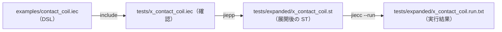
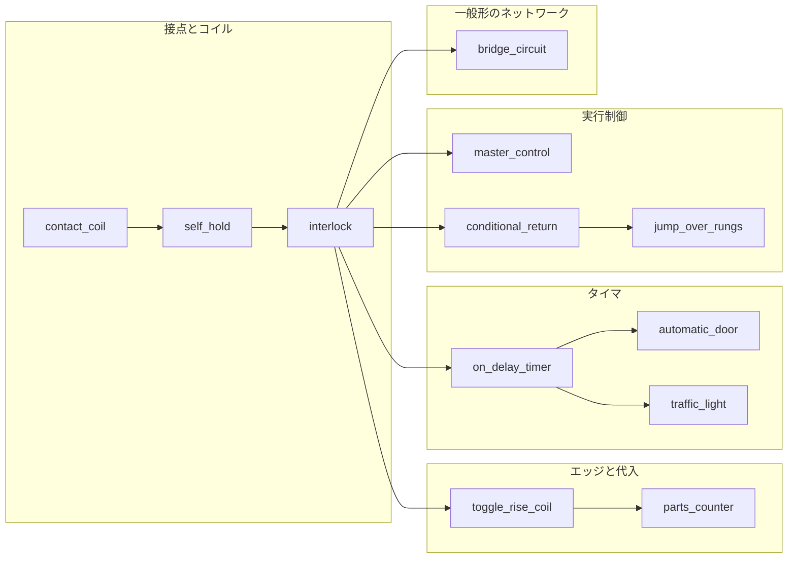
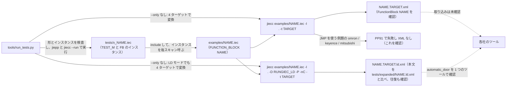
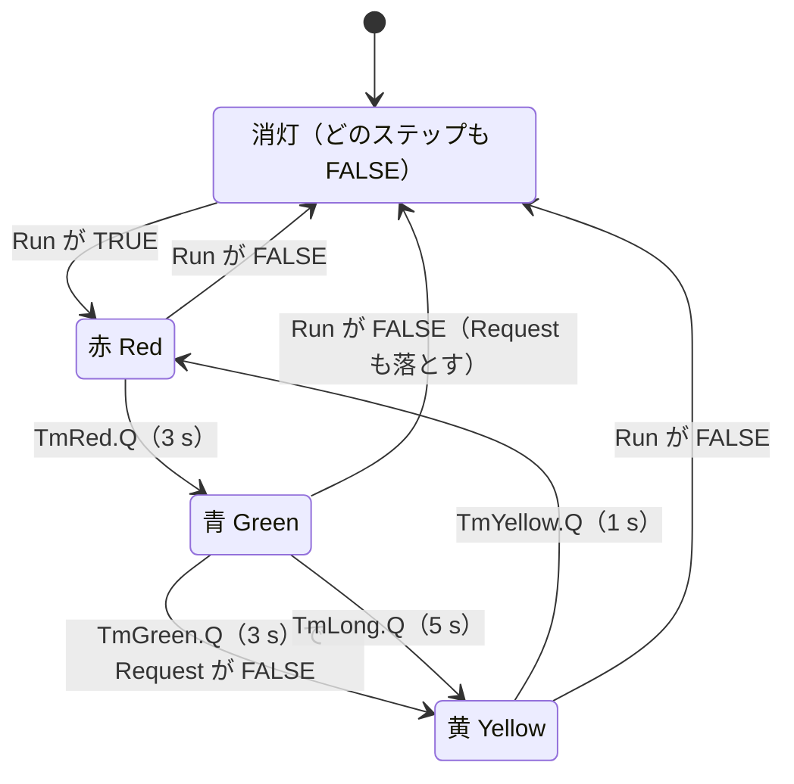

# RUNGIEC の例と例題

RUNGIEC で書いたラダーが何に展開されて、どう動くかの例と、`examples/` の例題の一覧と各例題のラダー、XML（ST モードと LD モード）への変換をまとめる。

この文書に出てくるツール:

- jiepp: IEC 61131-3 向けのプリプロセッサ。`{#define}` / `{#include}` / `{#if}` などのディレクティブを処理する。RUNGIEC を使うのに必要なのはこれだけ。https://github.com/yunos0987/jiepp （Windows と Linux の実行ファイルは https://github.com/yunos0987/jiepp/releases ）
- jiecc: IEC 61131-3 のテキストと IEC 61131-10 XML を相互に変換する無料のコマンドラインツール。IEC 61131-10 は PLC のプログラムを XML でやり取りするための規格。ST をインタプリタで実行する jier（`jiecc --run`）も含み、配布アーカイブには jiepp も入っている。利用者には必須ではなく、このリポジトリのテストの実行に必要である。https://www.graviness.com/iec_61131-3/jiecc.html
- jiecunit: IEC 61131-3 のテキストで書く単体テストの枠組み。このリポジトリのテストが git submodule として使う。https://github.com/yunos0987/jiecunit

この文書に出てくる番号と記号:

- `(* @expect ... *)` / `(* @cycles N *)`: テストのファイルの先頭に書く、期待する結果と実行するスキャン数（[「テストのやり方」](TESTING.md#テストのやり方)）。

## 目次

- [例: DSL → 展開後 ST → 実行結果](#例-dsl--展開後-st--実行結果)
- [例題](#例題)
  - [各例題のラダー](#各例題のラダー)

## 例: DSL → 展開後 ST → 実行結果

例題 `examples/contact_coil.iec`（`Y = X`）。確認は `tests/x_contact_coil.iec`。

この節で見るファイルの流れ:



DSL:

```
function_block contact_coil
var_input X: bool; end_var
var_output Y: bool; end_var
RUNGIEC_VAR()
BEGIN_RUNGIEC()
(*  |--| X |--( Y )--|  *)
RUNG(CONTACT(X), COIL(Y))
END_RUNGIEC()
end_function_block
```

X は FB の入力（`var_input`）、Y は出力（`var_output`）。確認ファイルは FB のインスタンスを置き、各スキャンで X を渡して呼び、同じスキャンの Y を確認する（「例題」の節）。

jiepp で展開した後の ST（`python tools/run_tests.py` が出力する `tests/expanded/x_contact_coil.st` から。このファイルは Git では追跡しない。`RUNGIEC_VAR()` と `RUNG(...)` はそれぞれ実際は 1 行で、この抜粋では文の区切りで改行し、行頭の空白を省いた。`BEGIN_RUNGIEC()` は初期化文を出し、`END_RUNGIEC()` は何も出さない。文は POU の本体に直接並ぶ）:

```
function_block contact_coil
var_input X: bool; end_var
var_output Y: bool; end_var
var RungiecEn: bool := true; RungiecIn: bool := true; RungiecAcc: bool := true; RungiecVal: bool := true; RungiecTmp: bool;
  RungiecRail: bool := true; RungiecSp: dint := -1; RungiecStIn: array[1..16] of bool; RungiecStAcc: array[1..16] of bool;
  RungiecNode: array[0..16] of bool; RungiecI: dint; RungiecMcSt: array[1..15] of bool; RungiecPrev: array[1..64] of bool; end_var
RungiecEn := true; RungiecIn := true; RungiecAcc := true; RungiecVal := true; RungiecTmp := false; RungiecRail := true; RungiecSp := 0;
(*  |--| X |--( Y )--|  *)
RungiecStIn[1 - RungiecSp] := RungiecIn; RungiecEn := RungiecRail; RungiecIn := RungiecRail;
RungiecSp := RungiecSp + 1; RungiecStIn[RungiecSp] := RungiecIn; RungiecStAcc[RungiecSp] := RungiecAcc; RungiecIn := RungiecEn;
RungiecAcc := RungiecIn;
RungiecEn := RungiecAcc; RungiecTmp := (X); RungiecVal := RungiecEn and RungiecTmp; RungiecAcc := RungiecVal;
RungiecEn := RungiecAcc; Y := RungiecEn; RungiecVal := RungiecEn; RungiecAcc := RungiecVal;
RungiecVal := RungiecAcc; RungiecEn := RungiecIn; RungiecIn := RungiecStIn[RungiecSp]; RungiecAcc := RungiecStAcc[RungiecSp]; RungiecSp := RungiecSp - 1;
end_function_block
```

- `RUNGIEC_VAR()` は初期化文の前の `var` ブロック（作業変数 13 個）になり、`BEGIN_RUNGIEC()` は初期化文になる。前処理の検査とカウンタの初期化は ST を何も出さない。`END_RUNGIEC()` は何も出さない。
- `RUNG` の先頭の `RungiecStIn[1 - RungiecSp] := RungiecIn;` は入れ子のトラップ（最上位では添字 1 で無害）、続く `RungiecEn := RungiecRail; RungiecIn := RungiecRail;` が左レールのパワーで、最後の `;` も `RUNG` が付ける。要素と結合子はそれぞれ `;` なしで終わり、親が `;` を補う。
- 接点のオペランドは一時変数 `RungiecTmp` 経由で評価され、接点は自分の入力パワーを含めた値 `RungiecVal := RungiecEn and RungiecTmp` を出し、直列はその値を `RungiecAcc := RungiecVal;` で写す。`Y := X and ...` のような 1 つの式にはならない。

`jiecc --run` の結果（`tests/expanded/x_contact_coil.run.txt`。jiecunit の出力）:

```
[========] Running 1 tests.
[ RUN    ] x_contact_coil
[     OK ] x_contact_coil (0us)
[========] 1 tests ran. (0us)
[ PASSED ] 1 tests.
```

手で 1 本だけ展開して実行するには、Windows のコマンドプロンプトでリポジトリルートから次を実行する。1 行目と 2 行目は、jiecc の `--run` が定義済みにする macro（`_JIER` など。jiecunit の `{#if}` が使う）の一覧を作る。`-D T_CYCLES` はテストの `@cycles` の値で、`--max-cycles` はその値 + 2。

```
type nul > %TEMP%\rungiec_empty.iec
tools\jiecc.exe --run -E -dM %TEMP%\rungiec_empty.iec --max-cycles 1 > %TEMP%\rungiec_predef.iec
tools\jiepp.exe -P -Werror=undef -include %TEMP%\rungiec_predef.iec -I . -I tests/support -I examples -I vendor/jiecunit -I vendor/jiecunit/sys -D T_CYCLES=4 tests/x_contact_coil.iec -o tests/expanded/x_contact_coil.st
tools\jiecc.exe --run tests/expanded/x_contact_coil.st --max-cycles 6
```

## 例題

`examples/` には利用者が書くコードだけを置く。例題 `examples/<名前>.iec` は、名前（例題の目的）と同じ名前の FUNCTION_BLOCK 1 つで、次の順に書く:

1. `{#include 'rungiec.iec'}`、短いコメント。
2. ラダーを書いた FUNCTION_BLOCK。入力は `var_input`、出力は `var_output` に書く。

大域変数と configuration は書かず、DSL のマクロのほかに `{#define}` を使わない。各社のツールに取り込むときは、FB を利用者のプログラムから呼ぶ形を想定している（例題 `automatic_door` の LD モードの XML を 1 つのツールで読み込めることを確認した。ほかの例題とツールは確認していない）。

```
{#include 'rungiec.iec'}
function_block on_delay_timer
var_input Start: bool; end_var
var_output Lamp: bool; end_var
var Tm: TON; end_var
RUNGIEC_VAR()
BEGIN_RUNGIEC()
RUNG(CONTACT(Start), FBT_BOX(Tm, TON, IN, Q, PT := T#1s), COIL(Lamp))
END_RUNGIEC()
end_function_block
```

例題 1 本を、ベンダーのツールに読み込ませる IEC 61131-10 の XML に変換するには、リポジトリルートで次を実行する（`-t` は `omron` / `keyence` / `codesys` / `mitsubishi`。`JMP()` / `LABEL()` を使う例題は `codesys` だけ）:

```
tools\jiecc.exe examples/on_delay_timer.iec -I . -t omron -o on_delay_timer.omron.xml
```

XML には FB が `<FunctionBlock name="on_delay_timer">` として入る。ランナーは 12 本の例題を 4 ターゲットで変換し、終了コード 0、error / warning の行が無いこと、XML に `<FunctionBlock name="<名前>">` があることを確認する。`JMP()` / `LABEL()` を使う例題（`jump_over_rungs`）は `-t codesys` でだけ XML になり、XML の ST のジャンプが `jmp <ラベル>;` であることも確認する。`-t omron` / `-t keyence` / `-t mitsubishi` では、変換が PP91 `RUNGIEC JMP to <ラベル> is not supported for the jiecc targets omron, keyence and mitsubishi`（`LABEL` も同じ形）だけで失敗し、XML を作らないことを確認する（各社のツールが展開後のジャンプを受け付けるかを確認していないため。`docs/DESIGN.md` の V23）。ベンダーのツールへの実際の取り込みは確認していない。

LD モード（ラダー図のまま IEC 61131-10 の LD XML にする。[GUIDE の「LD モード」](GUIDE.md#ld-モード)）で変換するには、`-D RUNGIEC_LD -P -nC` を追加する（LD モードでは `JMP()` / `LABEL()` を使う例題も 4 ターゲットで XML になる）:

```
tools\jiecc.exe examples/on_delay_timer.iec -I . -D RUNGIEC_LD -P -nC -t omron -o on_delay_timer.omron.ld.xml
```

この XML の `<BodyContent>`（jiecc の出力から抜き出した。前後の `<FunctionBlock>` と変数の宣言は省いた）:

```
		<BodyContent xsi:type="LD">
<Rung evaluationOrder="1">
<LdObject xsi:type="LeftPowerRail"><ConnectionPointOut connectionPointOutId="1"/></LdObject>
<LdObject xsi:type="Contact" operand="Start"><ConnectionPointIn><Connection refConnectionPointOutId="1"/></ConnectionPointIn><ConnectionPointOut connectionPointOutId="2"/></LdObject>
<FbdObject xsi:type="DataSource" identifier="T#1s"><ConnectionPointOut connectionPointOutId="3"/></FbdObject>
<FbdObject xsi:type="Block" typeName="TON" instanceName="Tm"><InputVariables><InputVariable parameterName="IN"><ConnectionPointIn><Connection refConnectionPointOutId="2"/></ConnectionPointIn></InputVariable><InputVariable parameterName="PT"><ConnectionPointIn><Connection refConnectionPointOutId="3"/></ConnectionPointIn></InputVariable></InputVariables><OutputVariables><OutputVariable parameterName="Q"><ConnectionPointOut connectionPointOutId="4"/></OutputVariable></OutputVariables></FbdObject>
<LdObject xsi:type="Coil" operand="Lamp"><ConnectionPointIn><Connection refConnectionPointOutId="4"/></ConnectionPointIn><ConnectionPointOut connectionPointOutId="5"/></LdObject>
<LdObject xsi:type="RightPowerRail"><ConnectionPointIn><Connection refConnectionPointOutId="5"/></ConnectionPointIn></LdObject>
</Rung>
      </BodyContent>
```

- 接点 `Start` の出力（2）が `Tm` の `Block` の入力 `IN` に、引数 `PT := T#1s` の `DataSource`（3）が入力 `PT` につながる。
- `FBT_BOX` の型名 `TON` が `Block` の `typeName` に入る（`FB_BOX` なら `typeName` は空で、Jiecc 9.4.0 は宣言の `TON` で補わない）。LD XML を取り込むツールによっては、FB のボックスに型名と、後段へつながる出力が必須のことがある。
- `FBT_BOX` は出力 `Q`（4）を後段のパワーにするので、コイル `Lamp` は 4 を受ける。

入力を与えて結果を確認するドライバ（jiecunit の `TEST_M` と `EXPECT_*`、`T_*` の補助、`@expect`）は `tests/x_<名前>.iec` にあり、例題を `{#include}` して `python tools/run_tests.py` で実行される（期待は `pass` だけ）。`TEST_M` は例題の FB のインスタンス（`Ctl: on_delay_timer;`）を持ち、各スキャンで入力表の値を渡してインスタンスを呼び、同じスキャンの出力（`Ctl.Lamp`）を確認する。

LD モード（`jiecc -D RUNGIEC_LD -P -nC`）の変換の期待値は、表の右端の列のファイル（omron の XML）にある。ランナーは 4 ターゲットの LD の本文がこのファイルの本文と同じことを確認する（`docs/TESTING.md`）。

例題を読む順の目安（矢印の順に要素が増える）:



| ファイル | 内容 | ラダーの抜粋 | LD モードの期待値 |
|---|---|---|---|
| `examples/contact_coil.iec` | 最も単純なネットワーク。X が TRUE の間だけ Y が TRUE | `RUNG(CONTACT(X), COIL(Y))` | `tests/expanded/contact_coil.ld.xml` |
| `examples/self_hold.iec` | 自己保持の起動・停止回路。停止優先、過負荷（b 接点）で停止 | `RUNG(PARALLEL(CONTACT(Start), CONTACT(Run)), NOT_CONTACT(Stop), NOT_CONTACT(Overload), COIL(Run))` | `tests/expanded/self_hold.ld.xml` |
| `examples/interlock.iec` | 正転・逆転のインターロック。一方が動作中はもう一方が起動しない | `RUNG(PARALLEL(CONTACT(Fwd), CONTACT(RunF)), NOT_CONTACT(Stop), NOT_CONTACT(RunR), COIL(RunF))` | `tests/expanded/interlock.ld.xml` |
| `examples/on_delay_timer.iec` | オンディレイタイマ。`FBT_BOX` でタイマを毎スキャン呼び、後段のパワーを `Q` にする | `RUNG(CONTACT(Start), FBT_BOX(Tm, TON, IN, Q, PT := T#1s), COIL(Lamp))` | `tests/expanded/on_delay_timer.ld.xml` |
| `examples/parts_counter.iec` | 部品カウンタ。立ち上がりで加算し、3 個で満杯、リセットで 0。加算と 0 クリアは `ST_EXEC` の代入文で書く | `RUNG(RISE_CONTACT(Sensor), NOT_CONTACT(Full), ST_EXEC(Count := Count + 1;))` | `tests/expanded/parts_counter.ld.xml` |
| `examples/master_control.iec` | マスタコントロール。OFF の領域ではコイルと `NOT_COIL` が OFF、SET は保持。`END_MC()` の後は影響なし | `BEGIN_MC(CONTACT(Auto), NOT_CONTACT(EStop))` … `END_MC()` | `tests/expanded/master_control.ld.xml` |
| `examples/conditional_return.iec` | 条件付き RETURN。保守中は後ろのネットワークを飛ばし、出力は前回値のまま | `RUNG(CONTACT(Maint), RETURN())` | `tests/expanded/conditional_return.ld.xml` |
| `examples/toggle_rise_coil.iec` | ボタンのトグル。`RISE_COIL` で 1 スキャンのパルスを作り、ランプを反転 | `RUNG(CONTACT(Btn), RISE_COIL(Pulse))` | `tests/expanded/toggle_rise_coil.ld.xml` |
| `examples/bridge_circuit.iec` | ブリッジ回路。直並列で書けないので一般形のネットワークで書く。E は節点 1 から 2 への一方向 | `BEGIN_NET()` `WIRE(0, 1, CONTACT(A))` … `WIRE(3, 4, COIL(Y))` `END_NET()` | `tests/expanded/bridge_circuit.ld.xml` |
| `examples/jump_over_rungs.iec` | 自動と手動の切り替え。自動では手動のラングを、手動では自動のラングをジャンプで飛ばす | `RUNG(CONTACT(Auto), JMP(AutoMode))` … `LABEL(AutoMode)` | `tests/expanded/jump_over_rungs.ld.xml` |
| `examples/traffic_light.iec` | 信号機。赤 → 青 → 黄 → 赤をステップのビットとタイマで進める。青のうちに押しボタンを押すと青が延びる。Run を切ると全消灯し、入れ直すと赤から | `RUNG(CONTACT(Red), CONTACT(TmRed.Q), RESET_COIL(Red), SET_COIL(Green))` | `tests/expanded/traffic_light.ld.xml` |
| `examples/automatic_door.iec` | 自動ドア。人の検出で開き、保持時間の後に閉じる。閉まる途中の検出で開き直す。開と閉のモータはインターロック | `RUNG(PARALLEL(CONTACT(Sensor), CONTACT(MotorOpen)), NOT_CONTACT(OpenLimit), NOT_CONTACT(MotorClose), COIL(MotorOpen))` | `tests/expanded/automatic_door.ld.xml` |

自己保持回路（`examples/self_hold.iec`）のアスキーアートと DSL:

```
(*  |--+--| Start |--+--|/Stop |--|/Overload |--( Run )--|  *)
(*  |  |             |                                   |  *)
(*  |  +--| Run |----+                                   |  *)
RUNG(PARALLEL(CONTACT(Start), CONTACT(Run)), NOT_CONTACT(Stop), NOT_CONTACT(Overload), COIL(Run))
```

この例題は停止ボタンを a 接点（押すと TRUE）で配線した入力として `NOT_CONTACT(Stop)` と書いている。現場では停止ボタンを b 接点（常閉）で配線し、TRUE を「押されていない」として `CONTACT(StopOk)` と書くことが多い。断線すると入力が FALSE になって止まるので、安全側に倒れる。書き方は `tests/t073_emergency_stop_no_auto_restart.iec`（`CONTACT(EStopOk)` と `CONTACT(StopOk)`）にある。

例題を追加したら、この表も更新し、確認用の `tests/x_<名前>.iec` も作る。展開後 ST と実行ログは `tests/expanded/x_<名前>.*` に出力される。ランナーは、例題の形（`function_block <名前>` が 1 つだけで、`program` が無い）と、確認ファイルが例題の FB のインスタンスを宣言していることを実行の前に検査し、`--only` なしのときは全例題を 4 ターゲットで XML に変換して確認する（LD モードも）。LD モードの期待値ファイル `tests/expanded/<名前>.ld.xml` も作る。最初はランナーが `tests/expanded/<名前>.ld.xml.new` に omron の XML を書いて失敗にするので、中身を確認してから `<名前>.ld.xml` に名前を変える（[`docs/TESTING.md` の「LD モードの変換の検査」](TESTING.md#ld-モードの変換の検査)）。

例題と確認ファイル、ランナー、XML への変換の関係:



### 各例題のラダー

各例題のアスキーアートと DSL（例題のファイルから抜き出したもの）。`examples/self_hold.iec` は上にある。

`examples/contact_coil.iec`:

```
(*  |--| X |--( Y )--|  *)
RUNG(CONTACT(X), COIL(Y))
```

`examples/interlock.iec`:

```
(*  |--+--| Fwd |--+--|/Stop |--|/RunR |--( RunF )--|  *)
(*  |  |           |                                |  *)
(*  |  +--| RunF |-+                                |  *)
RUNG(PARALLEL(CONTACT(Fwd), CONTACT(RunF)), NOT_CONTACT(Stop), NOT_CONTACT(RunR), COIL(RunF))
(*  |--+--| Rev |--+--|/Stop |--|/RunF |--( RunR )--|  *)
(*  |  |           |                                |  *)
(*  |  +--| RunR |-+                                |  *)
RUNG(PARALLEL(CONTACT(Rev), CONTACT(RunR)), NOT_CONTACT(Stop), NOT_CONTACT(RunF), COIL(RunR))
```

`examples/on_delay_timer.iec`:

```
(*  |--| Start |--[ Tm:TON(PT := T#1s) IN Q ]--( Lamp )--|   FBT_BOX calls the timer on every scan, so it sees IN = FALSE and resets  *)
RUNG(CONTACT(Start), FBT_BOX(Tm, TON, IN, Q, PT := T#1s), COIL(Lamp))
```

`examples/parts_counter.iec`:

```
(*  |--|P Sensor |--|/Full |--[[ ST: Count := Count + 1; ]]--|   count on the rising edge while not full  *)
RUNG(RISE_CONTACT(Sensor), NOT_CONTACT(Full), ST_EXEC(Count := Count + 1;))
(*  |--| Reset |--[[ ST: Count := 0; ]]--|  *)
RUNG(CONTACT(Reset), ST_EXEC(Count := 0;))
(*  |--| Count >= 3 |--( Full )--|  *)
RUNG(GE_CONTACT(Count, 3), COIL(Full))
```

`examples/master_control.iec`:

```
(*  |--| Auto |--|/EStop |--(MC)--|   the zone is ON while Auto and not EStop  *)
BEGIN_MC(CONTACT(Auto), NOT_CONTACT(EStop))
(*  |--| Go |--( Pump )--|  *)
RUNG(CONTACT(Go), COIL(Pump))
(*  |--| Go |--(/ Valve )--|  *)
RUNG(CONTACT(Go), NOT_COIL(Valve))
(*  |--| Go |--(S Latched )--|  *)
RUNG(CONTACT(Go), SET_COIL(Latched))
(*  |--(MCR)--|  *)
END_MC()
(*  |--| Go |--( Always )--|   outside the zone  *)
RUNG(CONTACT(Go), COIL(Always))
```

`examples/conditional_return.iec`:

```
(*  |--| Maint |--( Lamp )--|  *)
RUNG(CONTACT(Maint), COIL(Lamp))
(*  |--| Maint |--<RETURN>  *)
RUNG(CONTACT(Maint), RETURN())
(*  |--| Cmd |--( Out )--|   not executed during maintenance  *)
RUNG(CONTACT(Cmd), COIL(Out))
```

`examples/toggle_rise_coil.iec`:

```
(*  |--| Btn |--(P Pulse )--|   one-scan pulse on the rising edge  *)
RUNG(CONTACT(Btn), RISE_COIL(Pulse))
(*  |--+--| Pulse |--|/Lamp |--+--( Lamp )--|  *)
(*  |  |                       |            |  *)
(*  |  +--| Lamp |--|/Pulse |--+            |  *)
RUNG(PARALLEL(SERIES(CONTACT(Pulse), NOT_CONTACT(Lamp)), SERIES(CONTACT(Lamp), NOT_CONTACT(Pulse))), COIL(Lamp))
```

`examples/bridge_circuit.iec`:

```
(*  |--| A |--(1)--| C |--(3)--( Y )--|  *)
(*  |          |           |             *)
(*  |        | E |         |   (1 -> 2)  *)
(*  |          |           |             *)
(*  |--| B |--(2)--| D |---+             *)
BEGIN_NET()
WIRE(0, 1, CONTACT(A))
WIRE(0, 2, CONTACT(B))
WIRE(1, 2, CONTACT(E))
WIRE(1, 3, CONTACT(C))
WIRE(2, 3, CONTACT(D))
WIRE(3, 4, COIL(Y))
END_NET()
```

`examples/jump_over_rungs.iec`:

```
(*  |--| Auto |-->>AutoMode  *)
RUNG(CONTACT(Auto), JMP(AutoMode))
(*  |--| Jog |--( Motor )--|   manual mode  *)
RUNG(CONTACT(Jog), COIL(Motor))
(*  |-->>Done  *)
RUNG(JMP(Done))
(*  AutoMode:  *)
LABEL(AutoMode)
(*  |--| Cmd |--( Motor )--|   auto mode  *)
RUNG(CONTACT(Cmd), COIL(Motor))
(*  Done:  *)
LABEL(Done)
(*  |--| Auto |--( Lamp )--|  *)
RUNG(CONTACT(Auto), COIL(Lamp))
```

Motor のコイルは 2 つあるが、1 スキャンに実行されるのはどちらか 1 つなので、二重コイルの後勝ちにはならない。この例題は `-t codesys` では XML になり、`-t omron` / `-t keyence` / `-t mitsubishi` では `JMP()` / `LABEL()` の PP91 で XML にならない（「例題」の節の XML への変換の説明）。

`examples/traffic_light.iec`:

```
(*  |--|/Run |--(R Red )--(R Yellow )--(R Green )--(R Request )--|   stopped: all lamps off  *)
RUNG(NOT_CONTACT(Run), RESET_COIL(Red), RESET_COIL(Yellow), RESET_COIL(Green), RESET_COIL(Request))
(*  |--| Run |--|/Red |--|/Yellow |--|/Green |--(S Red )--|   no step yet: start from red  *)
RUNG(CONTACT(Run), NOT_CONTACT(Red), NOT_CONTACT(Yellow), NOT_CONTACT(Green), SET_COIL(Red))
(*  |--| Red |--| TmRed.Q |--(R Red )--(S Green )--|  *)
RUNG(CONTACT(Red), CONTACT(TmRed.Q), RESET_COIL(Red), SET_COIL(Green))
(*  |--| Green |--+--| TmGreen.Q |--|/Request |--+--(R Green )--(R Request )--(S Yellow )--|  *)
(*  |             |                              |                                         |  *)
(*  |             +--| TmLong.Q |----------------+                                         |   extended green  *)
RUNG(CONTACT(Green), PARALLEL(SERIES(CONTACT(TmGreen.Q), NOT_CONTACT(Request)), CONTACT(TmLong.Q)), RESET_COIL(Green), RESET_COIL(Request), SET_COIL(Yellow))
(*  |--| Yellow |--| TmYellow.Q |--(R Yellow )--(S Red )--|  *)
RUNG(CONTACT(Yellow), CONTACT(TmYellow.Q), RESET_COIL(Yellow), SET_COIL(Red))
(*  |--| Green |--| PedBtn |--(S Request )--|   a press while green extends this green  *)
RUNG(CONTACT(Green), CONTACT(PedBtn), SET_COIL(Request))
(*  |--| Red |--[ TmRed:TON(PT := T#3s) IN Q ]--|  *)
RUNG(CONTACT(Red), FBT_BOX(TmRed, TON, IN, Q, PT := T#3s))
(*  |--| Green |--[ TmGreen:TON(PT := T#3s) IN Q ]--|  *)
RUNG(CONTACT(Green), FBT_BOX(TmGreen, TON, IN, Q, PT := T#3s))
(*  |--| Green |--[ TmLong:TON(PT := T#5s) IN Q ]--|  *)
RUNG(CONTACT(Green), FBT_BOX(TmLong, TON, IN, Q, PT := T#5s))
(*  |--| Yellow |--[ TmYellow:TON(PT := T#1s) IN Q ]--|  *)
RUNG(CONTACT(Yellow), FBT_BOX(TmYellow, TON, IN, Q, PT := T#1s))
```

出力のランプ Red / Green / Yellow がそのままステップのビットで、Run が TRUE の間はちょうど 1 つが TRUE になる。移行のラングは、今のステップを `RESET_COIL` で落とし、次のステップを `SET_COIL` で立てる。どのステップも立っていないとき（起動直後と、Run を入れ直したとき）は 2 つめのラングが赤を立てる。Run が FALSE のときは最初のラングが全部を落とし、タイマは `FBT_BOX` の `IN` が FALSE になって戻る。

各ステップのタイマは、そのステップのビットを `FBT_BOX` の `IN` に渡し、毎スキャン呼ぶ。タイマのラングの後段（`Q`）は右レールにつながるだけで、移行のラングは `Q` を接点で読む。LD XML を取り込むツールによっては、FB のボックスに型名と、後段へつながる出力が必須のことがあるので、型名付きの `FBT_BOX` で置いている。タイマのラングは移行のラングの後ろにあるので、移行のラングが読む `Q` は前のスキャンの値になる。そのため、1 回の呼び出しで 1 s 進める確認ファイルの疑似 TON では、赤と青は 4 スキャン、黄は 2 スキャン続く。青のうちに PedBtn を押すと Request が立ち、`TmGreen.Q` の枝が `|/Request |` で切れるので、青は `TmLong`（5 s）まで延びて 6 スキャン続く。Request は青から黄へ移るラングで落ちる。押しボタンのラングは移行のラングの後ろにあるので、Green のランプが TRUE のスキャンの押下だけが数えられ、黄と赤のうちの押下は無視される。



確認の `tests/x_traffic_light.iec` は 35 スキャンで、1 周（スキャン 1〜14）、スキャン 16 の押下による青の延長（スキャン 15〜20 が青）、黄（スキャン 22）と赤（スキャン 24）の押下の無視、Request が立った青のうちに Run を切ると全消灯し（スキャン 29、30）、入れ直すと Request が落ちたまま赤から始まること（スキャン 31〜34 が赤）を確認する。どのスキャンでも、Run が TRUE ならランプはちょうど 1 つ、FALSE なら 0 であることも確認する。

`examples/automatic_door.iec`:

```
(*  |--| OpenLimit |--|/Sensor |--[ HoldTm:TON(PT := T#3s) IN Q ]--|   hold-open time; a detection restarts it  *)
RUNG(CONTACT(OpenLimit), NOT_CONTACT(Sensor), FBT_BOX(HoldTm, TON, IN, Q, PT := T#3s))
(*  |--+--| HoldTm.Q |---+--|/Sensor |--|/ClosedLimit |--|/MotorOpen |--( MotorClose )--|  *)
(*  |  |                 |                                                             |  *)
(*  |  +--| MotorClose |-+                                                             |  *)
RUNG(PARALLEL(CONTACT(HoldTm.Q), CONTACT(MotorClose)), NOT_CONTACT(Sensor), NOT_CONTACT(ClosedLimit), NOT_CONTACT(MotorOpen), COIL(MotorClose))
(*  |--+--| Sensor |-----+--|/OpenLimit |--|/MotorClose |--( MotorOpen )--|   after the closing rung, so a detection reopens at once  *)
(*  |  |                 |                                                |  *)
(*  |  +--| MotorOpen |--+                                                |  *)
RUNG(PARALLEL(CONTACT(Sensor), CONTACT(MotorOpen)), NOT_CONTACT(OpenLimit), NOT_CONTACT(MotorClose), COIL(MotorOpen))
```

開と閉は、どちらも `PARALLEL` の自己保持で、端のリミットスイッチ（OpenLimit / ClosedLimit）の b 接点で止まる。保持時間のタイマ HoldTm は、開端にいて人を検出していない間だけ `IN` が TRUE になるので、開いたままの検出で 0 に戻り、検出が無くなってから数え直す。閉のラングは `|/Sensor |` を持ち、開のラングより前にある。閉まる途中に人を検出すると、閉のラングが MotorClose を落とし、同じスキャンの開のラングが `|/MotorClose |` を通って MotorOpen を立てる。2 つのラングは相手の出力の b 接点（`|/MotorOpen |` と `|/MotorClose |`）を持つので、MotorOpen と MotorClose が同時に TRUE になることはない。

確認の `tests/x_automatic_door.iec` は 22 スキャンで、入力の OpenLimit と ClosedLimit はドアの動きを手で書いた表にしてある。閉じた状態からの検出で開き（スキャン 2）、開端で止まり（スキャン 5）、3 スキャン止まった後に閉じ始める（スキャン 8）。閉まる途中の検出で同じスキャンに開き直し（スキャン 11）、開端での検出（スキャン 14）で保持時間がやり直しになって、閉じ始めはスキャン 16 ではなく 18 になる。閉端で止まる（スキャン 21）。どのスキャンでも、2 つのモータの出力が同時に TRUE でないことも確認する。
