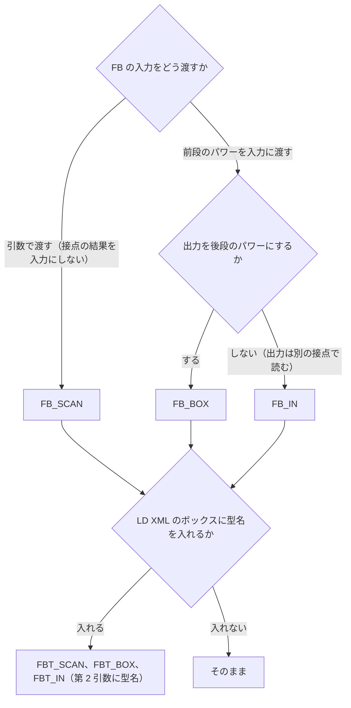
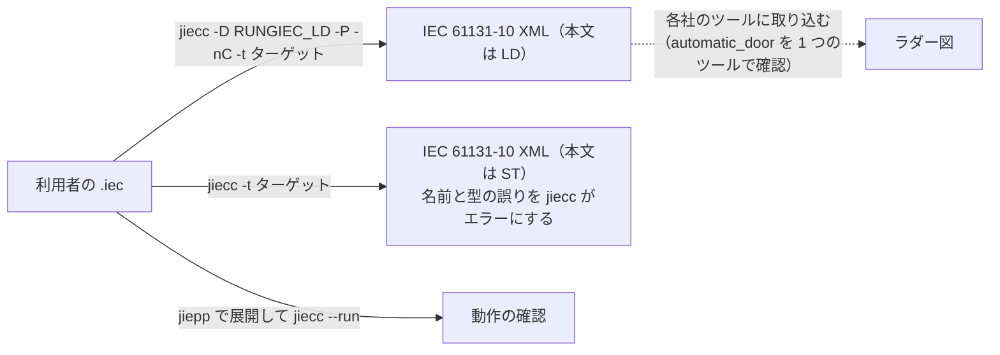

# RUNGIEC の書き方の手引き

RUNGIEC でラダーを書くときの規則と、前処理やコンパイルで検出されない書き間違いへの注意をまとめる。マクロ 1 個ずつの仕様は [`REFERENCE.md`](REFERENCE.md) にある。

この文書に出てくるツール:

- jiepp: IEC 61131-3 向けのプリプロセッサ。`{#define}` / `{#include}` / `{#if}` などのディレクティブを処理する。RUNGIEC を使うのに必要なのはこれだけ。https://github.com/yunos0987/jiepp （Windows と Linux の実行ファイルは https://github.com/yunos0987/jiepp/releases ）
- jiecc: IEC 61131-3 のテキストと IEC 61131-10 XML を相互に変換する無料のコマンドラインツール。IEC 61131-10 は PLC のプログラムを XML でやり取りするための規格。ST をインタプリタで実行する jier（`jiecc --run`）も含み、配布アーカイブには jiepp も入っている。利用者には必須ではなく、このリポジトリのテストの実行に必要である。https://www.graviness.com/iec_61131-3/jiecc.html

この文書に出てくる番号と記号:

- `PPnn`（`PP54`、`PP91` など）: jiepp の診断の番号。RUNGIEC の前処理の検査に外れると PP91 になる。
- `LNnn`（`LN10` など）: このリポジトリの lint（`tools/lint_rungiec.py`。前処理と jiecc でエラーにならない書き間違いを検査する）の規則の番号。
- `t001`、`e048`、`f007` などの括弧書き: その動作を確認するテストの名前（`tests/` のファイル。接頭辞は `t` 成功、`e` 前処理エラー、`f` jiecc 段階のエラー、`r` 展開されずに残る、`x` 例題の確認）。

## 目次

- [書き方](#書き方)
  - [長いラングの書式](#長いラングの書式)
- [使い方の注意](#使い方の注意)
  - [エッジ接点を置いてはいけない場所](#エッジ接点を置いてはいけない場所)
  - [タイマ・カウンタなど状態を持つ FB](#タイマカウンタなど状態を持つ-fb)
  - [二重コイル](#二重コイル)
  - [カンマと `RUNG` の書き間違い](#カンマと-rung-の書き間違い)
  - [`{#ignore}` と POU の本体](#ignore-と-pou-の本体)
  - [`*_ENO` マクロの引数](#_eno-マクロの引数)
  - [再起動後のエッジ前値](#再起動後のエッジ前値)
  - [ジャンプ](#ジャンプ)
  - [メモリ](#メモリ)
- [LD モード](#ld-モード)
  - [変換のしかた](#変換のしかた)
  - [LD モードの制約](#ld-モードの制約)
  - [ST モードと意味が違う点](#st-モードと意味が違う点)
  - [LD モードの例](#ld-モードの例)
- [未対応の機能と代わりの書き方](#未対応の機能と代わりの書き方)

## 書き方

最小の例と、各行が何に展開されるかは [README の「書き方」](../README.md#書き方)にある。

DSL を使う POU の並びと、各行がモードごとに出すもの:


- DSL を使う POU の並びは「利用者の `var` ブロック → `RUNGIEC_VAR()` → `BEGIN_RUNGIEC()` → ネットワーク → `END_RUNGIEC()`」。文は POU の本体に直接書き、`{st}` と `{end}` は書かない。この並びは ST モードと LD モード（[「LD モード」](#ld-モード)）で同じで、LD モードでは `BEGIN_RUNGIEC()` が `{ld}` を、`END_RUNGIEC()` が `{end}` を出す。
- `RUNGIEC_VAR()` は作業変数の `var` ブロックを宣言する（LD モードでは何も出さない）。利用者の `var` ブロックの後、`BEGIN_RUNGIEC()` の直前に書く（間に書けるのはコメントだけ。lint の LN16 が検査する）。
- 宣言の種類で 3 つある。PROGRAM・FB は `RUNGIEC_VAR()`、FB の作業変数を `var_temp` にしたいときは `RUNGIEC_VAR_TEMP()`、FUNCTION・METHOD は `RUNGIEC_VAR_NOEDGE()` を使う（[仕様の「宣言」](REFERENCE.md#宣言)の表）。`BEGIN_RUNGIEC()` と `END_RUNGIEC()` は 3 種類共通。
- `BEGIN_RUNGIEC()` は 1 回書く。前処理の検査をし、作業変数の初期化文を出す。`END_RUNGIEC()` はネットワークの最後に書く。`BEGIN_RUNGIEC()` との対と、`BEGIN_NET()` と `BEGIN_MC` の閉じ忘れを前処理で検査する。ST は出さない。
- ファイルの最後の POU で `END_RUNGIEC()` を忘れても、前処理と jiecc はエラーにしない（その POU の一般形のネットワークと MC 領域の閉じ忘れも検査されない）。`-D RUNGIEC_LD` で変換すると、閉じない `{ld}` で jiecc が構文エラー `INVALID_SYNTAX_FOR_CODEBLOCK` にする。途中の POU の付け忘れは、次の POU の `BEGIN_RUNGIEC()` が前処理エラーにする。
- DSL を使う POU では、`RUNGIEC_VAR*()` の前と `END_RUNGIEC()` の後に文を書かない（宣言の `var` ブロックとコメントは書ける）。ST は `ST_EXEC(...)` に書くか、DSL を使わない POU に書く（LD モードでは、`{ld}` の外の文が ST の本文になり、1 つの POU に LD と ST の本文が混ざる）。`RUNGIEC_VAR()` と `BEGIN_RUNGIEC()` の間に `{st}` を書くと、閉じないブロックになり jiecc の構文エラーになる（`f017`）。DSL を使わない POU（ネットワークを持たず、ST だけで書く POU）は、`RUNGIEC_VAR()` / `BEGIN_RUNGIEC()` / `END_RUNGIEC()` を書かず、文を POU の本体に直接書く。
- エッジ接点と遷移コイルが使うエッジのスロットは POU ごとに 1 から数える。1 つの POU で `RUNGIEC_EDGE_MAX` を超えると前処理エラー PP91 になる。
- 1 ネットワーク = `RUNG(...)` 1 個か、`BEGIN_NET()` から `END_NET()` までの 1 組（[「一般形のネットワーク」](REFERENCE.md#一般形のネットワーク)）。最上位のネットワークは必ずこのどちらかで書く。`RUNG` が左レールのパワーを渡し、文の終わりの `;` も自分で付けるので、利用者は末尾に `;` を書かない（書いても jiecc は受け付けるが、lint の LN11 が指摘する）。`SERIES` は入れ子の中だけで使う。要素と結合子は `;` を付けずに終わる作りで、親が `;` を補う。
- 最上位に `RUNG` なしで `SERIES(...)` や要素を書いてはならない（lint の LN10 が検出する）。`RUNG` を忘れた `SERIES(...)` の直後に識別子で始まる文（次の `RUNG(...)` など）が続くと jiecc の構文エラーになる（`f007`）。直後が `if` などのキーワードや `END_RUNGIEC()` のときは jiecc を通り、展開後は左レールのパワーを受けていない裸の `SERIES` になって、パワーの扱いが警告なしに意図と違うものになる。
- `RUNG` / `WIRE` / `BEGIN_MC` / `END_MC` / `LABEL` / `END_NET` を他の要素・結合子の中に入れてはならない。前処理では検出できないが、実行時に `InterpreterFault: array index 0 out of bounds` で止まる（`f013`〜`f015`、`f018`、`f019`、`f024`）。`BEGIN_NET` を `RUNG` / `WIRE` / `BEGIN_MC` の子に書くと前処理でエラーになる（PP91）。一般形のネットワークの中（`BEGIN_NET()` と `END_NET()` の間）には `RUNG` / `BEGIN_MC` / `END_MC` / `LABEL` / `BEGIN_NET` を書けない（PP91）。
- `JMP()` は最上位の `RUNG` か `WIRE` の最後の子に置き、`LABEL()` はネットワークの間に単独で書く（[仕様の「実行制御」](REFERENCE.md#実行制御begin_mc--end_mc--return--jmp--label)）。`JMP()` か `RETURN()` を持つ `WIRE` は一般形のネットワークの最後の `WIRE` にする（後ろの `WIRE` は PP91）。ジャンプは `BEGIN_MC` / `END_MC` をまたげない（PP91）。ST モードの `jiecc -t omron` / `-t keyence` / `-t mitsubishi` では `JMP()` / `LABEL()` を使えない（PP91。LD モードでは使える）。
- コイルを `PARALLEL` の直下の子として接点と混ぜて置く書き方は禁止（例: `PARALLEL(CONTACT(A), CONTACT(B), COIL(Y))`）。IEC どおりに読むと `Y` はパワー入力そのものになり、意図した `A or B` にならない。マージコイルは `RUNG(PARALLEL(CONTACT(A), CONTACT(B)), COIL(Y))` と書く。枝ごとにコイルを置く `PARALLEL(SERIES(CONTACT(B), COIL(Y1)), SERIES(CONTACT(C), COIL(Y2)))` は正しい書き方で、コイルだけの `PARALLEL(COIL(Y1), COIL(Y2))` も使える。禁止形は前処理では検出されない。このリポジトリでは lint の LN12 が検出する。
- マクロの引数の中にコメントを書かない（引数の先頭と末尾のコメントは展開時に消え、字句の間のコメントは残る）。アスキーアートは呼び出しの直前に書く。
- 公開マクロは 49 個。利用者が普通は書かないマクロ（内部マクロ）は `_RUNGIEC_` で始まり、公開マクロには含めない。名前の末尾の `_` は「公開マクロだが、普通は使わない」という目印に取ってあるが、該当するマクロは今は無い。名前は IEC 61131-3 の記号に合わせ、否定は `NOT_`、遷移は `RISE_` / `FALL_` を前置する。

### 長いラングの書式

1 行に収まらないラングは、枝を 1 本ずつ別の行にし、`PARALLEL` の階層ごとにインデントを 1 段下げる。アスキーアートは呼び出しの直前に `(* *)` で書く。例（`tests/t011_coil_conventions.iec` の 4 つ目の図）:

```
(*  |--| A |--+--| B |--( Yd1 )--|  *)
(*  |         |                  |  *)
(*  |         +--| C |--( Yd2 )--|  *)
RUNG(CONTACT(A), PARALLEL(
    SERIES(CONTACT(B), COIL(Yd1)),
    SERIES(CONTACT(C), COIL(Yd2))))
```

- 引数の途中の改行やインデントは展開に影響しない。閉じ括弧を行末にまとめると見やすい。
- コメントはマクロ呼び出しの前に置く。引数の中に置いたコメントは、引数の先頭か末尾なら展開で消え、字句の間なら展開後の ST に残るので、枝ごとの説明をそこに書かない。

## 使い方の注意

どれも前処理やコンパイルでは検出されず、エラーにならずに意図と違う動作になる。

書き間違いがエラーになる段階（各段の詳細は [DESIGN の「エラーと上限」](DESIGN.md#エラーと上限)）。この節は、いちばん右まで通り抜ける形を扱う:


### エッジ接点を置いてはいけない場所

エッジ接点（`RISE_CONTACT` など）はループ・条件付き実行のコード・FUNCTION の中に置かない。前値は呼び出し箇所ごとの静的変数で、毎スキャンちょうど 1 回更新されることを前提にしている。`for` / `while` の中では前値が 1 個しか無いので反復ごとの変化を正しく見られず、`if` の中では更新されないスキャンができて、エッジの検出を誤る。FUNCTION では前値を持てない（`RUNGIEC_VAR_NOEDGE()` ではコンパイルエラー、`RUNGIEC_VAR()` ではエラーにならずにレベル接点になる）。

### タイマ・カウンタなど状態を持つ FB

`FB_EXEC` の中の FB は、パワーが OFF のスキャンでは呼ばれない。TON / CTU のような標準 FB も同じで、次のように書くとタイマはパワー OFF で IN = FALSE の呼び出しを受けられず、リセットされない。カウンタも、呼ばれない間の入力の変化を見ない。

```
(* 誤り: Start が OFF の間は Tm が呼ばれず、Tm が止まったまま・リセットされないまま残る *)
RUNG(CONTACT(Start), FB_EXEC(Tm, IN := TRUE, PT := T#2s), CONTACT(Tm.Q), COIL(Out))
```

タイマ・カウンタは `FB_IN` で置くのが基本である。`FB_IN(Tm, IN, PT := T#2s)` は前段のパワーを `IN` に渡して毎スキャン呼ぶので、ラダーの図のとおり「前段の接点の結果がタイマの入力になる」。後段のパワーは前段のまま（パススルー）。

```
(*  |--| Start |--[ Tm(PT := T#2s) IN ]--| Tm.Q |--( Out )--|  *)
RUNG(CONTACT(Start), FB_IN(Tm, IN, PT := T#2s), CONTACT(Tm.Q), COIL(Out))
```

- TON は `Q` が立てば `IN` も立っているので、`Q` を同じ直列で読んでよい（`tests/t089_fb_in.iec`）。
- TOF / TP（`IN` が落ちた後も `Q` が残る）とカウンタ（`CU` はパルス、`Q` はレベル）は、`Q` を別の `RUNG` で読むか、`FB_BOX` で置く。`FB_IN` の後ろの同じ直列で読むと `IN and Q` になる。

```
(*  |--| Pulse |--[ Ct(R := Rst, PV := 3) CU ]--|  *)
RUNG(CONTACT(Pulse), FB_IN(Ct, CU, R := Rst, PV := 3))
(*  |--| Ct.Q |--( Full )--|  *)
RUNG(CONTACT(Ct.Q), COIL(Full))
```

タイマ・カウンタの置き方の選び方:



IEC のボックスと同じく、出力をそのまま後段のパワーにするときは `FB_BOX(inst, in_pin, out_pin, args...)` を使う。前段のパワーを `in_pin` に渡して毎スキャン呼び、後段のパワーを `inst.out_pin` にする。前段が OFF でも出力が TRUE なら後段は ON になる（TOF の `Q` が残る間など。`tests/t113_fb_box_tof.iec`）。分岐の中に置いても、その枝のパワーが出力に置き換わる（`tests/t116_fb_box_parallel_branch.iec`、`tests/t117_fb_box_replaces_power.iec`）。OFF の MC 領域では後段は OFF（`tests/t114_fb_box_mc_zone_off.iec`）。`in_pin` と `out_pin` は BOOL のピンにする。

```
(*  |--| Hold |--[ Tf(PT := T#200ms) IN Q ]--( Fan )--|   Fan follows Q, also after Hold falls  *)
RUNG(CONTACT(Hold), FB_BOX(Tf, IN, Q, PT := T#200ms), COIL(Fan))
```

`FB_SCAN` / `FB_IN` / `FB_BOX` / `FB_EXEC` / `FB_ENO` には、第 2 引数に FB の型名を追加した `FBT_SCAN` / `FBT_IN` / `FBT_BOX` / `FBT_EXEC` / `FBT_ENO` がある。ST モードの動作は同じで、LD モードではボックスの `typeName` に型名が入る（「LD モード」）。LD XML を取り込むツールによっては、FB のボックスに型名と、後段へつながる出力が必須のことがある。そのときは `FBT_BOX` で置く（`examples/on_delay_timer.iec`）。

```
(*  |--| Start |--[ Tm:TON(PT := T#1s) IN Q ]--( Lamp )--|  *)
RUNG(CONTACT(Start), FBT_BOX(Tm, TON, IN, Q, PT := T#1s), COIL(Lamp))
```

`FB_SCAN` は入力を引数で渡し、パワーにも左レールにも関係なく毎スキャン呼ぶ（`tests/t054_fb_scan.iec`）。前段の接点の結果は入力に渡らず、後段のパワーに影響するだけなので、複合条件を `IN` に渡したいときはコイルで中間の BOOL 変数を作り、`IN := Mid` と書く（`tests/t039_stateful_fb_pattern.iec`）。

```
(*  |--[ Tm(IN := Start, PT := T#2s) ]--| Tm.Q |--( Out )--|  *)
RUNG(FB_SCAN(Tm, IN := Start, PT := T#2s), CONTACT(Tm.Q), COIL(Out))
```

書き方の比較:

| 書き方 | 結果 |
|---|---|
| A: `RUNG(CONTACT(Start), FB_IN(T1, IN, PT := T#1s), CONTACT(T1.Q), COIL(Lamp))` | 正しく動く。毎スキャン呼ばれ、`IN` に前段のパワーを受ける。OFF の MC 領域では `IN = FALSE` になり、タイマはリセットされる |
| A': `RUNG(CONTACT(Start), FB_BOX(T4, IN, Q, PT := T#1s), COIL(Lamp))` | 正しく動く。A と同じく呼ばれ、後段のパワーが `T4.Q` になる（TON では A と同じ結果） |
| B: `RUNG(FB_SCAN(T2, IN := Start, PT := T#1s, Q => Lamp))` | 正しく動く。毎スキャン呼ばれ、`IN := Start` を受ける。OFF の MC 領域でも呼ばれるので、タイマは進み、`Lamp` も書き込まれる |
| C: `RUNG(CONTACT(Start), FB_EXEC(T3, IN := Start, PT := T#1s, Q => Lamp))` | 誤り。Start が OFF の間は T3 が呼ばれず、`IN = FALSE` を見ないので Q が TRUE のまま残り、再度 ON にしても遅延が掛からない |

#### MC 領域の中のタイマ

MC 領域が OFF の間、領域の中の `FB_IN` / `FB_BOX` のタイマは `IN = FALSE` で呼ばれてリセットされる（`ET` が 0、`Q` が FALSE）。`FB_SCAN` のタイマは呼ばれ続け、引数の `IN` に従って進み続ける（`tests/t057_timer_in_mc_zone.iec`）。三菱の MC は領域 OFF で通常のタイマの現在値を 0 にする（命令マニュアル SH-081266ENG で確認）ので、`FB_IN` の動作がそれに近い。次の図の注記は、領域が OFF の間は `IN = FALSE` で呼ばれてリセットされることを表す。

```
(*  |--| Z |--(MC)--|  *)
BEGIN_MC(CONTACT(Z))
(*  |--| Start |--[ Tm(PT := T#2s) IN ]--| Tm.Q |--( Out )--|   reset with IN = FALSE while the zone is OFF  *)
RUNG(CONTACT(Start), FB_IN(Tm, IN, PT := T#2s), CONTACT(Tm.Q), COIL(Out))
(*  |--(MCR)--|  *)
END_MC()
```

- DSL の外の通常の ST でタイマを呼んでもよい（`Tm(IN := Mid, PT := T#2s);`）。MC 領域の中に書いても MC の影響を受けず、毎スキャン呼ばれる。

### 二重コイル

同じ変数に複数のコイルを書くと、後のコイルの値が勝つ（最後に実行された書き込みが残る）。`COIL` と `SET_COIL` / `RESET_COIL` の併用は避ける（`tests/t017_double_coil_last_wins.iec`）。MC 領域の中のコイルと同じ変数を領域の外のコイルでも書くと、領域 OFF のときに書いた FALSE を後のコイルが上書きし（または逆）、MC で出力を切る効果が消える。領域の中で駆動する変数は、領域の外で書かない。

### カンマと `RUNG` の書き間違い

要素の間のカンマを忘れると、jiecc の構文エラー（`INVALID_SYNTAX`）になる（`f004`〜`f006`）。要素と結合子は代入で始まり代入で終わり `;` を付けない作りで、親が `;` を補うので、カンマの無い 2 個の要素は `a := x b := y` のように `;` なしで続いてしまうため。

```
RUNG(CONTACT(A) CONTACT(B), COIL(Y))    (* 誤り: カンマが無い。jiecc の構文エラー *)
```

最上位で `RUNG` を書き忘れた `SERIES(...)` の直後に識別子で始まる文（次の `RUNG(...)` など）が続く場合も構文エラーになる（`f007`）。`RUNG` を入れ子の中に書く（例: `RUNG(CONTACT(A), SERIES(RUNG(COIL(Y))))`）と、実行時フォールト `InterpreterFault: array index 0 out of bounds` で止まる（`f013`。`WIRE` と `BEGIN_MC` も同じ。`f014`、`f015`）。

それでもエラーにならずに通る書き間違いが残る。

- カンマの代わりに演算子を書く: `RUNG(CONTACT(A) and B, COIL(Y))`。`CONTACT(A) and B` が 1 個の子として展開され、`RungiecVal := RungiecEn and RungiecTmp and B;` のように `and B` が代入文の右辺に警告なしに組み込まれる。前処理でも jiecc でもエラーにならない（lint の LN14 が検出する）。`CONTACT` では値が A and B になるが、B は接点を経由しない（オペランドを 1 回評価する規則と、接点を 1 つの式にまとめない規則に反する）。エッジ接点（`RISE_CONTACT(A) and B` など）では `and B` が前値の更新に付くので、B は結果に効かず、前値が壊れてエッジの検出を誤る（`RISE_CONTACT` は B が FALSE の間 A が TRUE なら毎スキャン成立し、`FALL_CONTACT` は B が FALSE の間は一度も成立しない）。
- `RUNG` を忘れた最上位の `SERIES(...)` の直後が `if` などのキーワードや `END_RUNGIEC()` のときは、jiecc が受け付ける。展開後は左レールのパワーを受けない裸の `SERIES` になり、`RungiecEn` が前のネットワークの値のまま評価される。前処理でもコンパイルでも検出できないので、最上位は必ず `RUNG` で書く（lint の LN10 が検出する）。
- 展開後の ST（`jiepp -P` の出力）を確認すると見つけやすい。

### `{#ignore}` と POU の本体

- ST モードの展開後の ST は、`BEGIN_RUNGIEC()` の初期化文から POU の終わりまで、POU の本体に直接並ぶ（`{st}` / `{end}` で囲まない）。Jiecc 9.2.0 は POU の本体の文を原文の順に実行する。POU の本体のコメントに `{st}` / `{end}` と書かない（`(* {st} *)` も jiecc がディレクティブとして読み、構文エラーになる）。
- `{#ignore PP91}` は使わない。RUNGIEC の検査はすべて PP91 なので、抑制するとどの検査も効かなくなる。`{#ignore}` はそれより後の処理全体に及び、include したファイルの中に書いても利用者の POU の検査まで抑制する。項数エラー（`RUNG()` / `SERIES()`、上限超え）を抑制すると、振り分け先の無い `_RUNGIEC_SERIES_0(` などが ST に残る。テストランナーは展開後に `_RUNGIEC_` で始まる名前が残っていれば失敗にする（`r001`、`r002`）。

### `*_ENO` マクロの引数

`FUN_ENO` / `FUN_ENO_RET` / `FB_ENO` の引数は名前付きだけにし、`ENO =>` を書かない。ENO はマクロが必ず結線するので、自分で書くと 2 回結線されて（`ENO => B , ENO => RungiecTmp`）、jiecc もエラーにしない。後段のパワーがどちらの ENO になるかを当てにしてはならない。

### 再起動後のエッジ前値

エッジ接点の前値（`RungiecPrev`）は保持しない。再起動後の最初のスキャンは、入力がすでに ON なら `RISE_CONTACT` が成立する（前値は FALSE から始まる）。`RISE_CONTACT` が `SET_COIL` を駆動し、そのコイルの変数が保持変数なら、再起動のたびに再度セットされ得る。

### ジャンプ

`JMP()` で飛ばしたラングは、ST の `if` で包んで実行しなかったときと同じになる。

- 飛ばしたラングのコイルは前回の値のまま残る。出力を OFF にしたいときは、MC（`BEGIN_MC` / `END_MC`）を使う。
- 飛ばしたラングのエッジ接点と遷移コイルは前値が更新されない。飛ばしている間に入力が立ち上がると、次にそのラングを実行したスキャンで立ち上がりとして見る（`t028`）。遷移コイルは出力を保つので、TRUE のまま残ることがある。
- 後ろ向きのジャンプ（`LABEL(L)` より後ろの `JMP(L)`）は、間のラングを同じスキャンの中で繰り返す。条件が FALSE にならないとスキャンが終わらない（jiecc の `--max-cycles` でも止まらない）。間にエッジ接点と遷移コイルを置かない（1 スキャンに何回も評価される。lint の LN23 が検出する）。
- ラベルの大文字小文字をそろえる。`JMP(Skip)` と `LABEL(SKIP)` は jiecc では同じラベルとして飛ぶが、MC をまたぐかどうかの前処理の検査が働かない（lint の LN22 が検出する）。
- `ST_EXEC` の文の中に `goto` / `jmp` とラベルを書かない（lint の LN17）。

```
(*  |--| Mode |-->>Skip  *)
RUNG(CONTACT(Mode), JMP(Skip))
(*  |--| A |--( Y )--|   not executed while Mode is on, Y keeps its value  *)
RUNG(CONTACT(A), COIL(Y))
(*  Skip:  *)
LABEL(Skip)
```

### メモリ

エッジ前値の `RungiecPrev` は、DSL を使う POU（FB はインスタンス）ごとに `RUNGIEC_EDGE_MAX` 個（既定 64 個）の BOOL を持つ。エッジのスロットは POU ごとに 1 から数えるので、上限は 1 つの POU の中の個数に掛かる。エッジ接点と遷移コイルが少ない POU でも同じ大きさになる。`RUNGIEC_EDGE_MAX` はファイル単位の設定で、POU ごとには変えられない。作業変数は 13 個で、配列の `RungiecNode`（`RUNGIEC_NODE_MAX + 1` 個）と `RungiecMcSt`（`RUNGIEC_MC_MAX` 個）を含む。一般形のネットワークを使わない POU にもこれらは宣言される。`BEGIN_NET()` は一般形のネットワークごとに毎スキャン、節点を FALSE にする代入を `RUNGIEC_NODE_MAX` 回（既定 16 回）行う。

## LD モード

同じソースから、ST の代わりに IEC 61131-10 の LD XML（ラダー図を XML で表したもの。`<Rung>` の並び）を出すモード。各社のツールにラダー図として取り込むためのもので、マクロはそのまま使い、変換のときに `-D RUNGIEC_LD` を付けて切り替える（例題 `automatic_door` の LD モードの XML を 1 つのツールで読み込めることを確認した。ほかの例題とツールは確認していない）。jiepp 1.2.0 と Jiecc 9.2.0 が必要である（[README の「必要なツール」](../README.md#必要なツール)）。マクロごとの XML の形は[仕様の「LD モード」](REFERENCE.md#ld-モード)にある。

### 変換のしかた

同じソースを別の経路にも通す。LD の本文は jiecc が検査せず実行もしないので、動作と誤りは ST モードの経路で確認する:



Windows のコマンドプロンプトで、リポジトリルートから次を実行する:

```
tools\jiecc.exe examples/self_hold.iec -I . -D RUNGIEC_LD -P -nC -t omron -o self_hold.omron.ld.xml
```

- `-D RUNGIEC_LD` が LD モードにする。ソースの `{#include 'rungiec.iec'}` の前に `{#define RUNGIEC_LD 1}` と書いても同じ。`RUNGIEC_LD` が無いか 0 なら ST モード。
- `-P` と `-nC` を必ず付ける。`-P` が無いと jiepp の行マーカー（`(*{#:9 'examples/contact_coil.iec'}*)` など）が、`-nC` が無いとラダー図のコメントが `<BodyContent>` の中に残る。jiecc は `{ld}` の本文を検査しないので、どちらもエラーにならない。
- `-t` は `omron` / `keyence` / `codesys` / `mitsubishi`。LD の本文はどのターゲットでも同じ（このリポジトリのランナーが例題で確認する）。`-t keyence` では、jiecc が END と ENDH のラングを入れた 2 つ目の `<BodyContent xsi:type="LD">` を追加する。
- `JMP()` / `LABEL()` は、LD モードではどのターゲットでも使える。ST モードの `-t omron` / `-t keyence` / `-t mitsubishi` の PP91 は展開後の ST のジャンプの制限で、LD の `Jump` には当たらない。
- jiepp だけで展開してもよい（`tools\jiepp.exe -P -nC -D RUNGIEC_LD -I . examples/self_hold.iec -o self_hold.ld.txt`）。`(*{ld}*)` と `(*{end}*)` の間に `<Rung>` の並びが出る。XML の文書全体（`<Project>`、変数の宣言など）は jiecc が作る。
- DSL を使わない POU（`RUNGIEC_VAR*()` / `BEGIN_RUNGIEC()` を書かず、文を本体に直接書く POU）は、LD モードでも ST の本文のまま出る。
- `jiecc --run` は `{ld}` の本文を実行しない。動作は ST モードで確認する（このリポジトリのテストの実行は ST モード）。
- 前処理の検査（項数、空の子、エッジのスロット、一般形のネットワークと MC 領域の対と順序、節点番号、ジャンプとラベル、`BEGIN_RUNGIEC()` と `END_RUNGIEC()` の対）は ST モードと同じで、同じメッセージの PP91 になる。

### LD モードの制約

| 制約 | 外れたとき |
|---|---|
| 関数・FB のボックスの呼び出しの引数は名前付き（`IN := Start`、`Q => Lamp`）だけ。XML の `InputVariable` / `OutputVariable` が引数の名前を持つため | 位置指定の引数（`FB_EXEC(Tm, Start)`、`FUN_EXEC_RET(R, Add, 3, 4)`）は jiepp の PP81 `No ':=' or '=>' in the argument of a built-in macro`。1 個の引数で同じ行が 4 行出る（`e062`）。ST モードでは通るが、lint の LN25 が指摘する |
| ボックスの名前（インスタンス名、`FBT_*` の型名、関数名、`*_IN` の `pin`、`*_BOX` の `in_pin` と `out_pin`、`FUN_EXEC_RET` / `FUN_ENO_RET` の `dst`）を空にしない。呼び出しの引数は 32 個まで | PP91 `RUNGIEC LD: FB_EXEC has an empty name before its call arguments`（マクロの名前が入る）/ `RUNGIEC LD: FB_EXEC has more than 32 call arguments`。ST モードの `FB_EXEC()` は前処理を通る |
| 子は要素・`SERIES`・`PARALLEL` の呼び出しだけ | 裸の名前（`RUNG(A, COIL(Y))`）、`CONTACT(A) and B` や `CONTACT(A) or B` のような要素の後ろに続く式（`e066`）、カンマ忘れ（`CONTACT(A) CONTACT(B)`）、要素の中に書いた `RUNG` などの文マクロは PP91 `RUNGIEC LD: a child is not an element, SERIES or PARALLEL`（`e063`）。同じ行に PP52 や、`-Werror=undef` のときの PP54 も出る。ST モードでは、裸の名前は jiecc の構文エラー、演算子はエラーにならずに通り（lint の LN14 が検出する）、要素の中の文マクロは実行時フォールトになる |
| 入れ子の深さは `RUNGIEC_NEST_MAX` 以下（既定 16）。LD モードでは `RUNGIEC_NEST_MAX` も 16 以下にする（生成した表の深さが 16 まで） | 深さの超過は PP91 `RUNGIEC LD: nesting exceeds 16`（`RUNGIEC_NEST_MAX` の値が入る。`e060`）。`RUNGIEC_NEST_MAX` が 17 以上なら PP91 `RUNGIEC LD: nest limit 17 exceeds 16, the depth of the generated LD tables`（`e064`）。ST モードの深さの超過は実行時フォールト（`f001`） |
| 1 か所に合流する出力の数（`PARALLEL` の枝の出口、一般形のネットワークの 1 つの節点に入る `WIRE` の出口、一般形のネットワークの右レールにつなぐ節点の出口）は `RUNGIEC_LD_FANIN_MAX` 以下（既定 16、設定は 1〜32） | PP91 `RUNGIEC LD: too many parallel ends merge into one element; raise 2`（`RUNGIEC_LD_FANIN_MAX` の値が入る。`e061`）。設定が 1〜32 の外なら PP91 `RUNGIEC LD: merge limit 33 is out of range 1 to 32`（`e065`） |
| DSL を使う POU では、`RUNGIEC_VAR*()` の前と `END_RUNGIEC()` の後に文を書かない。その文は `{ld}` の外の ST の本文になる。1 つの POU に LD と ST の本文が混ざる XML を取り込めるツールは少ない | 前処理と jiecc は検出せず、LD と ST の本文が混ざった XML を出す。lint の LN24 が指摘する（ST モードでも指摘する） |
| `RUNGIEC_VAR_NOEDGE()` の POU（FUNCTION・METHOD）にエッジ接点と遷移コイルを置かない | ST モードは jiecc の `UNDEFINED_SYMBOL`（`f002`）。LD モードは検出せず、`edge="rising"` などの XML を出す |
| ST モードなら jiecc がエラーにする誤り（宣言していないオペランド `CONTACT(Strat)`、POU に無いラベルへの `JMP()`、型の不一致）を残さない。同じソースを ST モードでも変換するか `jiecc --run` で実行して確認する | jiecc は `{ld}` の本文を検査しないので、LD モードではエラーにならずに XML になる。ST モードでは jiecc のエラー（POU に無いラベルは `UNDEFINED_SYMBOL`。`f023`） |

LD モードには実行時のトラップが無い（作業変数が無い）。ST モードで実行時フォールトになる「要素の中の文マクロ」と「深さの超過」は、LD モードでは上の表のとおり前処理の PP91 になる。

`FB_*` の FB のボックスの `Block` は `typeName=""`（型の名前が空）で出る。前処理ではインスタンスの型（`Tm` の `TON`）が分からないため。Jiecc 9.2.0 は空のまま XML に出す。`FBT_*` では引数の型名が `typeName` に入る（`FBT_BOX(Tm, TON, IN, Q)` は `typeName="TON"`）。LD XML を取り込むツールによっては、FB のボックスに型名が必須のことがあるので、そのときは `FBT_*` を使う。前処理は型名がインスタンスの宣言と合うかを検査しない。各社のツールが空の `typeName` を受け付けるかは確認していない。関数のボックスと MC / MCR の `Block` は `typeName` に名前が入る。

`FB_BOX` / `FBT_BOX` の `Block` は、出力 `out_pin` の `OutputVariable` が後段の要素（または右レール）につながる。`in_pin` と `out_pin` が BOOL のピンであることは、LD モードでは jiecc が検査しない（ST モードでは jiecc がエラーにする。`in_pin` は実行時の型の不一致 `f025`、`out_pin` はコンパイルの `TYPE_ERROR` `f026`）。取り込むツールの検査に任せることになるので、同じソースを ST モードでも変換して確認する。

### ST モードと意味が違う点

LD モードの XML は接続のグラフで、各社のツールが実行のしかたを決める。ST モードの展開と次の点が一致しない。

| 項目 | ST モード | LD モード（XML） |
|---|---|---|
| OFF の MC 領域の `NOT_COIL` | FALSE を書く（`RungiecRail and not RungiecEn`） | `Coil negated="true"`。OFF の MC 領域での値は各社の実装 |
| 接点のオペランドに書いた関数の呼び出し | OFF の MC 領域でも毎スキャン実行する（`t058`） | オペランドの文字列のまま `operand` に入る。呼び出しの扱いは各社の実装 |
| 立ち上がり・立ち下がり接点、遷移コイルの前値 | `RungiecPrev[n]`（POU ごとの番号） | `edge="rising"` / `"falling"`。前値はランタイムが持つ |
| `FB_SCAN` の毎スキャンの呼び出し | パワーにも左レールにも関係なく呼ぶ | 電力の入力の無い `Block`（EN なし）。OFF の MC 領域で呼ぶかは各社の扱い |
| `FB_EXEC` / `FUN_EXEC` / `FUN_EXEC_RET` の後段 | 呼んだら ON（パワー ON のときだけ呼ぶので、前段のパワーと同じ値） | 前段の接続をそのまま後段へつなぐ（`ENO` を使わない） |
| `WIRE` の順序 | 書いた順に評価する | 接続のグラフ。評価の順は各社のツールが決める |
| `ST_EXEC` | `if` の中の ST の文 | Omron の拡張の `smcext:InlineST`。IEC 61131-10 の XSD には無い |
| 入れ子の深さの超過 | 実行時フォールト（`RungiecStIn` の添字） | 前処理の PP91 |
| 要素の中の `RUNG` などの文マクロ | 実行時フォールト（`f013` など） | 前処理の PP91（子の検査） |

### LD モードの例

例題の自己保持回路（`examples/self_hold.iec`）:

```
function_block self_hold
var_input Start, Stop, Overload: bool; end_var
var_output Run: bool; end_var
RUNGIEC_VAR()
BEGIN_RUNGIEC()
(*  |--+--| Start |--+--|/Stop |--|/Overload |--( Run )--|  *)
(*  |  |             |                                   |  *)
(*  |  +--| Run |----+                                   |  *)
RUNG(PARALLEL(CONTACT(Start), CONTACT(Run)), NOT_CONTACT(Stop), NOT_CONTACT(Overload), COIL(Run))
END_RUNGIEC()
end_function_block
```

上の「変換のしかた」のコマンドで作った XML の `<BodyContent>`（jiecc の出力から抜き出した。前後の `<FunctionBlock>` と変数の宣言は省いた）:

```
		<BodyContent xsi:type="LD">
<Rung evaluationOrder="1">
<LdObject xsi:type="LeftPowerRail"><ConnectionPointOut connectionPointOutId="1"/></LdObject>
<LdObject xsi:type="Contact" operand="Start"><ConnectionPointIn><Connection refConnectionPointOutId="1"/></ConnectionPointIn><ConnectionPointOut connectionPointOutId="2"/></LdObject>
<LdObject xsi:type="Contact" operand="Run"><ConnectionPointIn><Connection refConnectionPointOutId="1"/></ConnectionPointIn><ConnectionPointOut connectionPointOutId="3"/></LdObject>
<LdObject xsi:type="Contact" negated="true" operand="Stop"><ConnectionPointIn><Connection refConnectionPointOutId="2"/><Connection refConnectionPointOutId="3"/></ConnectionPointIn><ConnectionPointOut connectionPointOutId="4"/></LdObject>
<LdObject xsi:type="Contact" negated="true" operand="Overload"><ConnectionPointIn><Connection refConnectionPointOutId="4"/></ConnectionPointIn><ConnectionPointOut connectionPointOutId="5"/></LdObject>
<LdObject xsi:type="Coil" operand="Run"><ConnectionPointIn><Connection refConnectionPointOutId="5"/></ConnectionPointIn><ConnectionPointOut connectionPointOutId="6"/></LdObject>
<LdObject xsi:type="RightPowerRail"><ConnectionPointIn><Connection refConnectionPointOutId="6"/></ConnectionPointIn></LdObject>
</Rung>
      </BodyContent>
```

- 1 つの `RUNG` が 1 つの `<Rung>` になり、`evaluationOrder` は POU の中で 1 から数える。
- 各要素は出力の ID（`connectionPointOutId`）を 1 つ持ち、`ConnectionPointIn` の `Connection` で前段の出力の ID を指す。ID は POU ごとに 1 から振る。
- `PARALLEL` は要素を出さない。2 本の枝（`Start` の 2 と `Run` の 3）が、後ろの `Stop` の 2 つの `Connection` で合流する。
- コイルも出力の ID を持ち（パワーを素通しする）、最後の出力が右レール（`RightPowerRail`）につながる。

## 未対応の機能と代わりの書き方

次の機能は提供しない。現在の代わりの書き方だけを示す。

| 機能 | 代わりの書き方 |
|---|---|
| パワー（rung 条件）のエッジを後段の接点として使うこと | 遷移コイル（`RISE_COIL` / `FALL_COIL`）は書き込み先の変数にパルスを書く。後段で使うときは、その変数にエッジ接点を使うか、変数を接点で読む |
| `BEGIN_MC` / `END_MC` をまたぐジャンプ | MC 領域の外から中へ、中から外へは飛べない（PP91）。領域の中だけを飛ばすときは、領域の中に `JMP()` と `LABEL()` を置く。領域を丸ごと飛ばすときは、`BEGIN_MC` から `END_MC()` までを ST の `if` で包む（`BEGIN_MC` と `END_MC()` は同じ枝に入れる。lint の LN21）。どちらも飛ばしたラングのコイルは前回の値のまま残り、エッジ接点の前値は更新されない（「ジャンプ」） |
