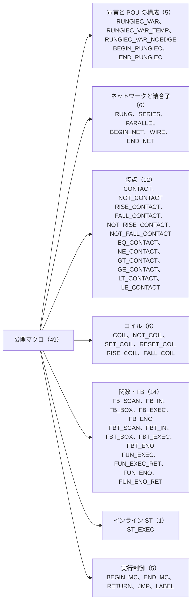
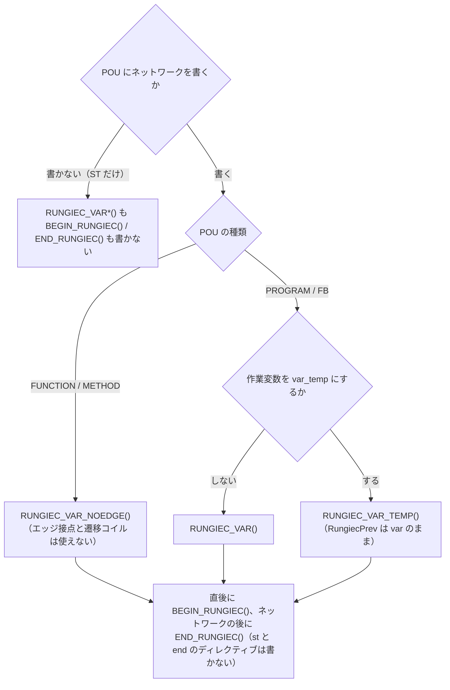
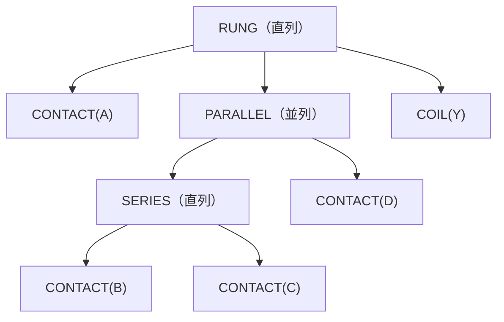
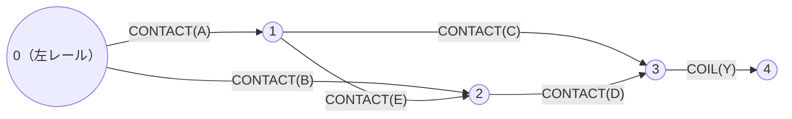
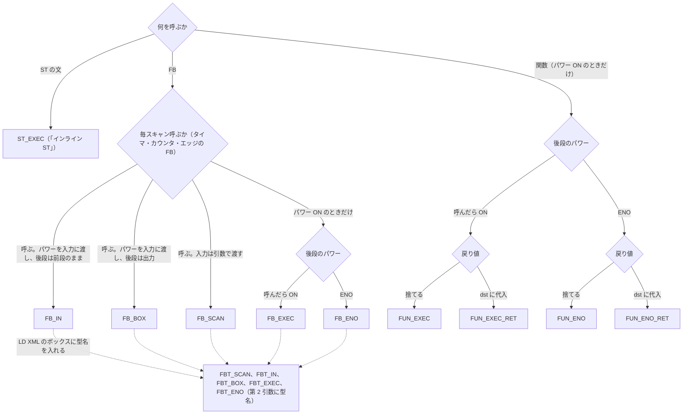
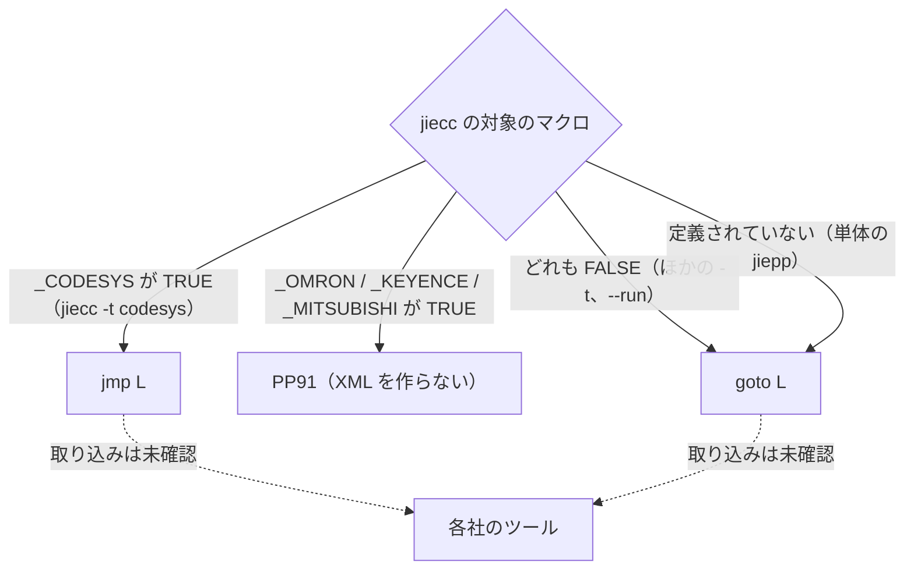

# RUNGIEC の仕様

RUNGIEC の公開マクロの形と意味、LD モードで出す XML の形、意味論、設定パラメータ、上限とエラー、IEC との差異、バージョン、予約名をまとめる。

この文書に出てくるツール:

- jiepp: IEC 61131-3 向けのプリプロセッサ。`{#define}` / `{#include}` / `{#if}` などのディレクティブを処理する。RUNGIEC を使うのに必要なのはこれだけ。https://github.com/yunos0987/jiepp （Windows と Linux の実行ファイルは https://github.com/yunos0987/jiepp/releases ）
- jiecc: IEC 61131-3 のテキストと IEC 61131-10 XML を相互に変換する無料のコマンドラインツール。IEC 61131-10 は PLC のプログラムを XML でやり取りするための規格。ST をインタプリタで実行する jier（`jiecc --run`）も含み、配布アーカイブには jiepp も入っている。利用者には必須ではなく、このリポジトリのテストの実行に必要である。https://www.graviness.com/iec_61131-3/jiecc.html

この文書に出てくる番号と記号:

- `PPnn`（`PP54`、`PP91` など）: jiepp の診断の番号。RUNGIEC の前処理の検査に外れると PP91 になる。
- `LNnn`（`LN10` など）: このリポジトリの lint（`tools/lint_rungiec.py`。前処理と jiecc でエラーにならない書き間違いを検査する）の規則の番号。
- `t001`、`e048`、`f007` などの括弧書き: その動作を確認するテストの名前（`tests/` のファイル。接頭辞は `t` 成功、`e` 前処理エラー、`f` jiecc 段階のエラー、`r` 展開されずに残る、`x` 例題の確認）。

## 目次

- [宣言](#宣言)
- [ネットワークと結合子](#ネットワークと結合子)
  - [一般形のネットワーク](#一般形のネットワーク)
- [接点](#接点)
- [コイル](#コイル)
- [関数・FB](#関数fb)
- [インライン ST（ST_EXEC）](#インライン-stst_exec)
- [実行制御（BEGIN_MC / END_MC / RETURN / JMP / LABEL）](#実行制御begin_mc--end_mc--return--jmp--label)
- [LD モード](#ld-モード)
  - [モードの指定と POU の構成](#モードの指定と-pou-の構成)
  - [要素の対応](#要素の対応)
  - [ID と接続](#id-と接続)
  - [LD モードの出力の例](#ld-モードの出力の例)
- [意味論](#意味論)
- [設定パラメータ](#設定パラメータ)
- [上限とエラー](#上限とエラー)
- [IEC との差異](#iec-との差異)
- [バージョン](#バージョン)
- [予約名と共有資源](#予約名と共有資源)

公開マクロの仕様はこの文書が正本。設計の理由と IEC・各社との差異は `docs/DESIGN.md`。

公開マクロ 49 個の一覧（括弧の中は個数）:



## 宣言

| マクロ | 使える POU | 内容 |
|---|---|---|
| `RUNGIEC_VAR()` | PROGRAM・FB。利用者の `var` ブロックの後、`BEGIN_RUNGIEC()` の直前に 1 回 | 作業変数とエッジの前値 `RungiecPrev` をすべて `var` ブロックとして宣言する |
| `RUNGIEC_VAR_TEMP()` | PROGRAM・FB。`BEGIN_RUNGIEC()` の直前に 1 回 | 作業変数は `var_temp`、`RungiecPrev` だけ `var`。VAR_TEMP を使える環境向け（IEC 61131-3 p.54 は FB・メソッド・プログラム用） |
| `RUNGIEC_VAR_NOEDGE()` | FUNCTION・METHOD。`BEGIN_RUNGIEC()` の直前に 1 回 | `var` に作業変数だけ。`RungiecPrev` が無いのでエッジ接点と遷移コイルを書くとコンパイルエラー（`f002`）。METHOD の `var` も FUNCTION と同じく一時変数で、スキャンをまたいで残らない |
| `BEGIN_RUNGIEC()` | 3 種類共通。`RUNGIEC_VAR*()` の直後に 1 回 | 作業変数を初期化する文を出す（パワー ON の状態にするだけで、`RungiecPrev` には触らない）。前処理のカウンタ（エッジのスロットなど）を POU ごとに初期化する。前の POU の `END_RUNGIEC()` の付け忘れ（`e044`、`e045`）と、`BEGIN_RUNGIEC()` の 2 回（`e047`）を前処理で検査し、PP91 にする |
| `END_RUNGIEC()` | 3 種類共通。ネットワークの最後に 1 回 | ST を展開しない。前に `BEGIN_RUNGIEC()` があるか（`e048`）、`BEGIN_NET()` と `BEGIN_MC` が閉じているか（`e022`、`e026`）を前処理で検査し、外れていれば PP91 |

宣言のマクロの選び方:



- LD モード（「LD モード」）では、`RUNGIEC_VAR*()` は何も出さず、`BEGIN_RUNGIEC()` は初期化文の代わりに `{ld}` を、`END_RUNGIEC()` は `{end}` を出す。前処理の検査は両モードで同じ。
- `RUNGIEC_VAR()` の付け忘れは作業変数が未定義で jiecc の `UNDEFINED_SYMBOL`（`f012`）。`BEGIN_RUNGIEC()` との間にはコメントのほかに何も書かない（lint の LN16 が検査する）。利用者が `Rungiec*` の名前を宣言すると `DUPLICATE_SYMBOL` になる。
- `BEGIN_RUNGIEC()` の付け忘れは `END_RUNGIEC()` の PP91 `RUNGIEC BEGIN_RUNGIEC is missing before END_RUNGIEC`（`e048`）、2 回書くと 2 つ目の PP91 `RUNGIEC END_RUNGIEC is missing before BEGIN_RUNGIEC`（`e047`）。
- 文は POU の本体に直接書く。DSL を使う POU には `{st}` / `{end}` を書かない（lint の LN16 が指摘する）。`RUNGIEC_VAR*()` と `BEGIN_RUNGIEC()` の間に `{st}` を書くと、閉じないブロックになり jiecc の構文エラー `INVALID_SYNTAX_FOR_CODEBLOCK`（`f017`）。DSL を使う POU には、`RUNGIEC_VAR*()` の前や `END_RUNGIEC()` の後に利用者の文を置かない（1 つの POU は 1 つの言語。lint の LN24）。ラングの中の ST は `ST_EXEC` に書く。
- `END_RUNGIEC()` は ST を出さない。付け忘れは、次の POU の `BEGIN_RUNGIEC()` が PP91 `RUNGIEC END_RUNGIEC is missing before BEGIN_RUNGIEC` にする（一般形のネットワークや MC 領域も開いたままなら `RUNGIEC END_NET and END_RUNGIEC are missing before the next BEGIN_RUNGIEC` なども出る。`e044`、`e045`）。ファイルの最後の POU で忘れると、前処理と jiecc はエラーにせず（その POU の一般形のネットワークと MC 領域の閉じ忘れも検査されない）、lint の LN16 が指摘する。`-D RUNGIEC_LD` で変換すると、閉じない `{ld}` で jiecc の構文エラー `INVALID_SYNTAX_FOR_CODEBLOCK` になる。次の POU が DSL を使わない場合、次の POU も `BEGIN_RUNGIEC()` を忘れた場合などは前処理では検出しない。
- 各社のラダーの END 命令に当たる要素は無い。スキャンの終わりは POU の終わりで、`END_RUNGIEC()` が END の位置に当たる。プログラムの末尾に書く三菱 MELSEC の `END`（SH-081266ENG p.207〜209）、キーエンス KV の `END` / `ENDH`（Visual KV のマニュアル 96M0366 p.3-94。KV-8000 などは未確認）、オムロン CS/CJ/CP の `END(001)`（W474 p.97）がこれに当たる。三菱の `FEND` の後ろに置くサブルーチンは、別の FUNCTION・FUNCTION_BLOCK に書く。オムロン NJ/NX（Sysmac Studio）と CODESYS には末尾に書く END が無く、POU は最後のネットワークで終わる。スキャンを途中で打ち切るとき（三菱の `FEND`、オムロン NJ/NX の `End`（W502 p.2-74）、CODESYS の `RETURN`、Rockwell の `TND`）は `RETURN()` を使う（「実行制御」）。POU の最後へ飛ぶときは、`END_RUNGIEC()` の直前に `LABEL()` を書く。
- `BEGIN_RUNGIEC()` を `if` などの中に書かない。通らない枝では初期化文が走らず、最初のネットワークで `InterpreterFault: array index 0 out of bounds` になる。
- 注意: FUNCTION で `RUNGIEC_VAR()` または `RUNGIEC_VAR_TEMP()` を使っても、エッジ接点は検出されず、前値が呼び出しごとに消えるのでエラーにならずにレベル接点として動く。FUNCTION では必ず `RUNGIEC_VAR_NOEDGE()` を使う。
- METHOD: `RUNGIEC_VAR_NOEDGE()` を使う（エッジ接点は使えない）。jiecc での METHOD の動作はこのリポジトリでは未検証。
- ACTION: ACTION は所属する FB / PROGRAM の変数を共有し、独自の宣言を持たない。FB の `RUNGIEC_VAR()` が宣言した作業変数を ACTION の中の DSL で使えるかは未検証。DSL を使う ACTION を、別の DSL ネットワークの途中（`FUN_EXEC` / `FB_EXEC` の中など）から呼んではならない（作業変数が同じ変数なので、入れ子のトラップで `InterpreterFault: array index 0 out of bounds` になるか、呼び出し元の状態が壊れる）。jiecc での ACTION の動作はこのリポジトリでは未検証。

## ネットワークと結合子

| マクロ | 意味 |
|---|---|
| `RUNG(c1,…,cN)` | 最上位のネットワーク。左レール（`RungiecRail`）のパワーを子に渡す直列（AND）で、`;` で文を終える。N の範囲は `SERIES` と同じ |
| `SERIES(c1,…,cN)` | 直列（AND）。入れ子の中だけで使う。N = 1〜`RUNGIEC_ARITY_MAX`（既定 16、最大 32）。範囲外は PP91 |
| `PARALLEL(c1,…,cN)` | 並列（OR）。N の範囲は同じ |
| `BEGIN_NET()` / `WIRE(from, to, c1,…,cN)` / `END_NET()` | 一般形のネットワーク（下の「一般形のネットワーク」）。`WIRE` の要素は直列に評価し、N の範囲は `SERIES` と同じ |

- `RUNG(a, b)` は `RUNG(SERIES(a, b))` と同じ意味で、どちらの書き方も使える（警告なし）。`RUNG(COIL(Y))` のように子が 1 個でもよい。
- 次のように書く（`tests/t053_rung_forms.iec`）。最上位のネットワークは `RUNG(...)` か `BEGIN_NET()` … `END_NET()` の組で書き（下の「一般形のネットワーク」）、MC 領域の `BEGIN_MC(条件...)` / `END_MC()` も最上位に書く（「実行制御」）。`SERIES` / `PARALLEL` と要素は最上位に書かず、どれの後にも `;` は書かない。

```
(*  |--+--| A |--+--( Y )--|  *)
(*  |  |         |         |  *)
(*  |  +--| B |--+         |  *)
RUNG(PARALLEL(CONTACT(A), CONTACT(B)), COIL(Y))
(*  |--| A |--( Y0 )--|  *)
RUNG(CONTACT(A), COIL(Y0))
(*  |--| A |--( Y1 )--|   SERIES inside RUNG  *)
RUNG(SERIES(CONTACT(A), COIL(Y1)))
(*  |--( Y1b )--|   SERIES inside RUNG with one element  *)
RUNG(SERIES(COIL(Y1b)))
(*  |--( Y2 )--|   single element  *)
RUNG(COIL(Y2))
(*  |--| A |--+--| B |--( Yd1 )--|  *)
(*  |         |                  |  *)
(*  |         +--| C |--( Yd2 )--|  *)
RUNG(CONTACT(A), PARALLEL(SERIES(CONTACT(B), COIL(Yd1)), SERIES(CONTACT(C), COIL(Yd2))))
```

入れ子の例。`PARALLEL` の枝に `SERIES` を置くと、その枝の中が直列になる（`Y = A and (B and C or D)`）:

```
(*  |--| A |--+--| B |--| C |--+--( Y )--|  *)
(*  |         |                |         |  *)
(*  |         +--| D |---------+         |  *)
RUNG(CONTACT(A), PARALLEL(SERIES(CONTACT(B), CONTACT(C)), CONTACT(D)), COIL(Y))
```

同じ呼び出しをマクロの木で表すと次のとおり。`RUNG` と `SERIES` は子を左から順に直列（AND）で、`PARALLEL` は並列（OR）で評価する:



### 一般形のネットワーク

直並列（`SERIES` と `PARALLEL` の入れ子）で書けない回路は、節点と配線で書く。縦線が節点（OR の合流点）、横線の上の要素の並びが 2 つの節点を結ぶ配線に当たる。節点 0 は左レール。

```
BEGIN_NET()
WIRE(from, to, c1, …, cN)
…
END_NET()
```

- `WIRE(from, to, c1, …)` は、節点 `from` のパワーから要素を直列に評価し、結果を節点 `to` に OR で合流させる。要素は 1 個以上で、中に `SERIES` / `PARALLEL` を置ける。
- 節点の値は、その節点に入る `WIRE` の出力の OR。パワーは左から右へ一方向に流れる（`from` から `to` へ）。
- 節点番号の規則（4 つ）:
  - 節点番号は 0〜64 の整数リテラルで、0 以上 `RUNGIEC_NODE_MAX`（既定 16、最大 64）以下。`from < to`。変数や式（`K`、`1 + 1`、`1 + K`）は PP91 `RUNGIEC WIRE from node K is not an integer literal from 0 to 64`（`e041`、`e042`、`e046`）。`{#define N 3}` のようなマクロは結果的に通るが、保証しない。
  - `to` は直前の `WIRE` の `to` 以上（`BEGIN_NET()` の直後は 0 と比べる）。
  - 番号は飛ばしてよい。
  - どの `WIRE` も書かない節点（節点 0 を除く）は FALSE。`BEGIN_NET()` が一般形のネットワークごと・スキャンごとに節点 1 以上を FALSE にする。
- 整数リテラルであること、範囲、最初の 2 つの規則は前処理が検査する（PP91）。書かれていない節点を `from` に読んでも検出しない。`from` を打ち間違えると、エラーにならずに FALSE として読まれる（`tests/t091_net_node_skip.iec`）。
- この規則で、`WIRE` を書いた順がそのまま評価の順になる（ある節点に書く `WIRE` はすべて、その節点を読む `WIRE` より前にある）。
- コイルで終わる配線の `to` には、どの `WIRE` も読まない番号（ふつうは直前の `to` より 1 大きい番号）を書く。1 行に 1 本書き、直前にアスキーアートを添える。
- `RUNG(c1, …)` は「節点 0 から 1 本の配線」と同じ意味になる。直並列で書けるものは `RUNG`、書けないものだけ一般形のネットワークで書く。要素の実装は共通なので、2 つの書き方で意味はずれない。
- 一般形のネットワークの中には `RUNG` / `BEGIN_MC` / `END_MC` / `BEGIN_NET` を書けない（PP91）。一般形のネットワークを MC 領域の中に置くと、節点 0 は領域の左レールになる。

ブリッジ回路（`examples/bridge_circuit.iec`）。E は節点 1 から 2 への一方向なので、`Y = A and C or B and D or A and E and D` になる（B → E → C の向きには流れない）。

```
(*  |--| A |--(1)--| C |--(3)--( Y )--|  *)
(*  |          |           |             *)
(*  |        | E |         |   (1 -> 2)  *)
(*  |          |           |             *)
(*  |--| B |--(2)--| D |---+             *)
BEGIN_NET()
WIRE(0, 1, CONTACT(A))
WIRE(0, 2, CONTACT(B))
WIRE(1, 2, CONTACT(E))
WIRE(1, 3, CONTACT(C))
WIRE(2, 3, CONTACT(D))
WIRE(3, 4, COIL(Y))
END_NET()
```

同じネットワークを節点と配線のグラフで描くと次のとおり。矢印は `WIRE` の `from` から `to` へ、ラベルは配線の上の要素:



## 接点

| マクロ | IEC 記号 | 意味 |
|---|---|---|
| `CONTACT(x)` | `--\| \|--` | a 接点（normally open） |
| `NOT_CONTACT(x)` | `--\|/\|--` | b 接点（normally closed） |
| `RISE_CONTACT(x)` | `--\|P\|--` | 立ち上がり（positive transition） |
| `FALL_CONTACT(x)` | `--\|N\|--` | 立ち下がり（negative transition） |
| `NOT_RISE_CONTACT(x)` | なし（DSL の拡張） | 立ち上がりの否定 |
| `NOT_FALL_CONTACT(x)` | なし（DSL の拡張） | 立ち下がりの否定 |
| `EQ_CONTACT(a, b)` | 比較ボックス | a = b |
| `NE_CONTACT(a, b)` | 比較ボックス | a <> b |
| `GT_CONTACT(a, b)` | 比較ボックス | a > b |
| `GE_CONTACT(a, b)` | 比較ボックス | a >= b |
| `LT_CONTACT(a, b)` | 比較ボックス | a < b |
| `LE_CONTACT(a, b)` | 比較ボックス | a <= b |

それぞれのラダーの記号と書き方。`|/P X |` と `|/N X |` は IEC に記号の無い DSL の拡張で、この文書ではこう描く:

```
(*  |--| X |--( Y1 )--|   normally open: X  *)
RUNG(CONTACT(X), COIL(Y1))
(*  |--|/X |--( Y2 )--|   normally closed: not X  *)
RUNG(NOT_CONTACT(X), COIL(Y2))
(*  |--|P X |--( Y3 )--|   rising edge of X  *)
RUNG(RISE_CONTACT(X), COIL(Y3))
(*  |--|N X |--( Y4 )--|   falling edge of X  *)
RUNG(FALL_CONTACT(X), COIL(Y4))
(*  |--|/P X |--( Y5 )--|   not the rising edge of X  *)
RUNG(NOT_RISE_CONTACT(X), COIL(Y5))
(*  |--|/N X |--( Y6 )--|   not the falling edge of X  *)
RUNG(NOT_FALL_CONTACT(X), COIL(Y6))
(*  |--| A = B |--( Y7 )--|  *)
RUNG(EQ_CONTACT(A, B), COIL(Y7))
(*  |--| A <> B |--( Y8 )--|  *)
RUNG(NE_CONTACT(A, B), COIL(Y8))
(*  |--| A > B |--( Y9 )--|  *)
RUNG(GT_CONTACT(A, B), COIL(Y9))
(*  |--| A >= B |--( Y10 )--|  *)
RUNG(GE_CONTACT(A, B), COIL(Y10))
(*  |--| A < B |--( Y11 )--|  *)
RUNG(LT_CONTACT(A, B), COIL(Y11))
(*  |--| A <= B |--( Y12 )--|  *)
RUNG(LE_CONTACT(A, B), COIL(Y12))
```

エッジ接点の値の例（1 = TRUE、0 = FALSE）。前値の初期値は FALSE なので、1 スキャン目に X が TRUE なら `|P X |` が成立する:

```
scan            1  2  3  4  5  6
X               1  1  0  0  1  0
|P X |          1  0  0  0  1  0
|N X |          0  0  1  0  0  1
|/P X |         0  1  1  1  0  1
|/N X |         1  1  0  1  1  0
```

## コイル

| マクロ | IEC 記号 | 意味 |
|---|---|---|
| `COIL(x)` | `( )` | 通常。パワーをそのまま書く |
| `NOT_COIL(x)` | `(/)` | 否定。パワーの反転を書く。左レールが OFF（OFF の MC 領域）では FALSE を書く |
| `SET_COIL(x)` | `(S)` | パワー ON のとき TRUE にして保持 |
| `RESET_COIL(x)` | `(R)` | パワー ON のとき FALSE にして保持 |
| `RISE_COIL(x)` | `(P)` | パワーの立ち上がりのスキャンだけ TRUE、それ以外は FALSE を書く（positive transition-sensing） |
| `FALL_COIL(x)` | `(N)` | パワーの立ち下がりのスキャンだけ TRUE、それ以外は FALSE を書く（negative transition-sensing） |

IEC の `(N)` は否定コイルではなく negative transition-sensing コイルなので、否定コイルは `NOT_COIL` と呼び、`(N)` に当たるのは `FALL_COIL` である。

- `RISE_COIL` / `FALL_COIL` の前値はエッジ接点と同じスロット `RungiecPrev` を 1 個使い、パワーの値をパワーに関係なく毎スキャン更新する。初期値は FALSE なので、最初のスキャンからパワーが ON なら `RISE_COIL` は TRUE を書く。`FALL_COIL` は初回に成立しない。
- どちらもパワーをそのまま後段に渡す（他のコイルと同じ）。`PARALLEL` の直下ではコイルだけの枝の組なら使える（`tests/t046_rise_fall_coil.iec`）。

それぞれのラダーの記号と書き方:

```
(*  |--| X |--( Y1 )--|   normal  *)
RUNG(CONTACT(X), COIL(Y1))
(*  |--| X |--(/ Y2 )--|   negated  *)
RUNG(CONTACT(X), NOT_COIL(Y2))
(*  |--| X |--(S Y3 )--|   set  *)
RUNG(CONTACT(X), SET_COIL(Y3))
(*  |--| X |--(R Y4 )--|   reset  *)
RUNG(CONTACT(X), RESET_COIL(Y4))
(*  |--| X |--(P Y5 )--|   positive transition-sensing  *)
RUNG(CONTACT(X), RISE_COIL(Y5))
(*  |--| X |--(N Y6 )--|   negative transition-sensing  *)
RUNG(CONTACT(X), FALL_COIL(Y6))
```

パワー（前段の `| X |` の値）と、各コイルが書く値の例（MC 領域の外。1 = TRUE、0 = FALSE、前値の初期値は FALSE）:

```
scan            1  2  3  4  5  6
power           1  1  0  0  1  0
( Y )           1  1  0  0  1  0
(/ Y )          0  0  1  1  0  1
(P Y )          1  0  0  0  1  0
(N Y )          0  0  1  0  0  1
```

`SET_COIL` と `RESET_COIL` は、パワー ON のスキャンだけ書き、それ以外は値を保つ。同じ変数に 2 つのラングで書くと、後のラングが勝つ（[「二重コイル」](GUIDE.md#二重コイル)）。次の 2 つのラングでは、`Set` と `Rst` が両方 ON のスキャン 5 で `M` は FALSE になる（`tests/t059_set_reset_priority.iec`）:

```
(*  |--| Set |--(S M )--|  *)
RUNG(CONTACT(Set), SET_COIL(M))
(*  |--| Rst |--(R M )--|  *)
RUNG(CONTACT(Rst), RESET_COIL(M))

scan            1  2  3  4  5  6
Set             0  1  0  0  1  0
Rst             0  0  0  1  1  0
M               0  1  1  0  0  0
```

## 関数・FB

| マクロ | 形 | 意味 |
|---|---|---|
| `FB_IN(Inst, pin, args...)` | インスタンス名、パワーを渡す入力の名前、呼び出しの引数 | 毎スキャン呼び、パワーを入力 `pin` に渡す（`pin := パワー`。TON / TOF / TP の `IN`、CTU の `CU`、R_TRIG の `CLK` など）。OFF の MC 領域では `pin = FALSE` で呼ぶ。後段のパワーは前段のまま（パススルー） |
| `FB_BOX(Inst, in_pin, out_pin, args...)` | インスタンス名、パワーを渡す入力の名前、後段のパワーにする出力の名前、呼び出しの引数 | 毎スキャン呼び、パワーを入力 `in_pin` に渡す。後段のパワーは出力 `Inst.out_pin`（IEC のボックスの形。前段が OFF でも出力が TRUE なら後段は ON）。OFF の MC 領域では `in_pin = FALSE` で呼び、後段は OFF。`in_pin` と `out_pin` は BOOL のピン |
| `FB_SCAN(Inst, args...)` | インスタンス名と呼び出しの引数 | パワーにも左レールにも関係なく毎スキャン呼ぶ（OFF の MC 領域でも呼ぶ）。入力は引数で渡す。後段のパワーは前段のまま（パススルー） |
| `FB_EXEC(Inst, args...)` | インスタンス名と呼び出しの引数 | パワー ON のときだけ呼ぶ。呼ばなければ出力は前回値のまま。呼んだら後段 ON |
| `FB_ENO(Inst, args...)` | インスタンス名と名前付き引数 | パワー ON のときだけ呼び、`ENO =>` を付ける。後段 = ENO |
| `FBT_IN(Inst, Type, pin, args...)` / `FBT_BOX(Inst, Type, in_pin, out_pin, args...)` / `FBT_SCAN(Inst, Type, args...)` / `FBT_EXEC(Inst, Type, args...)` / `FBT_ENO(Inst, Type, args...)` | 対応する `FB_*` の第 2 引数に FB の型名 `Type` を追加したもの | 対応する `FB_*` と同じ。LD モードではボックスの `typeName` に `Type` が入る（`FB_*` は `typeName=""`）。ST モードは `Type` を使わず、インスタンスの宣言と合うかも検査しない |
| `FUN_EXEC(Fn, args...)` | 関数名と呼び出しの引数。戻り値は捨てる | `FB_EXEC` と同じ呼び方（パワー ON のときだけ呼び、呼んだら後段 ON） |
| `FUN_EXEC_RET(dst, Fn, args...)` | 戻り値を `dst` に代入する（`dst := Fn(args...)`） | パワー ON のときだけ呼び、呼んだら後段 ON。呼ばなければ `dst` は保持 |
| `FUN_ENO(Fn, args...)` | 関数名と名前付き引数。戻り値は捨てる | パワー ON のときだけ呼び、後段 = ENO |
| `FUN_ENO_RET(dst, Fn, args...)` | 戻り値を `dst` に代入する | パワー ON のときだけ呼んで `dst` を更新し、後段 = ENO |

ボックスはこの 14 種類だけである。OFF の MC 領域（左レールが OFF）では、`FB_SCAN` / `FBT_SCAN` は呼び、`FB_IN` / `FBT_IN` / `FB_BOX` / `FBT_BOX` は入力のピンを FALSE にして呼び、残りの 8 種類（`FB_EXEC` / `FB_ENO` / `FBT_EXEC` / `FBT_ENO` / `FUN_EXEC` / `FUN_EXEC_RET` / `FUN_ENO` / `FUN_ENO_RET`）は呼ばない（パワーが OFF なので）。関数は状態を持たないので、パワー ON のときだけ呼ぶ `FUN_EXEC` 系だけを置く。

LD XML を取り込むツールによっては、FB のボックスに型名と、後段へつながる出力が必須のことがある。そのときは `FBT_BOX` で置く。`FB_BOX` / `FBT_BOX` の `in_pin` は BOOL の入力、`out_pin` は BOOL の出力にする。ST モードでは、違えば jiecc がエラーにする（`in_pin` は実行時の型の不一致 `InterpreterFault`、`out_pin` はコンパイルの `TYPE_ERROR`。`tests/f025_fb_box_in_pin_not_bool.iec`、`tests/f026_fbt_box_out_pin_not_bool.iec`）。LD モードでは jiecc が `{ld}` の本文を検査しないので XML が出て、取り込むツールの検査に任せることになる。

それぞれのラダーの記号と書き方（ボックスは 1 行の `[ ]` で描く）:

```
(*  |--| Start |--[ Tm(PT := T#2s) IN ]--| Tm.Q |--( Out )--|   FB_IN: the power goes to IN  *)
RUNG(CONTACT(Start), FB_IN(Tm, IN, PT := T#2s), CONTACT(Tm.Q), COIL(Out))
(*  |--| Start |--[ Tm(PT := T#2s) IN Q ]--( Out )--|   FB_BOX: the power goes to IN, Q is the power after the box  *)
RUNG(CONTACT(Start), FB_BOX(Tm, IN, Q, PT := T#2s), COIL(Out))
(*  |--| Start |--[ Tm:TON(PT := T#2s) IN Q ]--( Out )--|   FBT_BOX: FB_BOX with the type TON  *)
RUNG(CONTACT(Start), FBT_BOX(Tm, TON, IN, Q, PT := T#2s), COIL(Out))
(*  |--[ Tm(IN := Start, PT := T#2s) ]--| Tm.Q |--( Out )--|   FB_SCAN: called on every scan  *)
RUNG(FB_SCAN(Tm, IN := Start, PT := T#2s), CONTACT(Tm.Q), COIL(Out))
(*  |--| P |--[ Fb1 ]--( Y1 )--|   FB_EXEC  *)
RUNG(CONTACT(P), FB_EXEC(Fb1), COIL(Y1))
(*  |--| P |--[ Fb0 ENO ]--( Y2 )--|   FB_ENO  *)
RUNG(CONTACT(P), FB_ENO(Fb0), COIL(Y2))
(*  |--| P |--[ Bump ]--( Y3 )--|   FUN_EXEC  *)
RUNG(CONTACT(P), FUN_EXEC(Bump), COIL(Y3))
(*  |--| P |--[ R := Add(lhs := 3, rhs := 4) ]--( Y4 )--|   FUN_EXEC_RET  *)
RUNG(CONTACT(P), FUN_EXEC_RET(R, Add, lhs := 3, rhs := 4), COIL(Y4))
(*  |--| P |--[ EnoFn ENO ]--( Y5 )--|   FUN_ENO  *)
RUNG(CONTACT(P), FUN_ENO(EnoFn), COIL(Y5))
(*  |--| P |--[ R1 := EnoFn ENO ]--( Y6 )--|   FUN_ENO_RET  *)
RUNG(CONTACT(P), FUN_ENO_RET(R1, EnoFn), COIL(Y6))
```

IEC のボックスの形で描くと、パワーの流れは次のようになる。`FB_IN` と `FB_SCAN` は後段のパワーが前段のまま（パススルー）で、`Q` は接点で読む。`FB_BOX` は IEC のボックスと同じく、後段のパワーが出力 `Q` になる。`FB_EXEC` と `FB_ENO` はパワー ON のときだけ呼び、後段は呼んだかどうか（`FB_EXEC`）か ENO（`FB_ENO`）になる:

```
FB_IN(Tm, IN, PT := T#2s): the power goes to IN; the power after the box is the power before it

                         +----------+
|--| Start |--+----------|IN  Tm   Q|
              |   T#2s --|PT        |
              |          +----------+
              +---------------------| Tm.Q |--( Out )--|

FB_BOX(Tm, IN, Q, PT := T#2s): the power goes to IN; the power after the box is Q

                         +----------+
|--| Start |-------------|IN  Tm   Q|----( Out )--|
                 T#2s ---|PT        |
                         +----------+

FB_SCAN(Tm, IN := Start, PT := T#2s): called on every scan; the rung passes by the box

          +----------+
 Start ---|IN  Tm   Q|
  T#2s ---|PT        |
          +----------+
|--------------------------| Tm.Q |--( Out )--|

FB_EXEC(Fb1) / FB_ENO(Fb1): called only while the power is ON

            +----------+
|--| P |----|EN     ENO|----( Y )--|   FB_EXEC: Y = TRUE when Fb1 was called
            |   Fb1    |               FB_ENO : Y = ENO of Fb1 (FALSE when not called)
            +----------+
```

ボックスの選び方:



- `FB_IN` の後段はパススルーなので、同じ直列で `CONTACT(Inst.Q)` を読むと、その値は `パワー and Q` になる（IEC のボックスは出力をパワーにする。「IEC との差異」）。TON は `Q` が立てば `IN` も立っているので、同じ直列で読んでよい。TOF / TP（`IN` が落ちた後も `Q` が残る）とカウンタ（`CU` はパルス、`Q` はレベル）は、`Q` を別の `RUNG` で読む（`RUNG(CONTACT(Ct.Q), COIL(Full))`。`tests/t089_fb_in.iec`）。IEC と同じ形（出力が後段のパワー）が必要なら `FB_BOX` を使う。
- `FB_BOX` の出力は、どの深さでも後段のパワーを置き換える。分岐の中に置けば、その枝の値が出力になり、合流してコイルに届く（`tests/t116_fb_box_parallel_branch.iec`、`tests/t117_fb_box_replaces_power.iec`）。TOF の `Q` は `IN` が落ちた後も残るので、その間は後段が ON（`tests/t113_fb_box_tof.iec`）。OFF の MC 領域では、出力が TRUE でも後段は OFF（`tests/t114_fb_box_mc_zone_off.iec`）。
- 引数は「インスタンス名（関数名）、呼び出しの引数…」の形（呼び出しの形）だけを仕様とする。`FUN_EXEC(Count := Count + 1)` のように ST の文をそのまま渡す形など、これ以外の書き方は仕様外で、動作を保証しない。ST の文は `ST_EXEC` に書く（「インライン ST」）。
- 呼び出しの引数は、どのボックスでも名前付き（`name := v` / `name => v`）だけ（lint の LN25。LD モードでは位置指定は PP81）。LD の `InputVariable` / `OutputVariable` は引数の名前を持ち、位置指定を表す形が無い。`*_ENO` 版は、IEC でも `ENO =>` を書く呼び出しに位置指定を混ぜられない。
- 引数が 0 個でもよい: `FB_SCAN(Fb0)`、`FB_EXEC(Fb1)`、`FUN_ENO_RET(R1, ZeroOk)`、`FB_ENO(Cnt0)`。`FB_IN` は `pin` だけでもよい（`FB_IN(Trg, CLK)`）。`pin` を書かない `FB_IN(Tm)` は PP34（`e038`）。`out_pin` を書かない `FBT_BOX(Tm, TON, IN)` も PP34（`e072`）。
- ENO は常に結線される。関数や FB が `eno` に代入しなければ ENO は TRUE（IEC 6.6.1.5）。
- 戻り値が BOOL の関数の戻り値を後段パワーにしたいときは `RUNG(CONTACT(P), FUN_EXEC_RET(B, BoolFn, ...), CONTACT(B), COIL(Y))` と書く。
- 全ボックスマクロが同じ形（名前と引数を分ける）。標準関数（`ADD` / `MOVE` など）は jiecc が未対応なので、代入したいときは `ST_EXEC` に代入文を書く（`examples/parts_counter.iec`）。

## インライン ST（ST_EXEC）

| マクロ | 形 | 意味 |
|---|---|---|
| `ST_EXEC(文...)` | ST の文を 1 個以上 | パワー ON のときだけ文を実行する。後段のパワーは前段のまま（パススルー）。OFF の MC 領域では実行しない |

```
(*  |--|P Sensor |--|/Full |--[[ ST: Count := Count + 1; ]]--|  *)
RUNG(RISE_CONTACT(Sensor), NOT_CONTACT(Full), ST_EXEC(Count := Count + 1;))
(*  |--| En |--[[ ST: Over := Pos > Lim; ]]--| Over |--( Y )--|  *)
RUNG(CONTACT(En), ST_EXEC(Over := Pos > Lim;), CONTACT(Over), COIL(Y))
```

- `RUNG` / `SERIES` / `PARALLEL` / `WIRE` / `BEGIN_MC` の子のどこにでも置ける。
- 文の結果は後段のパワーにしない。後段に渡すときは変数に入れ、次の接点で読む（上の 2 つ目の例。`tests/t098_st_exec_result_contact.iec`）。
- 文の中の裸のカンマはそのまま書ける（`ST_EXEC(case N of 1, 2: K := 1; 3..4, 6: K := 2; end_case;)`。`tests/t099_st_exec_case_labels.iec`）。jiepp のビルトイン `__nosplit` が、文の中のカンマを外側のマクロの引数の区切りにしない。
- 最後の文の後の `;` は書いても書かなくてもよい。文と文の間の `;` は省けない（jiecc の `INVALID_SYNTAX`。`f022`）。`ST_EXEC()` は PP91 `RUNGIEC ST_EXEC has no statements`（`e049`）。
- 文の中に書かないもの:
  - DSL のマクロ。`RUNG` などの文マクロは実行時に `InterpreterFault: array index 0 out of bounds`（`f021`）。`COIL` などの要素、エッジ接点、遷移コイルは検出されずエラーにならずに通る
  - `return`（`RETURN()` を使う）
  - `goto` / `jmp` とラベル（`JMP()` と `LABEL()` を使う）
  - ディレクティブ（`{#if}` などは PP02。`e050`。`{#define}` などはエラーにならずその場で処理される）
  - コメント（引数の中のコメントは、位置によって消えたり残ったりする）
  - `Rungiec*` の名前（作業変数を書き換えると回路が壊れる）

## 実行制御（BEGIN_MC / END_MC / RETURN / JMP / LABEL）

| マクロ | 意味 |
|---|---|
| `BEGIN_MC(c1,…,cN)` | マスタコントロール領域の始まり。条件 `c1`〜`cN` を今の左レールの下で直列に評価し、次のネットワークから対の `END_MC()` までの左レールにする（条件が FALSE の間、左端のパワーが OFF になる）。N の範囲は `SERIES` と同じ |
| `END_MC()` | 最も内側の領域を閉じ、左レールを `BEGIN_MC` の前の値に戻す |
| `RETURN()` | パワー ON のとき POU（PROGRAM・FB・FUNCTION）から戻る。FUNCTION では戻る前に代入した戻り値が残る（IEC 61131-3 表 72 の RETURN）。最上位の `RUNG` か `WIRE` の最後の子に置く（`RUNG(RETURN())` も可）。`WIRE` なら一般形のネットワークの最後の `WIRE` にする |
| `JMP(L)` | パワー ON のとき、同じ POU の `LABEL(L)` へ飛ぶ（IEC 61131-3 表 72 のジャンプ）。後段のパワーは前段のまま。最上位の `RUNG` か `WIRE` の最後の子に置く（`RUNG(JMP(L))` は無条件のジャンプ）。`WIRE` なら一般形のネットワークの最後の `WIRE` にする。ST モードの `jiecc -t omron` / `-t keyence` / `-t mitsubishi` では使えない（PP91。LD モードでは使える） |
| `LABEL(L)` | ジャンプの行き先。ネットワークの間に単独で書く（`END_RUNGIEC()` の直前も可）。`L` は ST の識別子 |

```
(*  |--| Auto |--|/EStop |--(MC)--|  *)
BEGIN_MC(CONTACT(Auto), NOT_CONTACT(EStop))
  (*  |--| Line1 |--(MC)--|  *)
  BEGIN_MC(CONTACT(Line1))
    (*  |--| Start |--[ Tm(PT := T#2s) IN ]--| Tm.Q |--( Out )--|  *)
    RUNG(CONTACT(Start), FB_IN(Tm, IN, PT := T#2s), CONTACT(Tm.Q), COIL(Out))
  (*  |--(MCR)--|  *)
  END_MC()
  (*  |--| Go |--( Pump )--|  *)
  RUNG(CONTACT(Go), COIL(Pump))
(*  |--(MCR)--|  *)
END_MC()
```

この例の左レール（`RungiecRail`）の値。各ネットワークの左端はその時点の左レールで、`END_MC()` は 1 つ外側の値に戻す:

```
network                                              left rail (RungiecRail) here
---------------------------------------------------  ---------------------------
(start of the scan, after BEGIN_RUNGIEC())            TRUE
BEGIN_MC(CONTACT(Auto), NOT_CONTACT(EStop))   --+    R1 = Auto and not EStop
  BEGIN_MC(CONTACT(Line1))                    -+|    R2 = R1 and Line1
    RUNG(CONTACT(Start), ... COIL(Out))        ||    R2
  END_MC()                                    -+|    R1
  RUNG(CONTACT(Go), COIL(Pump))                 |    R1
END_MC()                                      --+    TRUE
```

- `BEGIN_MC` と `END_MC()` は最上位に対で書く。入れ子にでき（`RUNGIEC_MC_MAX` 段まで。既定 15）、内側の領域の左レールは外側の左レールと内側の条件の AND になる。`END_MC()` は最も内側の領域だけを閉じる（`tests/t088_mc_nested.iec`）。`END_MC()` の後に別の `BEGIN_MC` で独立した領域を作れる（`tests/t048_mc_second_zone.iec`）。
- 前処理が検査する（どれも PP91）: 入れ子が `RUNGIEC_MC_MAX` を超える（`e020`）、対の無い `END_MC()`（`e021`）、`END_RUNGIEC()` までに閉じていない（`e022`）、`END_RUNGIEC()` も忘れて次の POU の `BEGIN_RUNGIEC()` まで閉じていない（`e044`）、条件が 0 個（`e023`）、一般形のネットワークの中の `BEGIN_MC` / `END_MC`（`e024`、`e039`）。要素の中に書くと実行時フォールト（`f015`、`f018`）。
- 利用者の `if` などで `BEGIN_MC` と `END_MC()` の片方だけを包まない。前処理と jiecc では検出されず、`END_MC()` が古い値で左レールを戻す（lint の LN21 が検出する）。
- `RETURN()` は戻った時点で後ろの要素・ネットワークを警告なしに飛ばす。`RUNG` の途中や `PARALLEL` の枝の中には置かない（lint の LN13 が検出する）。`RUNG` か `WIRE` の最後の子に置く。`WIRE` に置くなら、その `WIRE` を `END_NET()` の直前の最後の `WIRE` にする（一般形のネットワークの前の `WIRE` は戻るスキャンでも実行される。後ろに `WIRE` があると PP91 `RUNGIEC WIRE after a WIRE that jumps or returns, write that WIRE last before END_NET`。`e058`）。
- `BEGIN_RUNGIEC()` の初期化は左レールを TRUE に戻す。`RETURN()` で領域が開いたまま戻っても、次のスキャンには残らない。

`RETURN()` の書き方（`examples/conditional_return.iec`）。`Maint` が ON のスキャンでは、このラングで POU から戻り、後ろのネットワークを実行しない:

```
(*  |--| Maint |--<RETURN>  *)
RUNG(CONTACT(Maint), RETURN())
```

ジャンプの書き方。図ではジャンプを右レールの無い `-->>L`、ラベルを `L:` の行で描く。`Mode` が ON のスキャンでは 2 つ目のネットワークを飛ばし、`Y` は前回の値のまま残る:

```
(*  |--| Mode |-->>Skip  *)
RUNG(CONTACT(Mode), JMP(Skip))
(*  |--| A |--( Y )--|  *)
RUNG(CONTACT(A), COIL(Y))
(*  Skip:  *)
LABEL(Skip)
```

1 つ目と 3 つ目の展開（jiepp の出力。文の切れ目で改行し、行頭の空白を除き、`(* *)` の注記を追加した）:

```
(* RUNG(CONTACT(Mode), JMP(Skip)) *)
RungiecStIn[1 - RungiecSp] := RungiecIn; RungiecEn := RungiecRail; RungiecIn := RungiecRail;
RungiecSp := RungiecSp + 1; RungiecStIn[RungiecSp] := RungiecIn; RungiecStAcc[RungiecSp] := RungiecAcc; RungiecIn := RungiecEn; RungiecAcc := RungiecIn;
RungiecEn := RungiecAcc;  RungiecTmp := (Mode); RungiecVal := RungiecEn and RungiecTmp; RungiecAcc := RungiecVal;
(* JMP(Skip): back to the state between networks, then jump *)
RungiecEn := RungiecAcc;  RungiecTmp := RungiecEn; if RungiecTmp then RungiecSp := 0; RungiecAcc := true; RungiecEn := RungiecRail; RungiecIn := RungiecRail; goto Skip; end_if; RungiecVal := RungiecTmp; RungiecAcc := RungiecVal;
RungiecVal := RungiecAcc; RungiecEn := RungiecIn; RungiecIn := RungiecStIn[RungiecSp]; RungiecAcc := RungiecStAcc[RungiecSp]; RungiecSp := RungiecSp - 1;
(* LABEL(Skip) *)
Skip: RungiecStIn[1 - RungiecSp] := RungiecIn;
```

ST のジャンプは jiecc の対象で変わる。`jiecc -t codesys` では `_CODESYS` が TRUE になり、`goto Skip;` が `jmp Skip;` になる（CODESYS の ST の書き方。ほかは同じ展開）。`jiecc -t omron` / `-t keyence` / `-t mitsubishi`（`_OMRON` / `_KEYENCE` / `_MITSUBISHI` が TRUE）では、`JMP()` と `LABEL()` が前処理エラーになり、XML を作らない（PP91 `RUNGIEC JMP to Skip is not supported for the jiecc targets omron, keyence and mitsubishi`、`LABEL` は `RUNGIEC LABEL Skip is not supported ...`。`e059`。各社のツールが展開後のジャンプを受け付けるかを確認していないため）。ほかの対象（`-t standard` / `-t phoenixcontact`）、`jiecc --run`、単体の jiepp では `goto`。CODESYS などのツールが展開後の `goto` / `jmp` とラベルを受け付けるかは確認していない（`docs/DESIGN.md` の V23）。



- `JMP()` と `LABEL()` は同じ MC 区間（`BEGIN_RUNGIEC()` / `BEGIN_MC` / `END_MC` で区切った範囲）に置く。間に `BEGIN_MC` / `END_MC` があると PP91（前向き `RUNGIEC JMP to L goes forward across BEGIN_MC or END_MC`、後ろ向き `RUNGIEC JMP to L goes back across BEGIN_MC or END_MC`。`e051`〜`e053`、`e056`）。OFF の MC 領域の中の `JMP()` はパワーが来ないので飛ばない。
- `WIRE` の最後の子の `JMP()` は一般形のネットワークの外のラベルへ飛べる（`tests/t027_jump_wire_and_mc.iec`）。その `WIRE` は `END_NET()` の直前の最後の `WIRE` にする。一般形のネットワークの前の `WIRE` は飛ぶスキャンでも実行され、IEC 61131-3 のようにネットワークを評価し終えてから飛ぶ。後ろに `WIRE` があると、飛んだスキャンでその `WIRE` が実行されないので PP91 `RUNGIEC WIRE after a WIRE that jumps or returns, write that WIRE last before END_NET`（`e057`）。一般形のネットワークの中には `LABEL()` を書けない（PP91。`e055`）。
- 後ろ向きのジャンプ（`LABEL(L)` より後ろの `JMP(L)`）は、間のネットワークを同じスキャンの中で繰り返す（`tests/t019_jump_backward_loop.iec`）。条件が FALSE にならないとスキャンが終わらない。
- ラベルは POU の中で 1 回（2 回は PP91 `RUNGIEC LABEL L is defined twice in this POU`。`e054`）。別の POU では同じ名前を使える。POU に無いラベルへの `JMP()` は jiecc の `UNDEFINED_SYMBOL`（`f023`）。
- ラベルの大文字小文字は `JMP()` と `LABEL()` でそろえる（jiecc は区別しないが、前処理の検査は区別する。lint の LN22 が検出する）。
- 飛ばしたネットワークのコイルは前回の値のまま、エッジ接点と遷移コイルの前値は更新されない（`tests/t028_jump_edge_skipped.iec`。[「ジャンプ」](GUIDE.md#ジャンプ)）。

MC 領域が OFF のとき（`BEGIN_MC` の条件が FALSE の間、対の `END_MC()` までのネットワーク）の動作:

| 要素 | 領域 OFF のときの動作 |
|---|---|
| `COIL` / `NOT_COIL` | FALSE を書く |
| `SET_COIL` / `RESET_COIL` | 実行しない（変数の値を保持する） |
| `FB_EXEC` / `FB_ENO` / `FBT_EXEC` / `FBT_ENO` / `FUN_EXEC` / `FUN_EXEC_RET` / `FUN_ENO` / `FUN_ENO_RET` | 呼ばない（引数も評価しない。FB の出力と `dst` は前回値のまま） |
| `ST_EXEC` | 文を実行しない（`tests/t097_st_exec_rail_off.iec`） |
| `FB_SCAN` / `FBT_SCAN` | 呼ぶ（引数も評価する。タイマは進み、`Q => Lamp` のような出力の結線も書き込む） |
| `FB_BOX` / `FBT_BOX` | `in_pin = FALSE` で呼ぶ。後段のパワーは出力に関係なく FALSE（TOF の `Q` が残っていても後段のコイルは FALSE を書く。`tests/t114_fb_box_mc_zone_off.iec`） |
| `FB_IN` / `FBT_IN` | `pin = FALSE` で呼ぶ（タイマは IEC どおりリセットされる。`CTU` は CV を保持し、領域が ON に戻ったとき入力が ON のままなら 1 つ数える。`tests/t100_ctu_in_mc_zone.iec`） |
| 接点・比較接点 | オペランドは評価する（パワーが OFF でも毎回 1 回）。オペランドに書いた関数の呼び出しも毎スキャン実行される（`tests/t058_operand_eval_rail_off.iec`） |
| エッジ接点 | 前値を更新する |
| `RISE_COIL` / `FALL_COIL` | 前値を更新する。領域の境界（レールの立ち上がり・立ち下がり）のスキャンでパルスを書く |

- MC は IEC 61131-3 に無い DSL の拡張。確認は `tests/t047_mc_zone.iec`、`tests/t054_fb_scan.iec`、`tests/t055_boxes_rail_off.iec`、`tests/t057_timer_in_mc_zone.iec`。
- 領域 OFF でも実行されるもの: `*_SCAN` / `*_IN` / `*_BOX`、接点のオペランドに書いた関数の呼び出し、ネットワークの間に書いた利用者の ST の文。接点のオペランドはパワーに関係なく毎スキャン評価するので、`CONTACT(Fn(x))` や `GT_CONTACT(Calc(a), 3)` の関数は領域 OFF でも呼ばれる。副作用のある関数はオペランドに書かず、パワーで呼び分けるボックス（`FUN_EXEC` など）で呼ぶ。MC 領域の中でも、ネットワークとネットワークの間に書いた利用者の ST の文（FB の呼び出し・代入）は MC の影響を受けず、領域 OFF でも毎スキャン実行される（`tests/t097_st_exec_rail_off.iec`）。
- `RETURN()` と `JMP()` のスキップされたネットワークのエッジ前値は更新されない。エッジ接点がスキップされると、立ち上がりを 1 スキャン遅れて見ることがある（`tests/t049_return_fb_function.iec`）。`RISE_COIL` / `FALL_COIL` が飛ばされると書き込み先の変数は前回の値のままなので、パルスが 1 スキャンより長く残ることがある（三菱の PLS を CJ で飛ばしたときと同じ。SH-081266ENG p.192）。`if` で包んだラングも同じ。

Omron NJ/NX シリーズの MC / MCR 命令（NJ/NX シリーズ 命令リファレンスの MC / MCR）との比較。MC 領域が OFF のとき、次は同じ動作になる:

- `COIL` / `NOT_COIL` は FALSE を書く（Omron の Out / OutNot）。`SET_COIL` / `RESET_COIL` は前の値を保持する。
- `FB_IN` / `FB_BOX` で呼ぶ TON と TP は、入力が FALSE のときの動作になる。
- `FUN_EXEC` / `FUN_EXEC_RET` / `FUN_ENO` / `FUN_ENO_RET`（Omron のファンクション）と `ST_EXEC`（Omron のインライン ST）は実行しない。
- OFF の領域の中の `JMP()` は飛ばない。
- CTU は、領域が ON に戻ったとき入力が ON なら 1 つ数える。
- 入れ子は 15 段まで（`RUNGIEC_MC_MAX` の既定も 15）。

違うところ:

| 項目 | Omron NJ/NX | RUNGIEC |
|---|---|---|
| TOF | 入力 `In` が TRUE のときの動作になり、リセットされる（ET = 0、Q = TRUE）。Q を後段の Out に接続していれば Out には FALSE が入る | `FB_IN` / `FB_BOX` が入力 `IN` を FALSE にして呼ぶ。IEC の TOF なので、遅延が始まる。`FB_BOX` の後段は FALSE |
| CTU / CTD / CTUD | 実行しない。カウント値を保持する | `FB_IN` が呼ぶ。`pin` に指定した入力（`CU` など）だけが FALSE になり、`CV` は保持される。ほかの入力（`CD`・`R`・`PV`）は利用者が渡した引数のままなので、`FB_IN(C1, CU, CD := X)` は X が TRUE なら OFF の領域でもカウントダウンする |
| タイマ・カウンタ以外の FB | 左母線に接続された実行条件が FALSE になる | `FB_SCAN` は毎スキャン呼ぶ（引数も評価する）。`FB_EXEC` / `FB_ENO` は呼ばない |
| 接点のオペランドに書いた関数の呼び出し | MC / MCR のページに記載がない（ファンクションは実行しない、とだけある） | 毎スキャン評価する（`tests/t058_operand_eval_rail_off.iec`） |
| `JMP()` と `LABEL()` の位置 | MC と MCR を囲む形、MC と MCR に囲まれる形、MC と MCR をまたぐ 2 つの形（JMP, MC, Label, MCR の順と MC, JMP, MCR, Label の順）の動作が決まっている | MC 領域に囲まれる形（同じ領域の中の `JMP()` と `LABEL()`）だけ書ける。ほかの 3 つの形は PP91（`e051`〜`e053`、`e056`） |
| MC の番号 | MCNo（0〜14）を Sysmac Studio が自動で割り当てる。ユーザは設定しない | 番号を持たない。入れ子の深さを前処理のカウンタで数え、上限は `RUNGIEC_MC_MAX`（既定 15、設定で変えられる） |
| 条件の渡し方 | MC 命令の入力 `In` を左母線に接続する。変数や定数は渡せない | `BEGIN_MC(c1,…,cN)` に条件の要素を並べ、今の左レールの下で直列に評価する |

三菱とキーエンスの MC / MCR は、この比較の対象にしていない（未確認）。

## LD モード

LD モードでは、公開マクロが ST の代わりに IEC 61131-10 の LD XML を出す。1 つのネットワークが 1 つの `<Rung>` になり、POU の `BEGIN_RUNGIEC()` から `END_RUNGIEC()` までが `{ld}` から `{end}` までの本文になる。jiecc はこの本文を `<BodyContent xsi:type="LD">` に入れた XML を作る。変換のコマンド、制約、ST モードと意味が違う点は [GUIDE の「LD モード」](GUIDE.md#ld-モード)にある。

### モードの指定と POU の構成

- `RUNGIEC_LD` を 0 でない値で定義すると LD モード（`jiecc` / `jiepp` の `-D RUNGIEC_LD`、または `{#include 'rungiec.iec'}` の前の `{#define RUNGIEC_LD 1}`）。未定義か 0 なら ST モード。`rungiec.iec` は `{#if defined(RUNGIEC_LD) \and\ RUNGIEC_LD}` で読むので、`-Werror=undef` でも未定義は PP54 にならない。
- 入口 `rungiec.iec` は共通部（版、設定と範囲の検査、前処理の検査とトークン連結、節点表）を定義し、末尾でモードの本体を include する: LD モードなら `rungiec_ld.iec`、ST モードなら `rungiec_st.iec`。公開マクロは本体だけが定義する。利用者は `rungiec.iec` だけを include する（本体を直接 include すると `{#error}` の PP91。`e069`、`e070`）。
- LD モードは jiepp のビルトイン `__xmlattr` / `__xmltext` / `__arg_lhs` / `__arg_rhs` / `__arg_dir` を `__has_builtin` で確認し、無ければ PP91 `RUNGIEC LD mode needs a jiepp with the XML and argument built-ins; use the jiepp version named in README.md`。
- 設定 `RUNGIEC_LD_FANIN_MAX`（「設定パラメータ」）は LD モードだけで使う。`RUNGIEC_NEST_MAX` は LD モードでは 16 以下。

| マクロ | ST モード | LD モード |
|---|---|---|
| `RUNGIEC_VAR()` / `RUNGIEC_VAR_TEMP()` / `RUNGIEC_VAR_NOEDGE()` | 作業変数の宣言 | 何も出さない（作業変数を使わない） |
| `BEGIN_RUNGIEC()` | 前処理の検査、初期化文 | 前処理の検査、`{ld}`。ID と `evaluationOrder` を 1 から数え直す |
| `END_RUNGIEC()` | 前処理の検査（ST は出さない） | 前処理の検査、`{end}` |

jiepp は `{ld}` / `{end}` を `(*{ld}*)` / `(*{end}*)` の形で出し、jiecc はこの形も読む。

### 要素の対応

属性値の中の `&` `<` `>` `"` `'` は `&amp;` などに、`ST_EXEC` の文の中の `&` `<` `>` はエスケープして出す。

| マクロ | LD XML |
|---|---|
| `CONTACT(x)` | `<LdObject xsi:type="Contact" operand="x">`。`ConnectionPointIn` と `ConnectionPointOut` を 1 つずつ持つ |
| `NOT_CONTACT(x)` | `Contact` に `negated="true"` |
| `RISE_CONTACT(x)` / `FALL_CONTACT(x)` | `Contact` に `edge="rising"` / `edge="falling"` |
| `NOT_RISE_CONTACT(x)` / `NOT_FALL_CONTACT(x)` | `Contact` に `negated="true"` と `edge="rising"` / `edge="falling"` |
| `EQ_CONTACT(a, b)` / `NE_CONTACT` / `GT_CONTACT` / `GE_CONTACT` / `LT_CONTACT` / `LE_CONTACT` | `<LdObject xsi:type="CompareContact" compareOperator="=" operand1="a" operand2="b">`。`compareOperator` は順に `=` / `&lt;&gt;` / `&gt;` / `&gt;=` / `&lt;` / `&lt;=` |
| `COIL(x)` | `<LdObject xsi:type="Coil" operand="x">`。`ConnectionPointOut` を持ち、パワーを後段へ素通しする |
| `NOT_COIL(x)` / `SET_COIL(x)` / `RESET_COIL(x)` / `RISE_COIL(x)` / `FALL_COIL(x)` | `Coil` に `negated="true"` / `latch="set"` / `latch="reset"` / `edge="rising"` / `edge="falling"` |
| `SERIES(...)` / `PARALLEL(...)` | 要素を出さない。接続だけ（「ID と接続」） |
| `RUNG(...)` | `<Rung evaluationOrder="n">`、`LeftPowerRail`、子の要素、`RightPowerRail`、`</Rung>` |
| `BEGIN_NET()` … `WIRE(from, to, ...)` … `END_NET()` | 1 つの `<Rung>`。`BEGIN_NET()` が `<Rung>` と `LeftPowerRail`、各 `WIRE` が要素、`END_NET()` が `RightPowerRail` と `</Rung>` を出す |
| `BEGIN_MC(c1, …)` | 1 つの `<Rung>`。条件の直列と、`<FbdObject xsi:type="Block" typeName="MC">`（入力 `In` に条件の出力、入力 `MCNo` に `DataSource`、出力 `ENO` を右レールへ） |
| `END_MC()` | 1 つの `<Rung>`。`<FbdObject xsi:type="Block" typeName="MCR">`（入力 `EN` に左レール、入力 `MCNo`、出力 `ENO` を右レールへ） |
| `JMP(L)` | `<FbdObject xsi:type="Jump" targetNetworkLabel="L">`。`ConnectionPointIn` だけを持ち、右レールへつながない |
| `LABEL(L)` | 左レールと、接続の無い右レールだけの `<Rung label="L" evaluationOrder="n">` |
| `RETURN()` | `<FbdObject xsi:type="Return">`。`ConnectionPointIn` だけを持つ |
| `FB_SCAN(inst, args...)` | `<FbdObject xsi:type="Block" typeName="" instanceName="inst">`。パワーの入力を持たない。後段は前段の接続のまま |
| `FB_IN(inst, pin, args...)` | 同じ `Block`。パワーを入力 `pin` へ。後段は前段の接続のまま |
| `FB_BOX(inst, in_pin, out_pin, args...)` | 同じ `Block`。パワーを入力 `in_pin` へ。後段は出力 `out_pin`（`<OutputVariable parameterName="out_pin">` が後段の要素か右レールにつながる） |
| `FB_EXEC(inst, args...)` | 同じ `Block`。パワーを入力 `EN` へ。後段は前段の接続のまま |
| `FB_ENO(inst, args...)` | 同じ `Block`。パワーを入力 `EN` へ。後段は出力 `ENO` |
| `FBT_SCAN(inst, type, args...)` / `FBT_IN` / `FBT_BOX` / `FBT_EXEC` / `FBT_ENO` | 対応する `FB_*` と同じで、`Block` の `typeName` が `type`（`<FbdObject xsi:type="Block" typeName="type" instanceName="inst">`） |
| `FUN_EXEC(fn, args...)` | `<FbdObject xsi:type="Block" typeName="fn">`（`instanceName` なし）。パワーを入力 `EN` へ。後段は前段の接続のまま |
| `FUN_EXEC_RET(dst, fn, args...)` | `FUN_EXEC` と同じで、戻り値の出力 `parameterName=""` を `<FbdObject xsi:type="DataSink" identifier="dst">` へ |
| `FUN_ENO(fn, args...)` / `FUN_ENO_RET(dst, fn, args...)` | パワーを入力 `EN` へ。後段は出力 `ENO`。`_RET` は戻り値を `DataSink` へ |
| `ST_EXEC(文...)` | `<LdObject xsi:type="smcext:InlineST" xmlns:smcext="https://www.ia.omron.com/Smc">`。文は `<smcext:ST><ST>…</ST></smcext:ST>` の中。自分の `connectionPointOutId` を持つが、後段は前段の接続のまま |

ボックス（`Block`）の書き方:

- 呼び出しの引数は名前付きだけ。`name := v` は `v` を `identifier` に持つ `<FbdObject xsi:type="DataSource">` と、`Block` の `<InputVariable parameterName="name">`。`name => v` は `Block` の `<OutputVariable parameterName="name">` と、`v` を `identifier` に持つ `<FbdObject xsi:type="DataSink">`。位置指定の引数は jiepp の PP81。
- 順は、`DataSource`（`:=` の引数の順）、`Block`、`DataSink`（戻り値、`=>` の引数の順）。`Block` の `InputVariables` は、パワーの入力（`pin` / `in_pin` か `EN`）、`:=` の引数の順。`OutputVariables` は、`ENO`（`*_BOX` では `out_pin`）、戻り値、`=>` の引数の順。中身の無い `InputVariables` / `OutputVariables` は書かない。
- `FB_*` の `Block` の `typeName` は `""`（前処理ではインスタンスの型が分からない）。`FBT_*` は引数の型名。関数の `Block` は関数名、MC / MCR は `MC` / `MCR`。LD XML を取り込むツールによっては、FB のボックスに型名と、後段へつながる出力が必須のことがある。そのときは `FBT_BOX` を使う。

### ID と接続

- ID（`connectionPointOutId` の値）は POU ごとに 1 から振り、POU の中で重ならない。`evaluationOrder` も POU ごとに 1 から、ネットワーク（`<Rung>`）ごとに 1 つ増える。`BEGIN_RUNGIEC()` が両方を 1 に戻す。
- `<Rung>` の左レールがその Rung の最初の ID を取る。要素は 1 つの ID を `ConnectionPointOut` に持ち、`ConnectionPointIn` の `<Connection refConnectionPointOutId="...">` で前段の出力の ID を指す。
- 直列は、前の子の出力が次の子の入力になる。並列は、各枝が同じ入力を受け、並列の出力は枝の出力の集まり（同じ ID は 1 回だけ）。並列の後ろの要素は、その全部を `Connection` で並べる。
- パワーを素通しする要素（`FB_SCAN` / `FB_IN` / `FB_EXEC` と、その `FBT_*`、`FUN_EXEC` / `FUN_EXEC_RET` / `ST_EXEC`）の後段は、前段の接続のまま。
- `<Rung>` の最後の出力を `RightPowerRail` につなぐ（出力の ID ごとに `ConnectionPointIn` を 1 つ）。最後の子が `JMP()` / `RETURN()` の Rung は出力が無いので、`RightPowerRail` を書かない。`LABEL()` の Rung は接続の無い `<LdObject xsi:type="RightPowerRail"/>` を書く。
- 一般形のネットワーク: 節点 0 は左レール。`WIRE(from, to, ...)` は節点 `from` に入った出力を入力にして要素を直列につなぎ、最後の出力を節点 `to` に加える。どの `WIRE` も `from` に使わない節点（1 以上）の出力を、`END_NET()` が右レールにつなぐ。どの `WIRE` も書かない節点から読む要素は、`Connection` を持たない（ST モードで FALSE と読むのと同じ意味）。
- `BEGIN_MC` / `END_MC()` の `MCNo` は MC 領域の入れ子の深さ（最も外側が 0）で、`END_MC()` は対の `BEGIN_MC` と同じ番号。
- 1 か所に合流する出力の数（並列の出口、一般形のネットワークの節点と右レール）は `RUNGIEC_LD_FANIN_MAX` 以下。入れ子の深さは `RUNGIEC_NEST_MAX` 以下（「上限とエラー」）。

### LD モードの出力の例

どれも `jiepp -P -nC -Werror=undef -D RUNGIEC_LD` の出力の、`BEGIN_RUNGIEC()` の `(*{ld}*)` から `END_RUNGIEC()` の `(*{end}*)` までをそのまま写した（行頭の空白も jiepp の出力のまま）。

直列と並列:

```
(*  |--| A |--+--| B |--+--( Y )--|  *)
(*  |         |         |         |  *)
(*  |         +--| C |--+         |  *)
RUNG(CONTACT(A), PARALLEL(CONTACT(B), CONTACT(C)), COIL(Y))
```

```
         (*{ld}*)
<Rung evaluationOrder="1">
<LdObject xsi:type="LeftPowerRail"><ConnectionPointOut connectionPointOutId="1"/></LdObject>
<LdObject xsi:type="Contact" operand="A"><ConnectionPointIn><Connection refConnectionPointOutId="1"/></ConnectionPointIn><ConnectionPointOut connectionPointOutId="2"/></LdObject>
<LdObject xsi:type="Contact" operand="B"><ConnectionPointIn><Connection refConnectionPointOutId="2"/></ConnectionPointIn><ConnectionPointOut connectionPointOutId="3"/></LdObject>
<LdObject xsi:type="Contact" operand="C"><ConnectionPointIn><Connection refConnectionPointOutId="2"/></ConnectionPointIn><ConnectionPointOut connectionPointOutId="4"/></LdObject>
<LdObject xsi:type="Coil" operand="Y"><ConnectionPointIn><Connection refConnectionPointOutId="3"/><Connection refConnectionPointOutId="4"/></ConnectionPointIn><ConnectionPointOut connectionPointOutId="5"/></LdObject>
<LdObject xsi:type="RightPowerRail"><ConnectionPointIn><Connection refConnectionPointOutId="5"/></ConnectionPointIn></LdObject>
</Rung>
      (*{end}*)
```

一般形のネットワーク。節点 1 に `A` と `B` の出力（2 と 3）が入り、どの `WIRE` も読まない節点 2 が右レールにつながる:

```
(*  |--| A |--+--(1)--( Y )--(2)--|  *)
(*  |         |                   |  *)
(*  |--| B |--+                   |  *)
BEGIN_NET()
WIRE(0, 1, CONTACT(A))
WIRE(0, 1, CONTACT(B))
WIRE(1, 2, COIL(Y))
END_NET()
```

```
         (*{ld}*)
   <Rung evaluationOrder="1">
<LdObject xsi:type="LeftPowerRail"><ConnectionPointOut connectionPointOutId="1"/></LdObject>
<LdObject xsi:type="Contact" operand="A"><ConnectionPointIn><Connection refConnectionPointOutId="1"/></ConnectionPointIn><ConnectionPointOut connectionPointOutId="2"/></LdObject>
<LdObject xsi:type="Contact" operand="B"><ConnectionPointIn><Connection refConnectionPointOutId="1"/></ConnectionPointIn><ConnectionPointOut connectionPointOutId="3"/></LdObject>
<LdObject xsi:type="Coil" operand="Y"><ConnectionPointIn><Connection refConnectionPointOutId="2"/><Connection refConnectionPointOutId="3"/></ConnectionPointIn><ConnectionPointOut connectionPointOutId="4"/></LdObject>
<LdObject xsi:type="RightPowerRail"><ConnectionPointIn><Connection refConnectionPointOutId="4"/></ConnectionPointIn></LdObject>
</Rung>
      (*{end}*)
```

`FB_IN`。パワー（`Run` の出力 2）を `Tm` の入力 `IN` に渡し、後段の `Tm.Q` も 2 を受ける:

```
(*  |--| Run |--[ Tm(PT := T#2s) IN ]--| Tm.Q |--( Lamp )--|  *)
RUNG(CONTACT(Run), FB_IN(Tm, IN, PT := T#2s), CONTACT(Tm.Q), COIL(Lamp))
```

```
         (*{ld}*)
<Rung evaluationOrder="1">
<LdObject xsi:type="LeftPowerRail"><ConnectionPointOut connectionPointOutId="1"/></LdObject>
<LdObject xsi:type="Contact" operand="Run"><ConnectionPointIn><Connection refConnectionPointOutId="1"/></ConnectionPointIn><ConnectionPointOut connectionPointOutId="2"/></LdObject>
<FbdObject xsi:type="DataSource" identifier="T#2s"><ConnectionPointOut connectionPointOutId="3"/></FbdObject>
<FbdObject xsi:type="Block" typeName="" instanceName="Tm"><InputVariables><InputVariable parameterName="IN"><ConnectionPointIn><Connection refConnectionPointOutId="2"/></ConnectionPointIn></InputVariable><InputVariable parameterName="PT"><ConnectionPointIn><Connection refConnectionPointOutId="3"/></ConnectionPointIn></InputVariable></InputVariables></FbdObject>
<LdObject xsi:type="Contact" operand="Tm.Q"><ConnectionPointIn><Connection refConnectionPointOutId="2"/></ConnectionPointIn><ConnectionPointOut connectionPointOutId="4"/></LdObject>
<LdObject xsi:type="Coil" operand="Lamp"><ConnectionPointIn><Connection refConnectionPointOutId="4"/></ConnectionPointIn><ConnectionPointOut connectionPointOutId="5"/></LdObject>
<LdObject xsi:type="RightPowerRail"><ConnectionPointIn><Connection refConnectionPointOutId="5"/></ConnectionPointIn></LdObject>
</Rung>
      (*{end}*)
```

`FBT_BOX`。`Block` の `typeName` が型名 `TON` になり、パワー（`Run` の出力 2）を入力 `IN` に渡し、出力 `Q`（4）が後段の `Lamp` につながる:

```
(*  |--| Run |--[ Tm:TON(PT := T#2s) IN Q ]--( Lamp )--|  *)
RUNG(CONTACT(Run), FBT_BOX(Tm, TON, IN, Q, PT := T#2s), COIL(Lamp))
```

```
         (*{ld}*)
<Rung evaluationOrder="1">
<LdObject xsi:type="LeftPowerRail"><ConnectionPointOut connectionPointOutId="1"/></LdObject>
<LdObject xsi:type="Contact" operand="Run"><ConnectionPointIn><Connection refConnectionPointOutId="1"/></ConnectionPointIn><ConnectionPointOut connectionPointOutId="2"/></LdObject>
<FbdObject xsi:type="DataSource" identifier="T#2s"><ConnectionPointOut connectionPointOutId="3"/></FbdObject>
<FbdObject xsi:type="Block" typeName="TON" instanceName="Tm"><InputVariables><InputVariable parameterName="IN"><ConnectionPointIn><Connection refConnectionPointOutId="2"/></ConnectionPointIn></InputVariable><InputVariable parameterName="PT"><ConnectionPointIn><Connection refConnectionPointOutId="3"/></ConnectionPointIn></InputVariable></InputVariables><OutputVariables><OutputVariable parameterName="Q"><ConnectionPointOut connectionPointOutId="4"/></OutputVariable></OutputVariables></FbdObject>
<LdObject xsi:type="Coil" operand="Lamp"><ConnectionPointIn><Connection refConnectionPointOutId="4"/></ConnectionPointIn><ConnectionPointOut connectionPointOutId="5"/></LdObject>
<LdObject xsi:type="RightPowerRail"><ConnectionPointIn><Connection refConnectionPointOutId="5"/></ConnectionPointIn></LdObject>
</Rung>
      (*{end}*)
```

ボックスの `:=` と `=>` の引数、戻り値、`ENO`。1 つ目の Rung の後段の `Y` は `ENO`（4）を受ける。2 つ目の `FB_SCAN` はパワーの入力を持たず、`Fb0.Q` は左レール（8）を受ける:

```
(*  |--| P |--[ R1 := EnoFn(ok_in := Good, n => Cnt) ENO ]--( Y )--|  *)
RUNG(CONTACT(P), FUN_ENO_RET(R1, EnoFn, ok_in := Good, n => Cnt), COIL(Y))
(*  |--[ Fb0(CU := P, CV => Cnt) ]--| Fb0.Q |--( Y )--|  *)
RUNG(FB_SCAN(Fb0, CU := P, CV => Cnt), CONTACT(Fb0.Q), COIL(Y))
```

```
         (*{ld}*)
<Rung evaluationOrder="1">
<LdObject xsi:type="LeftPowerRail"><ConnectionPointOut connectionPointOutId="1"/></LdObject>
<LdObject xsi:type="Contact" operand="P"><ConnectionPointIn><Connection refConnectionPointOutId="1"/></ConnectionPointIn><ConnectionPointOut connectionPointOutId="2"/></LdObject>
<FbdObject xsi:type="DataSource" identifier="Good"><ConnectionPointOut connectionPointOutId="3"/></FbdObject>
<FbdObject xsi:type="Block" typeName="EnoFn"><InputVariables><InputVariable parameterName="EN"><ConnectionPointIn><Connection refConnectionPointOutId="2"/></ConnectionPointIn></InputVariable><InputVariable parameterName="ok_in"><ConnectionPointIn><Connection refConnectionPointOutId="3"/></ConnectionPointIn></InputVariable></InputVariables><OutputVariables><OutputVariable parameterName="ENO"><ConnectionPointOut connectionPointOutId="4"/></OutputVariable><OutputVariable parameterName=""><ConnectionPointOut connectionPointOutId="5"/></OutputVariable><OutputVariable parameterName="n"><ConnectionPointOut connectionPointOutId="6"/></OutputVariable></OutputVariables></FbdObject>
<FbdObject xsi:type="DataSink" identifier="R1"><ConnectionPointIn><Connection refConnectionPointOutId="5"/></ConnectionPointIn></FbdObject>
<FbdObject xsi:type="DataSink" identifier="Cnt"><ConnectionPointIn><Connection refConnectionPointOutId="6"/></ConnectionPointIn></FbdObject>
<LdObject xsi:type="Coil" operand="Y"><ConnectionPointIn><Connection refConnectionPointOutId="4"/></ConnectionPointIn><ConnectionPointOut connectionPointOutId="7"/></LdObject>
<LdObject xsi:type="RightPowerRail"><ConnectionPointIn><Connection refConnectionPointOutId="7"/></ConnectionPointIn></LdObject>
</Rung>
<Rung evaluationOrder="2">
<LdObject xsi:type="LeftPowerRail"><ConnectionPointOut connectionPointOutId="8"/></LdObject>
<FbdObject xsi:type="DataSource" identifier="P"><ConnectionPointOut connectionPointOutId="9"/></FbdObject>
<FbdObject xsi:type="Block" typeName="" instanceName="Fb0"><InputVariables><InputVariable parameterName="CU"><ConnectionPointIn><Connection refConnectionPointOutId="9"/></ConnectionPointIn></InputVariable></InputVariables><OutputVariables><OutputVariable parameterName="CV"><ConnectionPointOut connectionPointOutId="10"/></OutputVariable></OutputVariables></FbdObject>
<FbdObject xsi:type="DataSink" identifier="Cnt"><ConnectionPointIn><Connection refConnectionPointOutId="10"/></ConnectionPointIn></FbdObject>
<LdObject xsi:type="Contact" operand="Fb0.Q"><ConnectionPointIn><Connection refConnectionPointOutId="8"/></ConnectionPointIn><ConnectionPointOut connectionPointOutId="11"/></LdObject>
<LdObject xsi:type="Coil" operand="Y"><ConnectionPointIn><Connection refConnectionPointOutId="11"/></ConnectionPointIn><ConnectionPointOut connectionPointOutId="12"/></LdObject>
<LdObject xsi:type="RightPowerRail"><ConnectionPointIn><Connection refConnectionPointOutId="12"/></ConnectionPointIn></LdObject>
</Rung>
      (*{end}*)
```

`ST_EXEC`。`InlineST` は自分の ID 3 を持つが、右レールは素通しした 2 につながる:

```
(*  |--| Run |--[[ ST: Count := Count + 1; ]]--|  *)
RUNG(CONTACT(Run), ST_EXEC(Count := Count + 1;))
```

```
         (*{ld}*)
<Rung evaluationOrder="1">
<LdObject xsi:type="LeftPowerRail"><ConnectionPointOut connectionPointOutId="1"/></LdObject>
<LdObject xsi:type="Contact" operand="Run"><ConnectionPointIn><Connection refConnectionPointOutId="1"/></ConnectionPointIn><ConnectionPointOut connectionPointOutId="2"/></LdObject>
<LdObject xsi:type="smcext:InlineST" xmlns:smcext="https://www.ia.omron.com/Smc"><smcext:ConnectionPointIn><Connection refConnectionPointOutId="2"/></smcext:ConnectionPointIn><smcext:ConnectionPointOut connectionPointOutId="3"/><smcext:ST><ST>Count := Count + 1;</ST></smcext:ST></LdObject>
<LdObject xsi:type="RightPowerRail"><ConnectionPointIn><Connection refConnectionPointOutId="2"/></ConnectionPointIn></LdObject>
</Rung>
      (*{end}*)
```

`JMP()`、`LABEL()`、`RETURN()`。`Jump` と `Return` の Rung は右レールを持たない:

```
(*  |--| Mode |-->>Skip  *)
RUNG(CONTACT(Mode), JMP(Skip))
(*  Skip:  *)
LABEL(Skip)
(*  |--| Stop |--<RETURN>  *)
RUNG(CONTACT(Stop), RETURN())
```

```
         (*{ld}*)
<Rung evaluationOrder="1">
<LdObject xsi:type="LeftPowerRail"><ConnectionPointOut connectionPointOutId="1"/></LdObject>
<LdObject xsi:type="Contact" operand="Mode"><ConnectionPointIn><Connection refConnectionPointOutId="1"/></ConnectionPointIn><ConnectionPointOut connectionPointOutId="2"/></LdObject>
<FbdObject xsi:type="Jump" targetNetworkLabel="Skip"><ConnectionPointIn><Connection refConnectionPointOutId="2"/></ConnectionPointIn></FbdObject>
</Rung>
    <Rung label="Skip" evaluationOrder="2">
<LdObject xsi:type="LeftPowerRail"><ConnectionPointOut connectionPointOutId="3"/></LdObject>
<LdObject xsi:type="RightPowerRail"/>
</Rung>
<Rung evaluationOrder="3">
<LdObject xsi:type="LeftPowerRail"><ConnectionPointOut connectionPointOutId="4"/></LdObject>
<LdObject xsi:type="Contact" operand="Stop"><ConnectionPointIn><Connection refConnectionPointOutId="4"/></ConnectionPointIn><ConnectionPointOut connectionPointOutId="5"/></LdObject>
<FbdObject xsi:type="Return"><ConnectionPointIn><Connection refConnectionPointOutId="5"/></ConnectionPointIn></FbdObject>
</Rung>
      (*{end}*)
```

`BEGIN_MC` と `END_MC()`。最も外側の領域なので `MCNo` は 0:

```
(*  |--| Auto |--(MC)--|  *)
BEGIN_MC(CONTACT(Auto))
(*  |--(MCR)--|  *)
END_MC()
```

```
         (*{ld}*)
    <Rung evaluationOrder="1">
<LdObject xsi:type="LeftPowerRail"><ConnectionPointOut connectionPointOutId="1"/></LdObject>
<LdObject xsi:type="Contact" operand="Auto"><ConnectionPointIn><Connection refConnectionPointOutId="1"/></ConnectionPointIn><ConnectionPointOut connectionPointOutId="2"/></LdObject>
<FbdObject xsi:type="DataSource" identifier="0"><ConnectionPointOut connectionPointOutId="3"/></FbdObject>
<FbdObject xsi:type="Block" typeName="MC"><InputVariables><InputVariable parameterName="In"><ConnectionPointIn><Connection refConnectionPointOutId="2"/></ConnectionPointIn></InputVariable><InputVariable parameterName="MCNo"><ConnectionPointIn><Connection refConnectionPointOutId="3"/></ConnectionPointIn></InputVariable></InputVariables><OutputVariables><OutputVariable parameterName="ENO"><ConnectionPointOut connectionPointOutId="4"/></OutputVariable></OutputVariables></FbdObject>
<LdObject xsi:type="RightPowerRail"><ConnectionPointIn><Connection refConnectionPointOutId="4"/></ConnectionPointIn></LdObject>
</Rung>
 <Rung evaluationOrder="2">
<LdObject xsi:type="LeftPowerRail"><ConnectionPointOut connectionPointOutId="5"/></LdObject>
<FbdObject xsi:type="DataSource" identifier="0"><ConnectionPointOut connectionPointOutId="6"/></FbdObject>
<FbdObject xsi:type="Block" typeName="MCR"><InputVariables><InputVariable parameterName="EN"><ConnectionPointIn><Connection refConnectionPointOutId="5"/></ConnectionPointIn></InputVariable><InputVariable parameterName="MCNo"><ConnectionPointIn><Connection refConnectionPointOutId="6"/></ConnectionPointIn></InputVariable></InputVariables><OutputVariables><OutputVariable parameterName="ENO"><ConnectionPointOut connectionPointOutId="7"/></OutputVariable></OutputVariables></FbdObject>
<LdObject xsi:type="RightPowerRail"><ConnectionPointIn><Connection refConnectionPointOutId="7"/></ConnectionPointIn></LdObject>
</Rung>
      (*{end}*)
```

## 意味論

- パワーの流れ: `RUNG` の左端とネットワークの節点 0 は左レール（`RungiecRail`、通常は常に ON。`BEGIN_MC` の領域の中ではその条件と外側の左レールの AND）。`RUNG` が `RungiecEn` と `RungiecIn` を左レールに合わせてから子を直列に評価する。`SERIES` は AND、`PARALLEL` は OR、ネットワークの節点は入る `WIRE` の OR。各要素にはその時点のパワーが `RungiecEn` として渡る。
- オペランドの評価: 接点のオペランドはパワーに関係なく毎回ちょうど 1 回評価する。`Y := A and B` のように 1 つの式にまとめたり短絡評価に頼ったりしない。
- エッジの前値: エッジ接点と遷移コイル（`RISE_COIL` / `FALL_COIL`）は呼び出し箇所ごとに前値を 1 個持ち、パワーに関係なく毎スキャン更新する。初期値は FALSE（初回に x = TRUE なら立ち上がりが成立）。
- オペランドの評価と前値の更新が毎スキャンちょうど 1 回にならない場合: 次の 3 つでは、オペランドの評価も前値の更新も行われないスキャンができる。(1) `RETURN()` で飛ばされた要素・ネットワークと、`JMP()` で飛ばされたネットワーク（「実行制御」。後ろ向きの `JMP()` で繰り返すネットワークは、逆に 1 スキャンに何回も評価・更新される）。(2) 利用者の ST の制御構文（`if` / `case` / `for` / `while` / `repeat`）の中、利用者の `return` / `exit` で飛ばされる位置、FUNCTION（前値を持てない）に置いた要素（[「エッジ接点を置いてはいけない場所」](GUIDE.md#エッジ接点を置いてはいけない場所)）。(3) ボックスや `ST_EXEC` の文や利用者の ST で呼ぶ FB・PROGRAM の中のネットワーク。呼ばれないスキャン（パワー OFF の `FB_EXEC` / `FB_ENO` / `FBT_EXEC` / `FBT_ENO` / `FUN_EXEC` / `FUN_EXEC_RET` / `FUN_ENO` / `FUN_ENO_RET` / `ST_EXEC`。OFF の MC 領域の中のこの 9 種類を含む。`*_SCAN` / `*_IN` / `*_BOX` は毎スキャン呼ぶので止まらない）では、中の要素の評価も前値の更新も止まる。MC 領域が OFF でも、呼び出し側のネットワークの評価と更新は止まらず、ネットワークの間に書いた利用者の ST の文も止まらない（領域の中のパワーで呼び分けるボックスで呼ぶ FB の中は除く）。
- コイル: コイルの後段パワーは、そのコイルへの入力パワー（IEC 61131-3 8.2.5 のパススルー）。
- EN / ENO: `*_SCAN` / `*_IN` / `*_BOX` 以外の 8 種類は、パワー OFF のとき関数・FB を呼ばない（FB の出力と `dst` は前回値のまま）。呼んだら `*_EXEC*` は後段 ON、`*_ENO` は後段 = ENO。パワー OFF なら後段は OFF。`*_SCAN` / `*_IN` / `*_BOX` はパワーにも左レールにも関係なく毎スキャン呼び（`*_IN` / `*_BOX` はパワーを入力のピンに渡す）、`*_SCAN` / `*_IN` の後段のパワーは前段のまま、`*_BOX` の後段のパワーは出力（OFF の MC 領域では OFF）。
- 戻り値 BOOL の関数は、上記の `FUN_EXEC_RET` と `CONTACT` の組み合わせで書く。

## 設定パラメータ

include の前に `{#define}` するか、`-D` で指定する。両方を同時に指定すると警告 PP35 が出る。

| パラメータ | 既定 | 範囲 | 内容 |
|---|---|---|---|
| `RUNGIEC_ARITY_MAX` | 16 | 1〜32 | `SERIES` / `PARALLEL` / `RUNG` / `WIRE` / `BEGIN_MC` の最大項数。設定が範囲外なら PP91 で前処理エラー。範囲外の項数（0 と上限超え）も PP91 |
| `RUNGIEC_NEST_MAX` | 16 | 1 以上（LD モードでは 1〜16） | ネストの上限。0 以下は PP91 で前処理エラー。LD モードでは 17 以上も PP91（生成した表の深さが 16 まで） |
| `RUNGIEC_EDGE_MAX` | 64 | 1 以上 | POU ごとのエッジのスロット（`RungiecPrev`）の個数。エッジ接点と遷移コイル（`RISE_COIL` / `FALL_COIL`）が 1 個ずつ使う。0 以下は PP91 で前処理エラー。1 つの POU で超えると PP91（「上限とエラー」） |
| `RUNGIEC_NODE_MAX` | 16 | 1〜64 | ネットワークの節点番号の上限（節点は 0〜`RUNGIEC_NODE_MAX`）。0 以下と、64 を超える値は PP91 で前処理エラー（64 は節点番号を検査する表の最後） |
| `RUNGIEC_MC_MAX` | 15 | 1 以上 | `BEGIN_MC` の入れ子の上限。0 以下は PP91 で前処理エラー |
| `RUNGIEC_LD` | 未定義 | 整数 | 0 でない値で定義すると LD モード（「LD モード」）。未定義か 0 なら ST モード |
| `RUNGIEC_LD_FANIN_MAX` | 16 | 1〜32 | LD モードで 1 か所に合流する出力の数の上限（並列の出口、一般形のネットワークの節点と右レール）。範囲外は PP91 で前処理エラー（32 は生成した集合の操作の上限）。ST モードでは使わない |

`RUNGIEC_NEST_MAX` / `RUNGIEC_EDGE_MAX` / `RUNGIEC_NODE_MAX` / `RUNGIEC_MC_MAX` は配列の境界になるので整数リテラルで指定する。整数リテラルだけの式（`1 + 1`）も Jiecc 9.2.0 では配列の境界として正しく読まれるが、仕様は整数リテラル。名前（変数・定数）を含む値は使えない: テストランナーの `-Werror=undef` では前処理エラー PP54、付けない jiepp では名前だけなら 0 と評価されて PP91、名前を含む式（`K + 16`）は jiecc のエラーになる。

## 上限とエラー

| 事象 | 検出時点 | 挙動 |
|---|---|---|
| `SERIES` / `PARALLEL` / `RUNG` / `WIRE` / `BEGIN_MC` の項数が 0、または `RUNGIEC_ARITY_MAX` 超え（33 以上を含む） | 前処理 | PP91 `RUNGIEC <名前> has N elements, allowed 1 to M`。終了コード 1、`.st` は作られない |
| 空の子・末尾のカンマ（`RUNG(CONTACT(A), )`） | 前処理 | PP91 `RUNGIEC empty element, look for a doubled or trailing comma` |
| `{#ignore PP91}` で項数エラーを抑制 | 前処理の後 | `_RUNGIEC_SERIES_0(` / `_RUNGIEC_SERIES_33(` が残り、テストランナーが残留として検出する |
| 引数の数の誤り（`CONTACT(A, Y)`、`FB_IN(Tm)`、`FBT_BOX(Tm, TON, IN)`） | 前処理 | PP34 `'<名前>: expected N, got K'`（jiepp が出す） |
| `FB_BOX` / `FBT_BOX` の `in_pin` / `out_pin` が BOOL のピンでない | ST モードは実行（`in_pin`）かコンパイル（`out_pin`）。LD モードはなし | ST モードは jiecc の `InterpreterFault: assignment type mismatch`（`in_pin`。`f025`）/ `TYPE_ERROR`（`out_pin`。`f026`）。LD モードは jiecc が `{ld}` の本文を検査しないので XML が出る |
| エッジ接点と遷移コイルが 1 つの POU で `RUNGIEC_EDGE_MAX` を超える | 前処理 | PP91 `RUNGIEC edge slot N exceeds M, ...` |
| `RUNGIEC_ARITY_MAX` が 1〜32 の外 | 前処理 | PP91 `RUNGIEC arity limit N is out of range 1 to 32` |
| `RUNGIEC_NEST_MAX` / `RUNGIEC_EDGE_MAX` / `RUNGIEC_NODE_MAX` / `RUNGIEC_MC_MAX` が 1 未満 | 前処理 | PP91 `RUNGIEC nest limit N ...` / `RUNGIEC edge slot count N ...` / `RUNGIEC node limit N ...` / `RUNGIEC MC nesting limit N ...`（どれも `must be an integer literal of 1 or more`） |
| `RUNGIEC_NODE_MAX` が 64 を超える | 前処理 | PP91 `RUNGIEC node limit N exceeds 64, the largest node number of the node table`（`e043`） |
| 設定に名前（変数・定数）を書く | 前処理（`-Werror=undef`）/ コンパイル | `-Werror=undef` では PP54。付けない jiepp では、名前だけなら PP91（0 と評価）、`K + 16` のような式は jiecc のエラー。整数リテラルだけの式は Jiecc 9.2.0 で正しく動く |
| `__has_builtin` や `__nosplit` の無い jiepp、`__assert` / `__counter` / `__counter_peek` / `__counter_set` / `__nosplit` を無効にした jiepp | 前処理 | PP91 `RUNGIEC needs a jiepp with the built-in assert, named counters and comma protection, ...`（[README の「必要なツール」](../README.md#必要なツール)） |
| Jiecc 9.2.0 より古い jiecc（jiecc が定義する `_JIECC_FULL_VER` が 90200 未満。jiepp だけの展開では確認しない） | 前処理 | PP91 `RUNGIEC needs Jiecc 9.2.0 or later`（`e071`） |
| `rungiec_st.iec` を直接 include する | 前処理 | PP91 `RUNGIEC rungiec_st.iec is the ST mode part of rungiec.iec; include rungiec.iec instead`（`e069`） |
| MC の入れ子が `RUNGIEC_MC_MAX` を超える | 前処理 | PP91 `RUNGIEC BEGIN_MC nesting exceeds M` |
| 対の無い `END_MC()` | 前処理 | PP91 `RUNGIEC END_MC without BEGIN_MC` |
| `END_MC()` / `END_NET()` の閉じ忘れ | 前処理（`END_RUNGIEC()`） | PP91 `RUNGIEC END_MC is missing before END_RUNGIEC` / `RUNGIEC END_NET is missing before END_RUNGIEC` |
| `END_MC()` / `END_NET()` と `END_RUNGIEC()` の両方の付け忘れ | 前処理（次の POU の `BEGIN_RUNGIEC()`） | PP91 `RUNGIEC END_MC and END_RUNGIEC are missing before the next BEGIN_RUNGIEC` / `RUNGIEC END_NET and END_RUNGIEC are missing before the next BEGIN_RUNGIEC`。同じ行に `RUNGIEC END_RUNGIEC is missing before BEGIN_RUNGIEC` も出る（`e044`、`e045`） |
| `END_RUNGIEC()` の付け忘れ | 前処理（次の POU の `BEGIN_RUNGIEC()`） | PP91 `RUNGIEC END_RUNGIEC is missing before BEGIN_RUNGIEC`。ファイルの最後の POU、次の POU が DSL を使わない場合などは検出しない |
| `BEGIN_RUNGIEC()` の付け忘れ / 2 回 | 前処理 | PP91 `RUNGIEC BEGIN_RUNGIEC is missing before END_RUNGIEC`（`e048`）/ `RUNGIEC END_RUNGIEC is missing before BEGIN_RUNGIEC`（`e047`） |
| 一般形のネットワークの中の `RUNG` / `BEGIN_MC` / `END_MC` / `LABEL` / `BEGIN_NET`、一般形のネットワークの外の `WIRE`、対の無い `END_NET()` | 前処理 | PP91（それぞれのメッセージ） |
| `JMP()` と `LABEL()` の間に `BEGIN_MC` / `END_MC` がある | 前処理 | PP91 `RUNGIEC JMP to L goes forward across BEGIN_MC or END_MC` / `RUNGIEC JMP to L goes back across BEGIN_MC or END_MC` / `RUNGIEC JMP to L and an earlier JMP to L are on different sides of BEGIN_MC or END_MC`（`e051`〜`e053`、`e056`） |
| 同じ POU に同じ `LABEL()` を 2 回 | 前処理 | PP91 `RUNGIEC LABEL L is defined twice in this POU`（`e054`） |
| `JMP()` か `RETURN()` を持つ `WIRE` の後に、同じネットワークの `WIRE` がある | 前処理 | PP91 `RUNGIEC WIRE after a WIRE that jumps or returns, write that WIRE last before END_NET`（`e057`、`e058`） |
| `jiecc -t omron` / `-t keyence` / `-t mitsubishi` で `JMP()` / `LABEL()` を使う | 前処理 | PP91 `RUNGIEC JMP to L is not supported for the jiecc targets omron, keyence and mitsubishi` / `RUNGIEC LABEL L is not supported for the jiecc targets omron, keyence and mitsubishi`（`e059`） |
| POU に無いラベルへの `JMP()` | コンパイル | `L; UNDEFINED_SYMBOL`（`f023`） |
| `JMP()` と `LABEL()` でラベルの大文字小文字が違う | なし | jiecc は同じラベルとして飛ぶが、MC 区間の検査が働かない（lint の LN22 が検出する） |
| 終わらない後ろ向きのジャンプ | なし | スキャンが終わらない |
| `WIRE` の `from` が負、または `from >= to` / `to > RUNGIEC_NODE_MAX` / `to` が直前の `WIRE` の `to` より小さい | 前処理 | PP91（それぞれのメッセージ。`to` が小さいときは直前の `to` も出す） |
| `WIRE` の節点番号が 0〜64 の整数リテラルでない（変数 `K`、式 `1 + 1`、`1 + K`） | 前処理 | PP91 `RUNGIEC WIRE from node K is not an integer literal from 0 to 64`（`to` も同じ形。`e041`、`e042`、`e046`）。`-Werror=undef` では、`'_RUNGIEC_IS_NODE_K0' is not defined` のような内部名の PP54 も出る。`(1)` は PP32 と PP52、`16#1` は PP52 |
| どの `WIRE` も書かない節点を `from` に読む（番号の打ち間違いを含む） | なし | エラーにならずに FALSE として読む |
| `RUNG` / `WIRE` / `BEGIN_MC` / `END_MC` / `LABEL` / `END_NET` を要素・結合子の中に入れる | 実行 | `InterpreterFault: array index 0 out of bounds`（入れ子のトラップ。`BEGIN_NET` は `RUNG` / `WIRE` / `BEGIN_MC` の子に書くと前処理で PP91） |
| `BEGIN_MC` と `END_MC` を利用者の `if` で片方だけ包む | なし | `END_MC` が古い値で左レールを戻す（lint の LN21 が検出する） |
| `FB_IN` の直後に TOF / TP / カウンタの `Q` を直列で読む | なし | 後段は `IN and Q` になる（パススルー。`Q` を後段のパワーにするなら `FB_BOX`） |
| 要素の間のカンマの書き忘れ（`CONTACT(A) CONTACT(B)`） | コンパイル | jiecc の構文エラー `INVALID_SYNTAX`（`f004`〜`f006`） |
| `ST_EXEC()`（文が 0 個） | 前処理 | PP91 `RUNGIEC ST_EXEC has no statements`（`e049`） |
| `ST_EXEC` の文の中の `{#if}` などのディレクティブ | 前処理 | jiepp の PP02（`e050`）。`{#define}` / `{#undef}` / `{#pragma}` はエラーにならず処理される |
| `ST_EXEC` の文の中の `RUNG` などの文マクロ | 実行 | `InterpreterFault: array index 0 out of bounds`（入れ子のトラップ。`f021`） |
| `ST_EXEC` の文の中の `COIL` などの要素、エッジ接点、`Rungiec*` の名前、`return`、`goto` / `jmp`、ラベル | なし | エラーにならずに通る（書かない。lint の LN17 が検出する） |
| `ST_EXEC` の文と文の間の `;` の書き忘れ | コンパイル | jiecc の構文エラー `INVALID_SYNTAX`（`f022`）。最後の文の後の `;` は省いてよい |
| 最上位で `RUNG` を忘れた `SERIES(...)` の直後に識別子で始まる文が続く | コンパイル | jiecc の構文エラー `INVALID_SYNTAX`（`f007`）。直後が `if` や `END_RUNGIEC()` なら通り、パワーの扱いが警告なしに意図と違うものになる（lint の LN10 が検出する） |
| `RUNG(...)` の直後に `;` を書く | なし | 空文として jiecc が受け付け、動作は変わらない。lint の LN11 が指摘する |
| ネストが `RUNGIEC_NEST_MAX` を超える | 実行 | 配列の範囲外フォールト |
| ファイルの最後の POU の `END_RUNGIEC()` の付け忘れ | なし | 前処理と jiecc はエラーにしない。その POU の一般形のネットワークと MC 領域の閉じ忘れも検査されない。lint の LN16 が指摘する。LD モードでは閉じない `{ld}` で jiecc の構文エラー `INVALID_SYNTAX_FOR_CODEBLOCK` |
| `RUNGIEC_VAR()` の付け忘れ | コンパイル | `RungiecEn; UNDEFINED_SYMBOL`（`f012`） |
| `RUNGIEC_VAR()` と `BEGIN_RUNGIEC()` の間に `{st}` を書く | コンパイル | 閉じないブロックになり、jiecc の構文エラー `INVALID_SYNTAX_FOR_CODEBLOCK`（`f017`） |
| `BEGIN_RUNGIEC()` を利用者の `if` などの中に書く | なし | ST モードではエラーにならず、条件が偽のスキャンは初期化文とネットワークを実行しない。`RUNGIEC_VAR*()` の直後に無いので lint の LN16 が指摘する。LD モードでは `{ld}` が文の中に出て、jiecc の構文エラー `INVALID_SYNTAX` |
| FUNCTION（`RUNGIEC_VAR_NOEDGE()`）でエッジ接点 | コンパイル | `RungiecPrev` が未定義 |
| FUNCTION で `RUNGIEC_VAR()` / `RUNGIEC_VAR_TEMP()` を使う | なし | 前値が呼び出しごとに消え、エッジ接点がエラーにならずにレベル接点になる |
| カンマの代わりに演算子（`CONTACT(A) and B`） | なし | 警告なしに 1 つの式にまとめられる。エッジ接点では前値が壊れる（[「カンマと `RUNG` の書き間違い」](GUIDE.md#カンマと-rung-の書き間違い)） |

LD モードだけのもの（[GUIDE の「LD モードの制約」](GUIDE.md#ld-モードの制約)）:

| 事象 | 検出時点 | 挙動 |
|---|---|---|
| LD モードのビルトイン（`__xmlattr` / `__xmltext` / `__arg_lhs` / `__arg_rhs` / `__arg_dir`）の無い jiepp | 前処理（`rungiec.iec` の include 時） | PP91 `RUNGIEC LD mode needs a jiepp with the XML and argument built-ins; use the jiepp version named in README.md` |
| `RUNGIEC_NEST_MAX` が 17 以上 | 前処理（同上） | PP91 `RUNGIEC LD: nest limit N exceeds 16, the depth of the generated LD tables`（`e064`） |
| `RUNGIEC_LD_FANIN_MAX` が 1〜32 の外 | 前処理（同上） | PP91 `RUNGIEC LD: merge limit N is out of range 1 to 32`（`e065`） |
| `rungiec_ld.iec` を直接 include する | 前処理 | PP91 `RUNGIEC rungiec_ld.iec is the LD mode part of rungiec.iec; include rungiec.iec instead`（`e070`） |
| ネストが `RUNGIEC_NEST_MAX` を超える | 前処理 | PP91 `RUNGIEC LD: nesting exceeds M`（`e060`。ST モードは実行時フォールト） |
| 1 か所に合流する出力が `RUNGIEC_LD_FANIN_MAX` を超える | 前処理 | PP91 `RUNGIEC LD: too many parallel ends merge into one element; raise M`（`e061`） |
| ボックスの位置指定の引数（`FB_EXEC(Tm, Start)`） | 前処理 | jiepp の PP81 `No ':=' or '=>' in the argument of a built-in macro`。1 個の引数で 4 行（`e062`）。lint の LN25 は両モードで指摘する |
| ボックスの名前が空（`FB_EXEC(, IN := A)`）、呼び出しの引数が 33 個以上 | 前処理 | PP91 `RUNGIEC LD: FB_EXEC has an empty name before its call arguments` / `RUNGIEC LD: FB_EXEC has more than 32 call arguments`（マクロの名前が入る） |
| 子が要素・`SERIES`・`PARALLEL` でない（裸の名前、`CONTACT(A) and B`、カンマ忘れ、要素の中の文マクロ） | 前処理 | PP91 `RUNGIEC LD: a child is not an element, SERIES or PARALLEL`（`e063`）。同じ行に PP52 や、`-Werror=undef` のときの PP54 も出る |
| `-P` か `-nC` を付けずに変換する | なし | 行マーカーやコメントが `<BodyContent>` の中に残る（jiecc は `{ld}` の本文を検査しない） |
| `RUNGIEC_VAR_NOEDGE()` の POU のエッジ接点・遷移コイル | なし | `edge="rising"` などの XML を出す（ST モードは `f002` のコンパイルエラー） |
| DSL を使う POU で、`RUNGIEC_VAR*()` の前か `END_RUNGIEC()` の後に利用者の文を書く | なし | その文が `{ld}` の外の ST の本文になり、LD と ST の本文が 1 つの POU に混ざった XML を jiecc が出す。lint の LN24 は両モードで指摘する |

## IEC との差異

- 関数・FB はパワー OFF のとき実行しない（IEC 8.2.6 の標準形は常に実行）。
- NOT_RISE / NOT_FALL は IEC に無い拡張。
- `BEGIN_MC` / `END_MC` は IEC に無い DSL の拡張（「実行制御」）。入れ子にでき、領域 OFF で `FB_SCAN` は呼び、`FB_IN` / `FB_BOX` のタイマはリセットされる（三菱の MC の通常タイマと同じ）。`RETURN()` は IEC 61131-3 表 72 の RETURN に当たる。
- `JMP()` / `LABEL()` は IEC 61131-3 表 72 のジャンプと 8.1.4 のネットワークラベルに当たる。IEC のラベルは整数でもよいが、RUNGIEC のラベルは識別子だけ。IEC に無い制限として、`BEGIN_MC` / `END_MC` をまたぐジャンプは書けず、`JMP()` を持つ `WIRE` は一般形のネットワークの最後の `WIRE` に限る（一般形のネットワークを評価し終えてから飛ぶ IEC の動作に合わせるため）。`jiecc -t omron` / `-t keyence` / `-t mitsubishi` では `JMP()` / `LABEL()` を使えない。IEC の ST にはジャンプの文が無いので、展開後の `goto` / `jmp` は処理系の拡張に頼る。
- `FB_IN` の後段はパススルー（前段のパワーのまま）。IEC のボックスは出力（`Q` など）が後段のパワーになるので、`FB_IN` の直後で TOF / TP / カウンタの `Q` を直列に読むと IEC の図と結果が違う（「関数・FB」）。IEC のボックスと同じ形が必要なら `FB_BOX`（出力が後段のパワーになる）を使う。
- 一般形のネットワークのパワーは左から右への一方向（`from` から `to` へ）だけに流れる。IEC の LD でも、右から左へのパワーの流れは無い（ブリッジ回路の中央の要素は 1 方向だけ導通する）。
- 遷移コイル `(P)` / `(N)` は IEC 61131-3 第 4 版の表 75 項目 8・9 に当たる（`RISE_COIL` / `FALL_COIL`）。
- インライン ST（`ST_EXEC`）は DSL の拡張。IEC の LD の接点・コイルの表（表 73〜75）には ST の文を置く要素が無く、関数・FB のボックスとして呼ぶ形が近い。
- 初回スキャンの立ち下がりは成立しない（IEC の `F_TRIG` とは異なる）。
- IEC 61131-3 との差異の一覧は `docs/DESIGN.md` にある。

## バージョン

`rungiec.iec` は 4 個のマクロでバージョンを公開する（現在 0.2.0）。

| マクロ | 値 | 内容 |
|---|---|---|
| `RUNGIEC_VERSION_MAJOR` | 0 | メジャー |
| `RUNGIEC_VERSION_MINOR` | 2 | マイナー |
| `RUNGIEC_VERSION_REVISION` | 0 | リビジョン |
| `RUNGIEC_VERSION` | 200 | `MAJOR * 10000 + MINOR * 100 + REVISION`（jiepp の `_JIEPP_FULL_VER` と同じ形式） |

利用側のファイルで `{#if}` を使い、必要なバージョンを確認できる（`tests/t051_version_macros.iec`）。

```
{#include 'rungiec.iec'}
{#if RUNGIEC_VERSION < 200}
{#error this file needs RUNGIEC 0.2.0 or later}
{#endif}
```

更新の規則: 互換性のない変更・機能の追加はマイナー（`MINOR`）を上げ、不具合の修正はリビジョン（`REVISION`）を上げる。4 個のマクロは一緒に変える。`rungiec.iec` の中の `{#if}` が `RUNGIEC_VERSION` と各部分の一致を検査する。

## 予約名と共有資源

- `Rungiec*` で始まる識別子は予約。作業変数は `RungiecEn` / `RungiecIn` / `RungiecAcc` / `RungiecVal` / `RungiecTmp` / `RungiecRail` / `RungiecSp` / `RungiecStIn` / `RungiecStAcc` / `RungiecPrev` / `RungiecNode` / `RungiecI` / `RungiecMcSt` の 13 個。ST の識別子は大文字小文字を区別しないので、`rungiecen` や `RUNGIECEN` も使えない。利用者が DSL を使う POU で `Rungiec*` の名前を宣言すると、`RUNGIEC_VAR()` の宣言と重なって jiecc の `DUPLICATE_SYMBOL` になる。`_RUNGIEC_*` は内部マクロの接頭辞で、利用者は使わない。
- 公開マクロの名前（`CONTACT` / `COIL` / `SERIES` / `WIRE` / `BEGIN_MC` / `RETURN` など）はマクロ名として大文字小文字を区別し、直後に `(` が続くときだけ展開される。利用者の FB や関数に `CONTACT` などの名前を付けて `CONTACT(...)` と呼ぶと、DSL のマクロに置き換わってしまう。
- jiepp の名前付きカウンタ `rungiec_edge` / `rungiec_net` / `rungiec_node` / `rungiec_mc` / `rungiec_open` / `rungiec_seg` / `rungiec_pou` と、ラベルごとの `rungiec_label_<ラベル>` / `rungiec_jump_<ラベル>` は RUNGIEC が使う（ST には残らない）。利用者は `__counter(rungiec_...)` などでこれらを使わない。`BEGIN_RUNGIEC()` が POU ごとに初期化し（`rungiec_seg` はファイル全体で数え続ける）、`END_RUNGIEC()` が `rungiec_open` / `rungiec_net` / `rungiec_mc` を 0 に戻す。
- LD モードは、さらに jiepp の名前付きカウンタ `_rungiec_ld_id` / `_rungiec_ld_rung` / `_rungiec_ld_t` / `_rungiec_ld_a` / `_rungiec_ld_b` と、`_rungiec_ld_` で始まる集合と記録のカウンタ（`_rungiec_ld_i<L>_n` など）を使う。利用者は `_rungiec_ld_` で始まるカウンタを使わない。
- ラベル（`LABEL()` の名前）は ST の識別子として残る。POU の中の変数と同じ名前にしても jiecc はエラーにしないが、紛らわしいので避ける。`Rungiec` で始まるラベルは使わない。
- `_RUNGIEC_IS_NODE_` で始まる名前は、節点番号を検査する表（`_RUNGIEC_IS_NODE_00` 〜 `_RUNGIEC_IS_NODE_640`）が使う。
