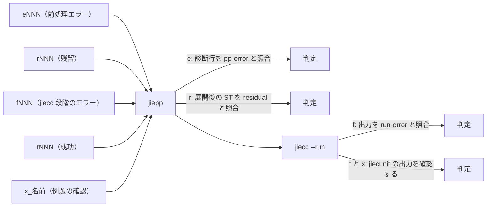
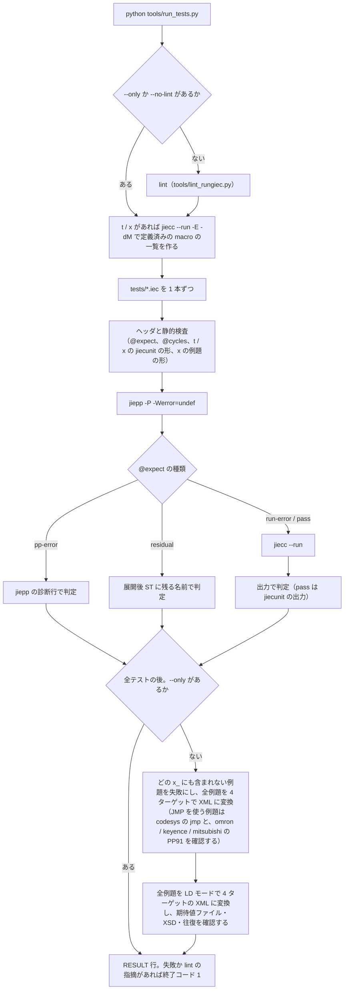
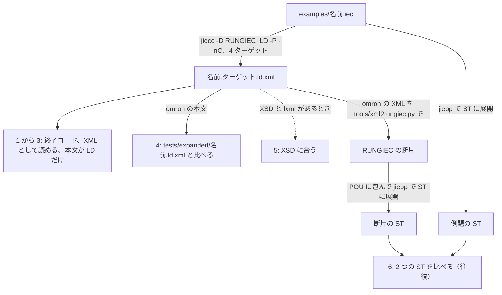

# RUNGIEC のテスト

このリポジトリのテストと lint の実行のしかたと、判定の決まりをまとめる。RUNGIEC を使うだけなら読まなくてよい。

この文書に出てくるツール:

- jiepp: IEC 61131-3 向けのプリプロセッサ。`{#define}` / `{#include}` / `{#if}` などのディレクティブを処理する。RUNGIEC を使うのに必要なのはこれだけ。https://github.com/yunos0987/jiepp （Windows と Linux の実行ファイルは https://github.com/yunos0987/jiepp/releases ）
- jiecc: IEC 61131-3 のテキストと IEC 61131-10 XML を相互に変換する無料のコマンドラインツール。IEC 61131-10 は PLC のプログラムを XML でやり取りするための規格。ST をインタプリタで実行する jier（`jiecc --run`）も含み、配布アーカイブには jiepp も入っている。利用者には必須ではなく、このリポジトリのテストの実行に必要である。https://www.graviness.com/iec_61131-3/jiecc.html
- jiecunit: IEC 61131-3 のテキストで書く単体テストの枠組み。このリポジトリのテストが git submodule として使う。https://github.com/yunos0987/jiecunit

この文書に出てくる番号と記号:

- `PPnn`（`PP54`、`PP91` など）: jiepp の診断の番号。RUNGIEC の前処理の検査に外れると PP91 になる。
- `LNnn`（`LN10` など）: このリポジトリの lint（`tools/lint_rungiec.py`。前処理と jiecc でエラーにならない書き間違いを検査する）の規則の番号。
- `t001`、`e048`、`f007` などの括弧書き: その動作を確認するテストの名前（`tests/` のファイル。接頭辞は `t` 成功、`e` 前処理エラー、`f` jiecc 段階のエラー、`r` 展開されずに残る、`x` 例題の確認）。
- `(* @expect ... *)` / `(* @cycles N *)`: テストのファイルの先頭に書く、期待する結果と実行するスキャン数（「テストのやり方」）。

## 目次

- [テストのやり方](#テストのやり方)
- [LD モードの変換の検査](#ld-モードの変換の検査)
- [ツールの置き場所](#ツールの置き場所)
- [LD XML 変換器のテスト](#ld-xml-変換器のテスト)

## テストのやり方

リポジトリを取得し、[README の「ツールの入手」](../README.md#ツールの入手)のとおり `tools/` にツールを置いてから、リポジトリルートで次を実行する。

```
git clone --recursive https://github.com/yunos0987/rungiec.git
cd rungiec
python tools/run_tests.py
```

テストは jiecunit（jiecc 用の単体テストの枠組み）を git submodule の `vendor/jiecunit` として使う。`--recursive` を付けずに clone した場合は、リポジトリルートで `git submodule update --init` を実行する（無いとランナーがそのように案内して終了する）。

最初に lint が `LINT: OK` を出し、最終行が `RESULT: N passed, 0 failed, N total`（`N` はテスト数）の形で failed が 0 なら成功（失敗があると終了コード 1。lint の指摘があると、その後に `RESULT: lint failed` の行が出て終了コード 1）。`examples/` の例題は直接は実行せず、各例題を `{#include}` する `tests/x_<名前>.iec` が実行する（どの `x_*.iec` にも含まれない例題があると失敗）。全例題の 4 ターゲットへの XML 変換も確認し、その結果は `XML: 48 of 48 example conversions passed (...)` の行に出る（失敗は failed に数える）。

```
python tools/run_tests.py                        lint と、全テストと全例題（展開 → 実行 → 判定、例題の XML 変換）
python tools/run_tests.py --no-lint              lint を実行せずにテストだけ
python tools/run_tests.py --only "t0*"           名前で絞り込み（テストと例題の両方に効く）
python tools/run_tests.py --lint-only            lint だけ
python tools/run_tests.py --lint-selftest        lint の自己検査（各規則が誤りを指摘し、正しい書き方を指摘しないこと）
```

各テストの先頭の `(* @expect ... *)` が期待の種類を表す。`pass`（t / x。jiecunit のテストが通る）、`pp-error`（e。jiepp の診断）、`residual`（r。展開後 ST に残る名前）、`run-error`（f。`jiecc --run` の出力）の 4 つ。

テストの種類と、判定する場所（ファイル名の接頭辞で種類が決まる）:



`python tools/run_tests.py` の流れ（`--lint-only` と `--lint-selftest` は lint だけを実行して終わる）:



- テストは 220 本（`tests/` の t 117、e 69、f 20、r 2 の 208 本と、例題の確認 x 12 本）。
- `--only` が無いとき、ランナーは全例題を LD モードでも 4 ターゲットで変換する（`jiecc examples/<名前>.iec -I . -D RUNGIEC_LD -P -nC -t <t> -o <xml>`。ST モードの変換と同じく同時に 2 本まで）。確認すること: (1) 終了コード 0 で error / warning の行が無い、(2) `xml.etree` で読める、(3) 本文が LD だけ（`<BodyContent xsi:type="LD">` が 1 個。keyence は jiecc が END / ENDH のラングの本文を追加するので 2 個で、比べるのは最初の 1 個）で、`<FunctionBlock name="<名前>">` があり、作業変数の ST（`RungiecAcc`）が無い、(4) 最初の LD の本文が期待値ファイル `tests/expanded/<名前>.ld.xml`（omron の XML。Git で追跡する）の本文と同じで、ほかの 3 ターゲットの本文も omron と同じ（`ContentHeader` の `creationDateTime` は比べない）、(5) 環境変数 `RUNGIEC_IEC10_XSD` に XSD のパスがあり lxml が入っていれば XSD に合う（`ST_EXEC` を使う例題は `smcext:InlineST` が XSD に無いので外し、`XSD SKIP` の行を出す。検査しないときは `XSD NOT RUN (...)` の行を出し、合否に数えない）、(6) `tools/xml2rungiec.py` で omron の XML を断片に戻し、断片と例題を ST モードで展開した、`BEGIN_RUNGIEC()` の初期化文の後から POU の終わりまでが、コメントを除き空白をまとめて同じ。xml2rungiec が全部を断片にできない例題は、理由を付けて `tools/run_tests.py` の `LD_ROUNDTRIP_SKIP` に並べる（並べた例題が全部を断片にできたとき、並べていない例題ができなかったときは失敗）。結果は `LD XML: 48 of 48 ...` と `LD ROUNDTRIP: ...` の行に出る（失敗は failed に数える）。
- ランナーは期待値ファイル `tests/expanded/<名前>.ld.xml` を書き換えない。本文が違うとき・ファイルが無いときは、omron の XML を `tests/expanded/<名前>.ld.xml.new`（Git で追跡しない）に書いて失敗にする。中身を確認してから `<名前>.ld.xml` に置き換える。一致すると `.new` を消す。
- jiepp に LD モードの組み込み（`__xmlattr` など）が無いと、LD モードの変換は `rungiec.iec` のエラー `RUNGIEC LD mode needs a jiepp with the XML and argument built-ins ...` で全部失敗する。
- GitHub Actions の CI（`.github/workflows/ci.yml`）は Linux と Windows で、ホームページから最新の jiecc / jiepp を取得し、版の表示が `Jiecc 9.` と `jiepp 1.` で始まること（このリポジトリが確認しているメジャー版）を確認してから、`python tools/gen_arity_table.py --check`、`python -m unittest discover -s tools/ld_xml -p "test_*.py"`（LD XML 変換器の単体テスト。lxml は入れないので XSD の検査は飛ぶ）、`python tools/run_tests.py --lint-selftest`、`python tools/run_tests.py`（lint を含む）を実行する。main への push と pull request のほか、ツールはこのリポジトリと別に更新されるので毎週も実行する。
- テスト名の接頭辞が期待を表す: `tNNN` 成功、`eNNN` 前処理エラー、`rNNN` 展開されずに残る、`fNNN` jiecc 段階のエラー（コンパイルまたは実行）。
- `eNNN` の期待（`(* @expect pp-error ... *)` のパターン）は、jiepp の診断行（`error: PPnn` / `warning: PPnn` を含む行）だけに照合する。PP91 は `(* @expect pp-error PP91: .RUNGIEC ... *)` と書き、アポストロフィと括弧は `.` で表す。
- 各テストの先頭に `(* @expect ... *)` と `(* @cycles N *)` を書く。判定は jiecc の出力文字列で行う。`jiecc --run` の終了コードは合否を表さない。
- `tNNN` と例題の確認 `x_*` は jiecunit のテスト（`tests/support/t_jiecunit.iec` を include し、`TEST_M(<ファイル名の語幹>)` の中で `EXPECT_*` を使う。形は [AGENTS.md の「テストを追加するとき」](../AGENTS.md#テストを追加するとき)）。`@cycles N` はテストの本体を実行するスキャン数（必須で 1 以上）で、ランナーは `--max-cycles N+2` で実行し、jiecunit の `[     OK ] <名前>`・`[========] 1 tests ran.`・`[ PASSED ] 1 tests.` があり `[ FAILED ]` が無ければ成功とする。失敗した確認は `Expected` / `Actual` と `<名前>:<行>@<サイクル> <確認の名前>` の行で示される。実行の前に、確認が 1 個以上あること、`program __main__` が残っていないことなども検査する。`eNNN` / `fNNN` / `rNNN` は jiecunit を使わない。
- jiecc の出力に `ir-audit: [ERROR]` があれば、成功を期待するテストは失敗になる。意図して期待するテストは `(* @expect run-error ir-audit: .ERROR. *)` と書く（今は該当するテストは無い）。
- 展開後 ST に `_RUNGIEC_` で始まる名前が（コメント以外に）残っていれば、括弧の有無にかかわらず残留としてランナーが失敗にする（`rNNN` 以外）。
- 展開後 ST と実行ログは `tests/expanded/`（例題の確認は `x_<名前>`）に出力される。Git で追跡するのは `eNNN` / `fNNN` / `rNNN` の出力と、例題の LD モードの期待値ファイル（`<名前>.ld.xml`）で、`tNNN` と `x_*` の出力は jiecunit の展開を含んで大きいので追跡しない（`.gitignore`）。jiepp と jiecc の診断のパスは、リポジトリルートからの相対で保存する（`tests/e041_wire_variable_node.iec:16.0: error: ...`。`@expect` の照合もこの形に対して行う）。
- lint（`tools/lint_rungiec.py`）は、前処理と jiecc でエラーにならない書き間違いを検査する。たとえば最上位で `RUNG` を忘れた形（LN10）、`RUNG(...)` の後の `;`（LN11）、`PARALLEL` でコイルと接点を混ぜる形（LN12）、`RETURN()` と `JMP()` の位置（LN13）、カンマの代わりの演算子（LN14）、POU の中の `RUNGIEC_VAR()` / `BEGIN_RUNGIEC()` / `END_RUNGIEC()` の位置と、DSL を使う POU に書いた `{st}` / `{end}`（LN16）、`ST_EXEC` の文の中の DSL マクロや `return`（LN17）、ラベルの大文字小文字の違い（LN22）、後ろ向きのジャンプの間のエッジ接点（LN23）、DSL を使う POU の `RUNGIEC_VAR*()` の前と `END_RUNGIEC()` の後の利用者の文（LN24）、ボックスの位置指定の引数（LN25）、`rungiec.iec` と `rungiec_st.iec` の define の書き方（LN1〜LN8）。規則の一覧は[`docs/DESIGN.md` の「lint の規則」](DESIGN.md#lint-の規則)にある。
- `python tools/run_tests.py` はテストの前に lint を実行する。指摘は `LINT LNxx パス:行: メッセージ` の行に出て、指摘があってもテストは続き、終了コードは 1 になる。`--only` と `--no-lint` のときは lint を実行しない。
- 意図して誤りを含むテストは `(* @lint-allow LNxx *)` を書き、その規則の指摘を受けない（`f007` など 14 本）。
- 全テストの一覧と、各テストが確認する内容は [`docs/DESIGN.md` の「テスト対応表」](DESIGN.md#テスト対応表)にある。

## LD モードの変換の検査

LD モード（同じソースから IEC 61131-10 の LD XML を出す。[GUIDE の「LD モード」](GUIDE.md#ld-モード)）は、例題の変換と LD モードの `e` テストで確認する。`jiecc --run` で `{ld}` の本文を実行する検査は無い（動作は ST モードの t / x のテストが確認する）。

例題の変換は、`--only` が無いときにランナーが全例題（12 本）を 4 ターゲット（omron / keyence / codesys / mitsubishi）で行う（48 本）。コマンドは次の形で、ST モードの変換と同じスレッドプールで同時に 2 本まで動かす:

```
jiecc examples/<名前>.iec -I . -D RUNGIEC_LD -P -nC -t <ターゲット> -o <一時フォルダ>/<名前>.<ターゲット>.ld.xml
```

例題 1 本の検査の流れ（番号は下の項目）:



確認すること（上の「テストのやり方」の (1)〜(6)）:

1. 終了コード 0 で、error / warning の行が無い。
2. `xml.etree` で XML として読める。
3. 本文が LD だけ。`<BodyContent xsi:type="LD">` が 1 個（keyence は 2 個。jiecc が END と ENDH のラングを入れた本文を追加するので、比べるのは最初の 1 個。`tools/run_tests.py` の `LD_BODY_COUNTS`）、`<FunctionBlock name="<名前>">` があり、ST モードの作業変数（`RungiecAcc`）が無い。
4. omron の最初の LD の本文が、期待値ファイル `tests/expanded/<名前>.ld.xml` の本文と同じ（`xml.etree` が書き出した `<BodyContent>` の文字列どうしで比べる。`ContentHeader` の `creationDateTime` は比べない）。ほかの 3 ターゲットの本文も omron と同じ。
5. 環境変数 `RUNGIEC_IEC10_XSD` に IEC 61131-10 の XSD のパスがあり、lxml が入っていれば、XSD に合う。`ST_EXEC` を使う例題（ソースのコメントを除いた `ST_EXEC(` で見分ける。今は `parts_counter`）は、`smcext:InlineST` が XSD に無いので外し、`XSD SKIP examples/<名前>.iec: ...` の行を出す。どちらかが無ければ `XSD NOT RUN (...)` の行を 1 行出し、合否に数えない。
6. 往復: `tools/xml2rungiec.py` で omron の XML を RUNGIEC の断片に戻し、`tools/ld_xml_roundtrip.py` の `wrap()` で POU に包む。断片と例題を jiepp（`-P -nC -Werror=undef`、t / x と同じ定義済みの macro の `-include`）で ST モードに展開し、`BEGIN_RUNGIEC()` の初期化文（7 つの代入の並び。ちょうど 1 つ）の後から最初の `end_function_block` / `end_program` / `end_function` までを、コメントを除き空白をまとめて比べる。切り出しが作業変数 `RungiecAcc` を含まなければ失敗にする（両方が空で一致するのを防ぐ）。

結果の行（失敗は `FAIL examples/<名前>.iec -t <ターゲット> (LD): ...` / `FAIL examples/<名前>.iec (LD ROUNDTRIP): ...` の行に出て、failed に数える）:

```
LD XML: 48 of 48 example conversions passed (omron, keyence, codesys, mitsubishi)
XSD NOT RUN (RUNGIEC_IEC10_XSD is not set): the LD XML is not checked against the XSD
LD ROUNDTRIP: 9 of 9 examples passed, 3 in LD_ROUNDTRIP_SKIP
```

- 期待値ファイルの更新: ランナーは `tests/expanded/<名前>.ld.xml` を書き換えない。本文が違うか、ファイルが無いときは、omron の XML を `tests/expanded/<名前>.ld.xml.new`（Git で追跡しない）に書いて失敗にする。中身を確認してから `<名前>.ld.xml` に置き換え、もう一度ランナーを実行する（一致すると `.new` は消える）。期待値ファイルは日付の入った `creationDateTime` も含むが、比べるのは本文だけ。
- `LD_ROUNDTRIP_SKIP`: xml2rungiec が全部を断片にできない例題を、理由とともに並べる。並べた例題が全部を断片にできたとき（リストから外す）と、並べていない例題ができなかったときは失敗にする。今は 3 本:

| 例題 | 理由 |
|---|---|
| `bridge_circuit` | 直並列でない一般形のネットワーク。xml2rungiec は直並列のラングだけを変換する |
| `conditional_return` | xml2rungiec が `Return` を変換せず、本文を丸ごと飛ばす |
| `parts_counter` | xml2rungiec が `ST_EXEC` の `InlineST` を、両側が同じネットワークの要素と読んで飛ばす |

- LD モードの `e` テスト（`e060`〜`e068`、`e073`）は、`{#include 'rungiec.iec'}` の前に `{#define RUNGIEC_LD 1}` を書く（`e059` の `{#define _OMRON true}` と同じ形）。本体を直接 include する誤りを試す `e069`（`rungiec_st.iec`）と `e070`（`{#define RUNGIEC_LD 1}` の後の `rungiec_ld.iec`）は、`rungiec.iec` の代わりに本体を include する。PP91 のメッセージの中の設定の名前は値に置き換わる（`RUNGIEC LD: nesting exceeds 16`）ので、`(* @expect pp-error ... *)` のパターンも値で書く。t / x のテストは ST モードだけで実行する。
- LD モードには、`__xmlattr` などのビルトインのある jiepp（jiepp 1.4.0。Jiecc 9.4.0 の配布アーカイブの jiepp も同じ）が必要である。それより古い版では、LD モードの変換が全部失敗する（ランナーは飛ばさない）。

## ツールの置き場所

jiepp と jiecc の入手と版は [README の「必要なツール」](../README.md#必要なツール)にある。テストを実行するときは、2 つの実行ファイルをリポジトリの `tools/` に置く（Git では追跡しない）。

- テストランナーは既定で `tools/jiepp` / `tools/jiecc` を探し、無ければ `.exe` を付けた名前を使う。PATH 上の `jiepp` は古い版のことがあるので使わない。
- 別の場所のバイナリを使うときは `--jiepp` / `--jiecc` か、環境変数 `RUNGIEC_JIEPP` / `RUNGIEC_JIECC` で指定する。
- テストランナーは jiepp に `-Werror=undef` を付ける（`{#if}` と `__assert` の条件の中の未定義の名前が前処理エラー PP54 になる。設定パラメータに名前を書いた誤りがこれでエラーになる）。`WIRE` の節点番号に変数や式を書いた誤りは、`-Werror=undef` が無くても RUNGIEC の検査（PP91）でエラーになる。
- RUNGIEC は jiepp のビルトイン `__assert` と名前付きカウンタ（`__counter` / `__counter_peek` / `__counter_set`）と、カンマを引数の区切りにしない `__nosplit`（`ST_EXEC` が使う）を使う。`rungiec.iec` は `__has_builtin` でこれらを確認し、`__has_builtin` や `__nosplit` の無い jiepp や、`-D __assert=` / `-U __assert` / `{#define __assert}` などでビルトインを無効にした jiepp では、PP91 `RUNGIEC needs a jiepp with the built-in assert, named counters and comma protection, ...` になる（代わりの動作は無い）。LD モードでは、入口 `rungiec.iec` が LD モードの本体 `rungiec_ld.iec` を include する前に、さらに `__xmlattr` / `__xmltext` / `__arg_lhs` / `__arg_rhs` / `__arg_dir` を確認し、無ければ PP91 `RUNGIEC LD mode needs a jiepp with the XML and argument built-ins; ...` になる（上の「LD モードの変換の検査」）。
- `tools/*.py` は Python 3.7 以上と、その標準ライブラリだけを前提にする。例外は lxml（任意）で、`tools/ld_xml` の XSD 検査にだけ使い、入っていなければその検査を飛ばす（構文は 3.4 の範囲で、`subprocess.run` は 3.5 から。3.7 は `dict` が挿入順を保つと決まった版）。実行して確認した版は 3.10 と 3.12〜3.15。

## LD XML 変換器のテスト

`tools/xml2rungiec.py` と `tools/rungiec2xml.py`（`tools/ld_xml/` が本体）は、IEC 61131-10 の LD XML（Omron の Sysmac Studio（https://www.ia.omron.com/sysmac/ ）の書き出しを含む）と RUNGIEC の断片を相互に変換する。jiepp も jiecc も使わず、`run_tests.py` の対象でもない。

単体テストはリポジトリルートで実行する。小さな手組みのラングで、読み書き、アスキーアート、往復の一致を確認する。

```
python -m unittest discover -s tools/ld_xml -p "test_*.py"
```

- 環境変数 `RUNGIEC_IEC10_XSD` に `IEC61131_10_Ed1_0.xsd` のパスを入れ、lxml が入っていれば、書き出した XML を XSD で検査するテストも動く。どちらかが無ければそのテストだけを飛ばす（結果の行に `skipped=1` と出る）。CI は lxml を入れないので飛ばす。
- ラダー図のアスキーアートの記号は AGENTS.md の「図の書き方」と同じで、列の検査（`ascii_art.alignment_problems`）が分岐の縦線と接点の縦線を区別して揃いを確認する。オペランドの名前は XML のまま写すので、日本語の名前は全角として列を数える。

実際の XML での往復の検査は `tools/ld_xml_roundtrip.py` で行う（lxml と XSD が必要）。

```
python tools/ld_xml_roundtrip.py IN.xml --out DIR --xsd IEC61131_10_Ed1_0.xsd --jiepp tools/jiepp.exe
```

- XML を RUNGIEC の断片にして標準の XML に戻し、次を確認する: 戻した XML が XSD に合い、IEC の名前空間の外の要素や `AddData` が無いこと、断片にしたラングを戻して読み直した形が元と同じこと、元の XML のラング数と変換の数が合うこと、`(* @skipped N 理由 *)` のコメントが変換しなかったラングと合うこと。`--jiepp` を付けると、断片を jiepp で展開して診断・`{#` の残り・`_RUNGIEC_` の残りが無く、lint の指摘も無いことを確認する。
- 終了コード 0 はすべて成功、1 は失敗、2 は入力が読めない、3 は他は成功だが lxml が無い・`--jiepp` が無いなどで検査の一部を実行していない。結果は `DIR/roundtrip.json`。`ST_EXEC` を含むラングには標準の XML の形が無いので戻せず、`reverse_skips_0` が失敗として残る。
- Omron の Jump は `JMP()` に、Label は `LABEL()` に変換する。この断片は `jiecc -t omron` / `-t keyence` / `-t mitsubishi` では前処理エラー PP91 になる（`-t codesys` では通る）。変換器が標準の XML を書き出すのは `rungiec2xml.py` で、jiecc を使わない。
